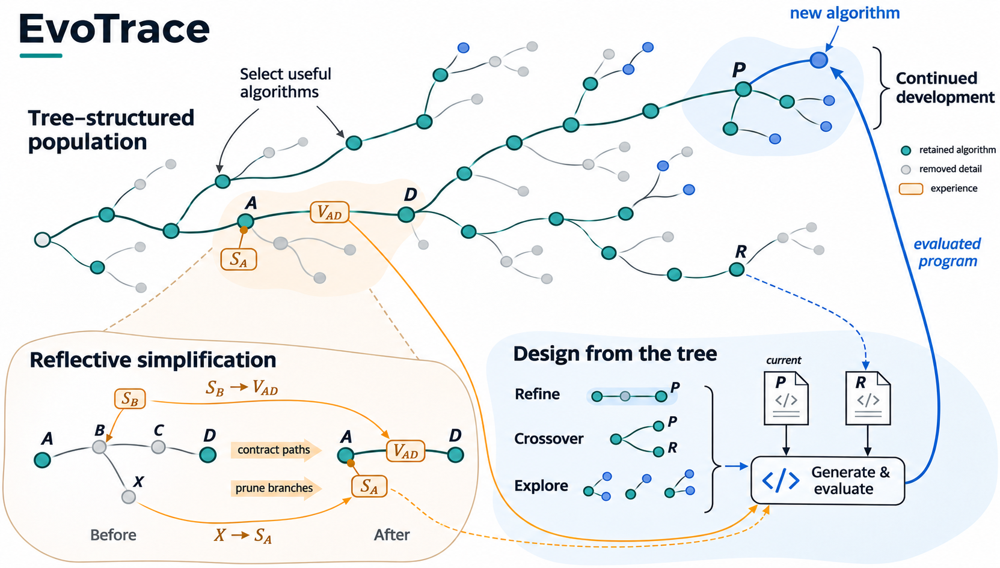
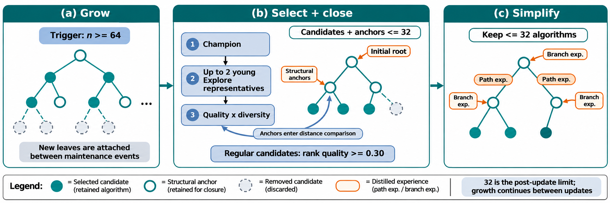
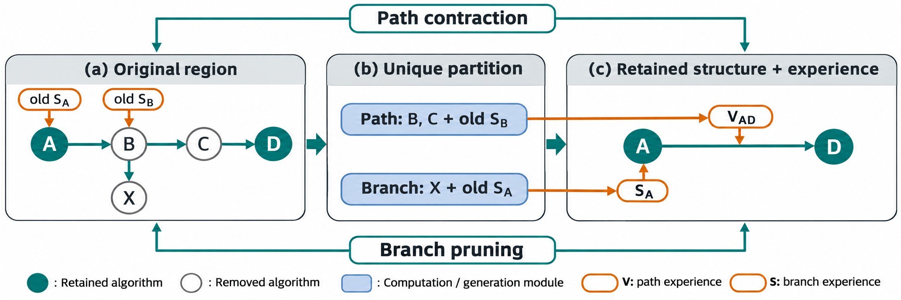
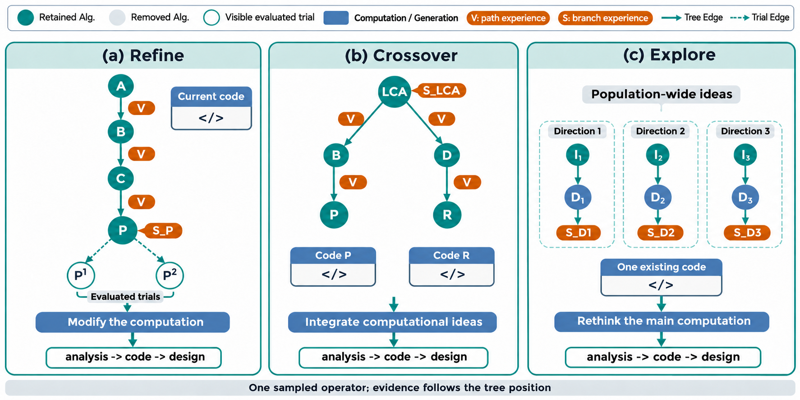

# EvoTrace V1：树状种群与反思简化

机制说明定稿，2026年11月13日。本文完整描述EvoTrace V1的搜索机制、默认参数及其实现语义，供方法阅读与机制确认。对应源码与冻结批次列于文末。

## 摘要

自动算法设计需要在有限评价预算下选择已有算法、产生新实现，并利用开发过程中积累的经验。EvoTrace V1以树状种群（tree-structured population）统一组织算法个体及其发展关系：节点是可继续修改的算法，边记录派生过程，节点与边上的经验承接已移除的尝试。搜索通过质量加权的父代采样和三类生成算子扩展种群；当节点数达到触发容量时，系统联合考虑算法质量、代码差异与连接成本，选定保留集合，再执行旁支剪枝与路径收缩。区域反思将移除部分的计算、结果及已有经验凝练到保留结构，供后续修改、融合与探索使用。由此，算法的优胜劣汰与演化轨迹的持续利用在同一搜索结构中衔接。

## 1. 问题定义与方法概览

给定一个算法设计任务，搜索需要实现指定函数，以改善完整求解器的目标。任务提供可观察输入、函数接口、输出用途与合法性要求。评价器执行候选代码并返回适应度或失败反馈；全文统一采用适应度越小越好的约定。

EvoTrace V1反复执行“选择—生成—评价—入树—反思简化”。父代选择决定下一次开发从哪个现存算法出发；生成算子决定修改、融合或探索的方式；树状种群保存这些尝试的联系。种群更新同时处理算法的保留、发展关系的重连以及经验的交接。更新后的树继续承担父代选择与生成上下文的组织。



**图1｜树状种群中的选择、经验积累与继续发展。** 主视觉是一棵持续演化的算法树。青色节点是保留的开发起点，灰色细节表示已简化的历史实现，蓝色表示新增或近期算法。左下放大展示路径经历转为边上的变异经验V，旁支经历转为节点上的选择经验S。右下以路径、分化分支和方向概览组织当前设计材料；P是主父代，R是辅助参考。橙色经验进入生成，受评程序沿蓝色回流线接入P之下，继续扩展同一棵树。回流线表示程序数据流；新算法只有一条主父代边。V1在达到容量条件后确定保留集合并整理相应区域。

搜索预算按实际程序评价次数计算。初始化、失败评价和修复后的重评都消耗预算；生成、修复与反思的模型请求另行记录。搜索结束时，系统从完整尝试档案中固定训练适应度最好的有效程序，同分取编号较早者，再由实验入口执行独立测试。

## 2. 树状种群

### 2.1 算法、发展关系与经验

种群以虚拟根连接初始算法。虚拟根没有代码，不参与父代选择，也不占算法容量。默认初始化5个有效算法。初始化逐次进行，后续初始化可以读取已有初始算法的思想与成绩，以及近期失败实现和反馈。

| 结构位置 | 保存内容 | 搜索中的作用 |
| --- | --- | --- |
| 算法节点 | 完整代码、实现描述、适应度或错误、累计直接子代数、方向编号 | 作为后续开发的起点 |
| 主父子边 | 主父代、生成算子、可选交叉参考来源 | 连接算法的发展过程 |
| 边的变异经验（variation experience） | 被收缩路径上的修改、结果与相关旧经验 | 说明保留实现如何形成 |
| 节点的选择经验（selection experience） | 归属该节点的已移除旁支经历 | 说明围绕这一位置尝试过什么 |

每个非初始算法只有一个主父代。Crossover还记录另一算法作为参考，但不为它增加第二条主父代边。因此，搜索结构是一棵主父代树，交叉来源通过额外编号及原始尝试记录保存。

树节点对应一次生成尝试的**最终已评价实现**。一次尝试最多进行一次修复；修复前后共享程序编号，修复重评增加评价次数，不额外增加树节点。原始请求与评价记录保留修复过程，树上的逐节点反思读取最终已评价实现。没有产生可评价程序的请求不入树。最终不可行的实现以失败叶节点暂存，不能成为父代或交叉参考，并在下一次种群重构时移除。

### 2.2 设计方向与累计开发

Init与Explore创建新的设计方向。Refine和Crossover继承主父代的方向编号；交叉参考不改变这一归属。方向编号由其创建时的节点确定，起点被收缩后，后代仍沿用原编号。

方向累计评价数包含该方向起点、后续Refine/Crossover的评价，以及相关失败和修复重评。一个方向内再次执行Explore时，新增评价归入新方向。V1在重构后保留仍有节点存活的方向及其累计评价；完全退出显式种群的方向通过经验继续影响搜索，其方向计数不再保留为活动状态。

节点的累计直接子代数记录从该算法实际生成并入树的后代尝试，包括最终失败、后来被淘汰以及由Explore产生的子代。重构不重置这一计数。路径重连形成的拓扑子代不补计为一次新开发。

## 3. 容量约束下的算法选择

### 3.1 生长与重构节奏

V1默认在树达到64个算法节点时重构，并将更新后的节点数控制在32以内。触发数量包括暂存失败节点；虚拟根不计入。32是**重构后的容量上限**，两次重构之间允许种群继续生长。若候选不足、过于相近或所需结构无法容纳，重构结果可以少于32个节点。

算法选择与结构补全共用容量。对任一候选集合，系统补回连接保留路线所需的最近共同祖先（lowest common ancestor, LCA）及其路径上的初始根节点。结构补入的节点仍是可用算法，也占用容量。历史Explore起点没有强制边界保护，可以随中间路径收缩。



**图2｜V1的容量选择与结构闭包。** 冠军、新方向代表和常规质量—差异候选依次进入选择；每次加入都补齐必要连接，并将完整集合计入32的容量。蓝色回路表示补入锚点参与后续候选的距离比较。0.30的秩质量门槛用于常规候选。示意子树省略单独的虚拟根，顶端初始算法属于容量内节点；图中绘制数量不表示真实种群规模。

### 3.2 质量与差异的联合选择

系统在本次全部可行算法中计算秩质量，同分按编号从早到晚排序：

$$
\text{秩质量}=1-
\frac{\text{从0开始的适应度排名}}{\max(1,\text{参与排名的算法数}-1)}.
$$

可行算法不超过32个时，系统保留全部可行算法。否则，系统首先保留当前冠军并补齐结构，然后在容量内加入有限的新方向代表，最后迭代选择常规候选。

代码差异采用抽象语法树（abstract syntax tree, AST）的结构距离，具体计算见第5.2节。常规候选的秩质量须不低于0.30，与当前保留集合的最近AST距离须不低于0.08。与任一已保留算法的适应度相差不超过$10^{-9}$时，二者距离还须不低于0.20。在满足这些条件的候选中，系统按下式选择：

$$
\text{选择分数}
=\text{秩质量}\times
\left(0.65+0.35\times\text{与保留集合的最近AST距离}\right).
$$

每次加入候选前，系统重新计算包含必要连接的完整保留集合；总节点数不超过32时才接受。加入后更新剩余候选与保留集合的最近距离，直到没有合格且容得下的候选。选择分数相同时优先较早编号。

**结构补入的算法也参与后续距离比较。** 因而，V1中的代表性判定同时受到算法选择与连接需要的影响；候选可能因接近一个结构锚点而被排除，即使它的适应度更好。这是V1保留规则的实际语义。

### 3.3 有限的新方向保护

在每个Explore方向中，系统取当前最好的可行算法作为代表。默认从原始方向编号距最新节点编号不超过16、累计评价少于4次的方向中，按代表的秩质量选择至多2个进行保留。每次加入仍须通过完整结构的容量检查。

这项保护延缓部分新方向的淘汰。它不为方向预留后续评价次数，受保护算法仍通过统一父代概率竞争预算。冠军、新方向代表和常规候选共同形成主动选择集合，结构补全决定最终保留集合。

## 4. 反思简化与经验交接

### 4.1 同一保留集合下的两种结构操作

保留集合确定后，系统在更新前的原始拓扑上划分移除区域。每个移除节点恰好属于一个区域。

| 区域 | 结构操作 | 经验承接位置 |
| --- | --- | --- |
| 保留端点之间的中间路径 | 删除中间版本，后代重连到最近保留祖先 | 重连边的变异经验 |
| 不通往任何保留后代的旁支 | 剪去旁支，按最近保留祖先归组 | 承接节点的选择经验 |

例如，原结构包含`A → B → C → D`及`B → X`，仅保留A和D时，B、C的路径经历进入新边`A → D`，X的旁支经历进入A的选择经验。B、C此前承接的旧选择经验随其原承载节点进入路径材料；新剪除的X仍按本次拓扑分区归属A。虚拟根承接已移除的初始方向。



**图3｜联合简化中的经验归属。** B、C随路径收缩进入边`A → D`的变异经验；X随旁支剪除进入最近保留祖先A的选择经验。B上已有的旧选择经验随B进入路径材料，A上已有的旧选择经验则与X的材料合并。每个新移除节点只进入一个区域。图中S、V分别指选择经验和变异经验，示例未展开其他旧边经验。

路径重连同时保留阶段类型。两端方向不同时标记Explore；同方向内按路径是否含交叉来源标记Crossover或Refine。收缩链包含交叉时，保存链上最后一个交叉参考编号。重连边表示一个发展阶段，原始尝试日志保留真实生成算子与参考来源。

### 4.2 区域反思

每条收缩路径和每个承接位置的旁支组分别调用一次反思模型。模型读取任务、代码、评价与错误，以及区域携带的旧经验。路径材料提供保留端点的代码、端点净差分和中间逐步变化；旁支材料按当前树记录的关系组织尝试，并补足差分基准。未收缩边对应实际生成的父子关系，已收缩边的代码比较对应阶段端点，并携带此前的阶段经验。生成时的自述不作为反思证据。输入代码移除注释和文档字符串，差分保留全部改动行；区域外实际父代提供完整基准，区域内用局部编号连接对应尝试。

反思输出一个`experience`段落，联系值得记住的计算思想、观察结果与旧经验。提示建议约120词；解释或一般规律可由材料自然形成，未来设计决定留给后续生成。路径的端点分数变化由程序计算并附加，摘要使用计算过程而非临时节点编号指代尝试。

旧经验随下一轮所属区域再次进入反思。中间节点的选择经验、路径已有的变异经验和承接位置已有的旁支经验均参与交接。模型调用或输出解析失败时，系统使用有限长度的确定性摘要；该回退按960字符预算整理材料，可能损失文字细节。完整输入、输出、异常与用量仍保存在原始记录中。

## 5. 评价预算的分配

### 5.1 父代采样

树中所有可行节点共同参与父代选择，内部算法与叶节点使用同一规则。采样同时考虑当前质量和已经投入的开发次数：

$$
\text{父代权重}
=\operatorname{sigmoid}\!\left(
10\frac{\text{可行适应度中位数}-\text{当前适应度}}{\text{归一化尺度}}
\right)
\frac{1}{1+\text{累计直接子代数}}.
$$

父代概率由所有可行节点的权重归一化得到。归一化尺度通常取中位数绝对偏差（median absolute deviation, MAD），下限为$10^{-6}$。MAD不超过$10^{-9}$时，改用大于$10^{-9}$的非零绝对偏差的中位数，并保持同一下限。全部原始权重为零时使用均匀采样。

质量项提高较好算法的采样权重，使用次数项降低反复开发同一算法的权重。这一概率取决于当前保留种群；种群重构改变候选集合和适应度分布，也会改变后续预算分配。

### 5.2 算子与交叉参考

选定主父代后，系统按固定先验抽取Refine、Explore或Crossover，概率分别为0.45、0.30和0.25。

Crossover先构造参考资格池。可行算法不超过12个时使用全池；超过12个时，按适应度排序，仅保留秩质量不低于0.30的算法，再排除主父代。秩质量按第3节的公式计算。

排序中的同分算法按编号从早到晚排列。参考还须与主父代具有不同的标准化源码。合格参考中，系统优先考虑尚未与该主父代配对的算法，并选择AST结构距离最大的一个；距离相同时依次优先较好适应度和较早编号。全部参考都已配对时允许复用；没有不同源码的合格参考时，将本次算子改为Refine。

代码距离统计AST父子类型和遍历序列二元组，使用多重集Jaccard距离。普通变量名与数值字面量不形成独立取值特征，调用名称、运算类型及程序结构参与比较。标准化源码等价性则保留变量与常数，只忽略排版、注释和文档字符串。两种判据分别承担结构差异排序和相同实现排除。

## 6. 三种算子对应的生成上下文

三种算子依据当前设计任务读取同一棵树的不同视图，单次输出依次包含`analysis`、完整`code`和事实性的`design`描述。`analysis`说明本次计算选择；`design`描述返回代码实际实现的思想与过程。

| 算子 | 主要材料 | 设计任务 |
| --- | --- | --- |
| Refine | 当前代码与成绩、根到当前算法的形成路径、当前节点选择经验、可见子尝试 | 根据实现与发展经历选择有意义的修改 |
| Crossover | 两份当前实现、共同祖先及其选择经验、两条分化路径、主父代的可见子尝试 | 理解两种计算并决定如何融合或借鉴 |
| Explore | 不同方向的入口思想、近期发展和相关经验，随后给出一份现有实现 | 构思主要计算方式不同的新算法 |



**图4｜三种设计任务对应的树视图。** Refine围绕当前算法P读取形成路径、选择经验及已评价子尝试；Crossover围绕主父代P与参考R读取共同祖先和两条分化路径；Explore按方向组织已有思想、近期发展和相关选择经验。图中V表示路径经验，S表示旁支选择经验。三幅子图是一次搜索可能选择的三种视图，每次只采样一个算子。

形成路径中，未收缩边展示实际代码差分与结果；已收缩边展示端点结果、后代实现描述和阶段经验。差分序列提供实际基准代码。当前拓扑上的子边可能代表重连后的发展阶段，不能都解释为一次原始直接生成。

Refine与Crossover默认使用10的路径展示窗口，读取最近4条可行子尝试和2条失败子尝试。子尝试按算子、参考、标准化源码和结果去重，保留最近记录，再按生成顺序展示。Crossover的共同祖先只展示一次，默认提供参考完整源码。

Explore按各方向最新保留版本的编号排序，再用入口源码等价性及0.12的AST距离门槛筛选不同代表，最多展示8个方向。每个方向提供入口思想、最新保留版本的思想、入口边经验及该方向各保留节点的选择经验。V1不将方向内部全部变异经验铺入这一视图。方向编号、累计评价数及内部筛选信息保留在元数据中；Explore中的现有实现不单独展示成绩，相关经验可以包含观察结果。

两类经验默认参与生成。经验展示开关只控制是否把经验写入提示；关闭展示不会自动关闭反思。关闭反思模型时，结构更新仍执行，并使用确定性摘要。

## 7. 完整搜索过程

```text
输入：任务、生成模型、评价预算及默认配置
建立虚拟根、空树和尝试档案
当预算未耗尽且未触发连续未评价停止条件时：
    若有效初始算法不足5个，构造初始化提示
    否则，采样父代和算子，必要时选择参考，读取相应树上下文
    生成候选；需要时进行一次格式修复或程序修复
    对可解析程序执行评价，每次评价单独计费
    将本次尝试的最终已评价实现入树
    若算法节点总数达到64：
        在32容量内选择算法并补齐必要结构
        在更新前拓扑上划分路径与旁支区域
        逐区域反思、交接经验并重连保留节点
    提交本次尝试及其对应的树更新
输出：完整尝试档案中训练适应度最好的有效程序
```

每次尝试最多使用一次修复机会：格式修复成功后若程序仍执行失败，该次尝试不再追加程序修复。已达到评价预算时也不追加修复评价。连续10次尝试未产生程序评价时，搜索提前停止；已有有效程序仍可作为输出。

| 参数组 | V1默认设置 |
| --- | --- |
| 初始化与预算 | 5个有效初始算法；1000次评价 |
| 种群节奏 | 64个节点触发；重构后至多32个节点 |
| 常规保留资格 | 秩质量≥0.30；AST距离≥0.08；同分距离≥0.20 |
| 质量—差异分数 | 秩质量×(0.65+0.35×最近AST距离) |
| 新方向保护 | 编号差≤16、方向评价少于4次，至多2个代表 |
| 父代质量系数 | 10；按累计直接子代数折扣 |
| 算子先验 | Refine 0.45；Explore 0.30；Crossover 0.25 |
| 交叉资格池 | ≤12个可行算法时全池；更大时秩质量≥0.30 |
| 生成展示窗口 | 路径10；可行/失败子尝试4/2；方向8 |
| 模型请求 | 生成温度1.0、输出上限16384 tokens；反思温度0.3、输出上限1536 tokens |

## 8. 源码与复查依据

本文对应`20261112_165634_evotrace_v1_co4`冻结批次；写作核对时，工作区V1的16个Python源码文件与该快照逐文件一致。研究定义不依赖结果目录或看板名称。

| 机制 | 对应实现 |
| --- | --- |
| 完整循环、修复与最终选择 | [search.py](../evotrace_v1/search.py) |
| 节点、边、方向与入树计数 | [models.py](../evotrace_v1/models.py) |
| 容量选择、结构闭包与区域划分 | [topology.py](../evotrace_v1/topology.py) |
| 父代、算子与交叉参考 | [allocation.py](../evotrace_v1/allocation.py) |
| 三类生成材料 | [context.py](../evotrace_v1/context.py) |
| 区域反思与经验交接 | [reflection.py](../evotrace_v1/reflection.py) |

已完成尝试日志保存生成、评价和反思记录，是恢复搜索的状态来源；发生重构时，同一条提交保存对应树快照。完整尝试档案与当前可采样种群分别保留。源码指纹与文档核对记录见[设计核对目录](../experiments_result/analysis/evotrace_design_documents_20261113/)。动态更新版本的完整机制见[EvoTrace V2](EvoTrace-v2设计.md)。


### 历史选择与反思依据

[统一选择离线实验](记录/2026-11-11-统一种群选择离线实验.md)在四任务各3路、共48个原树状态上核对容量与连接。首轮前10名保留为117/120，原规则为110/120；对齐保留数量后仍为117对110。首轮平均最近邻AST距离分别为统一规则0.2176、原规则0.2254、仅按质量0.1949。这些结果支持当时的结构选择，未证明完整搜索收益。[冻结输入与逐路报告](../experiments_result/analysis/20261111_unified_population_selection/README.md)保留原始证据。

[首轮提示词审阅](记录/2026-11-11-EvoTrace-V1机制与提示词运行审阅.md)记录了预摘要遗漏内部错误、旧经验以及按行截断遮蔽代码变化的问题。后续输入保留区域内各步证据；进一步修订依据见[11月12日记录](记录/2026-11-12-提示词简化依据.md)。
