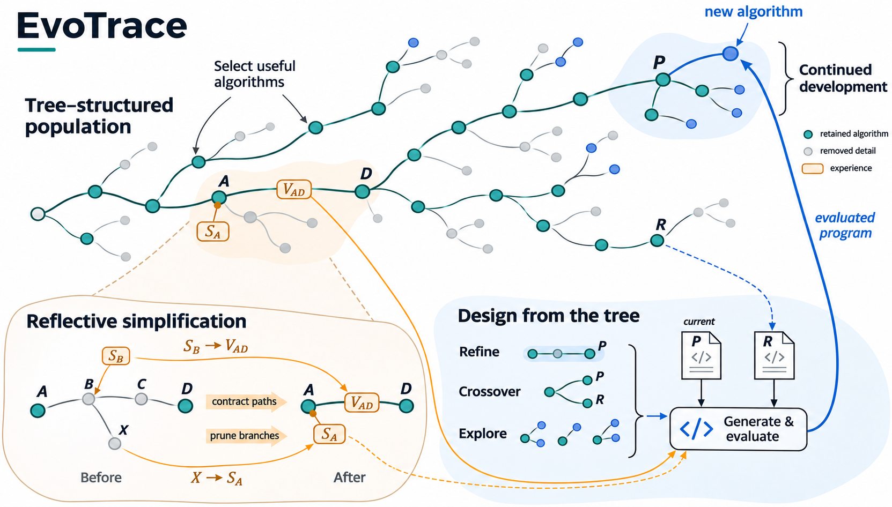
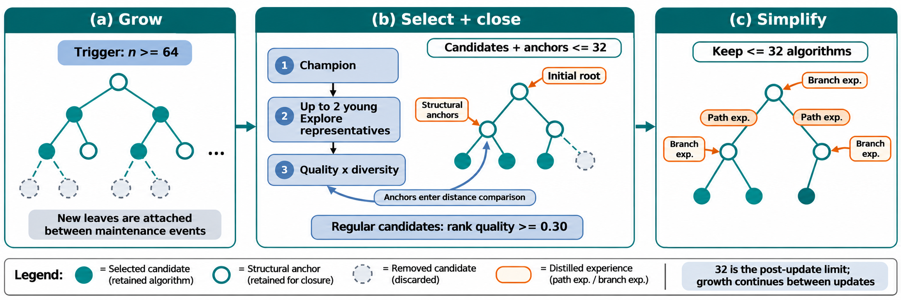
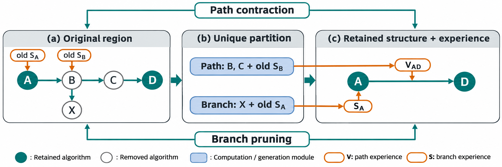
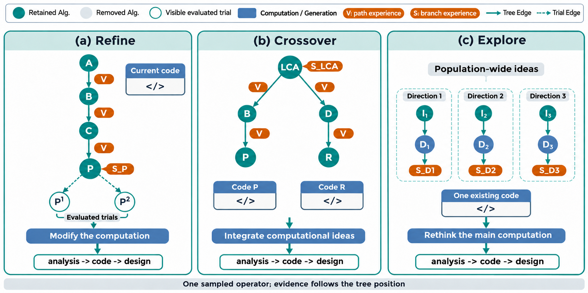

# EvoTrace V1：树状种群与反思简化

种群容量有限时，一个算法可能会被后代取代。沿途试过哪些改法、哪些得到了更好的结果，仍值得在下一次设计时参考。EvoTrace V1 用**树状种群（tree-structured population）**把这两件事联系起来。节点保存受评算法，父子边记录生成来源。树生长到容量阈值时，算法依据实测表现和代码差异竞争保留名额，连接入选算法所需的祖先也占用名额。这次选择同时确定后续可以开发哪些算法，以及哪些经历需要凝练。

**保留下来的算法在树上的位置决定经验的归属。** 两个保留端点之间发生过的修改凝练到重连边上，说明后代怎样从祖先演化而来。退出的旁支凝练到最近的保留祖先上，记录从那里出发还尝试过什么。下一轮搜索从存活的可行算法中选择父代，大语言模型沿它的形成路径和分支读取相关经验，继续修改、融合或探索。

## 1. 树状种群中的算法与设计方向

给定完整求解器中的一个函数接口，任务说明规定可观察的输入、返回值的用途和合法性要求。评价器执行候选程序，给出适应度或失败反馈，以下均采用目标值越小越好的约定。每个算法节点对应一次生成尝试最终受评的实现，保存源码、设计简述和评价结果。可行的内部节点与叶节点都能成为父代。失败实现暂存为叶节点，在下次重构时作为旁支经历处理。

虚拟根连接独立生成的初始算法。初始化依次收集 5 个有效算法，每次可参考先前初始算法的思想和成绩，以及近期失败实现和反馈。此后，精化（Refine）、交叉（Crossover）和探索（Explore）都从选定的主父代 $p$ 派生子代。交叉另记参考个体 $q$ 的编号，树上只建立一条主父代边 $p\to v$。

**设计方向**记录一种思路从哪里开始。初始化和探索各自创建新方向，精化和交叉继承主父代的方向。因而一次探索既是 $p$ 的子代，也是一个新方向的起点。方向编号由起点确定，路径收缩后，后代仍沿用该编号。



**图 1　树状种群的生长与重构。** 蓝色子代接在主父代 P 下，交叉时从 R 读取参考。灰色节点退出显式种群后，路径经历以 V 标在边上，旁支经历以 S 标在保留节点上。两类经验都可进入后续生成。

## 2. 容量触发的选择与反思简化

### 2.1 算法和必要祖先共用保留名额

两次重构之间，树随受评算法逐个生长。默认达到 64 个算法节点时触发重构，更新后至多保留 32 个。失败节点计入触发规模，虚拟根单独存在。每次试选一个算法，都要补齐连接已选个体所需的最近公共祖先（lowest common ancestor，LCA）和通向它们的初始算法。补入的节点同样占用这 32 个名额，也参与下一位候选的代码距离比较。

若可行个体不超过 32 个，全部保留。否则先保留冠军及必要祖先，再考虑新方向，剩余名额用于兼顾质量和结构差异的选择。新方向的保护以方向为单位。每个探索方向由其当前最优实现代表。若方向起点与最新节点的编号差不超过 16，且该方向累计评价少于 4 次，就按代表的适应度由优到劣尝试保留，至多选 2 个。受保护的代表仍须满足容量约束，后续评价机会仍靠父代竞争取得。

代码距离 $\operatorname{dist}$ 取抽象语法树（abstract syntax tree，AST）父子标签与遍历二元组的多重集 Jaccard 距离。它计入调用名称、运算类型和结构，普通变量名与数值常数的变化可具有零距离。对常规候选，设 $N$ 为当前可行个体数，$r_i$ 为个体 $i$ 按适应度从优到劣、从零起算的名次，同分按编号先后排序。秩质量 $q_i$ 和它相对当前保留集合 $H$ 的最近代码距离 $d_i$ 为

$$
q_i=1-\frac{r_i}{\max(1,N-1)},\qquad
d_i=\min_{j\in H}\operatorname{dist}(i,j).
$$

候选须满足 $q_i\ge 0.30$、$d_i\ge 0.08$。对每个与它分差不超过 $10^{-9}$ 的已保留个体，距离还须达到 $0.20$。在补齐连接后仍能容纳的候选中，选取 $q_i(0.65+0.35d_i)$ 最大者，同分取较早编号。随后更新 $H$ 及所有候选的最近距离，直至名额用尽或没有合格候选。由于 $H$ 包含分叉和初始算法，一个较优候选也可能因接近某个结构上必须保留的祖先而落选。



**图 2　连接成本如何影响个体竞争。** 每次接纳候选都要检查补齐祖先后的总规模。蓝色回路表示这些祖先也会影响下一次距离比较。图中树顶的初始算法计入容量，虚拟根省略。

### 2.2 路径收缩与旁支剪枝

在重构前的同一棵树上，每个待移除节点只归入一个区域。两个保留端点之间的中间链构成**路径收缩**区域，阶段经历写入重连边的**变异经验（variation experience）**。其余待移除节点按最近的保留祖先合为旁支组，剪除后写入该祖先的**选择经验（selection experience）**。整条初始分支退出时由虚拟根承接。

设 $A\to B\to C\to D$ 是一条路径，$B$ 还派生了旁支 $X$，本轮只保留 $A,D$。$B,C$ 的修改经历进入新边 $A\to D$。同轮剪去的 $X$ 归到最近的保留祖先 $A$。如果 $B$ 在早先的重构中已积累过选择经验，这段旧经验则随 $B$ 进入 $A\to D$。以后从 $D$ 继续设计时，模型仍能沿路径读到它。



**图 3　同轮剪去的旁支与早先留下的经验。** $X$ 更新 $A$ 上的 S，$B$ 先前承接的 S 则与路径经历共同写入新边上的 V。

重连边概括一段演进。两端方向不同时标记为探索，同方向中包含历史交叉时标记为交叉，其余标记为精化。发生过交叉的收缩链保留最后一个交叉参考编号。原始尝试记录仍保存各步实际使用的算子和参考来源。

### 2.3 一次反思如何承接旧经验

每条收缩路径、每个保留祖先下的旁支组分别反思一次。路径反思读取两端代码、端点间的净差分、各步实际修改与评价，以及中间节点和旧边上的经验。旁支反思围绕实际父代的实现，读取各次尝试的差分、结果或错误，以及承接位置原有的经验。若输入边已经收缩，比较的是阶段端点。代码材料去除注释和文档字符串，保留全部改动行，并在需要时补入区域外父代的完整基准实现。

模型将这些材料凝练为一段约 120 个英文词的 `experience`，用具体计算指代各次尝试。路径两端的分数变化由程序计算并附上。经验可以包含有依据的解释。承载它的节点或边日后再次被移除时，相关旧经验随新材料进入下一次反思。模型调用或解析失败时，使用按 960 字符预算整理的确定性摘要。

## 3. 按适应度与直接子代数分配评价预算

重构后的树同时给出两项选择依据。适应度说明某个设计当前表现如何，累计直接子代数 $c_i$ 说明已经从该位置尝试过多少次。设 $f_i$ 为个体 $i$ 的适应度，$m$ 为树上全部可行个体的适应度中位数，$s$ 为分差尺度。父代概率按全体可行个体归一化，$\sigma$ 为 sigmoid 函数。

$$
w_i=\sigma\!\left(10\,\frac{m-f_i}{s}\right)\frac{1}{1+c_i},
\qquad P(i)=\frac{w_i}{\sum_{j\in\mathcal V_{\mathrm{feas}}}w_j}.
$$

$s$ 通常取中位数绝对偏差（median absolute deviation，MAD），下限为 $10^{-6}$。若 MAD 不超过 $10^{-9}$，改取大于 $10^{-9}$ 的绝对偏差的中位数，仍取同一下限。若此类偏差为空，取下限。全部权重为零时均匀抽样。

从 $i$ 生成并入树的每个直接子代贡献一次 $c_i$，包括探索子代、最终失败或后来被剪除的子代。修复重评仍属同次生成，路径重连也沿用原计数。用于新方向保护的累计量另按**实际评价次数**计费，含失败和修复重评。探索子代的评价计入它开辟的新方向。重构后，仍有个体存活的方向保留其累计评价。

## 4. 演化经历怎样进入下一次设计

选定父代后，以 0.45、0.30、0.25 的概率分别抽取精化、探索、交叉。每次生成给出三个字段。`analysis` 说明此次计算选择，`code` 给出完整程序，`design` 描述程序实际采用的计算。

| 算子 | 本次设计需要的材料 |
| --- | --- |
| 精化 | 读取父代代码与成绩、从根到父代的形成路径、父代的选择经验，以及从这里出发的子尝试，决定下一步修改。 |
| 交叉 | 对照父代与参考的源码、共同祖先及其选择经验、分化后的两条路径和父代的子尝试，选择可借用的计算。 |
| 探索 | 阅读各方向的入口思想、近期发展与经验，再以所选父代的实现为参照，构思主要计算方式不同的算法。 |



**图 4　算子围绕不同的设计问题取材。** 精化追溯 P 的形成路径，交叉从 P 与 R 的共同祖先比较两条分支，探索跨方向读取已有设计及其尝试。

交叉从合格参考中优先选择与该主父代尚未配对、且结构距离最大的个体。可行个体至多 12 个时从全池取参考，更多时先按全体可行个体排序，保留秩质量至少 0.30 者。再排除主父代及与它标准化源码相同者。距离并列时依次取适应度较好、编号较早者。未用组合耗尽后可复用，没有合格参考时执行精化。选择参考时用第 2 节的 AST 距离衡量结构差异。源码等价性另保留变量名与常数值，忽略排版、注释和文档字符串。

精化与交叉默认使用 10 步路径窗口，展示最近 4 条可行及 2 条失败子尝试。子尝试按算子、参考、标准化源码和结果合并重复，取最新记录，再按生成顺序展示。普通边给出实际代码差分和基准，收缩边给出阶段经验、后代设计和端点结果。交叉的共同祖先只展示一次，并默认提供参考的完整源码。

探索优先选近期有新版本的方向，按入口源码等价性及 0.12 的 AST 距离阈值去重，至多展示 8 个。每个方向提供入口与最新保留版本的设计、入口边经验和该方向各保留节点的选择经验。方向内部的其他边经验留在各自路径，作为参照的现有实现只给源码。两类经验默认可见。关闭经验展示只改变生成输入，关闭反思模型则由确定性摘要承接经验。

## 附录　完整流程、评价协议与版本依据

```text
逐次初始化，集齐 5 个有效算法后，按全树可行个体的权重抽父代。
选择生成算子，读取相应的路径、分叉或方向，生成并评价。
将最终受评实现接入树，记录直接子代数与所属方向的评价消耗。
树中算法节点达到 64 个时，在 32 个名额内选取算法并补齐祖先。
在同一棵重构前的树上对移除区域反思，写入经验并重连存活个体。
重复至预算耗尽或触发停止条件，从完整档案选出训练最优程序。
```

默认预算为 1000 次程序评价。初始化、普通评价、执行失败及修复重评共用预算。一次生成至多修复一次，格式修复与运行修复共用这次机会，只有剩余预算足够时才重评。未产生可评价程序的请求只记模型用量，连续 10 次此类尝试后结束搜索。生成与反思的温度分别为 1.0 和 0.3，输出上限分别为 16384 和 1536 tokens。最终从完整尝试档案选出训练适应度最优的可行程序，同分取较早编号，再由实验入口执行独立测试。

本设计对应 2026 年 11 月 13 日定稿及冻结批次 `20261112_165634_evotrace_v1_co4`。已完成尝试及其同次提交的重构快照是恢复依据。定稿时核对的 16 个 Python 源文件与批次快照一致。后续提交 `190fe372` 将工作区实现整理为 14 个 Python 文件，复现原批次时使用冻结源码。[冻结批次](../experiments_result/evotrace_v1/launch_20261112_165634_evotrace_v1_co4/README.md) · [历史核对材料](../experiments_result/analysis/evotrace_design_documents_20261113/)

实现可按机制查阅。[搜索循环](../evotrace_v1/search.py) · [个体与计数](../evotrace_v1/models.py) · [容量选择](../evotrace_v1/topology.py) · [区域反思](../evotrace_v1/reflection.py) · [父代与参考](../evotrace_v1/allocation.py) · [算子上下文](../evotrace_v1/context.py) · [后续 V3 设计](EvoTrace-v3设计.md)

离线比较使用四个任务各三路的 48 个固定树状态。在 12 路首次从 64 个节点压缩到 32 个的比较中，联合选择保留了前十名个体中的 117/120 个，原规则保留 110/120 个。两者的平均最近邻 AST 距离分别为 0.2176 和 0.2254，仅按质量选择时为 0.1949。这组数字衡量同一批候选在一次重构后的保留情况。[冻结输入与逐路报告](../experiments_result/analysis/20261111_unified_population_selection/README.md)
