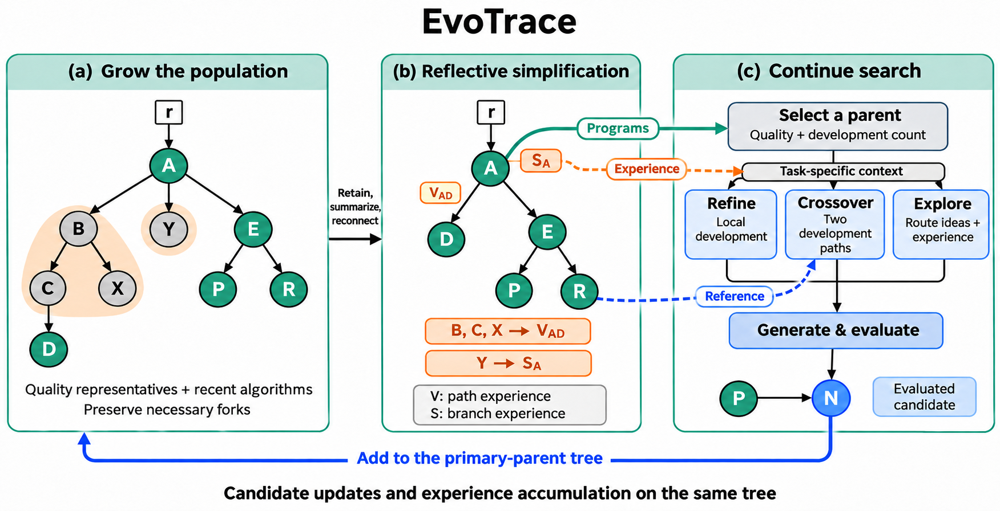
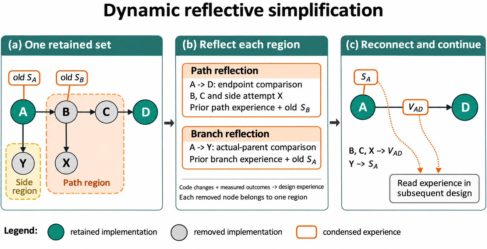

# EvoTrace V2：树状种群的反思压缩与持续演化

本文定义当前EvoTrace V2的搜索状态、更新规则与默认参数，按2026年11月14日修复后的源码核对。该实现已冻结为`20261114_103407_evotrace_v2_repaired_co4`。研究动机见[研究概述](树状种群与反思简化.md)，实现与验证依据见第8节。

## 摘要

算法搜索产生可执行实现，也留下计算选择及其评价结果。实现的开发价值与经历的参考价值不同：候选可以退出种群，其经历仍可为后续设计提供依据。EvoTrace V2将反思视为搜索经历的压缩，以树状种群结合候选竞争与发展历史组织。每次受评实现入树后，同一保留结构共同确定显式候选、历史整理范围与经验承接位置。中间路径及其同轮移除旁支凝练为重连边经验，其余移除旁支凝练为保留祖先经验；已有经验随载体再次简化时继续交接。后续搜索从这一结构中同时读取开发起点与相关经历。

## 1. 问题定义与总体机制

给定任务接口、可观察输入、返回对象用途及合法性要求，搜索需要实现指定函数，改善完整求解器的目标。评价器执行候选代码并返回适应度或失败反馈；全文采用适应度越小越好的约定。

EvoTrace V2反复执行“选择—生成—评价—入树—动态反思简化”。父代选择按路线最大节点权重与路线内归一化分配预算，节点权重结合当前质量和本路线开发次数；Refine、Crossover与Explore分别承担修改、融合与探索。算法入树后，系统从同一维护前状态确定保留集合，再由树的连接关系决定哪些旁支可以移除、哪些中间路径可以收缩。区域经验回到树上，参与下一轮算法设计。

一个保留版本既可作为开发起点，也可连接已有经历。质量代表、近期活跃与必要分叉共同决定保留。所有保留可行节点都按同一节点权重参与路线归组采样，旧基点保持再次分化的机会。

路径收缩与旁支剪枝由同一保留集合产生，不需要独立宽度、长度触发阈值。移除节点若位于保留端点之间，其经历与同轮旁支共同进入重连边；其余旁支就近进入保留节点或虚拟根的选择经验。

评价预算包含初始化、失败和修复重评。模型生成、修复及反思的请求与用量单独记录。搜索结束时，系统固定完整尝试档案中训练适应度最好的有效程序，同分取编号较早者，再由实验入口执行独立测试。



**图1｜从种群更新到后续设计。** 保留集合共同决定结构简化与经验归属；更新后的树提供可选程序及任务相关上下文。每次尝试选择一种算子，Crossover另读参考实现，受评结果沿单一主父代关系入树。

## 2. 带经验与使用记录的树状种群

### 2.1 个体与发展关系

虚拟根连接初始算法，本身没有代码，不参与采样。默认初始化5个有效算法。初始化逐次生成，读取已有初始算法的思想与成绩，以及近期失败实现和反馈；任务提供的示例代码可以作为起始材料。每个后续算法连接一个主父代；Crossover另外记录参考来源，形成可追溯的交叉输入关系。搜索和结构维护基于主父代树进行。

| 结构位置 | 保存内容 | 作用 |
| --- | --- | --- |
| 算法节点 | 代码、实现描述、适应度或错误、路线编号、最近局部开发时刻、累计同路线开发尝试数 | 提供后续开发起点 |
| 主父子边 | 主父代、算子、参考来源、是否已收缩 | 连接发展过程 |
| 边的变异经验（variation experience） | 已收缩发展阶段的经历 | 支持理解当前实现如何形成 |
| 节点的选择经验（selection experience） | 已剪旁支的经历 | 支持理解围绕该位置的既往尝试 |
| 虚拟根的选择经验 | 已移除初始路线的经历 | 保留退出显式种群的路线经验 |

一个节点对应一次生成尝试的最终已评价实现。一次尝试最多进行一次修复；修复前后共享程序编号，重评增加评价数，不增加树节点。原始请求与评价记录保留修复过程，树上的逐节点反思读取最终已评价实现。没有可评价程序的请求不入树。最终不可行节点保存错误，不能成为父代或参考；初始化完成后的下一次维护会将其整理为旁支材料。

Init与Explore创建路线，Refine与Crossover继承主父代路线。路线起点可以被压缩，后代仍保存原路线编号。V2持续保留所有已记录路线的累计评价，即使某个路线已无显式节点。路线累计评价是历史汇总，不进入采样权重；路线采样使用该路线保留节点的最大权重。

选择经验与变异经验的名称对应简化操作，不限定评价结果的方向；两类经验均可包含改进、同分、退步或失败。选择经验进入生成上下文与后续反思，不参与父代采样。

路线是按Init/Explore来源定义的开发分组，用于组织采样和局部上下文。算子描述指定生成任务，实际计算由返回代码实现。

### 2.2 评价时钟与实际使用

评价时钟按已完成尝试中的实际评价次数推进，包含失败和修复重评。每次受评实现入树时，系统记录新节点出生时刻；只有Refine/Crossover刷新主父代的开发时刻。Explore不刷新原父代，交叉只读参考不刷新参考时刻。时间单位是程序评价次数。

同路线父代的局部开发可维持其子尝试的近期资格。默认将满足下式的可行算法视为近期算法：

$$
\text{当前评价时钟}-\max(\text{自身最近出生或使用时刻},\ \text{同路线树上父代的最近开发时刻})<40.
$$

父代为虚拟根或属于其他路线时只看自身时刻。差值达到40时，节点退出近期保留集合。同路线子尝试不再开发时，可在父代也冷却后共同失去近期资格；质量代表和必要分叉仍保留。节点仅被展示在上下文中、作为结构锚点保留或承接反思，不刷新使用时刻。没有产生程序评价的接口故障不推进时钟。

累计同路线开发尝试数与最近开发时刻承担不同职责：前者进入父代采样折扣，后者决定近期保留资格。重新连接已有后代不增加开发次数；承接经验也不视为当前算法的一次新使用。

## 3. 一次选择决定保留与结构简化

初始化得到5个有效算法后，每次有新的受评实现入树，系统检查整棵当前树。所有保留资格均从同一维护前快照计算。

### 3.1 质量与差异代表

系统对当前全部可行节点按适应度、编号排序，计算秩质量：

$$
\text{秩质量}=1-
\frac{\text{从0开始的适应度排名}}{\max(1,\text{参与排名的算法数}-1)}.
$$

首先保留冠军，再由好到差检查秩质量不低于0.50的候选。候选在两种情况下不加入质量代表集合：它已被同路线严格更优后代超越，或它已被代码接近的代表覆盖。

取代按派生关系判断。只有同路线后代的适应度严格更好，候选才被标为已超越；跨Explore后代和同分后代不触发这一判断。被取代的祖先仍可因近期使用或必要分叉保留。若它被移除且位于两个保留端点之间，其经历进入重连边；其余情况按第3.3节的区域规则交接。

覆盖按代码差异判断。代码差异采用抽象语法树（abstract syntax tree, AST）的结构距离，具体计算见第5.2节。覆盖候选的代表适应度不差于它。覆盖条件为标准化源码相同，或AST距离小于0.08；两者适应度相差不超过$10^{-9}$时，距离门槛改为0.20。没有被覆盖的候选加入代表集合，并参与后续比较。

这一选择在结构补全之前完成，近期保留节点也不预先加入代表比较。结构锚点不排斥质量代表，近期较弱实现也不会阻止更好的实现入选。整个维护过程中，排名和质量代表集合只计算一次，不因本轮删除而反复重算。

### 3.2 近期保留与必要连接

主动保留集合是质量代表与近期可行算法的并集：

$$
\text{主动保留集合}
=\text{质量与差异代表集合}\cup\text{近期使用或出生集合}.
$$

系统沿这些算法的祖先关系补回连接保留路线所需的最近共同祖先（lowest common ancestor, LCA）分叉，得到最终保留集合。虚拟根单独存在，不计为算法。原始初始算法与Explore起点不具有额外的结构保留资格；只有自身满足保留判据或作为必要分叉时才留下。

对于可行节点，退出显式种群需要同时满足三个条件：它自身及同路线父代均不近期、未被选为质量代表、也不是必要连接。未开发初稿在近期窗口内同样保留；窗口不为它预留开发次数。较好且不同的实现以及必要分叉可以长期存在，因此规则不规定节点总数上限或固定增长速度。

### 3.3 联合划分路径与旁支

系统在维护前拓扑上完成唯一分区。保留端点之间被移除的中间节点属于路径收缩区域；其余移除节点向上寻找第一个不属于旁支移除集合的祖先：若该祖先是被收缩中间节点，旁支并入对应路径区域；若是保留节点或虚拟根，则组成该位置的旁支区域。每个移除节点在本轮维护中只属于其中一个区域，同一承接位置的多条旁支合并处理。

这一分区允许一次维护同时削减宽度与长度。例如，冷旁支被剪除后，其原父节点若只剩通往一个保留后代的连接，可以在同次更新中成为被收缩的中间节点。系统不需要先修改树，再启动另一轮选择来获得这一结果。

## 4. 经历沿树的结构交接

### 4.1 经验的目标位置

| 移除区域 | 更新后的结构 | 经验位置 |
| --- | --- | --- |
| 保留祖先至后代之间的中间路径 | 后代直接重连到最近保留祖先 | 重连边的变异经验 |
| 附着于本轮收缩中间节点的旁支 | 与中间路径一起整理 | 同一重连边的变异经验 |
| 其余移除旁支 | 删除相应旁支 | 最近承接的保留祖先的选择经验 |
| 无保留祖先的初始路线 | 退出显式算法树 | 虚拟根的选择经验 |

原结构为`A → B → C → D`及`B → X`、只保留A和D时，B、C及X的经历共同进入`A → D`的变异经验；A原有选择经验仍保存在A。B、C早先承接的旧旁支经验随其原承载节点进入路径材料。新移除旁支和旧摘要保持各自来源，同一批材料不被重复分给两个区域。

收缩边两端路线不同时标为Explore，保留转向含义；同路线按历史交叉来源标为Crossover或Refine，并记录最后一个历史交叉参考编号；连接虚拟根的边使用根连接标记。阶段类型概括该段发展，原始日志保留逐次生成来源。经过压缩的入口称为保留路径入口，不要求它仍是历史初始算法。



**图2｜区域划分与经验交接。** B、C及B的同轮移除旁支X共同进入路径区域，写入重连边V_AD；A的另一旁支Y与原S_A合并。B已有的S_B随其所属路径进入V_AD。

### 4.2 区域反思与递归利用

每个最终路径区域和旁支区域调用一次反思，不设置等待固定条数的积累队列。同轮各区域读取同一维护前材料，分别写入目标节点或边。

路径反思提供保留端点代码、端点净差分、中间受评实现与结果、同轮移除旁支、旧边经验和中间节点旧选择经验。旁支反思提供承接位置基准、尝试间的代码差分、评价与错误，以及承接位置和移除区域的旧经验。未收缩边按实际生成父子关系比较；已收缩边明确作为发展阶段输入，比较其端点并提供已有经验。材料是代码、差分、评价与已有经验。生成时的设计自述不作为反思证据。旁支反思使用各次尝试的实际父代作为比较基准；虚拟根处的初始实现提供任务级评价。两类反思均区分Explore初稿与局部修改，将观察结果归于具体受评实现。

反思的目标是一段算法设计经验：哪些计算思想被尝试，各自怎样改变结果，这对求解该问题说明了什么。模型输出一个`experience`段落，先陈述对应比较的观察结果，再按需描述可能解释。净结果与中间单步结果分开，组合改动不归因于单个部件，不输出未来设计命令。旧经验按当前评价事实重新整理。提示建议约120词，材料少时可以更短。经验供后续改进该算法的设计读取。反思材料中的当前比较仅展示程序算好的improved/regressed/tied/failed标签，既有经验原文一并提供。原始分数留在日志，路径经验的端点分数变化由程序计算并附加。

后续维护继续吸收原承载位置的旧经验。正常模型摘要受输出token上限和简洁要求控制；调用或解析失败时，使用按960字符预算整理的确定性回退。完整区域输入、模型响应与异常仍可从原始记录复查。

## 5. 评价预算的分配

### 5.1 质量与开发投入共同决定父代概率

所有保留可行算法，包括内部节点与旧基点，都使用同一权重：

$$
w(v)=\sigma\!\left(10\frac{m-f(v)}{s}\right)\frac{1}{1+c(v)},\qquad
P(D)=\frac{\max_{u\in D}w(u)}{\sum_{D'}\max_{u\in D'}w(u)},\qquad
P(v\mid D)=\frac{w(v)}{\sum_{u\in D}w(u)}.
$$

$m$取每次采样前在当前保留树上重算的质量代表的适应度中位数。代表沿用第3节的质量与差异选择，不包含仅因近期或分叉连接保留的节点，也不复用上次维护前的代表编号。$s$通常取中位数绝对偏差（median absolute deviation, MAD），下限为$10^{-6}$。MAD不超过$10^{-9}$时，改取大于$10^{-9}$的非零绝对偏差中位数；无此偏差时使用下限。最终父代概率为$P(D(v))P(v\mid D(v))$。

$c(v)$只计以$v$为主父代的Refine/Crossover受评尝试，包含失败和后来被删除的尝试。同次修复不重复计数；Explore、只读参考、重连和历史经验交接均不增加它。计数跨收缩保留。

路线按最大节点权重竞争，内部按同一权重分配，消除多版本权重的直接累加偏置。质量代表由当前保留树选出，$m,s$随代表集合更新。实现使用对数权重计算两级归一化；最终概率下溢时使用最小正浮点值处理数值边界。

选定父代后，系统按Refine 0.45、Explore 0.30、Crossover 0.25的固定先验抽取算子。

### 5.2 统一的交叉参考选择

Crossover先排除主父代和与主父代标准化源码相同的算法，再对实际可用的可行参考按适应度排序，同分按编号排序。参考资格用第3节的秩质量公式，在排除主父代及同源码后的参考集合中计算。

秩质量不低于0.30的参考进入资格池。仅有一个可用参考时，其秩质量为1。所有种群规模使用同一规则。

在资格池内，系统优先考虑与当前主父代尚未配对的参考，再选择AST结构距离最大的一个；距离相同时依次选择适应度较好、编号较早者。全部合格参考都已配对时允许复用；没有参考时改用Refine。配对按“主父代—参考”的有序关系记录。

代码距离采用AST父子类型和遍历序列二元组的多重集Jaccard距离。普通变量名与数值字面量不形成独立取值特征，调用名称、运算类型和程序结构参与比较。源码等价性检查保留变量与常数，只忽略排版、注释及文档字符串。结构距离量化上述语法特征的差异，用于代表筛选与参考排序。

## 6. 三尺度生成与输入适配

### 6.1 按设计任务读取发展经历

三个算子都输出`analysis`、完整`code`和事实性的`design`描述。`analysis`解释本次计算选择，`design`描述返回代码实际实现的过程。

| 算子 | 材料组织 | 设计任务 |
| --- | --- | --- |
| Refine | 当前实现与成绩；本路线入口到当前节点的保留路径、直接来源摘要和入口边经验；当前节点选择经验及可见子尝试 | 利用实现和开发经历决定下一步修改 |
| Crossover | 两份实现；同路线读取共同祖先及双支，跨路线分别读取各自局部发展与来源摘要；主父代的可见子尝试 | 决定借鉴什么计算以及如何融合 |
| Explore | 不同路线的入口思想、近期发展和节点/边经验；随后给出一份现有实现 | 构思主要计算方式不同的新算法 |

未收缩边展示相对真实父代的代码差分与评价；已收缩边展示端点结果、后代实现描述与阶段经验。差分序列附带实际基准代码。可见子尝试按算子、参考、标准化源码和结果去重，保留最近记录，默认不再设置数量截断。拓扑重连后的子边可以表示多步发展，当前出边数不等于累计真实直接子代数。

Explore按每个路线最新保留版本的编号排序，用入口源码等价性和0.12的AST距离门槛选择不同路线代表。每个代表提供入口思想、最新保留版本的思想、入口边经验、路线内节点的选择经验，以及内部边的变异经验。每段经验标注来源，不重复附带完整设计描述。其“近期发展”按保留版本的生成次序确定，不使用冷却时钟排序。路线编号、累计评价数及内部筛选信息保存在元数据中；当前参考实现不单独展示成绩，经验可以保留相关结果。

### 6.2 由实际输入预算控制展示

V2默认组织全部相关保留路径、子尝试和不同路线材料，再检查三类演化生成提示的实际输入。正式Qwen配置使用服务tokenizer，输入上限为30000 tokens；未提供计数器的独立客户端使用UTF-8字节数作保守代理，并记录计数方式。

超出窗口时，系统分别尝试减少路径、可行子尝试、失败子尝试、路线或路线经验的展示数量，每轮采用实际释放输入最多的取舍，再重新计数。取舍以完整条目进行，路径窗口保留入口或基准及近期阶段，路线窗口优先保留生成次序较新的代表。当前源码、交叉参考源码和解释差分所需的基准仍提供给模型；单条经验不按字符截断。必要材料仍超窗时明确报错。

展示取舍只改变一次生成提示，不修改树、保留资格和经验归属。两类经验默认展示；关闭经验展示不会自动取消反思，关闭反思模型则使用确定性摘要完成结构更新。

## 7. 完整过程与默认设置

```text
输入：任务、生成模型、评价预算及默认配置
建立虚拟根、空树和尝试档案
当预算未耗尽且未触发连续未评价停止条件时：
    若有效初始算法不足5个，构造初始化提示
    否则，采样父代与算子，选择必要参考并适配生成上下文
    生成候选；需要时进行一次格式修复或程序修复
    对可解析程序执行评价，每次评价单独计费
    将最终已评价实现入树，推进评价时钟并更新实际使用
    若初始化完成且本次有受评实现入树：
        在同一快照上选定质量代表与近期保留算法；
        近期按版本自身或同路线父代的开发判断，超越仅由同路线严格更优后代触发
        补齐必要LCA分叉，得到最终保留集合
        在原拓扑上唯一划分移除路径与旁支
        有移除区域时，逐区域反思并重连树
    提交本次尝试及其对应的树更新
输出：完整尝试档案中训练适应度最好的有效程序
```

一次尝试最多使用一次修复机会。格式修复之后即使执行失败，也不再追加程序修复；预算耗尽时不追加修复重评。连续10次尝试未产生程序评价时，搜索提前停止。

V2保持以下机制性质：冠军受到保护；所有保留算法通过主父代关系连到虚拟根；移除区域唯一；被移除经历有明确承接位置。树可以持续增长，简化的时机与范围由当前状态决定。近期窗口和代表筛选共同决定保留资格，实际开发机会仍由父代采样决定。

### 7.1 默认参数

| 参数组 | V2默认设置 |
| --- | --- |
| 初始化与预算 | 5个有效初始算法；1000次评价 |
| 近期保留 | 自身或同路线树上父代的最近开发距当前评价时钟小于40 |
| 质量代表资格 | 秩质量≥0.50，按适应度从优到劣选择一次；同路线严格更优后代标记祖先已超越 |
| 代表覆盖 | 源码相同或AST距离<0.08；同分时距离<0.20 |
| 结构补全 | 必要LCA分叉；不强制保留初始根或Explore起点 |
| 父代质量系数 | 10；按Refine/Crossover主父代尝试数折扣；路线最大权重归组 |
| 算子先验 | Refine 0.45；Explore 0.30；Crossover 0.25 |
| 交叉资格池 | 先排除主父代及同源码，再要求参考秩质量≥0.30 |
| 生成上下文 | 默认完整组织；演化生成输入上限30000 tokens |
| 模型请求 | 生成温度1.0、输出上限16384 tokens；反思温度0.3、输出上限1536 tokens |

### 7.2 相对V1的机制差异

| 机制 | V1 | V2 |
| --- | --- | --- |
| 更新时机 | 64个节点触发，更新后至多32个 | 初始化完成后逐次检查受评入树状态 |
| 主动选择 | 容量内联合质量—差异分数，含有限Explore保护 | 一次质量代表选择与近期保留取并集；近期按一段发展判断，代表选择使用派生关系 |
| 结构与代表的关系 | 补入锚点参与后续距离比较 | 代表先定，结构后补 |
| 初始根 | 有保留后代时强制补回 | 按自身资格或必要分叉保留 |
| 使用记录 | 累计直接子代数、存活路线累计评价 | 同路线开发计数与时钟，保留全部路线评价 |
| 父代采样 | 全体节点权重直接归一化 | 路线按最大权重竞争，路线内按同一权重分配 |
| 收缩基点的同轮旁支 | 最近保留祖先的选择经验 | 与中间路径共同进入重连边变异经验 |
| 参考资格 | 小种群全池，大种群质量池 | 所有规模采用同一参考质量规则 |
| 上下文展示 | 路径、子尝试、路线的固定数量窗口 | 实际输入预算触发展示缩减 |
| Explore经验 | 入口边经验与路线内节点选择经验 | 同时读取路线内部的变异经验 |

两版都以树状种群结合个体选择与发展经历，都使用路径变异经验、节点选择经验及三类生成算子。V2改变这一结构的维护规则，并调整与持续生长相关的展示边界。

## 8. 源码与复查依据

本文对应11月14日修复后源码。各冻结实验的条件由其配置和源码定义。最新修复的实现、固定状态回放和残留反思问题见[修复记录](记录/2026-11-14-V2最小修复与回放.md)，冻结条件见[启动记录](../experiments_result/evotrace_v2_repaired/launch_20261114_103407_evotrace_v2_repaired_co4/README.md)。

| 机制 | 对应实现 |
| --- | --- |
| 搜索与逐次维护入口 | [search.py](../evotrace_v2/search.py) |
| 使用时钟与树结构 | [models.py](../evotrace_v2/models.py) |
| 一次选择、LCA闭包与唯一分区 | [topology.py](../evotrace_v2/topology.py) |
| 父代、算子与交叉参考 | [allocation.py](../evotrace_v2/allocation.py) |
| 三算子材料与输入适配 | [context.py](../evotrace_v2/context.py) |
| 区域证据、反思及经验交接 | [reflection.py](../evotrace_v2/reflection.py) |

已完成尝试日志是恢复状态的来源。结构与反思结果在同一次尝试提交中保存；恢复使用已提交结果，不重做已提交的反思。完整尝试档案、当前保留树和单次提示的展示视图分别承担复查、搜索与生成职责。11月13日版本的源码指纹与文档核对保存在[历史核对目录](../experiments_result/analysis/evotrace_design_documents_20261113/)。容量触发版本的完整机制见[EvoTrace V1](EvoTrace-v1设计.md)。
