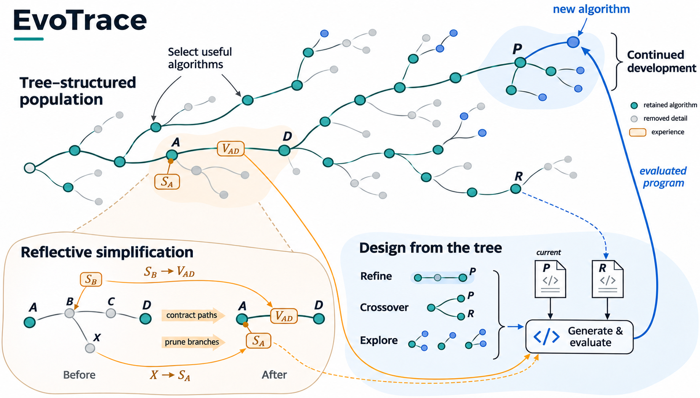
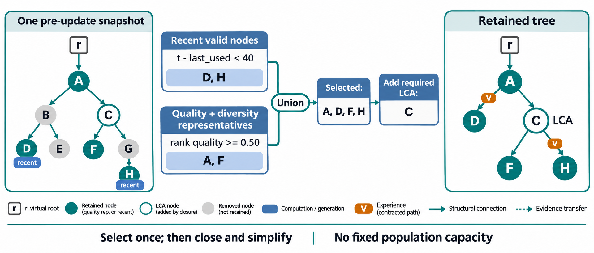
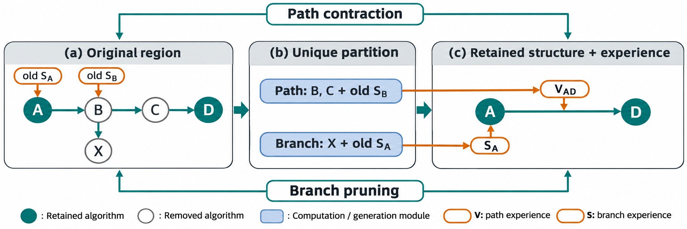
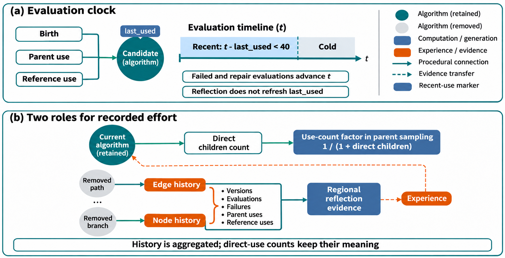
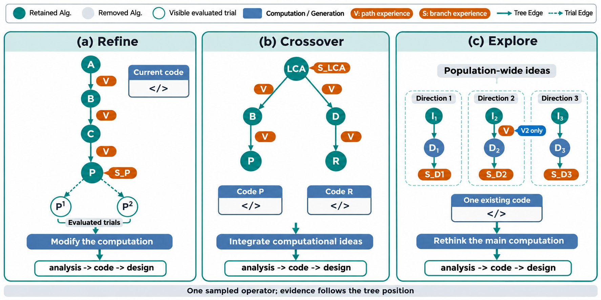

# EvoTrace V2：持续生长的树状种群与动态反思简化

机制说明定稿，2026年11月13日。本文完整描述改版EvoTrace V2的搜索机制、默认参数及其实现语义。对应动态简化批次`20261113_114716_evotrace_v2_dynamic_co4`，采用最近使用与质量差异的一次选择规则。

## 摘要

算法设计的搜索过程同时产生可继续开发的实现和可供后续利用的经验。EvoTrace V2以树状种群（tree-structured population）组织这两类状态：保留节点提供开发起点，发展关系连接算法的形成过程，节点与边上的经验承接已移除的尝试。搜索在每次受评实现入树后，依据最近实际使用与当前质量差异确定保留算法，补齐必要分叉，再统一划分旁支剪枝与路径收缩区域。反思将移除经历凝练到保留结构，实际评价和使用次数沿相同区域交接。由此，个体选择、结构简化与经验积累共同维护一棵持续生长的树，支持后续修改、跨分支融合与新方向探索。

## 1. 问题定义与总体机制

给定任务接口、可观察输入、返回对象用途及合法性要求，搜索需要实现指定函数，改善完整求解器的目标。评价器执行候选代码并返回适应度或失败反馈；全文采用适应度越小越好的约定。

EvoTrace V2反复执行“选择—生成—评价—入树—动态反思简化”。父代选择按当前质量和累计直接开发次数分配预算；Refine、Crossover与Explore分别承担修改、融合与探索。算法入树后，系统从同一维护前状态确定保留集合，再由树的连接关系决定哪些旁支可以移除、哪些中间路径可以收缩。区域经验回到树上，参与下一轮算法设计。



**图1｜持续生长、反思简化与经验回流。** 主视觉是一棵同时组织算法个体和发展经历的树。青色保留算法继续作为开发起点，灰色历史细节在局部简化后转为橙色的节点选择经验S和边变异经验V；左下放大给出两类转换及其归属。右下通过形成路径、共同祖先分叉和全树方向概览组织下一次设计。P提供当前实现，R提供辅助参考；经验进入生成后，受评程序沿蓝色数据流返回P，成为同一棵树的新子代。回流线不表示第二条主父代边。V2在初始化完成后的受评入树时，依据使用与质量状态确定保留集合并整理相应区域。

维护的保留判据使用整棵当前树中的可行算法排序，以及每个节点的最近使用时间。具体移除区域由拓扑产生。宽分叉的剪枝与长路径的收缩是同一保留集合的结构后果，不需要独立的宽度、长度触发阈值。

评价预算包含初始化、失败和修复重评。模型生成、修复及反思的请求与用量单独记录。搜索结束时，系统固定完整尝试档案中训练适应度最好的有效程序，同分取编号较早者，再由实验入口执行独立测试。

## 2. 带经验与使用记录的树状种群

### 2.1 个体与发展关系

虚拟根连接初始算法，本身没有代码，不参与采样。默认初始化5个有效算法。初始化逐次生成，读取已有初始算法的思想与成绩，以及近期失败实现和反馈；任务提供的示例代码可以作为起始材料。每个后续算法连接一个主父代；Crossover另外记录参考来源，形成可追溯的交叉输入关系。搜索和结构维护基于主父代树进行。

| 结构位置 | 保存内容 | 作用 |
| --- | --- | --- |
| 算法节点 | 代码、实现描述、适应度或错误、方向编号、最近使用时刻、自身开发统计 | 提供后续开发起点 |
| 主父子边 | 主父代、算子、参考来源、是否已收缩 | 连接发展过程 |
| 边的变异经验（variation experience）及其历史统计 | 已收缩发展阶段的经历与投入 | 支持理解当前实现如何形成 |
| 节点的选择经验（selection experience）及其历史统计 | 已剪旁支的经历与投入 | 支持理解围绕该位置的既往尝试 |
| 虚拟根的选择经验及其历史统计 | 已移除初始方向的经历与投入 | 保留退出显式种群的方向经验 |

一个节点对应一次生成尝试的最终已评价实现。一次尝试最多进行一次修复；修复前后共享程序编号，重评增加评价数，不增加树节点。原始请求与评价记录保留修复过程，树上的逐节点反思读取最终已评价实现。没有可评价程序的请求不入树。最终不可行节点保存错误，不能成为父代或参考；初始化完成后的下一次维护会将其整理为旁支材料。

Init与Explore创建方向，Refine与Crossover继承主父代方向。方向起点可以被压缩，后代仍保存原方向编号。V2持续保留所有已记录方向的累计评价，即使某个方向已无显式节点。方向计数是历史汇总视图，不构成单独的方向采样器。

### 2.2 评价时钟与实际使用

评价时钟按已完成尝试中的实际评价次数推进，包含失败和修复重评。每次受评实现入树时，系统更新新节点的出生时刻、主父代的最近使用时刻，以及交叉参考的最近使用时刻。时间单位是程序评价次数。

默认将满足下式的可行算法视为近期算法：

$$
\text{当前评价时钟}-\text{最近出生或实际使用时刻}<40.
$$

差值达到40时，节点退出近期保留集合。节点仅被展示在上下文中、作为结构锚点保留或承接反思，不刷新使用时刻。没有产生程序评价的接口故障不推进时钟。

累计直接子代数与最近使用时刻承担不同职责：前者进入父代采样折扣，后者决定近期保留资格。重新连接已有后代不增加直接子代数；接入历史经验也不视为当前算法的一次新使用。

## 3. 一次选择决定保留与结构简化

初始化得到5个有效算法后，每次有新的受评实现入树，系统检查整棵当前树。所有保留资格均从同一维护前快照计算。

### 3.1 质量与差异代表

系统对当前全部可行节点按适应度、编号排序，计算秩质量：

$$
\text{秩质量}=1-
\frac{\text{从0开始的适应度排名}}{\max(1,\text{参与排名的算法数}-1)}.
$$

首先保留冠军，再由好到差检查秩质量不低于0.50的候选。

代码差异采用抽象语法树（abstract syntax tree, AST）的结构距离，具体计算见第5.2节。候选若已被一个适应度不差于它的代表覆盖，则不再加入质量代表集合。覆盖条件为标准化源码相同，或AST距离小于0.08；两者适应度相差不超过$10^{-9}$时，距离门槛改为0.20。没有被覆盖的候选加入代表集合，并参与后续比较。

这一选择在结构补全之前完成，近期保留节点也不预先加入代表比较。结构锚点不排斥质量代表，近期较弱实现也不会阻止更好的实现入选。整个维护过程中，排名和质量代表集合只计算一次，不因本轮删除而反复重算。

### 3.2 近期保留与必要连接

主动保留集合是质量代表与近期可行算法的并集：

$$
\text{主动保留集合}
=\text{质量与差异代表集合}\cup\text{近期使用或出生集合}.
$$

系统沿这些算法的祖先关系补回连接保留路线所需的最近共同祖先（lowest common ancestor, LCA）分叉，得到最终保留集合。虚拟根单独存在，不计为算法。原始初始算法与Explore起点不具有额外的结构保留资格；只有自身满足保留判据或作为必要分叉时才留下。

对于可行节点，退出显式种群需要同时满足三个条件：已不近期、未被选为质量代表、也不是必要连接。未开发初稿在近期窗口内同样保留；窗口不为它预留开发次数。较好且不同的实现以及必要分叉可以长期存在，因此规则不规定节点总数上限或固定增长速度。

### 3.3 联合划分路径与旁支

系统在维护前拓扑上完成唯一分区。保留端点之间被移除的中间节点属于路径收缩区域；不通往任何保留后代的移除节点，按最近保留祖先组成旁支区域。每个移除节点只属于其中一个区域，同一承接位置的多条旁支合并处理。

这一分区允许一次维护同时削减宽度与长度。例如，冷旁支被剪除后，其原父节点若只剩通往一个保留后代的连接，可以在同次更新中成为被收缩的中间节点。系统不需要先修改树，再启动另一轮选择来获得这一结果。



**图2｜一次选择、随后补全连接。** 示例中，D、H满足近期使用条件，A、F入选质量与差异代表；二者并集确定后，补回必要LCA节点C。原树中的B、G成为路径中间版本，E成为旁支。右图仅标出两条收缩边的变异经验，旁支经验的归属见图3。方形r是虚拟根，不作为算法采样；示例颜色表示本次维护的保留结果，字母集合不代表实验数据。

## 4. 经历与投入沿同一结构交接

### 4.1 经验的目标位置

| 移除区域 | 更新后的结构 | 经验位置 |
| --- | --- | --- |
| 保留祖先至后代之间的中间路径 | 后代直接重连到最近保留祖先 | 重连边的变异经验 |
| 不通往保留后代的旁支 | 删除相应旁支 | 最近保留祖先的选择经验 |
| 无保留祖先的初始方向 | 退出显式算法树 | 虚拟根的选择经验 |

原结构为`A → B → C → D`及`B → X`、只保留A和D时，B、C的经历进入`A → D`的变异经验，X进入A的选择经验。B、C早先承接的旧旁支经验随其原承载节点进入路径材料。新移除旁支和旧摘要保持各自来源，同一批材料不被重复分给两个区域。



**图3｜同一保留集合下的剪枝、收缩与经验交接。** B、C及其携带的旧经验进入边`A → D`；新剪旁支X进入A的选择经验。B原有的选择经验与本轮新剪除的X分属不同材料，分别沿原承载位置和本轮分区交接。S和V表示选择经验与变异经验，未展开的旧边历史采用同一交接原则。

收缩边带有阶段类型和最后一个历史交叉参考编号；连接虚拟根的边使用根连接标记。阶段类型概括该段发展，原始日志保留逐次生成来源。经过压缩的入口称为保留路径入口，不要求它仍是历史初始算法。

### 4.2 自身使用与承接历史

V2分别保存五项实际统计：版本数、评价数、失败评价数、主父代使用数、交叉参考使用数。版本数对应入树节点，修复前后仍计一个版本；评价和失败次数包含修复重评；一次受评子尝试为主父代增加一次使用，Crossover另为参考增加一次使用。

统计分为三类承载位置：保留节点的自身统计、节点选择经验的历史统计、入边变异经验的历史统计。虚拟根另保存选择历史。路径收缩汇总中间节点的自身统计、旧选择历史及路径旧入边历史，并纳入后代原入边的历史；旁支剪除汇总被移除节点及其旧历史，再与承接位置已有选择历史合并。保留端点的自身统计保持原义。

沿这一唯一分区，各项统计分别守恒：

$$
\begin{aligned}
\text{全部已记录历史投入}
={}&\text{保留节点自身投入之和}\\
&+\text{节点选择历史之和}\\
&+\text{边变异历史之和}\\
&+\text{虚拟根选择历史}.
\end{aligned}
$$

上述等式对五项统计逐项成立。失败次数是评价次数的子集，主父代与参考使用是不同角色的计数；它们不能相加为另一种评价预算。方向累计评价是对同批历史的另一汇总视图，也不与上述承载位置重复相加。

这些历史统计进入反思输入，用于呈现材料经历了怎样的实际开发。它们包含此前已吸收的历史，不代表独立重复实验，也不转化为承接算法的采样惩罚。当前算法的累计直接子代数继续只描述从自身实际生成的尝试。



**图4｜近期保留与历史投入的不同用途。** 出生、实际父代使用和交叉参考使用更新`last_used`；所有程序评价推进时钟，失败和修复重评也在其中。直接子代数提供父代采样中的使用次数折扣，质量项仍按第5节计算。被移除区域的五项历史统计归入边或节点，进入区域反思后随经验参与后续生成；承接的历史使用次数不增加当前算法的直接子代数。

### 4.3 区域反思与递归利用

每个最终路径区域和旁支区域调用一次反思，不设置等待固定条数的积累队列。同轮各区域读取同一维护前材料，分别写入目标节点或边。

路径反思提供保留端点代码、端点净差分、中间逐步变化与结果、旧边经验和中间节点旧选择经验。旁支反思提供承接位置基准、尝试间的代码差分、评价与错误，以及承接位置和移除区域的旧经验。未收缩边按实际生成父子关系比较；已收缩边明确作为发展阶段输入，比较其端点并提供已有经验。实际开发与参考次数随材料提供。生成时的设计自述不作为反思证据。

模型输出一个`experience`段落，联系实际计算、观察结果与有用旧经验，并区分观察与可能解释。提示建议约120词，材料少时可以更短。经验为后续设计提供材料，后续算子自行决定如何使用；移除本身不构成对算法思想的否定。端点分数变化由程序计算并附加。

后续维护继续吸收原承载位置的旧经验。正常模型摘要受输出token上限和简洁要求控制；调用或解析失败时，使用按960字符预算整理的确定性回退。文字经验是有损凝练，统计守恒不表示文字细节逐项完整保留。完整区域输入、模型响应与异常仍可从原始记录复查。

## 5. 评价预算的分配

### 5.1 质量与开发投入共同决定父代概率

所有保留的可行算法都能成为父代，内部节点与叶节点使用同一规则：

$$
\text{父代权重}
=\operatorname{sigmoid}\!\left(
10\frac{\text{可行适应度中位数}-\text{当前适应度}}{\text{归一化尺度}}
\right)
\frac{1}{1+\text{累计直接子代数}}.
$$

归一化尺度通常取中位数绝对偏差（median absolute deviation, MAD），下限为$10^{-6}$。MAD不超过$10^{-9}$时，使用大于$10^{-9}$的非零绝对偏差的中位数，并保持同一下限。各节点权重归一化为父代概率；全部权重为零时均匀采样。

累计直接子代数包含实际生成并入树的失败、已淘汰及Explore子代，跨压缩保留。历史区域承接的使用次数不灌入该计数。压缩改变可选父代及适应度分布，因此会与这一分配规则共同影响后续搜索。

选定父代后，系统按Refine 0.45、Explore 0.30、Crossover 0.25的固定先验抽取算子。

### 5.2 统一的交叉参考选择

Crossover先排除主父代和与主父代标准化源码相同的算法，再对实际可用的可行参考按适应度排序，同分按编号排序。参考资格用第3节的秩质量公式，在排除主父代及同源码后的参考集合中计算。

秩质量不低于0.30的参考进入资格池。仅有一个可用参考时，其秩质量为1。所有种群规模使用同一规则。

在资格池内，系统优先考虑与当前主父代尚未配对的参考，再选择AST结构距离最大的一个；距离相同时依次选择适应度较好、编号较早者。全部合格参考都已配对时允许复用；没有参考时改用Refine。配对按“主父代—参考”的有序关系记录。

代码距离采用AST父子类型和遍历序列二元组的多重集Jaccard距离。普通变量名与数值字面量不形成独立取值特征，调用名称、运算类型和程序结构参与比较。源码等价性检查保留变量与常数，只忽略排版、注释及文档字符串。结构距离用于筛选与排序，不被解释为算法行为等价的证明。

## 6. 三尺度生成与输入适配

### 6.1 按设计任务读取发展经历

三个算子都输出`analysis`、完整`code`和事实性的`design`描述。`analysis`解释本次计算选择，`design`描述返回代码实际实现的过程。

| 算子 | 材料组织 | 设计任务 |
| --- | --- | --- |
| Refine | 当前实现与成绩；完整保留路径；当前节点选择经验及可见子尝试 | 利用实现和开发经历决定下一步修改 |
| Crossover | 两份实现；共同祖先及其选择经验；通向两端的分化路径；主父代的可见子尝试 | 决定借鉴什么计算以及如何融合 |
| Explore | 不同方向的入口思想、近期发展和节点/边经验；随后给出一份现有实现 | 构思主要计算方式不同的新算法 |



**图5｜按当前设计任务组织上下文。** Refine读取形成路径与局部尝试；Crossover读取共同祖先和分化路径，比较两份实现；Explore从全树方向思想、近期发展及相关经验中构思新计算方式。右图的蓝色“V2 only”标记指出，相较V1新增读取的方向内部变异经验。V表示路径经验，S表示旁支选择经验；三种视图每次仅选用一种。

未收缩边展示相对真实父代的代码差分与评价；已收缩边展示端点结果、后代实现描述与阶段经验。差分序列附带实际基准代码。可见子尝试按算子、参考、标准化源码和结果去重，保留最近记录，默认不再设置数量截断。拓扑重连后的子边可以表示多步发展，当前出边数不等于累计真实直接子代数。

Explore按每个方向最新保留版本的编号排序，用入口源码等价性和0.12的AST距离门槛选择不同方向代表。每个代表提供入口思想、最新保留版本的思想、入口边经验、方向内节点的选择经验，以及内部边的变异经验。其“近期发展”按保留版本的生成次序确定，不使用冷却时钟排序。方向编号、累计评价数及内部筛选信息保存在元数据中；当前参考实现不单独展示成绩，经验可以保留相关结果。

### 6.2 由实际输入预算控制展示

V2默认组织全部相关保留路径、子尝试和不同方向材料，再检查三类演化生成提示的实际输入。正式Qwen配置使用服务tokenizer，输入上限为30000 tokens；未提供计数器的独立客户端使用UTF-8字节数作保守代理，并记录计数方式。

超出窗口时，系统分别尝试减少路径、可行子尝试、失败子尝试、方向或方向经验的展示数量，每轮采用实际释放输入最多的取舍，再重新计数。取舍以完整条目进行，路径窗口保留入口或基准及近期阶段，方向窗口优先保留生成次序较新的代表。当前源码、交叉参考源码和解释差分所需的基准仍提供给模型；单条经验不按字符截断。必要材料仍超窗时明确报错。

展示取舍只改变一次生成提示，不修改树、保留资格和经验归属。两类经验默认展示；关闭经验展示不会自动取消反思，关闭反思模型则使用确定性摘要完成结构更新。

## 7. 完整过程与默认设置

```text
输入：任务、生成模型、评价预算及默认配置
建立虚拟根、空树和尝试档案
当预算未耗尽且未触发连续未评价停止条件时：
    若有效初始算法不足5个，构造初始化提示
    否则，采样父代与算子，选择必要参考并适配生成上下文
    生成候选；需要时进行一次格式修复或程序修复
    对可解析程序执行评价，每次评价单独计费
    将最终已评价实现入树，推进评价时钟并更新实际使用
    若初始化完成且本次有受评实现入树：
        在同一快照上选定质量代表与近期保留算法
        补齐必要LCA分叉，得到最终保留集合
        在原拓扑上唯一划分移除路径与旁支
        有移除区域时，交接统计、逐区域反思并重连树
    提交本次尝试及其对应的树更新
输出：完整尝试档案中训练适应度最好的有效程序
```

一次尝试最多使用一次修复机会。格式修复之后即使执行失败，也不再追加程序修复；预算耗尽时不追加修复重评。连续10次尝试未产生程序评价时，搜索提前停止。

V2保持以下机制性质：冠军受到保护；所有保留算法通过主父代关系连到虚拟根；移除区域唯一；被移除经历和投入有明确承接位置；保留节点自身使用与承接历史分别保存。树可以持续增长，简化的时机与范围由当前状态决定。近期窗口和代表筛选共同决定保留资格，实际开发机会仍由父代采样决定。

### 7.1 默认参数

| 参数组 | V2默认设置 |
| --- | --- |
| 初始化与预算 | 5个有效初始算法；1000次评价 |
| 近期保留 | 评价时钟差小于40 |
| 质量代表资格 | 秩质量≥0.50，按适应度从优到劣选择一次 |
| 代表覆盖 | 源码相同或AST距离<0.08；同分时距离<0.20 |
| 结构补全 | 必要LCA分叉；不强制保留初始根或Explore起点 |
| 父代质量系数 | 10；按累计直接子代数折扣 |
| 算子先验 | Refine 0.45；Explore 0.30；Crossover 0.25 |
| 交叉资格池 | 先排除主父代及同源码，再要求参考秩质量≥0.30 |
| 生成上下文 | 默认完整组织；演化生成输入上限30000 tokens |
| 模型请求 | 生成温度1.0、输出上限16384 tokens；反思温度0.3、输出上限1536 tokens |

### 7.2 相对V1的机制差异

| 机制 | V1 | V2 |
| --- | --- | --- |
| 更新时机 | 64个节点触发，更新后至多32个 | 初始化完成后逐次检查受评入树状态 |
| 主动选择 | 容量内联合质量—差异分数，含有限Explore保护 | 一次质量代表选择与近期保留取并集 |
| 结构与代表的关系 | 补入锚点参与后续距离比较 | 代表先定，结构后补 |
| 初始根 | 有保留后代时强制补回 | 按自身资格或必要分叉保留 |
| 使用统计 | 当前节点直接子代数、存活方向累计评价 | 加入评价时钟、参考次数及区域历史聚合，保留全部方向评价 |
| 参考资格 | 小种群全池，大种群质量池 | 所有规模采用同一参考质量规则 |
| 上下文展示 | 路径、子尝试、方向的固定数量窗口 | 实际输入预算触发展示缩减 |
| Explore经验 | 入口边经验与方向内节点选择经验 | 同时读取方向内部的变异经验 |

两版都以树状种群结合个体选择与发展经历，都使用路径变异经验、节点选择经验及三类生成算子。V2改变这一结构的维护规则，并调整与持续生长相关的统计和展示边界。

## 8. 源码与复查依据

本文对应`20261113_114716_evotrace_v2_dynamic_co4`冻结批次；写作核对时，工作区V2的16个Python源码文件与该快照逐文件一致。此前采用宽度8、路径4的旧V2属于另一冻结条件。

| 机制 | 对应实现 |
| --- | --- |
| 搜索与逐次维护入口 | [search.py](../evotrace_v2/search.py) |
| 使用时钟与自身统计 | [models.py](../evotrace_v2/models.py) |
| 一次选择、LCA闭包、唯一分区与历史转移 | [topology.py](../evotrace_v2/topology.py) |
| 父代、算子与交叉参考 | [allocation.py](../evotrace_v2/allocation.py) |
| 三算子材料与输入适配 | [context.py](../evotrace_v2/context.py) |
| 区域证据、反思及经验交接 | [reflection.py](../evotrace_v2/reflection.py) |

已完成尝试日志是恢复状态的来源。结构、统计与反思结果在同一次尝试提交中保存；恢复使用已提交结果，不重做已提交的反思。完整尝试档案、当前保留树和单次提示的展示视图分别承担复查、搜索与生成职责。源码指纹与文档核对记录见[设计核对目录](../experiments_result/analysis/evotrace_design_documents_20261113/)。容量触发版本的完整机制见[EvoTrace V1](EvoTrace-v1设计.md)。
