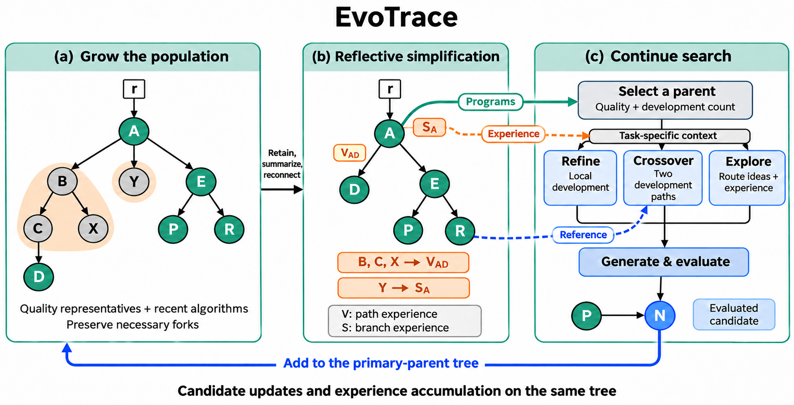
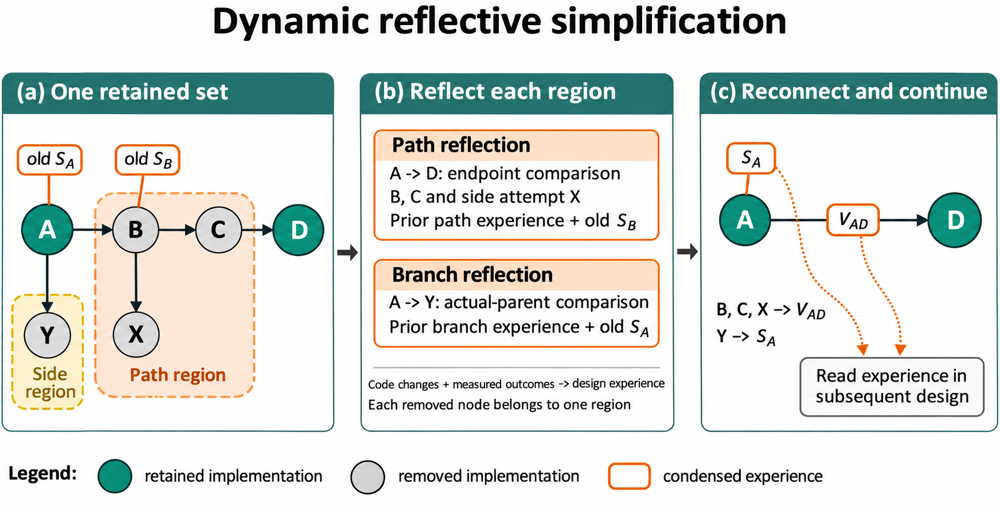

# EvoTrace V2：树状种群的反思压缩与持续演化

一个算法刚被改写时，一次评价只能说明这个实现的表现。若同一处还在产生新尝试，后续子代可能改变对这条路线的判断。EvoTrace V2 让**树状种群（tree-structured population）**随局部开发持续生长。每次新实现受评，树既保留成绩和程序结构有代表性的算法，也保留近期出生、被开发或同路线父代仍在开发的可行算法。补齐连接它们的分叉后，便可确定本轮能简化哪些路径和旁支。

这种更新使算法的更替同时成为积累设计经验的过程。同一路线中，表现更好的后代可以接替早期实现。过渡节点退出后，沿途如何改写、还尝试过哪些旁支，都可以凝练到通往后代的边上。其余退出的旁支把经验留给最近的保留祖先。下一轮搜索从存活算法中选择起点，在沿用、融合或重新构思一种计算时，可以读到与该位置有关的尝试。



**图 1　一次选择如何同时更新算法和经验。** 保留个体的位置确定收缩路径、待剪旁支和各自的经验归属。下一次生成读取更新后的树，受评子代又沿主父代关系接回树上。

## 1. 树状种群与局部开发

任务给出待实现的函数接口、可观察输入、输出用途与合法性要求。评价器执行候选代码，在完整求解器上返回适应度或失败反馈，目标值越小越好。树上每个算法节点保存一次生成尝试最终受评的实现、设计简述及结果。未通过评价的实现记录失败，初始化完成后由下一次维护整理为旁支材料。虚拟根连接初始算法，父代和交叉参考均取自可行个体。

初始化依次收集 5 个有效算法，可以读取任务示例、先前初始算法的思想和成绩，以及近期失败实现和反馈。此后的子代都接在选定的主父代下。精化（Refine）和交叉（Crossover）沿用主父代的**路线**，交叉另记参考来源。探索（Explore）也从主父代派生，但以子代的编号开辟新路线。路线编号沿后代传递，即使入口被收缩，仍能辨认这些算法属于哪条路线。

V2 用两种记录描述开发。**最近开发时刻**回答一个位置是否仍然活跃。评价时钟按实际执行的程序评价推进，含失败与修复重评。新节点入树时记录出生时刻，从它发起的精化或交叉会刷新其最近开发时刻。**累计同路线开发次数**则回答从这个位置已经试了多少次，用于分配预算。一次精化或交叉尝试计一次，即使失败、经过修复或后来被剪除。探索将此次评价归入新路线，原父代的开发时刻和次数沿用原值。交叉只刷新主父代，被读取的参考个体沿用已有记录。重连和经验交接也沿用原计数。

## 2. 一次选择决定哪些经历需要压缩

### 2.1 质量代表与近期个体共同保留

初始化完成后，每有一个受评实现入树，就在包含该实现的树上确定本轮保留集合。先对全部可行个体按适应度从优到劣排序，同分取较早编号。若共有 $N$ 个可行个体、$r_i$ 为从零起的名次，则秩质量为 $q_i=1-r_i/\max(1,N-1)$。质量代表集 $Q$ 保留冠军，再依次检查 $q_i\ge 0.50$ 的候选。

候选获得代表资格须满足两个条件。第一，同一路线上还没有严格优于它的后代。同分后代和跨探索路线的后代均不构成这种取代。第二，其实现尚未被成绩至少同样好的已选代表覆盖。覆盖指标准化源码相同，或抽象语法树（abstract syntax tree，AST）距离小于 0.08。两者分差不超过 $10^{-9}$ 时，距离门槛改为 0.20。代表资格先于近期保留与分叉补全确定，因此仅因近期使用或结构连接而留下的节点不会排斥质量代表。

另一个保留依据是最近的实际开发。设当前评价时钟为 $t$，$\ell_i$ 为节点 $i$ 出生或最近一次被精化、交叉开发的时刻。如果当前树上父代 $p$ 与 $i$ 属于同一路线，取 $a_i=\max(\ell_i,\ell_p)$，否则取 $a_i=\ell_i$。近期集合 $A_t$ 和主动保留集合为

$$
A_t=\{i\text{ 可行}\mid t-a_i<40\},\qquad S_t=Q\cup A_t.
$$

因此，父代仍在同一路线上被开发时，它已有的子尝试也可以保持近期资格。满 40 次评价后，个体仍可凭质量或连接作用留下。被提示引用、被选为分叉或承接经验都不会刷新时钟。近期资格保障一段留树时间，下一次派生仍由抽样决定。

最后，补齐 $S_t$ 中个体两两之间的最近公共祖先（lowest common ancestor，LCA）分叉。初始算法和探索起点也按自身资格或连接需要保留。每轮只在同一份更新前快照上选择和补全一次。种群规模取决于仍具代表性或仍在开发的路线，V2 不设固定的全树节点上限。

### 2.2 用保留下来的后代确定经验归属

在选定的保留节点之间，省去中间链，让后代直接接到最近保留祖先上。**附着在这条中间链上的待剪旁支，也属于这段演进。** 中间链和这些旁支共同构成一个路径区域，凝练为重连边的**变异经验（variation experience）**。其余待剪节点按最近保留祖先归组，凝练成该节点的**选择经验（selection experience）**。整条初始路线退出时，经验归入虚拟根。每个移除节点在本轮只进入一个区域，哪怕区域只有一个节点，也可当轮反思。

设 $A\to B\to C\to D$，另有 $B\to X$，本轮只保留 $A,D$。从 $B$ 出发的 $X$ 是发展到 $D$ 途中做过的尝试，因而与 $B,C$ 一起进入新边 $A\to D$。若另有直接从 $A$ 出发的旁支 $Y$ 被剪去，$Y$ 与 $A$ 原有的选择经验合并。$B$ 过去承接的旧选择经验也随它进入新边。以后精化 $D$，仍能沿形成路径读到关于这些改动与试探的经验。



**图 2　同一轮简化中的两处经验。** 与 $B,C$ 同时移除的 $X$ 和 $B$ 上的旧经验共同进入边 $A\to D$，从 $A$ 直接出发的 $Y$ 更新节点 $A$ 上的经验。

收缩边记录阶段类型。两端属于不同路线时标为探索，同路线中出现历史交叉时标为交叉，其余标为精化。链上最后一个历史交叉参考编号随边保留。连接虚拟根的收缩边使用根连接标记。各次真实生成的主父代和参考来源仍可在尝试档案中追溯。

### 2.3 反思如何保留比较的依据

每个区域反思一次，同轮各区域读取同一份更新前的材料。路径反思比较保留端点的代码与净变化，结合中间实现、同轮移除的侧枝、实测结果和原有经验。旁支反思以承接位置及各次尝试的实际父代为基准，结合代码差分、失败原因及旧经验。新生边对应一次真实派生，收缩边比较一个阶段的端点。根下的初始实现以任务评价为据。探索初稿的结果归于该次实际受评的实现。

反思先写清比较的起点、具体改动与观察结果，再酌情给出可能解释。当前代码比较使用程序计算的改进、退步、同分或失败标签，旧经验按原文提供。端点分数变化由程序另行附在路径经验上，原始数值保存在记录中。多处代码同时变化时，只能把测得的结果归于这组改动。模型把观察凝练成一段通常不超过 120 个英文词的 `experience`。后续压缩会再读相关旧经验。关闭反思模型、调用失败或输出无法解析时，以 960 字符预算生成确定性摘要。

## 3. 评价预算怎样在路线间分配

保留资格回答哪些个体还能继续发展，预算权重决定下一次实际从哪里出发。V2 的所有存活可行个体都参与抽样，包括连接分叉的旧算法。每次抽样前，在当前保留树上重新确定质量代表，以其适应度中位数 $m$ 和分差尺度 $s$ 衡量个体 $v$ 的表现。设 $c(v)$ 为从该个体出发的累计同路线开发尝试数，$D$ 为一条含可行个体的路线。节点权重、路线概率和路线内概率为

$$
w(v)=\sigma\!\left(10\frac{m-f(v)}{s}\right)\frac{1}{1+c(v)},\qquad
P(D)=\frac{\max_{u\in D}w(u)}{\sum_{D'}\max_{u\in D'}w(u)},\qquad
P(v\mid D)=\frac{w(v)}{\sum_{u\in D}w(u)}.
$$

$\sigma$ 为 sigmoid 函数。$s$ 取代表适应度的中位数绝对偏差（median absolute deviation，MAD），下限为 $10^{-6}$。当 MAD 不超过 $10^{-9}$ 时，改取大于 $10^{-9}$ 的绝对偏差的中位数，无此偏差则取下限。

路线以其中权重最高的个体竞争预算，路线内个体再按各自权重分配这份预算，最终父代概率为 $P(D(v))P(v\mid D(v))$。在各个体权重给定时，加入一个权重低于该路线最高值的版本，只改变路线内部的预算分配。冻结版本还保留所有路线的累计评价，包括已退出的路线，供追溯历史投入。抽样折扣使用的是节点自身的 $c(v)$。

## 4. 生成算子如何读取局部路线与全树经历

选定主父代后，按精化 0.45、探索 0.30、交叉 0.25 的先验抽取算子。三者都输出 `analysis`、完整 `code` 和 `design`，分别说明本次计算选择、给出程序、描述实际实现。

| 算子 | 用于这次设计的经历 |
| --- | --- |
| 精化 | 从本路线的保留入口追溯至父代，读取直接来源摘要、入口边经验、父代源码与成绩、节点经验及子尝试。 |
| 交叉 | 比较两份实现。同路线的两者从共同祖先追溯各自分支，跨路线则分别读取各自的局部发展与来源摘要，再结合主父代的子尝试。 |
| 探索 | 跨路线读取入口思想、近期发展、节点经验和边经验，再以所选父代的实现为参照，重新构思核心计算。 |

交叉先排除主父代及标准化源码相同者，在余下可行参考中重算秩质量，取 $q\ge 0.30$ 的候选。仅余一个候选时其秩质量为 1。优先选与当前父代尚未配对、AST 距离最大的参考，距离并列取成绩较好、编号较早者。已用组合可以在未用组合耗尽后复用，无参考时改为精化。该规则适用于所有种群规模。距离采用 AST 父子标签与遍历二元组的多重集 Jaccard 距离，计入调用名称、运算类型和结构。标准化源码比较另保留变量名与常数值，忽略排版、注释和文档字符串。

普通边展示真实父子的代码差分和成绩，收缩边展示阶段端点结果、后代设计及边经验。差分附基准代码。子尝试按算子、参考、标准化源码和结果去重，取最近记录。探索按各路线最新保留版本的编号优先选择近期发展的路线，以入口源码和 0.12 的 AST 距离阈值筛选代表。每条路线给出入口与最新版本的设计、入口边经验、内部边的变异经验及保留节点的选择经验。各段经验标明来源，父代实现单独展示时隐去成绩。

三类算子都先组织树上相关的路径、子尝试与路线。只有材料超出输入预算时，才缩减展示范围。当前源码、交叉参考源码和解释差分所需的基准优先保留。两类经验默认可见，隐藏它们只改变本次生成可读的材料。树上的经验仍可进入后续反思。

## 附录　完整流程、评价协议与版本依据

本节链接的冻结批次、历史核对和修复记录位于本地实验与归档目录。

```text
逐次初始化至 5 个有效个体。之后分配路线与父代，选取算子并生成子代。
评价最终实现，接入主父代树，用实际评价次数推进时钟。
在同一快照上选择质量代表，与近期可行个体取并集，再补齐必要分叉。
把中间链及其附着侧枝归给重连边，其余旁支归给最近保留祖先。
对每个有节点退出的区域反思一次，更新树并继续搜索。
预算耗尽或触发停止条件时，从完整档案选出训练最优程序。
```

本文对应 2026 年 11 月 14 日修复并冻结的 `20261114_103407_evotrace_v2_repaired_co4`。默认总预算 1000 次程序评价，包括初始化、失败评价和修复重评。一次尝试至多执行一次格式或运行修复，修复前后共用算法编号，预算耗尽即停止重评。连续 10 次尝试未产生程序评价时提前结束。生成温度为 1.0，输出上限 16384 tokens。反思温度为 0.3，输出上限 1536 tokens。完整档案中训练适应度最优、同分时编号较早的可行程序进入独立测试。[冻结批次](../experiments_result/evotrace_v2/launch_20261114_103407_evotrace_v2_repaired_co4/README.md)

**抽样与输入预算。** 冻结实现用对数权重归一化父代概率，并以最小正浮点数处理概率下溢。正式 Qwen 配置用服务端分词器计数，三类演化算子的输入上限为 30000 tokens，独立客户端缺少计数器时用 UTF-8 字节数作保守估计。提示超限时，每轮从路径、可行或失败子尝试、路线和路线经验中选出释放空间最多的一项，按完整条目缩减。路径优先保留入口及近期阶段，路线优先保留近期代表。必要材料仍超限时，该次提示报错。

每次完成的尝试与对应的树更新一并保存，恢复时直接读取已提交的反思结果。冻结代码可按机制查阅。[搜索循环](../experiments_result/evotrace_v2/launch_20261114_103407_evotrace_v2_repaired_co4/source/evotrace_v2/search.py) · [节点与评价时钟](../experiments_result/evotrace_v2/launch_20261114_103407_evotrace_v2_repaired_co4/source/evotrace_v2/models.py) · [保留与区域划分](../experiments_result/evotrace_v2/launch_20261114_103407_evotrace_v2_repaired_co4/source/evotrace_v2/topology.py) · [区域反思](../experiments_result/evotrace_v2/launch_20261114_103407_evotrace_v2_repaired_co4/source/evotrace_v2/reflection.py) · [父代与参考](../experiments_result/evotrace_v2/launch_20261114_103407_evotrace_v2_repaired_co4/source/evotrace_v2/allocation.py) · [路线与输入窗口](../experiments_result/evotrace_v2/launch_20261114_103407_evotrace_v2_repaired_co4/source/evotrace_v2/context.py)

### 与 V1 的机制对应

| 决策 | V1 | V2 |
| --- | --- | --- |
| 何时保留、何时简化 | 达到全树容量时重构，对少数新探索方向提供有限保护 | 每个受评实现入树后更新，保留质量代表与近期算法 |
| 分叉如何参与竞争 | 必要祖先与候选共用名额，也参与后续距离比较 | 代表先定，再补近期个体和必要分叉 |
| 同轮剪去过渡节点的侧枝 | 经验归最近保留祖先 | 经验随中间链进入重连边 |
| 下一次从哪里出发 | 全树可行个体直接竞争 | 路线以最高节点权重竞争，路线内按节点权重选择 |
| 探索从路线中读到哪些经验 | 入口边经验与保留节点的选择经验 | 同时读取路线内部边上的变异经验 |
| 上下文展示到什么范围 | 路径、子尝试和方向分别设数量窗口 | 先组织完整材料，仅在超过输入预算时缩减 |

该修复批次的选择、输入材料及反思偏差另有固定状态记录。[V1 设计](EvoTrace-v1设计.md) · [V2 实现说明](../evotrace_v2/README.md) · [V2 修复与回放](../archive/documents_20261116_history/记录/2026-11-14-V2最小修复与回放.md) · [历史核对材料](../experiments_result/analysis/evotrace_design_documents_20261113/) · [论文引言](../paper/paper-中文.md#1-引言) · [V3 设计](EvoTrace-v3设计.md)
