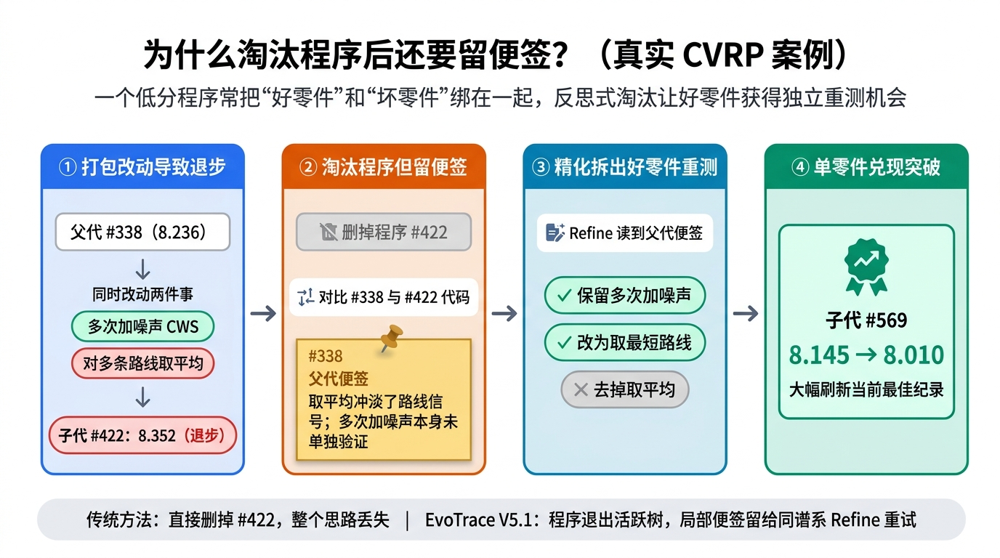
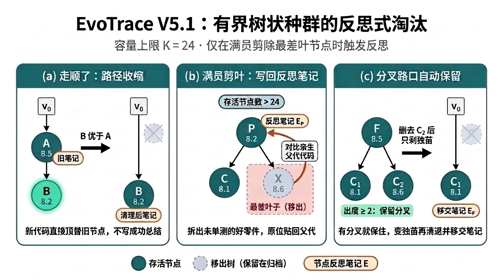
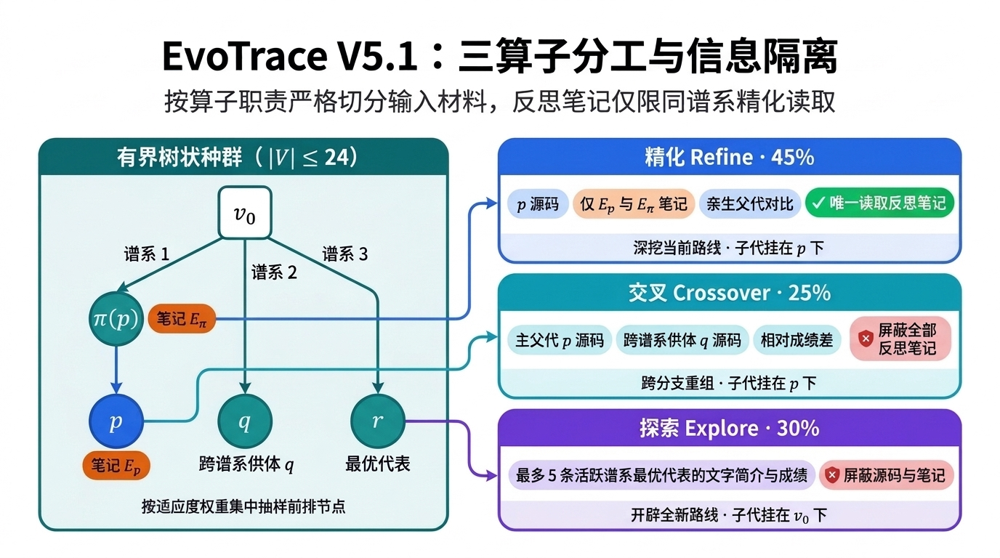

# EvoTrace V5.1：有界树状种群上的反思式淘汰

> **核心结论（3 句话看懂 V5.1）**：
> 1. **痛点**：LLM 改代码常把几个改动绑在一起，一个坏零件就能把整份程序拖成低分；直接删掉程序会丢掉其中还没单独测过的好零件，而把反思塞进全局池广播又容易收窄探索视野。
> 2. **解法**：EvoTrace V5.1 在**容量上限 $K=24$ 的树状种群**上做**反思式淘汰**——走顺了就用**路径收缩**原地顶替（不写“成功总结”），满员砍掉最差叶节点时才触发**剪枝反思**，基于完整代码对比把未单测的好零件写成便签贴回存活父代，且**严格只给同谱系 `Refine` 读**。
> 3. **极简参数**：种群与选择层只围绕两个核心参数运转——活跃树容量 $K=24$ 与选择陡峭度 $\lambda=10$。

---

## 1. 问题背景：LLM-AHD 领域的真实局限与核心定位

在基于 LLM 的自动启发式设计（AHD）中，搜索算法需在有限程序评价预算 $B$ 内演化可执行启发式函数。与常规生成任务不同，**AHD 交付的是全程极值，而不是平均值**——任何提高平均生成质量却压缩提案方差的机制，都可能损害前沿破纪录能力。

### 一个真实案例：为什么淘汰程序后还要留便签？



> **真实记录（CVRP 任务，见[机制作用的证据](记录/2026-11-19-机制作用的证据.md#四个经验使用案例)）**：父代 `#338`（成绩 `8.236`）采用确定性 Clarke-Wright 节约法（CWS）。子代 `#422` 一次性绑了两个改动——“8 次加噪声运行 CWS”＋“对多条路线取平均”，结果退步到 `8.352` 被淘汰。反思笔记点出“取平均冲淡了路线信号”后，后续 `Refine` 在 `#569` 中**保留“多次加噪声”、把“取平均”改成“取总路程最短解”**，一举把当时的最好纪录从 **`8.145`** 推进到 **`8.010`**。这正是“整份程序该淘汰，但其中好零件值得孤立重测”的典型场景。

对照现有代表性范式，可见三类明确的机制缺口：

1. **种群与岛屿方法（EoH、FunSearch、ShinkaEvolve）：淘汰或落选改动的对比信息未交还给原父代**
   - EoH 每代按适应度截断固定规模种群；FunSearch 按行为签名分簇并定期重置较弱岛屿；ShinkaEvolve 维护岛内归档、新颖性筛选与全局 meta-scratchpad。
   - 但在一次代码改写中，LLM 常将多个改动捆绑在一起，局部瑕疵会拖累整份程序得分而使其落选。上述方法并未将落选改法相对其具体生成父代的代码对比信息交还给后续修改该父代的算子，导致有价值的局部部件未能获得独立重测机会。
2. **搜索树与系统发育森林方法（MCTS-AHD、PhyloEvolve）：活跃树持续扩张或轨迹提示未与淘汰事件耦合**
   - MCTS-AHD 保留全部已生成节点，随预算推进，UCT 需在持续增长的历史节点中分配访问预算；PhyloEvolve 维护系统发育森林并将演化轨迹输入提示，但未将经验提炼绑定于容量淘汰事件，亦未区分开发与探索算子的记忆隔离。
3. **反思式演化方法（ReEvo、RefineEvo、MEMOIR）：经验存放位置、内容形态与消费边界的选择**
   - ReEvo 以成对短期反思服务交叉、以全局长期反思服务精英变异；RefineEvo 比较亲子改动并按条件检索；MEMOIR 在分支终止时触发反思，并将压缩经验汇总至全局池供新分支使用。
   - **V5.1 的清晰差异化定位**落在三个正交决策上：**① 存在哪**——锚定于存活父节点并沿树迁移（而非写入全局池）；**② 写什么**——仅在容量剪叶时基于完整代码差异拆解尚未独立检验的局部部件与疑似瑕疵（而非总结成功路径或失败禁令）；**③ 谁来读**——严格仅限同谱系 `Refine` 读取自身与直接父代笔记，屏蔽 `Crossover` 与 `Explore`，避免记忆收窄跨思路与前沿探索分布。

**核心洞见**：将有界树状种群视为**局部想法笔记的路由器**——容量 $K$ 维持竞争压力，路径收缩让进展由源码直接承接并带动笔记随谱系推进，出度约束自然保护分叉地址不失效，而容量剪叶将谱系内被淘汰尝试中值得孤立验证的部件原位交还给局部精化算子。

---

## 2. 方法设计：四个极简且协同的组件

### 2.1 有界树状种群表示

沿用标准 AHD 协议（训练目标值 $f(v)$ 越小越优，预算 $B=1000$，初始规模 $N_0=5$）。EvoTrace V5.1 维护一棵以虚拟根 $v_0$ 统筹的有根树 $T = (\mathcal{V} \cup \{v_0\}, \mathcal{E})$，每次更新后严格满足 $|\mathcal{V}| \le K$（默认 $K=24$）：

- **谱系划分**：`Init` 与 `Explore` 挂接于 $v_0$ 下，各自开启独立谱系；`Refine` 与 `Crossover` 挂接于主父代 $p \in \mathcal{V}$ 下，留在同一谱系中。任意存活节点 $v \in \mathcal{V}$ 的谱系归属 $L(v)$ 定义为其沿父指针上溯至 $v_0$ 前的顶级祖先。
- **精确去重**：忽略注释、文档字符串与排版，仅拒绝与当前 $\mathcal{V}$ 中节点规范 AST 完全一致的重复程序；保留代码不同的同分变体，不阻断中性漂移。全部受评程序存于历史归档 $\mathcal{A}$，搜索结束返回 $\mathcal{A}$ 中训练最优实现。
- **单一经验载体**：每个存活节点 $u \in \mathcal{V}$ 仅维护一段**节点经验 $E_u$**（记录从该分支被淘汰尝试中提取的未兑现想法与疑似缺陷），取消边经验。

### 2.2 路径收缩与固定容量淘汰（反思式淘汰）



> **直觉速览**：上图对应树上最常发生的三种动作——**(a) 走顺了就收缩**（新程序更强直接顶替前身，省下树名额，也不废话写“成功总结”）；**(b) 满 24 个就砍最差叶子并贴便签**（唯一产生新反思笔记的时机）；**(c) 分叉路口自然保住**（连着两条活路的老节点出度 $\ge 2$，不会被拆；等旁支删光只剩独苗时再撤掉并移交便签）。

每当新可行且非重复的节点 $v_{\text{new}}$ 接入树中，依次执行两步确定性更新：

1. **路径收缩（不写成功路径反思，跨节点继承时对照新源码清理旧笔记）**
   - 对任意无分叉单链 $A \to v_1 \to \dots \to v_k \to D$（$k \ge 1$，允许 $A = v_0$；中间节点均满足出度 $|\operatorname{Ch}(v_j)| = 1$），若末端 $D$ 严格优于全部中间节点（$\forall j,\; D \succ v_j$），则移除 $(v_1, \dots, v_k)$ 并重连 $\pi(D) \leftarrow A$。
   - **不生成“成功路径”反思**，由 $D$ 的存活源码直接承接进展。同时，一条谱系的连续改进始终原地替换其前身，不挤占其他谱系的名额。
   - 若被移除的中间祖先携带非空节点经验，则与 $E_D$ 一同对照 $D$ 的当前源码做一次轻量清理/合并，剔除已在 $D$ 中兑现或过时的条目；若仅 $D$ 自身有笔记，零调用原样保留。反复执行至不动点。

2. **固定容量淘汰（唯一产生新想法笔记的时机）**
   - 若路径收缩后仍有 $|\mathcal{V}| > K$，记全局最优节点为 $v^* = \arg\min_{u \in \mathcal{V}} f(u)$，在所有**非全局最优且出度不超过 $1$**的节点集合
     $$\mathcal{U}_{\text{elig}} = \bigl\{u \in \mathcal{V} \setminus \{v^*\} : |\operatorname{Ch}(u)| \le 1\bigr\}$$
     中，移出目标值最差者 $u^* = \arg\max_{u \in \mathcal{U}_{\text{elig}}} f(u)$（同分取较晚编号）：
     - **叶节点且父节点在树内（$|\operatorname{Ch}(u^*)| = 0, \pi(u^*) \in \mathcal{V}$）**：触发**剪枝反思**，始终对照 $u^*$ 的**亲生生成父代**（从归档取 `parent_id`，若与接收笔记的存活祖先不同则单列存活祖先）的完整源码/无截断差异与实测变化，仅在证据明确揭示具体实现缺陷或未孤立验证的部件时保留想法，更新 $E_{\pi(u^*)}$；若重复尝试已有笔记想法仍未胜出且无新证据，则删除该条目。
     - **单节点根谱系（$|\operatorname{Ch}(u^*)| = 0, \pi(u^*) = v_0$）**：直接移出 $\mathcal{V}$，不向 $v_0$ 写入经验。
     - **单子节点（$|\operatorname{Ch}(u^*)| = 1$，唯一子节点为 $c$）**：重连 $\pi(c) \leftarrow \pi(u^*)$，按前述规则将 $E_{u^*}$ 清理/合并至 $E_c$。
   - 每次移出后重新执行第 1 步路径收缩至不动点（若剪去旁支使某分叉祖先出度降为 $1$ 且其剩余子代更优，则该子代立即收缩接替并清理继承刚更新的 $E_P$），循环直至 $|\mathcal{V}| \le K$。

> **结构保证（无死锁与自动保留分叉）**：对任意 $|\mathcal{V}| \ge 2$ 的有限有根树，每个真实节点在 $\mathcal{V}$ 内至多有一个父节点且至少一个谱系根以 $v_0$ 为父，故 $\sum_{u \in \mathcal{V}} |\operatorname{Ch}(u)| \le |\mathcal{V}| - 1 < 2(|\mathcal{V}| - 1)$，因此必存在非最优且出度 $\le 1$ 的节点，循环必然终止于 $|\mathcal{V}| \le K$。同时，连接多条存活分支的分叉祖先因出度 $\ge 2$ 自动保留，无需额外的最近公共祖先（LCA）骨架重构。

### 2.3 适应度加权父代选择与跨谱系供体选择

沿用 EvoTrace V1 / ShinkaEvolve 经过实证检验的适应度加权机制：记当前存活树 $\mathcal{V}$ 的适应度中位数为 $m$、中位数绝对偏差（MAD）尺度为 $s$（若 $\operatorname{MAD} \le 10^{-9}$ 则取非零偏差中位数，下限 $10^{-6}$），定义质量权重：
$$q(u) = \sigma\!\left(\lambda\,\frac{m - f(u)}{s}\right), \qquad \lambda = 10.$$

- **主父代抽样（`Refine` / `Crossover`）**：结合以 $u$ 为主父代已消耗的直接评价次数 $n_u$（新节点 $n_u=0$，失败、修复与重复均计入）：
  $$P_{\text{parent}}(u) \propto \frac{q(u)}{1 + n_u}.$$
  该权重将评价预算集中于高于中位数的精英与新晋竞争个体；同时，因出度 $\ge 2$ 留在树上的低分分叉祖先权重自动趋近于 $0$，无需硬性禁选规则。
- **交叉供体抽样（`Crossover`）**：从其他谱系 $\mathcal{D}(p) = \{u \in \mathcal{V} : L(u) \ne L(p)\}$（单谱系时回退至 $\mathcal{V}\setminus\{p\}$；单节点时退回 `Refine`）中，按 $P_{\text{donor}}(q \mid p) \propto q(q)$ 概率抽样。

> **数字直觉例子**（假设当前树上 5 个节点的目标值如下，越低越好；算得中位数 $m = 6.00$、MAD 尺度 $s = 0.20$、$\lambda = 10$）：
>
> | 节点角色 | 目标值 $f(u)$ | 质量权重 $q(u)$ | 已消耗直接评价 $n_u$ | 抽为主父代的概率 $P_{\text{parent}}(u)$ |
> | :--- | :---: | :---: | :---: | :---: |
> | 冠军（已经深挖 3 次） | `5.70` | `1.0000` | `3` | **14.29%**（受 $1/(1+3)$ 折扣，避免一直只挖它） |
> | 新晋前排（刚入树） | `5.85` | `0.9994` | `0` | **57.13%**（成绩好且没挖过，立刻拿到最高机会） |
> | 中位数节点（刚入树） | `6.00` | `0.5000` | `0` | **28.58%**（中游新苗也有适度试探机会） |
> | 偏弱叶节点（刚入树） | `6.20` | `0.00005` | `0` | **< 0.01%**（落后中位数 1 个 MAD，几乎不耗预算） |
> | 低分老分叉（因出度 $\ge 2$ 留在树上） | `7.50` | `≈ 0` | `2` | **0.00%**（只当“分叉路口和便签站”，完全不抢预算） |

### 2.4 算子分工与上下文隔离



沿用经 V1–V3 验证的算子先验 `(Refine 0.45, Explore 0.30, Crossover 0.25)`，遵循“**只提供当前源码本身不包含的互补信息**”原则，取消对生成前 `analysis` 的硬字数截断，并保持源码原文风格（仅去注释与文档字符串，不经 `ast.unparse` 重排）：

| 算子（先验） | 挂载位置与选材 | 提示词上下文 | **隔离边界** |
| :--- | :--- | :--- | :--- |
| **Refine（0.45）** | 抽主父代 $p$；挂接于 $p$ 下 | ① $p$ 的去注释源码；<br>② 仅读取 $p$ 自身与直接存活父节点 $\pi(p)$ 的节点经验（避免长寿根祖先向深层子树广播过期想法）；<br>③ 仅当亲生生成父节点仍在树上（非收缩边）且优于 $p$ 时，附 1 步完整原始代码对比；<br>④ 存活直接子尝试与至多 3 条未修复的近期失败 | **唯一读取反思笔记的算子**；不提供成功路径叙事；随机屏蔽两臂共用同一中性指令且固定非记忆区块顺序 |
| **Crossover（0.25）** | 抽主父代 $p$ 与跨谱系供体 $q$；挂接于 $p$ 下 | 仅展示主父代 $p$ 与供体 $q$ 的成绩、相对差距、设计简述与去注释源码（单谱系回退时去除跨谱系标签） | **彻底屏蔽全部反思笔记**与长历史 |
| **Explore（0.30）** | 挂接于 $v_0$ 开启新谱系；取最优至多 $M=5$ 条活跃谱系的各自最优代表（不足不补齐） | 仅展示上述谱系代表的成绩与设计简述 | **彻底屏蔽全部源码与全部反思笔记**；不含任何任务特定算法范式示例 |

---

## 3. 整体算法流程与提示词规范

### 3.1 算法伪代码

```text
算法 1：EvoTrace V5.1
输入：任务接口、评价器 f、预算 B=1000、初始规模 N_0=5、容量 K=24、陡峭度 λ=10、探索代表数 M=5
可选验证参数：reflection_mask_prob ∈ [0, 1]（默认 0.0；设为 0.5 用于同 run 随机屏蔽对照）

1. 初始化：在 v_0 下收集 N_0 个规范 AST 互异的可行初始启发式，各自成为独立谱系。
2. 主演化循环（预算 B 内且树非空）：
   (a) 按 (0.45, 0.30, 0.25) 抽样算子 ω ∈ {Refine, Explore, Crossover}。
   (b) 构造提示上下文：
       • Explore：选至多 M 条活跃谱系的最优代表（仅成绩与设计简述），置 p ← v_0；
       • Refine / Crossover：按 P(u) ∝ q(u)/(1+n_u) 抽主父代 p；
         - Refine：按 1 - reflection_mask_prob 决定是否展示节点经验 E，构造前瞻上下文；
         - Crossover：从其他谱系按 q(q) 抽供体 q，构造无反思双源码上下文。
   (c) 调用 LLM 生成（analysis / code / design）并评价（至多单次格式或运行修复）；
       若 p ≠ v_0，将实际评价次数计入 n_p。
   (d) 若可行且与当前 V 中节点规范 AST 不重复，接入 p 下并更新树：
       ① 路径收缩至不动点：单链 A → v_1…v_k → D 满足 ∀j, D ≻ v_j 时，重连 π(D) ← A，
          继承/合并非空节点经验 E，不写成功路径反思；
       ② 当 |V| > K 时循环：移出非全局最优且出度 ≤ 1 的最差节点 u*；
          - 叶节点且 π(u*) ∈ V：触发剪枝反思更新 E_{π(u*)}；
          - 叶节点且 π(u*) = v_0：直接移出，不写经验；
          - 单子节点（唯一子 c）：重连 π(c) ← π(u*) 并继承/合并 E_{u*} 至 E_c；
          - 再次执行 ① 至不动点。
3. 输出：返回完整历史归档 A 中训练目标值最优的可行启发式，并执行独立测试。
```

### 3.2 关键提示词要点（完整实现见 `evotrace_v5_1/context.py` 与 `reflection.py`）

1. **剪枝反思（仅在叶淘汰时触发）**：始终以 $u^*$ 的**亲生生成父代**为比较基准（截断 diff 自动回退为被淘汰叶完整去注释源码），**绝不输入生成前 `analysis` 与 `design`**。采用中性认知措辞（“单次标量分数本身无法证明是想法失败还是实现失败”），仅在完整代码揭示具体实现瑕疵或未孤立检验部件时保留条目；重试既有笔记想法仍未胜出时删除该条目；严禁总结父代为何成功、严禁输出泛化禁令。
2. **`Refine` 生成指令**：随机屏蔽两臂共用同一份中性开放指令（仅当能指出具体待移除瑕疵或待孤立测试部件时才重测笔记想法，否则提出新的结构级改进），且非记忆区块优先排布、在长度裁剪之后记录真实的 `memory_shown / memory_source / memory_truncated`。
3. **`Crossover` 与 `Explore` 指令**：`Crossover` 鼓励架构级重组，按 `cross_lineage` 动态标示跨谱系/同谱系并以百分比差距对比；`Explore` 要求改变所用信息、表示方式或计算过程，严格不带任务相关提示词。

---

## 4. 机理验证方案

1. **同 run 随机屏蔽配对验证（`--reflection-mask-prob 0.5`）**：在完全相同的树状态、指令与非记忆上下文上，仅对有本地笔记的 `Refine` 调用随机展示/屏蔽 `[Unrealized Ideas Worth a Second Chance]`，按笔记来源（`self` / `parent` / `both`）与父代距冠军差距分层，观测子代胜父率、步长与改进上尾（`p90`/`p97`）、前沿穿越率、同分克隆占位数与新 `Explore` 谱系二次繁殖率。
2. **端到端基准对照（`--reflection-mask-prob 0.0`）**：在同算力评测口径下，于 TSP、CVRP、OP、FSSP 四项任务（3 种子，$B=1000$）对比 **EvoTrace V5.1**、**V5.1-无反思**、**EvoTrace V3**、**Base** 及统一时限口径的外部基线（EoH、ReEvo、MCTS-AHD、RefineEvo）。
