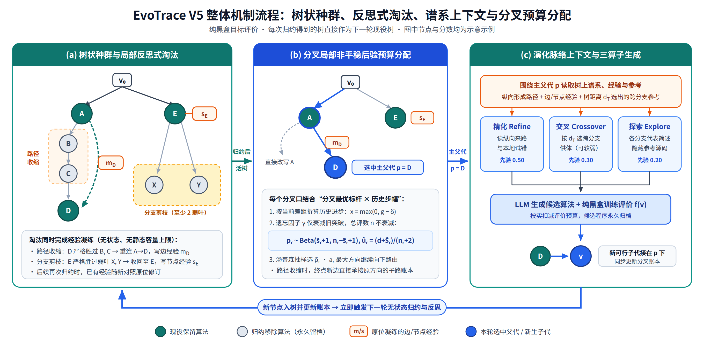
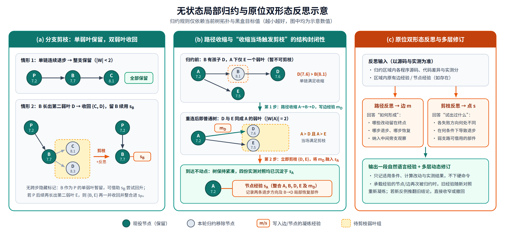
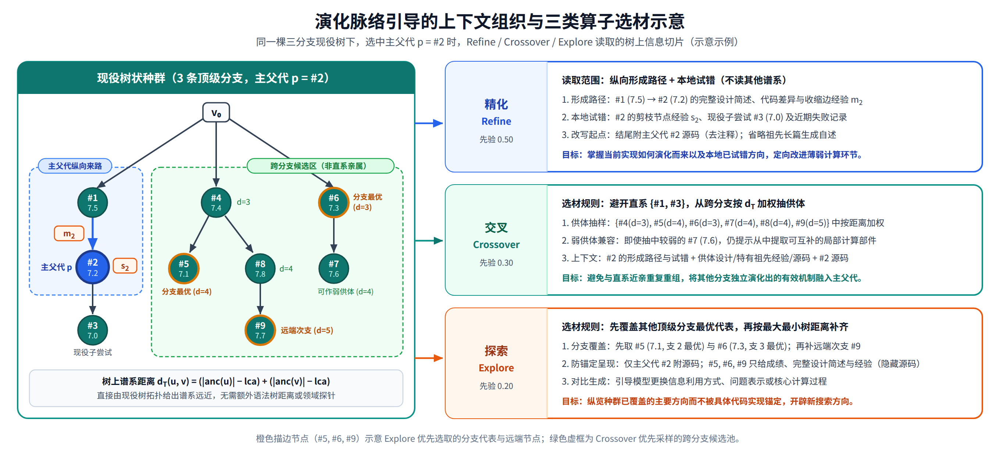
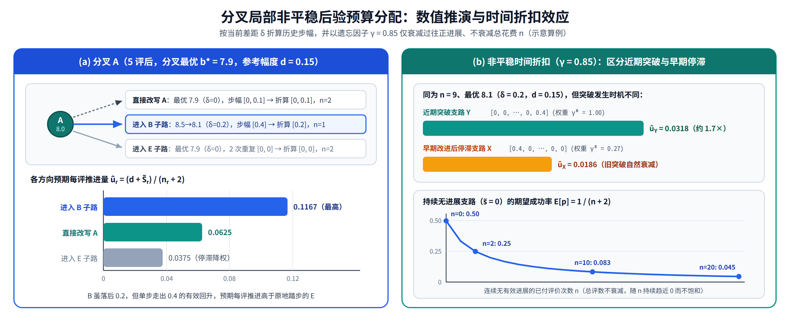

# EvoTrace V5：树状启发式种群与反思式淘汰

> **文档说明**：本文给出 EvoTrace V5 的机制设计，采用基于大语言模型的自动启发式设计（automatic heuristic design, AHD）领域标准术语与表述风格。文中示例的数值与代码片段仅用于说明机制流程，不代表在线实验结果。

---

## 概述

基于大语言模型（LLM）的自动启发式设计通过在给定外层求解器内反复生成、修改并评价可执行启发式函数，在有限评价预算内优化目标值。在此过程中，每个已评价的启发式同时承担两种角色：它既是问题求解方案，也是后续派生新启发式的父代。

EvoTrace V5 将候选启发式组织为一棵动态有根树，使**种群淘汰与反思总结在同一次树结构简化中完成（反思式淘汰）**，并由简化后的树直接支撑后续的**演化上下文构造**与**分层父代选择**（图 1）：

1. **树状种群表示（第 2 节）**：以有根树 $T$ 记录启发式间的父子派生关系，在重连边上保存**边经验** $E_{u\to w}$，在节点上保存**节点经验** $E_u$，并由树拓扑自然定义启发式间的树上距离 $d_T$。
2. **反思式淘汰（第 3 节）**：不依赖全局种群容量上限或人工代码距离阈值，仅依据当前树拓扑与实测目标值执行两条局部简化规则——**分支剪枝**与**路径收缩**；每次移除节点时，原位将代码修改与目标值变化总结为边经验或节点经验，并在后续简化中结合新结果修订原有经验。
3. **演化上下文与搜索算子（第 4 节）**：围绕选定的主父代，按**精化（Refine）**、**交叉（Crossover）**与**探索（Explore）**的分工从树上组织提示上下文，并依据树上距离 $d_T$ 选取跨分支参考启发式与分支代表。
4. **分层父代选择（第 5 节）**：自根节点沿树逐层选择分支，在每个内部节点依据各分支相对当前局部最优目标值的改善幅度与折扣历史统计，采用汤普森抽样（Thompson sampling）决定下一轮扩展的主父代。



> **图 1｜EvoTrace V5 的种群更新与启发式生成流程。** （a）树上局部发生路径收缩（移除中间节点 $B, C$ 并生成边经验 $m_D$）与分支剪枝（移除弱叶 $X, Y$ 并更新节点经验 $s_E$）；（b）简化后的树直接用于自顶向下的分层父代选择，选定主父代 $p = D$；（c）按所选算子组织谱系上下文与跨分支参考，经 LLM 生成并评价新启发式 $v$ 后接入父代 $p$ 下方，进入下一轮更新。

---

## 1. 问题背景与相关方法

遵循主流基于 LLM 的 AHD 研究（FunSearch、EoH、ReEvo、MCTS-AHD），现有方法在组织历史搜索记录时存在三类典型权衡：

1. **固定规模种群丢弃局部演化记录**：以 FunSearch、EoH 为代表的种群方法按目标值维持固定大小的启发式集合，低分个体直接淘汰。在启发式代码演化中，结构性修改常先引起目标值暂时退化、再经后续修改获得改善；立即截断既会中断此类非单调改进路径，也丢失了局部父子对比信息。
2. **语言反思与父代谱系解耦**：ReEvo、RefineEvo、MEMOIR 等方法通过短期或长期反思将经验汇总至全局提示文本或外部经验池。经验脱离产生它的具体父代实现后，容易泛化为缺乏适用条件的宽泛结论，后续出现反例时也难以在对应位置原位修正。
3. **搜索树规模控制依赖全局超参数**：MCTS-AHD 与 Clade-AHD 在树中保留全部已生成启发式，树规模随评价预算持续增长；EvoTrace V4 引入代表集容量 $K$、AST 距离阈值 $\delta$ 与区域批大小 $m$ 控制树简化，但将淘汰时机绑定于多个人工全局阈值。

下表概括 EvoTrace V5 与代表性 AHD 方法的结构差异：

| 方法 | 种群结构 | 淘汰 / 简化机制 | 经验存储与修订 | 父代与参考选择 |
| --- | --- | --- | --- | --- |
| **FunSearch / EoH** | 岛屿 / 扁平种群 | 按目标值与容量截断 | 无淘汰反思 | 基于目标值 / 排名抽样 |
| **ReEvo / RefineEvo** | 扁平种群 + 经验池 | 种群更新与反思分离 | 全局长期反思或正负经验池 | 基于适应度抽样 |
| **MCTS-AHD / Clade-AHD** | 搜索树 | 节点扩展选择或冻结子树 | 无随局部简化生成的边/节点经验 | UCT / 子树后代统计 |
| **EvoTrace V4** | 有根树 | 全局 $K$ 代表 + 半径 $\delta$ + 满 $m$ 批归约 | 满 $m$ 区域生成边/节点经验 | 全树排名折扣抽样；AST 距离选参考 |
| **EvoTrace V5（本文）** | **动态有根树** | **无全局容量/距离阈值；分支剪枝 + 路径收缩** | **随每次局部简化原位生成边/节点经验，并随后续简化动态修订** | **分层分支进展抽样；树上距离 $d_T$ 选参考** |

---

## 2. 问题设置与树状种群

遵循标准基于 LLM 的 AHD 协议，任务在固定外层求解器（如逐步贪心构造、蚁群优化或引导式局部搜索）内设计一个关键启发式函数。每个候选启发式 $v$ 为符合给定函数签名的 Python 程序，在训练实例集上运行外层求解器得到平均目标值 $f(v)$（统一按最小化表述，越小越优）。正常执行并返回有限目标值的程序称为**可行启发式**，抛出异常或超时的程序记录错误信息；每次实际执行的评价均计入总预算 $B$。搜索结束时返回全程训练目标值最优的可行启发式，并在独立测试集上评估其泛化性能。

EvoTrace V5 将搜索种群维护为一棵有根树 $T = (\mathcal{V} \cup \{v_0\}, \mathcal{E})$（实现见 [models.py](../evotrace_v5/models.py)）：

- **节点与派生边**：$v_0$ 为不含代码与目标值的虚拟根，用于连接各初始启发式；$\mathcal{V}$ 为当前留在树中的可行启发式节点集合；$\pi(v)$ 表示节点 $v$ 的父节点，$\operatorname{Ch}(u) = \{v \in \mathcal{V} : \pi(v) = u\}$ 表示 $u$ 的直接子节点集合。每个节点保存源码 $c_v$、设计简述 $d_v$ 与实测目标值 $f(v)$。被移出树的程序仍保存在历史记录中，不影响最终最优启发式的返回。
- **边经验与节点经验**：每条有向边 $\pi(v) \to v$ 可附带一段自然语言**边经验** $E_{\pi(v)\to v}$（记作 $m_v$），概括沿祖先链演化至 $v$ 的修改与结果；每个算法节点 $u \in \mathcal{V}$ 可附带一段**节点经验** $E_u$（记作 $s_u$），概括从 $u$ 派生并被剪除的旁支尝试。
- **严格优劣关系 $u \succ v$**：当可行节点 $u, v \in \mathcal{V}$ 满足 $f(u) < f(v)$（超出浮点舍入容差）时，记作 $u \succ v$；目标值持平时互不支配。
- **树上距离 $d_T(u, v)$**：记 $\operatorname{anc}(u)$ 为从 $v_0$ 的直接子节点到 $u$ 的节点路径，$\ell(u, v)$ 为 $\operatorname{anc}(u)$ 与 $\operatorname{anc}(v)$ 的最长公共前缀长度，两节点在树上的最短边数距离为：
  $$d_T(u, v) = \bigl(|\operatorname{anc}(u)| - \ell(u, v)\bigr) + \bigl(|\operatorname{anc}(v)| - \ell(u, v)\bigr).$$
  若 $\ell(u, v) < \min(|\operatorname{anc}(u)|, |\operatorname{anc}(v)|)$，则 $u$ 与 $v$ 互不为祖先或后代，称为**跨分支节点**。

---

## 3. 反思式淘汰

在树状种群中，节点淘汰与反思总结统一于同一次局部树简化：由局部目标值偏序确定无需独立保留的过渡节点或劣质叶节点，在将其移出树的同时，将对应代码修改与目标值变化原位总结为边经验或节点经验（图 2，实现见 [topology.py](../evotrace_v5/topology.py) 与 [reflection.py](../evotrace_v5/reflection.py)）。



> **图 2｜局部简化规则与原位反思机制。** （a）父节点存在至少两个严格劣于自身的叶节点时触发分支剪枝，单弱叶暂留，刚完成剪枝的节点携新节点经验 $s_B$ 保留；（b）单链后代严格优于中间节点时触发路径收缩并生成边经验 $m_D$，重连后若满足剪枝条件则继续在同一更新周期内剪枝并将 $m_D$ 并入 $s_A$；（c）反思直接对照源码修改、实测目标值与已有经验，输出一段设计经验并支持依据反例修订旧结论。

### 3.1 局部简化规则

因虚拟根 $v_0$ 不对应启发式程序，以下两条规则中的父节点 $P$ 与路径端点 $A, D$ 均限定为真实节点 $\mathcal{V}$：

1. **分支剪枝（Branch Pruning）**：对节点 $P \in \mathcal{V}$，定义其严格劣于自身的叶节点集合为
   $$W(P) = \{B \in \operatorname{Ch}(P) : \operatorname{Ch}(B) = \varnothing \;\land\; P \succ B\}.$$
   当 $|W(P)| \ge 2$ 时，将 $W(P)$ 中的叶节点移出 $\mathcal{V}$，并触发**剪枝反思**更新节点经验 $E_P$。
2. **路径收缩（Path Contraction）**：对不含活分叉的单链 $A \to v_1 \to \dots \to v_k \to D$（$k \ge 1$，且中间节点满足 $|\operatorname{Ch}(v_j)| = 1$），若末端节点 $D$ 严格优于全部中间节点：
   $$\forall j \in \{1, \dots, k\},\quad D \succ v_j,$$
   则选取满足条件的最大连续中间段 $(v_1, \dots, v_k)$ 移出 $\mathcal{V}$，重连父边 $\pi(D) \leftarrow A$，并触发**路径反思**写入边经验 $E_{A\to D}$。路径收缩不对端点 $A$ 与 $D$ 的相对优劣作额外要求。

每当新可行启发式接入树后，算法按**叶端优先（后序遍历）、先剪枝后收缩**的确定性顺序反复查找并执行简化，直至达到不动点。上述规则仅依赖当前树拓扑与目标值，不引入额外节点状态标记，并具有以下结构特征：

- **允许非单调演化**：分支剪枝阈值取 $2$ 而非 $1$，使单次退化形成的单弱叶或连续单链暂留于树中，为先退化后改善的结构性修改留出扩展机会；节点 $B$ 在收回自身弱叶获得新经验 $E_B$ 后，若其本身为父代 $P$ 的唯一弱叶，也可继续借助 $E_B$ 派生后代。
- **单调链压缩与级联闭环**：连续改进链与低谷回升链均被折叠为单条重连边；每次简化所得仍为标准有根树，若重连后的邻接关系立即满足剪枝条件（如图 2(b)），会在本轮继续执行剪枝。
- **仅向直接父代回退**：只要子代目标值不劣于其父代，即使其他兄弟分支目标值更优，该子代仍保留在树中参与第 5 节的父代选择。

### 3.2 原位反思与跨轮修订

每次简化在调整树指针前触发一次 LLM 反思：

- **路径反思**（写入重连边 $E_{A\to D}$）：读取起点 $A$、中间节点与终点 $D$ 的去注释源码、紧凑代码差异、目标值变化及沿途已有经验，概括最终保留的计算修改、引发退化或带来改善的步骤。
- **剪枝反思**（更新父节点 $E_P$）：读取父节点 $P$ 及其原有节点经验 $E_P$，以及各被剪叶节点的源码、差异、目标值变化与原有经验，概括从 $P$ 测试过的修改方向、退化条件以及劣质分支中仍具价值的局部组件。

反思提示遵循三项约束：（1）**以源码与实测为准**，不将生成阶段的设计自述输入反思，按代码实际计算的量识别组件；（2）**克制归因、不作指令式建议**，仅当单步改动隔离单一变化时归因，多处同步改动报告组合效果，经验仅陈述适用条件、计算修改与实测变化；（3）**跨轮反例修订**，当携带旧经验的节点或边在后续更新中再次被移除时，原有经验随新对照一并进入反思，依据新证据收窄适用条件或撤回过时结论。

#### 示例 1：简化联动与反例修订

- **收缩触发剪枝**：设局部拓扑为 `A(7.2) → B(8.1) → D(7.6)` 与 `A(7.2) → E(7.5)`。首先对单链执行路径收缩，移出 `B`、重连 `A → D` 并写入边经验 $E_{A\to D}$；随后在更新后的树上检测到 $W(A) = \{D, E\}$，将 `D`（连同 $E_{A\to D}$）与 `E` 一并剪除，合并总结写入节点经验 $E_A$。
- **基于反例的经验修订（CVRP 示意）**：父代 `P (8.538)` 在首次剪枝时移除了两个忽略车辆载重约束的构造启发式（`8.920` 与 `8.815`），形成节点经验 $E_P$；后续沿 `P` 演化出路径 `P (8.538) → M (8.610) → Q (8.236)`（在节约法启发式中引入显式载重可行性掩码与剩余容量归一化）并触发路径收缩时，反思结合旧经验与 `Q (8.236)` 的实测反例，将结论修订为“忽略容量的构造项引起退化，而引入显式容量约束与剩余容量归一化的节约项将目标值由 `8.538` 改善至 `8.236`”。

---

## 4. 演化上下文与搜索算子

在选定主父代 $p \in \mathcal{V}$ 后，算法按固定先验概率抽样**精化（Refine）**、**交叉（Crossover）**或**探索（Explore）**算子，并从树 $T$ 中构造对应的提示上下文（图 3，实现见 [allocation.py](../evotrace_v5/allocation.py) 与 [context.py](../evotrace_v5/context.py)）。每次生成调用按顺序输出 `analysis`、`code` 与 `design` 三个字段，其中 `design` 为忠实于实现代码 $c_v$ 的计算简述 $d_v$。



> **图 3｜三类搜索算子的上下文组织与树距离选材。** 围绕主父代 `#2`：Refine 组织纵向形成路径（`#1 → #2`）与本地试错；Crossover 排除祖先与后代 `#1, #3`，按树上距离 $d_T$ 从跨分支抽取参考启发式（允许目标值较弱的 `#7`）；Explore 覆盖其他顶级分支的最优代表 `#5, #6` 并按最大最小树距离补齐远端节点 `#9`，仅展示设计简述与经验以防源码模仿。

1. **精化（Refine）**：沿主父代 $p$ 的形成路径依次展示各祖先节点的目标值变化、设计简述 $d$、紧凑代码差异以及边/节点经验，随后给出 $p$ 的节点经验 $E_p$、仍在树上的直接子节点结果与近期执行失败记录，最后给出 $p$ 的去注释源码 $c_p$。当 $p$ 已存在存活直接子节点时，提示明确说明这些子分支已在探索中，引导模型尝试不同修改方向；祖先节点生成时的长篇 `analysis` 不进入上下文。
2. **交叉（Crossover）**：从另一条独立分支引入互补计算组件。候选池 $\mathcal{D}_{\text{cross}}(p)$ 优先排除 $p$ 的祖先与后代（仅当整棵树退化为单链时回退至 $\mathcal{V}\setminus\{p\}$），并按树上距离加权抽样参考启发式 $q$：
   $$P_{\text{donor}}(q \mid p) = \frac{d_T(p, q)}{\sum_{u \in \mathcal{D}_{\text{cross}}(p)} d_T(p, u)}.$$
   抽样不按目标值截断，允许总目标值弱于 $p$ 的启发式贡献局部有效组件。提示在 Refine 的主父代路径与 $c_p$ 之间插入 $q$ 的相对目标值、设计简述 $d_q$、$q$ 及其特有祖先的局部经验以及源码 $c_q$。
3. **探索（Explore）**：旨在跳出已有实现结构，设计新的问题表示或主要计算方式。参考集 $\mathcal{R}$（规模上限 $M$）的构造分两步：首先从除 $p$ 所在顶级分支外的每条顶级分支选取目标值最优的分支代表；若数量不足 $M$，再从剩余可行节点中按最大最小树距离贪心补齐（同距取目标值更优者）：
   $$q^* = \arg\max_{q \in \mathcal{V} \setminus (\{p\} \cup \mathcal{R})} \min_{u \in \{p\} \cup \mathcal{R}} d_T(q, u).$$
   提示仅给出主父代 $p$ 的设计简述与源码 $c_p$，其余参考启发式按目标值由优到劣排列，**仅提供设计简述与相关经验，不提供参考源码**，以降低实现层面的模仿锚定。

当上下文包含历史经验时，提示明确将其界定为特定实现条件下的实测观察，而非不可违背的约束，允许在新计算结构下重新检验。

#### 示例 2：主父代 `#2` 下三类算子的提示上下文结构

```text
【Refine（主父代 #2）】
  [Development]  #1 (7.5): 仅依据欧氏距离选择最近节点
                 → #2 (7.5 -> 7.2 improved): 加入 5 近邻孤立度权重 + 边经验 m_2
  [Attempts]     节点经验 s_2（平方惩罚与最远点回拉均引起退化）
                 + 存活直接子代 #3 (7.0，提示尝试不同于 #3 的修改方向)
  [Current Code] #2 的去注释源码。

【Crossover（主父代 #2，跨分支参考 #7）】
  同 Refine 的 [Development] 与 [Attempts]
  + [Donor]      #7 (7.6, worse than current 7.2): 设计简述（两步前瞻折返代价）+ #7 源码
  + [Current Code] #2 的去注释源码。

【Explore（主父代 #2，分支代表 #5, #6, #9）】
  [Current Algorithm]    #2 (7.2) 的设计简述与源码（唯一提供的源码）
  [Other Approaches]     #5 (7.1 最小生成树下界)、#6 (7.3 动态遗憾)、#9 (7.7 凸包夹角)——不提供源码
  [Relevant Experiences] 上述节点关联的边经验与节点经验。
```

---

## 5. 分层父代选择

在树状种群中，所有存活节点均可作为父代继续扩展。若仅依据目标值分配预算，评价机会容易过度集中于已停滞的高分个体；若仅按访问次数均摊，则会消耗预算于持续无改善的分支。EvoTrace V5 采用自顶向下的分层分支选择，在每个分叉节点结合**当前局部最优目标值**与**各分支的折扣历史改善统计**分配评价机会（图 4，实现见 [allocation.py](../evotrace_v5/allocation.py)）。



> **图 4｜分层分支选择与折扣因子效应示意。** （a）节点 `A` 处，当前最优目标值落后 `0.2` 的子分支 `B` 因近期产生 `0.4` 的目标值改善，其相对局部最优的预期单评改善高于直接扩展 `A` 与已停滞的子分支 `E`；（b）折扣因子 $\gamma = 0.85$ 使近期产生改善的分支高于早期改善后停滞的分支，持续无改善分支的期望改善概率随评价次数单调下降。

### 5.1 逐层分支路由与统计维护

父代选择从虚拟根 $v_0$ 递归向下：
- 在真实节点 $u \in \mathcal{V}$ 处，候选分支集合 $\mathcal{R}(u)$ 包含直接扩展当前节点 $\text{direct}(u)$ 与进入各直接子节点对应的子树分支 $\{\text{branch}(c) : c \in \operatorname{Ch}(u)\}$。每棵子树在 $u$ 处仅对应一个候选分支，其竞争权重不随子树内节点数量放大。若仅存在单个候选分支（如叶节点仅能直接扩展），则直接选定。
- 每个候选分支 $r$ 按评价顺序维护统计记录 $H_r = (b_r, n_r, (g_{r,1}, \dots, g_{r,n_r}))$，分别为该分支的历史最优目标值、已投入评价次数及历次评价的目标值改善量。一次评价完成后，沿本次路由路径更新末端直接扩展统计及沿途各子树分支统计：若本次可行子代满足 $f(v) < b_{r,\text{前}}$，则记录改善量 $g_{r,t} = b_{r,\text{前}} - f(v)$ 并更新 $b_r \leftarrow f(v)$，否则记录 $g_{r,t} = 0$。
- **路径收缩下的统计继承**：当路径收缩将 $A \to v_1 \dots v_k \to D$ 重连为 $A \to D$ 时，新分支 $\text{branch}(D)$ 直接继承原入口节点 $v_1$ 的子树统计 $H^{\text{br}}_{v_1}$，保持该子树的完整历史评价记录不丢失。

### 5.2 面向局部最优差距的折扣汤普森抽样

在包含多个候选分支的节点 $u$ 处，记当前局部最优目标值（local incumbent）与各分支差距为：
$$b_* = \min_{r \in \mathcal{R}(u)} b_r, \qquad \delta_r = b_r - b_* \ge 0.$$
将分支 $r$ 历史上第 $t$ 次评价的目标值改善量 $g_{r,t}$ 扣除当前差距 $\delta_r$，得到该改善幅度若再次出现时可超越局部最优 $b_*$ 的超额改善量：
$$x_{r,t} = \max(0,\; g_{r,t} - \delta_r).$$
引入折扣因子 $\gamma \in (0, 1]$（默认 $\gamma = 0.85$）对历史正向改善证据施加指数衰减，同时保留未衰减的总评价次数 $n_r$：
$$\tilde{s}_r = \sum_{t=1}^{n_r} \gamma^{n_r - t}\,\mathbb{I}(x_{r,t} > 0), \qquad \tilde{S}_r = \sum_{t=1}^{n_r} \gamma^{n_r - t}\,x_{r,t}.$$

由此构造各分支超越局部最优的后验概率与平滑改善幅度：
1. **改善概率后验**：取均匀先验 $\operatorname{Beta}(1,1)$，后验分布为 $p_r \sim \operatorname{Beta}(\tilde{s}_r + 1,\; n_r - \tilde{s}_r + 1)$，期望为 $\frac{\tilde{s}_r + 1}{n_r + 2}$。未评价分支初始期望为 $1/2$，持续无改善分支随 $n_r$ 增大趋近于 $0$，近期改善保留满权重。
2. **平滑改善幅度**：取该节点全部加权正改善的均值 $d = \frac{\sum_r \tilde{S}_r}{\sum_r \tilde{s}_r}$（当 $\sum_r \tilde{s}_r > 0$）作为共享先验尺度，计算平滑幅度 $a_r = \frac{d + \tilde{S}_r}{\tilde{s}_r + 1}$。

决策时对每个分支独立抽样 $\tilde{p}_r \sim \operatorname{Beta}(\tilde{s}_r + 1, n_r - \tilde{s}_r + 1)$，选择 $\tilde{p}_r a_r$ 最大者继续向下路由（当该节点尚无任何正 $x_{r,t}$ 时，直接比较 $\tilde{p}_r$）。[Agrawal & Goyal, 2012](https://proceedings.mlr.press/v23/agrawal12/agrawal12.pdf)

#### 示例 3：5 次评价后的局部选择对比

设初始节点 `A (8.0)` 经过 5 次评价：直接扩展 `A` 生成 `B (8.5)` 与 `E (7.9)`；进入子分支 `B` 生成 `C (8.1)`（改善量 `0.4`）；进入子分支 `E` 两次均停留在 `7.9`。此时局部最优 $b_* = 7.9$，共享改善尺度 $d = (0.1 + 0.2)/2 = 0.15$：

| 节点 `A` 的候选分支 | 分支最优 $b_r$ | 差距 $\delta_r$ | 历史改善 $g_t$ | 超额改善 $x_t$ | 期望改善概率 | 平滑幅度 $a_r$ | 预期单评改善 |
| --- | ---: | ---: | --- | --- | ---: | ---: | ---: |
| 直接扩展 `A` | `7.9` | `0.0` | `[0, 0.1]` | `[0, 0.1]` | `0.500` | `0.125` | `0.0625` |
| **子分支 `B`** | **`8.1`** | **`0.2`** | **`[0.4]`** | **`[0.2]`** | **`0.667`** | **`0.175`** | **`0.1167`** |
| 子分支 `E` | `7.9` | `0.0` | `[0, 0]` | `[0, 0]` | `0.250` | `0.150` | `0.0375` |

子分支 `B` 尽管当前目标值落后 `0.2`，但近期产生了超过该差距的改善量，因此获得最高预期单评改善；已停滞的子分支 `E` 权重相应降低。

---

## 6. 整体搜索流程

```text
算法 1：EvoTrace V5
输入：任务接口、训练评价函数 f、评价预算 B、初始规模 N_0、折扣因子 γ
初始化：仅含虚拟根 v_0 的树 T，空经验集 (E_edge, E_node)，空分支统计 L

1. 初始化阶段：在 v_0 下反复生成并评价候选启发式，直至获得 N_0 个源码互异的可行初始启发式。
2. 主演化循环（在预算 B 内且树非空）：
   (a) 分层父代选择（第 5 节）：自 v_0 沿 T 逐层执行折扣汤普森抽样，选定主父代 p ∈ V。
   (b) 算子与上下文构造（第 4 节）：按固定概率抽样算子（Refine / Crossover / Explore），
       依据树上距离 d_T 选取参考启发式或分支代表，构造提示并生成候选 v。
   (c) 评价与入树：运行外层求解器评价 v（至多单次修复，均计入预算）；
       若 v 可行且与当前树中节点源码不重复，则接入 p 下方。
   (d) 统计更新：沿路由路径更新末端直接扩展及沿途各子树分支的评价统计 L。
   (e) 反思式淘汰（第 3 节）：在树上按叶端优先、先剪枝后收缩循环执行简化直至不动点：
       • 每次简化前原位调用反思生成或修订边经验 / 节点经验；
       • 应用树结构重连并同步更新统计 L。
3. 返回全程训练目标值最优的可行启发式，并在独立测试集上评估泛化性能。
```

#### 单轮端到端追踪示意

设第 13 次评价后树上包含分支 `v0 → A(7.20) → B(7.90) → C(8.05)`、`A → E(7.60)` 与 `v0 → F(7.30) → G(7.10)`：
1. **父代选择**沿 `v0 → A → B → C` 选定主父代 `C`，抽样得到算子 `Refine`。
2. **上下文与生成**读取 `C` 的形成路径 `A → B → C` 及源码 $c_C$，生成并测得新子代 `D (7.50)`，接入 `C` 下方并更新沿途分支统计。
3. **反思式淘汰**：
   - 首先触发**路径收缩**：`D (7.50)` 同时严格优于 `B (7.90)` 与 `C (8.05)`，原位路径反思写入边经验 $E_{A\to D}$，移除 `{B, C}`、重连 `A → D` 并继承原 `B` 的子树统计；
   - 随后触发**分支剪枝**：重扫发现 $W(A) = \{D (7.50), E (7.60)\}$，原位剪枝反思综合 `A, E, D` 及刚生成的 $E_{A\to D}$ 更新节点经验 $E_A$，移除 `{D, E}`。
4. 后续再次选定 `A` 时，Refine 可直接利用由 `B, C, D, E` 总结而来的节点经验 $E_A$；若抽样得到 Crossover，树上距离将引导参考启发式从另一分支 `{F, G}` 中选取。

---

## 7. 实验验证设计与实现索引

### 7.1 消融与对照设计

| 验证目标 | 对照组设置 | 核心观测指标 |
| --- | --- | --- |
| **整体求解性能** | 在 TSP、CVRP、FSSP、OP 四项组合优化任务（3 随机种子，$B=1000$）上，对比完整 EvoTrace V5 与 EoH、ReEvo、MCTS-AHD、Base 及 EvoTrace V4。 | 独立测试集目标值、评价预算利用率及总模型调用与词元开销。 |
| **反思式淘汰贡献** | 完整 V5 vs. 关闭反思（保留相同树简化与分层选择）vs. 不执行简化的纯生长树。 | 区分局部树简化与原位经验总结的各自净贡献，并观测树节点规模演化。 |
| **上下文与树距离选材** | 有经验 vs. 无经验；树上距离选参考/代表 vs. 随机采样；Explore 隐藏 vs. 展示参考源码。 | 局部生成质量、分支结构多样性与完整搜索测试目标值。 |
| **分层分支选择** | 折扣因子 $\gamma=0.85$ vs. 无折扣 $\gamma=1.0$ vs. 全树扁平父代选择。 | 停滞分支预算占比与非单调分支的后续改善表现。 |

### 7.2 默认参数与源码索引

| 模块 | 默认参数与核心职责 | 源码路径 |
| --- | --- | --- |
| **数据模型** | 预算 $B=1000$、初始规模 $N_0=5$、三字段 JSON 输出（`analysis` / `code` / `design`） | [models.py](../evotrace_v5/models.py) |
| **局部简化与去重** | 分支剪枝（$|W(P)|\ge 2$）、路径收缩、忽略注释与排版的规范 AST 精确去重 | [topology.py](../evotrace_v5/topology.py) |
| **原位反思** | 反思温度 `0.3`，直接对照源码修改与实测目标值输出约 60–120 词经验段落 | [reflection.py](../evotrace_v5/reflection.py) |
| **上下文与算子** | 算子先验 `(0.50, 0.30, 0.20)`、Explore 参考上限 $M=5$、上下文长度保护 `90,000` 字符 | [context.py](../evotrace_v5/context.py) · [allocation.py](../evotrace_v5/allocation.py) |
| **分层父代选择** | 自顶向下 Beta 后验汤普森抽样，默认折扣因子 $\gamma = 0.85$ | [allocation.py](../evotrace_v5/allocation.py) |
| **搜索主循环** | 单次格式/运行修复、`pending.json` 与 JSONL 断点续跑、反思开关消融支持 | [search.py](../evotrace_v5/search.py) · [cli.py](../evotrace_v5/cli.py) |
