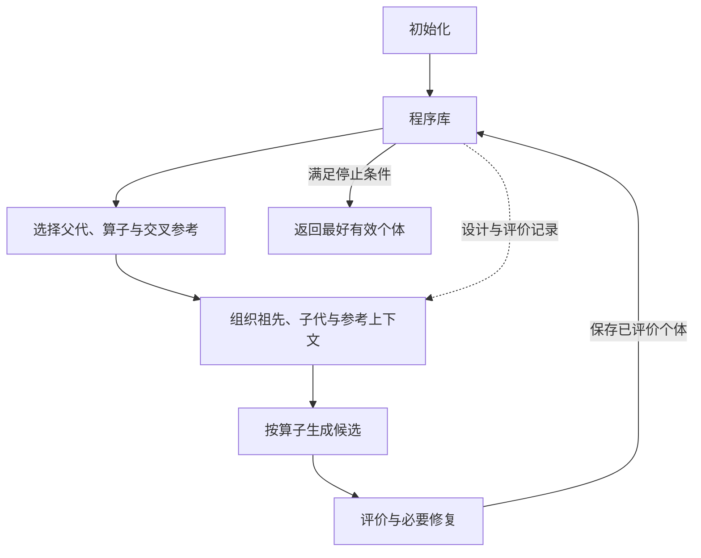
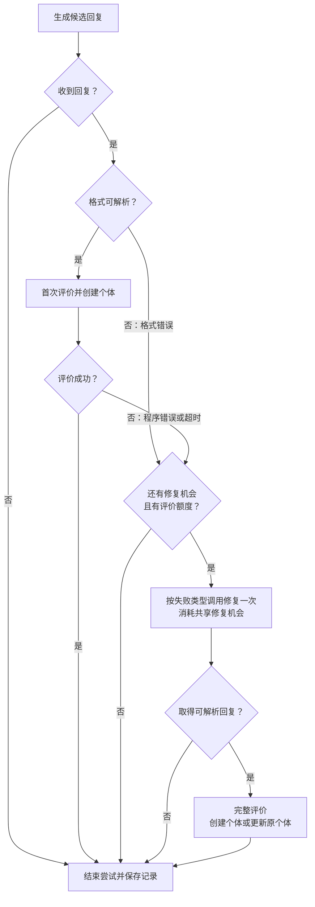

# TraceAAD Base：基础方法说明

独立实现与运行方式见 [`traceaad_base`](../traceaad_base/README.md)。

TraceAAD Base 利用演化轨迹指导自动算法设计（automatic algorithm design，AAD）。大模型在固定求解框架中设计指定函数，评估器将其接入框架并评价求解结果。搜索目标是在给定评价预算内找到成绩最好的有效算法。

程序库保存候选的分析、设计、代码、来源与评价。祖先和已有子代的记录指导后续生成，直接子代的质量与调用成本指导父代选择。初始化提供算法起点，随后反复选择、生成与评价，直至满足停止条件。



## 1. 程序个体

程序个体（program individual）表示一个候选算法，是搜索的基本单位，记录其分析、设计、代码、演化来源和评价结果：

```text
Program {
    id             个体编号
    analysis       本次设计或修改的计算变化及其依据
    code           待设计函数的完整实现（含导入与辅助函数）
    design         设计说明
    operator       生成操作（Init / Refine / Explore / Crossover）
    parent_id      父代个体编号
    reference_id   交叉参考个体编号（仅 Crossover 填写）
    evaluation {
        status     评价状态
        fitness    评价成绩，越小越好（失败时为空）
        failure    失败信息（成功时为空）
    }
}
```

生成个体从 `1` 开始编号，初始化个体的 `parent_id` 为 `0`。有样例时，0 号保存样例代码与已有设计说明，其余字段为空；无样例时，以 0 表示虚拟父代，不创建记录。样例仅用于初始化参考，不参与评价、父代或交叉参考选择，也不作为最终结果。

## 2. 程序库

程序库（program archive）以 `id → Program` 的映射保存全部个体。生成程序在首次评价后入库，修复更新原记录；有效个体参与父代选择，最终失败个体通过失败历史指导后续生成。

各次生成的个体独立保存，不做代码去重。每条记录的分析、设计、代码与评价对应同一版本。`analysis` 随子代保存，通过 `parent_id` 关联父代，无须另建边对象。

## 3. 个体生成操作

个体生成操作（Generate）以任务、相关算法和算子指令为输入，调用大模型依次生成分析、设计说明与完整实现：

```text
Generate(
    task_description,  任务说明
    template_program,  任务提供的函数模板（可含初始参考实现）
    context,           相关个体及历史上下文（可空）
    instruction        算子指令
) → {
    analysis       采用或修改哪些计算、依据是什么、如何影响决策
    design         算法实际决策机制的完整说明
    code           符合接口的完整源码
}
```

编号与演化来源由搜索过程记录，评价结果由评估器给出。一次生成及其必要修复、评价构成一次尝试；当前尝试结束并完成记录与统计更新后，再开始下一次。

生成与修复统一使用采样温度 **1.0**，最大输出长度为 **16,384 tokens**。

模型请求使用 JSON Schema 约束输出：`analysis`、`design`、`code` 为三个必填字符串，不允许额外字段。解析后检查字段是否为空或仅含空白；格式错误沿用一次修复流程。

### 3.1 公共提示模板

任务说明给出问题、求解目标与待设计函数的作用；函数模板给出签名与输入输出；算子指令提出本次设计要求。这一组织方式参照 [EoH、ReEvo 等方法](记录/2026-10-30-AAD任务与接口提示核对.md)。例如，在线装箱的待设计函数为箱子优先级函数，固定框架据此选择可行箱子，最终目标是减少箱子使用数。

`function_template` 是 `template_program` 的接口展示形式：保留导入、函数签名与输入输出说明，函数体以 `pass` 占位。完整样例代码单列于初始化上下文。

````text
{task_description}

Implement the following Python function:
```python
{function_template}
```

[Context]
{context}

[Instruction]
{instruction}

[Output]
Return exactly one valid JSON object with three string fields, in this order:
- "analysis": In 2–3 concise sentences, using at most 100 English words or 200 Chinese characters, explain the algorithmic rationale of the proposed change, the evidence that motivates it, and its expected effect on solving the task.
- "design": Describe the final algorithm implemented in "code" in one self-contained paragraph of 2–3 concise sentences, using at most 100 English words or 200 Chinese characters. State the solution representation, the main solving principle, and how the procedure determines the returned result.
- "code": Provide the complete implementation of the required function, including necessary imports and helper definitions. Do not include comments or docstrings.
First determine a complete executable algorithm; then make "analysis" and "design" accurately describe the final "code".
Preserve the required function signature and satisfy the task constraints and input/output requirements.
Return only the JSON object, without Markdown fences or additional text.
````

无上下文时省略 `[Context]`。提示中的 `Score` 沿用任务评价指标；若任务说明未给出指标含义或方向，在成绩材料前补充一次，例如“平均路径长度，越小越好”。

## 4. 初始化

初始化结合已有算法与评价反馈，逐次生成采用不同核心决策机制的算法起点。

### 4.1 生成上下文

初始化沿用公共提示模板，按以下顺序提供材料：

- **可选样例**：0 号样例的完整代码与已有设计说明。
- **有效初始个体**：全部有效初始个体的编号、设计、完整代码与成绩，按成绩从优到劣排列，同分时按编号升序排列。
- **失败尝试**：按第 5.1 节的失败历史窗口，从 `parent_id=0` 下选取并呈现失败个体。

八个基准任务均以 `template_program` 中的极简实现作为默认样例，见[任务初始参考代码](记录/2026-10-30-任务初始参考代码.md)。

没有对应材料时省略该部分；样例没有设计说明时省略 `Design` 行。`Algorithm` 块按个体重复，编号沿用程序库中的 `id`：

````text
[Example Algorithm]
Design: {example.design}
```python
{example.code}
```

[Existing Algorithms]
Listed best first. Lower scores are better.

Algorithm {program.id}
Parent: Algorithm {program.parent_id}
Analysis: {program.analysis}
Design: {program.design}
Score: {program.evaluation.fitness}
```python
{program.code}
```

[Failed Attempts]
Algorithm {failed_program.id}
Parent: Algorithm {failed_program.parent_id}
Analysis: {failed_program.analysis}
Design: {failed_program.design}
Failure: {failed_program.evaluation.failure}
````

### 4.2 初始化指令

**尚无有效初始个体时**，根据任务设计并实现算法：

```text
Design an effective algorithm for the task described above and implement the specified Python function.
```

**已有有效初始个体时**，结合已有设计与成绩，设计采用不同主要计算的候选：

```text
Design an effective algorithm for the task and implement the specified Python function.
Use the existing algorithms and their scores to identify the decision information they already use.
Develop a solution procedure that obtains useful decision information through a different main computation.
```

提供失败尝试时，追加：

```text
Use the failed designs, their analyses, and evaluation feedback to guide how you implement your design.
```

### 4.3 初始化流程

每次尝试按第 7、8 节完成评价、必要修复与入库。默认收集到 **5 个评价成功的生成个体**后结束初始化；修复结果按同一个体计数。

达到初始化数量且仍有预算时进入演化。若提前触发第 9 节的停止条件，则直接返回已有结果。

## 5. 轨迹上下文与演化算子

演化使用精炼（Refine）、探索（Explore）和交叉（Crossover）三个算子。Refine 与 Explore 属于变异（mutation），分别沿用或改换父代的核心机制；Crossover 整合不同个体的计算。三者均沿用公共生成接口，依次返回 `analysis`、`design` 与完整 `code`。

### 5.1 共同上下文

演化上下文只提供当前父代的完整代码，明确本次设计的出发点；祖先与已有子代通过分析、设计及评价传递局部改进脉络。分析说明改动及其依据，成绩或错误反馈给出评价结果。

- **祖先链**：沿 `parent_id` 回溯，取最近 8 个祖先，排除当前父代与 0 号根；按演化顺序提供编号、父代、生成操作、分析、设计与成绩。
- **有效子代**：取当前父代下最多 3 个评价成功的直接子代。优先保留成绩最好者（同分取编号较大者），再按编号从近到远补充，按编号从旧到新呈现。
- **失败子代**：取当前父代下最近 2 个最终失败的直接子代，按编号从旧到新呈现来源、分析、设计与失败反馈。反馈保留错误类型、关键报错或超时条件，省略重复调用栈。
- **交叉参考**：额外提供一个有效个体的分析、设计、完整代码与成绩，使模型能够直接理解两种算法并进行综合。

历史仅按个体数量限制，不另设 token 上限；不足时按实际数量提供。

各部分按以下顺序组织，没有对应材料时省略。历史中的 `Algorithm` 块按记录重复；交叉产生的记录额外标明 `Reference`，没有分析的样例省略 `Analysis`：

````text
[Ancestor History]
Ancestors of the current algorithm, ordered from earlier to later.

Algorithm {ancestor.id}
Parent: Algorithm {ancestor.parent_id}
Operator: {ancestor.operator}
Analysis: {ancestor.analysis}
Design: {ancestor.design}
Score: {ancestor.evaluation.fitness}

[Evaluated Offspring]
Previous algorithms generated directly from the current algorithm, ordered from earlier to later.

Algorithm {child.id}
Parent: Algorithm {child.parent_id}
Operator: {child.operator}
Analysis: {child.analysis}
Design: {child.design}
Score: {child.evaluation.fitness}

[Failed Offspring]
Failed attempts generated directly from the current algorithm.

Algorithm {failed.id}
Parent: Algorithm {failed.parent_id}
Operator: {failed.operator}
Analysis: {failed.analysis}
Design: {failed.design}
Failure: {failed.evaluation.failure}

[Reference Algorithm]
Algorithm {reference.id}
Analysis: {reference.analysis}
Design: {reference.design}
Score: {reference.evaluation.fitness}
```python
{reference.code}
```

[Current Algorithm]
Algorithm {parent.id}
Parent: Algorithm {parent.parent_id}
Operator: {parent.operator}
Analysis: {parent.analysis}
Design: {parent.design}
Score: {parent.evaluation.fitness}
```python
{parent.code}
```
````

按实际提供的历史，在算子指令后追加相应要求。

**祖先链：**

```text
Read the ancestor sequence as the development of an algorithmic idea.
Use the changes and their evaluated outcomes to decide which direction should be continued, revised, or redirected.
```

**有效子代：**

```text
Read the previous offspring as trials of alternative developments of the current idea.
Use their analyses, designs, and outcomes to develop a meaningful next variant rather than repeating an already tested direction.
```

**失败子代：**

```text
Use the failed offspring and their feedback to understand which proposed directions were not executable or not suitable for the task.
Account for that evidence when choosing and implementing the next algorithm.
```

### 5.2 Refine：沿原机制精炼

沿用父代代码中实际参与决策的核心计算，改进其计算步骤、辅助组件或参数，包含参数调整与简化。适合完善新实现，或沿近期持续改善成绩的设计方向继续开发。

指令：

```text
Develop the current algorithm as a continuation of its solution principle.
Use its implementation, history, and outcomes to identify a specific weakness or opportunity, then make one coherent improvement to the construction method, evaluation rule, search process, or parameters.
Implement a complete algorithm whose decisions remain grounded in the refined principle.
```

### 5.3 Explore：改换核心机制

改变主要决策依据或产生决策信息的机制。适合引入其他求解方法，或在现有方向进展趋缓时探索替代方案。

指令：

```text
Design an alternative solution method based on a different algorithmic principle.
Choose a representation and a construction or search process suited to the underlying problem; the method may reason through auxiliary solutions, future consequences, or a different search space.
Implement the complete method using the available inputs and return the result required by the function interface.
```

### 5.4 Crossover：整合互补计算

将参考设计中的计算适配到父代实现，使双方计算共同参与求解。适合整合能够承担互补作用的设计，例如一方提供候选筛选，另一方提供候选评分。

指令：

```text
Study the current and reference algorithms as two sources of algorithmic ideas.
Identify complementary principles and synthesize them into one coherent solution method, explaining the role of each source and how they work together in the final decisions.
Implement the complete synthesized algorithm using the available inputs and the required function interface.
```

## 6. 父代与生成操作的选择

父代选择以历史产出质量估计继续开发的价值，并结合模型调用成本分配生成机会。

### 6.1 父代候选

程序库中全部评价成功的生成个体均可作为父代。每轮依次选择父代、算子与所需参考，再按第 5 节组织上下文。

### 6.2 开发结果与调用成本

每次演化尝试记录主父代、实际算子、可选参考、模型调用数与最终评价。对父代 \(p\)，累计：

- \(C_p\)：以它为主父代的尝试消耗的模型调用总数，包含生成、修复及失败请求。
- \(\mathcal V_p\)：这些尝试产生的全部最终有效直接子代。

每个有效子代都贡献其质量，是否超过父代或交叉参考不影响计分。一次尝试最多贡献一个最终子代；最终无有效产出时记零。直接生成消耗 1 次调用，经过修复合计消耗 2 次。

交叉的成本与产出归主父代。统计使用全部已完成的演化尝试；提示中的历史窗口只限制展示数量。调用成本与第 9 节的评价预算分别记录。

### 6.3 选择权重

第 \(t\) 轮选择前，将全部父代候选按成绩从低到高排名，记个体 \(x\) 的名次为 \(r_t(x)\)。名次从 1 开始，同分取平均名次。以倒数排名表示当前质量：

\[
q_t(x)=\frac{1}{r_t(x)}.
\]

用父代自身质量平滑单位调用的子代产出质量，得到选择权重与概率：

\[
w_p(t)=\frac{3q_t(p)+\sum_{y\in\mathcal V_p}q_t(y)}{3+C_p},
\qquad
P_t(p)=\frac{w_p(t)}{\sum_j w_j(t)}.
\]

概率归一化时，\(j\) 遍历本轮全部父代候选。常数 3 是初始估计的平滑强度，等效于 3 次调用。未尝试父代的权重为 \(q_t(p)\)；随直接证据增加，选择逐步依据实际产出质量与成本。

父代及历史子代均使用当前名次重算质量，以反映它们在程序库中的竞争位置。倒数排名参照 ShinkaEvolve，直接子代质量参照 QUBE，设计依据见[父代选择定案](记录/2026-10-30-父代选择定案.md)。

### 6.4 算子与交叉参考

选定父代后，按固定概率选择算子：Refine 为 **0.45**，Explore 为 **0.30**，Crossover 为 **0.25**。第 5 节的适用场景说明各算子的设计用途，实际调度使用这一配比。

交叉参考从全部父代候选中筛选：保留成绩不劣于候选成绩中位数者，排除当前父代，再均匀随机选择一个。参考提供设计与成绩，由交叉指令引导模型适配、整合其中的计算。

没有合格参考时，移除 Crossover 并归一化 Refine、Explore 的概率，记录实际执行算子。算子配比与参考选择的依据见[预算分配调研](记录/2026-10-30-TraceAAD预算分配调研.md)。

## 7. 程序评价

程序评价（Evaluate）将生成函数接入固定求解框架，在任务实例上求解、检查结果并计算成绩。

### 7.1 输入与执行

```text
Evaluate(
    code,          生成的完整源码
    task,          基准任务：固定求解框架、评价实例、合法性检查与计分规则
    time_limit     单个个体完成全部实例评价的总时限，单位为秒
) → evaluation {
    status         success / error / timeout
    fitness        有限实数或 null，越小越好
    failure        错误或超时反馈文本，成功时为 null
}
```

评价实例、随机种子、计分规则与总时限采用 task 的配置，各个体使用相同设置。评估器在独立进程中完成代码组装、实例求解、合法性检查与计分。

`fitness` 按任务规则汇总，通常为各实例成绩的平均值；单实例成绩可以是路径长度，也可以是相对差距等归一化指标。

### 7.2 返回结果

| 情况 | 判定条件 | `status` | `fitness` | `failure` |
| --- | --- | --- | --- | --- |
| 成功 | 完成全部评价，输出与解通过任务检查，汇总成绩为有限实数 | `success` | 汇总成绩 | `null` |
| 错误 | 代码装载或执行报错，输出或解不合法，或未得到有限成绩 | `error` | `null` | 具体错误反馈 |
| 超时 | 总时限耗尽时，本次评价仍未结束 | `timeout` | `null` | `Evaluation exceeded the total time limit of {time_limit} seconds.` |

错误反馈包含错误类型、原因与相关代码位置，并保留可用的相关调用栈（traceback）；结果非法时说明预期要求与实际结果。

### 7.3 超时处理

全部实例共享一个评价总时限。计时采用实际经过时间（wall-clock time），从代码装载到成绩汇总，不含排队时间；切换实例时不重置计时，不另设单实例时限。

评价总时限为每实例时间额度乘实例数，默认额度为10秒；训练16例共160秒，主测试50例共500秒。

总时限耗尽且评价尚未结束时，终止评价进程及其子进程，返回 `timeout`。已完成部分实例的成绩不作为本次 `fitness`。

## 8. 修复

修复（Repair）处理格式错误、程序错误与评价超时，尽可能保留算法思想，使候选可评价。**每次尝试最多发起一次修复，三类错误共享这次机会。** 接口未取得回复时，按第 9.2 节结束尝试。

### 8.1 格式错误修复

回复须为 JSON 对象，且 `analysis`、`design`、`code` 均为非空字符串；无法解析、缺失字段、类型错误或仅含空白均为格式错误。格式错误记入生成记录，代码语法与执行错误由 `Evaluate` 反馈。

沿用公共提示中的任务说明、函数模板与输出要求，提供原始回复和解析反馈：

```text
[Original Response]
{raw_response}

[Parsing Feedback]
{parsing_failure}
```

解析反馈指出错误位置、缺失字段或实际类型等具体原因。修复指令：

```text
Convert the original response into the JSON object specified in [Output], using the parsing feedback to correct its structure, required fields, and string escaping.
Preserve the existing algorithmic idea and computational logic.
Complete any missing or truncated content consistently with that approach and the task requirements.
```

### 8.2 程序错误与超时的共同上下文

两类修复沿用公共提示模板，提供当前来源、分析、设计、完整代码与评价反馈：

````text
[Current Algorithm]
Algorithm {program.id}
Parent: Algorithm {program.parent_id}
Operator: {program.operator}
Analysis: {program.analysis}
Design: {program.design}
```python
{program.code}
```

[Failure Feedback]
{program.evaluation.failure}
````

### 8.3 程序错误修复指令

当 `status=error` 时，定位并修正导致异常或非法结果的计算：

```text
Trace the reported exception or invalid result to its cause in the code, using the design to understand the intended algorithm.
Correct the faulty computations or data handling so the function executes correctly and satisfies the task requirements, while retaining the intended core decision mechanism.
```

### 8.4 评价超时修复指令

当 `status=timeout` 时，先改善实现效率；若算法步骤本身开销过大，再调整其计算方式或规模：

```text
Reduce runtime so the full evaluation finishes within the reported total time limit.
Identify the core computation and its contribution to the returned result.
First correct non-termination and eliminate redundant work, reusing intermediate results where possible.
Preserve a working version of the core procedure by reducing candidate sets, iteration counts, or search ranges when needed.
If the core method remains too costly, use a smaller search or cheaper approximation of the same decision information, keeping that estimate in the final decision.
```

### 8.5 修复结果与记录

修复依次返回 `analysis`、`design` 与完整 `code`。三类修复指令末尾统一追加以下要求，使分析保留原设计依据并反映实际修复，使设计说明与修复后的实现一致：

```text
Update "analysis" to retain the original design rationale and describe the computational changes implemented after repair.
Update "design" to describe the repaired algorithm as a self-contained procedure consistent with "code".
```

修复机会在请求发出时消耗，按回复处理结果：

- **回复可解析**：调用 `Evaluate`；首次评价创建个体，重评更新原个体的分析、设计、代码与评价。
- **未取得可解析回复**：结束尝试，保留已有个体。

修复保留个体编号、父代、交叉参考与原生成操作。修复记录保存原始回复或修复前版本、失败反馈、修复回复与评价结果。尚未进入评价的格式错误保存在生成记录中。

修复评价额度按第 9.1 节预留。修复后的评价直接结束本次尝试：



## 9. 评价预算、停止与最终结果

### 9.1 评价预算

默认预算为 **1,000 次评价**。每次调用 `Evaluate` 计一次，包含初始化、普通生成及修复重评，成功、错误和超时均计数。一次评价以 task 规定的全部实例为对象；格式错误或接口失败尚未进入评价时不扣额度。

每次生成前预留一次评价额度，格式修复沿用该额度；程序错误或超时修复须另有一次重评额度。尝试结束仍未得到可评价代码时，释放预留额度。

### 9.2 连续未评价的停止条件

每次模型调用发出一次请求，采用模型配置中的有限总时限。请求超时或接口报错时结束本次尝试，修复调用失败时保留已有个体；收到空回复时按格式错误处理。

初始化与演化共用连续未评价计数，初值为 0。每次尝试结束时，若至少调用过一次 `Evaluate`，计数清零；否则加 1。连续 **10 次尝试未进入评价**时异常停止，以限制评价预算无法推进时的重复调用。

### 9.3 停止与返回

评价预算耗尽或触发连续未评价上限后，停止新的生成与修复，完成已启动的评价，返回成绩最好的有效生成个体；没有有效个体则报告失败。记录停止原因与实际评价次数。Base 不因成绩停滞提前停止。
