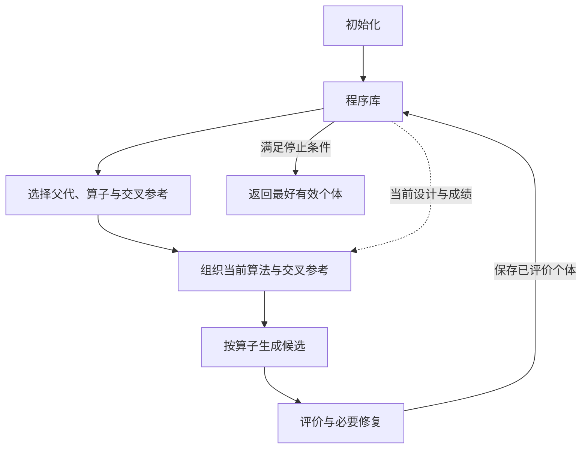
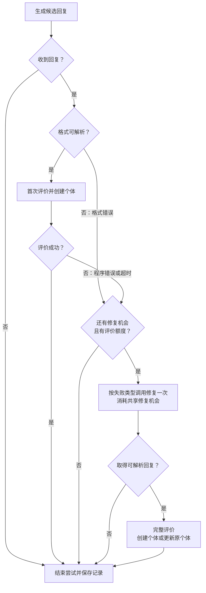

# TraceAAD Base：基础方法说明

独立实现与运行方式见 [`traceaad_base`](../traceaad_base/README.md)。

TraceAAD Base 是不利用轨迹经验的基础演化搜索对照，用于自动算法设计（automatic algorithm design，AAD）。大模型在固定求解框架中设计指定函数，评估器将其接入框架并评价求解结果。搜索目标是在给定评价预算内找到成绩最好的有效算法。

程序库保存候选的分析、设计、代码、来源与评价，供追溯与研究分析使用。演化生成只读取当前算法的代码、自包含设计说明和成绩；交叉增加参考设计与成绩。初始化与修复沿用原有流程。父代选择只依赖当前成绩和已投入调用，算子按固定概率选择，不做轨迹价值估计或反思。初始化提供算法起点，随后反复选择、生成与评价，直至满足停止条件。

本说明自2026年11月9日修订起对应 `static_algorithm_context_v1`。11月5日正式 Base 批次仍使用祖先、子代和失败历史；保留的 V21、V22.1、V24、V24.1 版本保留各自原有提示行为，其中共用的旧 Base 提示固定在 `traceaad_v21/frozen_base_prompts.py`。旧批次的结果不代表本版对照。



## 1. 程序个体

程序个体（program individual）表示一个候选算法，是搜索的基本单位，记录其分析、设计、代码、演化来源和评价结果：

```text
Program {
    id             个体编号
    analysis       本次设计或修改的计算变化及其依据
    code           待设计函数的完整实现（含导入与辅助函数）
    design         设计说明
    operator       生成操作（Init / Refine / Explore / Crossover）
    parent_id      父代个体编号
    reference_id   交叉参考个体编号（仅 Crossover 填写）
    evaluation {
        status     评价状态
        fitness    评价成绩，越小越好（失败时为空）
        failure    失败信息（成功时为空）
    }
}
```

生成个体从 `1` 开始编号，初始化个体的 `parent_id` 为 `0`。有样例时，0 号保存样例代码与已有设计说明，其余字段为空；无样例时，以 0 表示虚拟父代，不创建记录。样例仅用于初始化参考，不参与评价、父代或交叉参考选择，也不作为最终结果。

## 2. 程序库

程序库（program archive）以 `id → Program` 的映射保存全部个体。生成程序在首次评价后入库，修复更新原记录；有效个体参与父代选择，最终失败个体保留在记录中。Base 不把祖先、已有子代、失败子代历史、演化来源或此前的 `analysis` 放入演化生成提示。初始化仍可参考已有初始候选及失败反馈；修复仍读取本次候选自己的设计、分析、代码和错误，不查找祖先或其他子代。

各次生成的个体独立保存，不做代码去重。每条记录的分析、设计、代码与评价对应同一版本。`analysis` 随子代保存，通过 `parent_id` 关联父代，无须另建边对象。

## 3. 个体生成操作

个体生成操作（Generate）以任务、相关算法和算子指令为输入，调用大模型依次生成分析、设计说明与完整实现：

```text
Generate(
    task_description,  任务说明
    template_program,  任务提供的函数模板（可含初始参考实现）
    context,           当前算法或初始化材料（可空）
    instruction        算子指令
) → {
    analysis       采用或修改哪些计算、依据是什么、如何影响决策
    design         算法实际决策机制的完整说明
    code           符合接口的完整源码
}
```

编号与演化来源由搜索过程记录，评价结果由评估器给出。一次生成及其必要修复、评价构成一次尝试；当前尝试结束并完成记录与统计更新后，再开始下一次。

生成与修复统一使用采样温度 **1.0**，最大输出长度为 **16,384 tokens**。

模型请求使用 JSON Schema 约束输出：`analysis`、`design`、`code` 为三个必填字符串，不允许额外字段。解析后检查字段是否为空或仅含空白；格式错误沿用一次修复流程。

### 3.1 公共提示模板

任务说明给出问题、求解目标与待设计函数的作用；函数模板给出签名与输入输出；算子指令提出本次设计要求。这一组织方式参照 [EoH、ReEvo 等方法](记录/2026-10-30-AAD任务与接口提示核对.md)。例如，在线装箱的待设计函数为箱子优先级函数，固定框架据此选择可行箱子，最终目标是减少箱子使用数。

`function_template` 是 `template_program` 的接口展示形式：保留导入、函数签名与输入输出说明，函数体以 `pass` 占位。完整样例代码单列于初始化上下文。

````text
{task_description}

Implement the following Python function:
```python
{function_template}
```

[Context]
{context}

[Instruction]
{instruction}

[Output]
Return exactly one valid JSON object with three string fields, in this order:
- "analysis": In 2–3 concise sentences, using at most 100 English words or 200 Chinese characters, explain the approach you will implement and why it suits the task. When modifying an algorithm, state which computations you retain, replace, or add, the relevant evidence from the provided context, and how the change affects the returned result.
- "design": Describe the decision procedure implemented in "code" in one self-contained paragraph of 2–3 concise sentences, using at most 100 English words or 200 Chinese characters. State its representation, main computations, and how their results determine the output. Include the formulas or parameter values needed to understand the core mechanism.
- "code": Provide the complete implementation of the required function, including necessary imports and helper definitions. Do not include comments or docstrings.
Keep "analysis" and "design" consistent with the implementation in "code".
Preserve the required function signature and satisfy the task constraints and input/output requirements.
Return only the JSON object, without Markdown fences or additional text.
````

无上下文时省略 `[Context]`。提示中的 `Score` 沿用任务评价指标；若任务说明未给出指标含义或方向，在成绩材料前补充一次，例如“平均路径长度，越小越好”。

## 4. 初始化

初始化保持原有行为，结合已有算法与评价反馈，逐次生成采用不同核心决策机制的算法起点。已有初始候选的比较与失败反馈是共同基础流程，不按演化路径组织材料。

### 4.1 生成上下文

初始化沿用公共提示模板，按以下顺序提供材料：

- **可选样例**：0 号样例的完整代码与已有设计说明。
- **有效初始个体**：全部有效初始个体的编号、来源、分析、设计、完整代码与成绩，按成绩从优到劣排列，同分时按编号升序排列。
- **失败尝试**：从 `parent_id=0` 下取最近2个最终失败个体，按编号从旧到新呈现来源、分析、设计与失败摘要。窗口由 `failure_count` 控制。异常摘要保留候选代码位置，消息中的数字替换为 N，超时只说明未在允许时间内完成。

八个基准任务均以 `template_program` 中的极简实现作为默认样例，见[任务初始参考代码](记录/2026-10-30-任务初始参考代码.md)。

没有对应材料时省略该部分；样例没有设计说明时省略 `Design` 行。`Algorithm` 块按个体重复，编号沿用程序库中的 `id`：

````text
[Example Algorithm]
Design: {example.design}
```python
{example.code}
```

[Existing Algorithms]
Listed best first. Lower scores are better.

Algorithm {program.id}
Parent: Algorithm {program.parent_id}
Analysis: {program.analysis}
Design: {program.design}
Score: {program.evaluation.fitness}
```python
{program.code}
```

[Failed Attempts]
Algorithm {failed_program.id}
Parent: Algorithm {failed_program.parent_id}
Analysis: {failed_program.analysis}
Design: {failed_program.design}
Failure: {failed_program.evaluation.failure}
````

### 4.2 初始化指令

**尚无有效初始个体时**，根据任务设计并实现算法：

```text
Design an effective algorithm for the task described above and implement the specified Python function.
```

**已有有效初始个体时**，结合已有设计与成绩，设计采用不同主要计算的候选：

```text
Design an effective algorithm for the task and implement the specified Python function.
Use the existing algorithms and their scores to identify the decision information they already use.
Develop a solution procedure that obtains useful decision information through a different main computation.
```

提供失败尝试时，追加：

```text
Use the failed designs, their analyses, and evaluation feedback to guide how you implement your design.
```

### 4.3 初始化流程

每次尝试按第 7、8 节完成评价、必要修复与入库。默认收集到 **5 个评价成功的生成个体**后结束初始化；修复结果按同一个体计数。

达到初始化数量且仍有预算时进入演化。若提前触发第 9 节的停止条件，则直接返回已有结果。

## 5. 静态上下文与演化算子

演化使用精炼（Refine）、探索（Explore）和交叉（Crossover）三个算子。Refine 与 Explore 属于变异（mutation），分别沿用或改换父代的核心机制；Crossover 整合不同个体的计算。三者均沿用公共生成接口，依次返回 `analysis`、`design` 与完整 `code`。

### 5.1 共同上下文

Refine 与 Explore 只读取当前父代的编号、自包含设计说明、成绩和完整代码。Crossover 额外读取参考算法的设计与成绩；参考表示与原有 Base 保持一致。

三种算子的指令只定义本次操作，不要求利用形成路径、已尝试修改或后代结果。当前个体的 `analysis`、父代编号、原生成算子和交叉来源也不进入提示。轨迹完整记录在程序库中。

````text
[Reference Design]
Score: {reference.evaluation.fitness}
Design: {reference.design}

[Current Algorithm]
Algorithm {parent.id}
Design: {parent.design}
Score: {parent.evaluation.fitness}
```python
{parent.code}
```
````

`[Reference Design]` 只在 Crossover 中提供。`ancestor_count`、`offspring_count` 供机制版本使用；Base 的 `failure_count` 只控制初始化失败反馈，不向演化生成提供失败子代。

### 5.2 Refine：沿原机制精炼

沿用父代代码中实际参与决策的核心计算，改进其计算步骤、辅助组件或参数，包含参数调整与简化。用于完善当前实现。

指令：

```text
Identify the current algorithm's core decision mechanism from its code, including the intermediate computations that determine the returned result.
Improve solution quality by refining those computations, their supporting steps, or their parameters, while preserving the core mechanism's role in the decision.
```

### 5.3 Explore：改换核心机制

改变主要决策依据或产生决策信息的机制。用于引入其他求解方法。

指令：

```text
Design an alternative algorithm that improves solution quality through a different main decision mechanism.
Draw on solution methods for the underlying problem to choose an internal representation and computations.
Implement that mechanism using the available inputs and return the result required by the function interface.
```

### 5.4 Crossover：整合互补计算

将参考设计中的计算适配到父代实现，使双方计算共同参与求解。适合整合能够承担互补作用的设计，例如一方提供候选筛选，另一方提供候选评分。

指令：

```text
Improve solution quality by integrating a computation from the reference design that supplies information complementary to the current algorithm.
Implement the selected computation using its stated representation and formulas, and combine its result with the current decision mechanism so both contribute to the returned result.
Align their input representations and numerical scales so the selected computations work together.
```

## 6. 父代与生成操作的选择

父代选择回答一个问题：下一次尝试从哪个算法开始，最可能得到更好的算法。可靠的信息有两项：算法现在的成绩，以及从它出发已经投入了多少次尝试。

### 6.1 父代候选

每份不同的源码是一个候选，由最早产生它的有效个体代表。相同源码的后续个体留在程序库中，但不再作为父代。这样，从同一份代码出发的调用成本集中在一个节点上，复制品不会增加这份代码的机会。

### 6.2 选择权重

第 \(t\) 轮选择前，将全部候选按成绩从低到高排名，名次 \(r_t(p)\) 从 1 开始，同分取平均名次。\(C_p\) 是以 \(p\) 为父代的尝试消耗的模型调用总数，包含生成、修复及失败请求。

\[
w_p(t)=r_t(p)^{-1.5}\cdot\frac{3}{3+C_p},
\qquad
P_t(p)=\frac{w_p(t)}{\sum_j w_j(t)}.
\]

**指数 1.5。** 指数大于 1 时，低名次候选的总权重有上界，不随程序库增长。指数等于 1 时，这部分权重会随程序库持续增加。指数取 2 时，模拟中超过一半的尝试落在第 1 名上，集中过度。

**访问项。** 尝试增加后，节点的机会下降，搜索转向其他节点。3 是平滑强度：尝试 3 次调用后权重减半。

**子代不向父代计功。** 子代更好时，搜索直接从子代开始，子代已有自己的权重。把功劳再记给父代，等于重复计算。Explore 的子代还换掉了父代的机制，其好坏不反映父代的价值。

### 6.3 算子与交叉参考

选定父代后，按固定概率选择算子：Refine 为 **0.45**，Explore 为 **0.30**，Crossover 为 **0.25**。

交叉参考从候选中筛选：保留成绩不劣于候选成绩中位数者，排除与父代相同的源码，再均匀随机选择一个。参考提供设计与成绩，由交叉指令引导模型适配其中的计算。没有合格参考时，本次实际执行 Explore，并记录实际算子。

## 7. 程序评价

程序评价（Evaluate）将生成函数接入固定求解框架，在任务实例上求解、检查结果并计算成绩。

### 7.1 输入与执行

```text
Evaluate(
    code,          生成的完整源码
    task,          基准任务：固定求解框架、评价实例、合法性检查与计分规则
    time_limit     单个个体完成全部实例评价的总时限，单位为秒
) → evaluation {
    status         success / error / timeout
    fitness        有限实数或 null，越小越好
    failure        错误或超时反馈文本，成功时为 null
}
```

评价实例、随机种子、计分规则与总时限采用 task 的配置，各个体使用相同设置。评估器在独立进程中完成代码组装、实例求解、合法性检查与计分。

`fitness` 按任务规则汇总，通常为各实例成绩的平均值；单实例成绩可以是路径长度，也可以是相对差距等归一化指标。

### 7.2 返回结果

| 情况 | 判定条件 | `status` | `fitness` | `failure` |
| --- | --- | --- | --- | --- |
| 成功 | 完成全部评价，输出与解通过任务检查，汇总成绩为有限实数 | `success` | 汇总成绩 | `null` |
| 错误 | 代码装载或执行报错，输出或解不合法，或未得到有限成绩 | `error` | `null` | 具体错误反馈 |
| 超时 | 总时限耗尽时，本次评价仍未结束 | `timeout` | `null` | `Evaluation exceeded the total time limit of {time_limit} seconds.` |

记录保存完整错误反馈。提示只使用其中的异常类型、消息和候选代码自身的调用栈；评价器调用栈不进入提示。结果非法时，消息说明违反了什么要求。

### 7.3 超时处理

全部实例共享一个评价总时限。计时采用实际经过时间（wall-clock time），从代码装载到成绩汇总，不含排队时间；切换实例时不重置计时，不另设单实例时限。

评价总时限为每实例时间额度乘实例数，默认额度为10秒；训练16例共160秒，主测试50例共500秒。

总时限耗尽且评价尚未结束时，终止评价进程及其子进程，返回 `timeout`。已完成部分实例的成绩不作为本次 `fitness`。

## 8. 修复

修复（Repair）处理格式错误、程序错误与评价超时，尽可能保留算法思想，使候选可评价。**每次尝试最多发起一次修复，三类错误共享这次机会。** 接口未取得回复时，按第 9.2 节结束尝试。

### 8.1 格式错误修复

回复须为 JSON 对象，且 `analysis`、`design`、`code` 均为非空字符串；无法解析、缺失字段、类型错误或仅含空白均为格式错误。格式错误记入生成记录，代码语法与执行错误由 `Evaluate` 反馈。

沿用公共提示中的任务说明、函数模板与输出要求，提供原始回复和解析反馈：

```text
[Original Response]
{raw_response}

[Parsing Feedback]
{parsing_failure}
```

解析反馈指出错误位置、缺失字段或实际类型等具体原因。修复指令：

```text
Convert the original response into the JSON object specified in [Output], using the parsing feedback to correct its structure, required fields, and string escaping.
Preserve the existing algorithmic idea and computational logic.
Complete any missing or truncated content consistently with that approach and the task requirements.
```

### 8.2 程序错误与超时的共同上下文

两类修复保持原有行为，沿用公共提示模板，提供本次候选的来源、分析、设计、完整代码与自身评价反馈。来源是该候选记录中的编号信息；修复不查找祖先或其他子代，不比较演化路径。程序错误的反馈为异常类型、消息和候选代码自身的调用栈，消息中的数字替换为 N。超时的反馈说明每个问题实例允许的时间：

````text
[Current Algorithm]
Algorithm {program.id}
Parent: Algorithm {program.parent_id}
Operator: {program.operator}
Analysis: {program.analysis}
Design: {program.design}
```python
{program.code}
```

[Failure Feedback]
{failure_feedback}
````

### 8.3 程序错误修复指令

当 `status=error` 时，定位并修正导致异常或非法结果的计算：

```text
Trace the reported exception or invalid result to its cause in the code, using the design to understand the intended algorithm.
Correct the faulty computations or data handling so the function executes correctly and satisfies the task requirements, while retaining the intended core decision mechanism.
```

### 8.4 评价超时修复指令

当 `status=timeout` 时，先改善实现效率；若算法步骤本身开销过大，再调整其计算方式或规模：

```text
Reduce runtime so the full evaluation finishes within the reported time limit.
Identify the core computation and its contribution to the returned result.
First correct non-termination and eliminate redundant work, reusing intermediate results where possible.
Preserve a working version of the core procedure by reducing candidate sets, iteration counts, or search ranges when needed.
If the core method remains too costly, use a smaller search or cheaper approximation of the same decision information, keeping that estimate in the final decision.
```

### 8.5 修复结果与记录

修复依次返回 `analysis`、`design` 与完整 `code`。程序错误与超时的修复指令末尾追加以下要求。格式修复只转换已有回复，不追加：

```text
In "analysis", state only what went wrong and what you changed to correct it; the earlier analysis is kept.
Update "design" to describe the repaired algorithm as a self-contained procedure consistent with "code".
```

系统把修复说明接在原分析之后，保存为 `{原分析}\nRepair: {修复说明}`。这样，研究记录保留原来的修改依据与修复过程；这些分析可用于本次修复与初始化候选展示，不进入后续演化生成。

修复机会在请求发出时消耗，按回复处理结果：

- **回复可解析**：调用 `Evaluate`；首次评价创建个体，重评更新原个体的设计、代码与评价，并在分析后追加修复说明。
- **未取得可解析回复**：结束尝试，保留已有个体。

修复保留个体编号、父代、交叉参考与原生成操作。修复记录保存原始回复或修复前版本、失败反馈、修复回复与评价结果。尚未进入评价的格式错误保存在生成记录中。

修复评价额度按第 9.1 节预留。修复后的评价直接结束本次尝试：



## 9. 评价预算、停止与最终结果

### 9.1 评价预算

默认预算为 **1,000 次评价**。每次调用 `Evaluate` 计一次，包含初始化、普通生成及修复重评，成功、错误和超时均计数。一次评价以 task 规定的全部实例为对象；格式错误或接口失败尚未进入评价时不扣额度。

每次生成前预留一次评价额度，格式修复沿用该额度；程序错误或超时修复须另有一次重评额度。尝试结束仍未得到可评价代码时，释放预留额度。

### 9.2 连续未评价的停止条件

每次模型调用发出一次请求，采用模型配置中的有限总时限。请求超时或接口报错时结束本次尝试，修复调用失败时保留已有个体；收到空回复时按格式错误处理。

初始化与演化共用连续未评价计数，初值为 0。每次尝试结束时，若至少调用过一次 `Evaluate`，计数清零；否则加 1。连续 **10 次尝试未进入评价**时异常停止，以限制评价预算无法推进时的重复调用。

### 9.3 停止与返回

评价预算耗尽或触发连续未评价上限后，停止新的生成与修复，完成已启动的评价，返回成绩最好的有效生成个体；没有有效个体则报告失败。记录停止原因与实际评价次数。Base 不因成绩停滞提前停止。

新运行的 `run_config.json` 保存 `generation_protocol=static_algorithm_context_v1`。恢复前先核对该标识；旧 Base 日志须使用原始源码快照恢复，不能接入本版继续搜索。

V23.1 已同步为当前 Base 加机制1：生成侧沿用本版提示，选择侧复用 V22.1 的机制1。其历史批次保留原有条件。

本版正式批次 `20261109_base_static_co6` 已于11月9日15:52启动18路，与新V23.1共用同一源码和共同实验条件。结果目录为 `experiments_result/traceaad_base_static_20261109`，启动与配对核对见[记录](记录/2026-11-09-Base正式对照启动与V24停止.md)。
