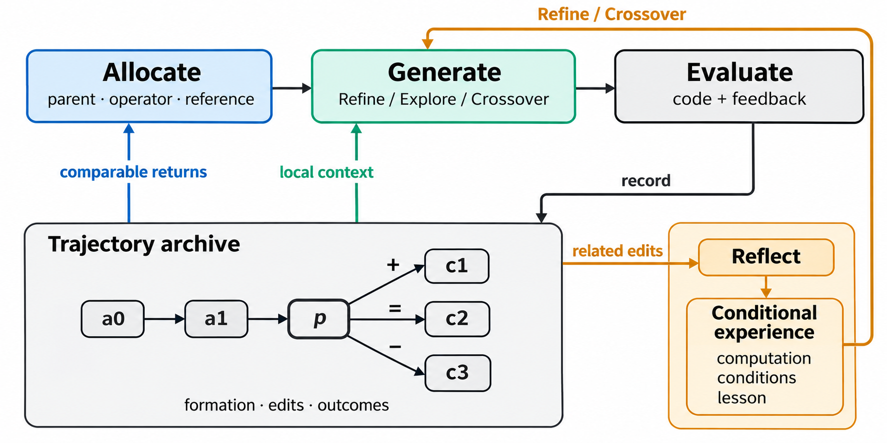
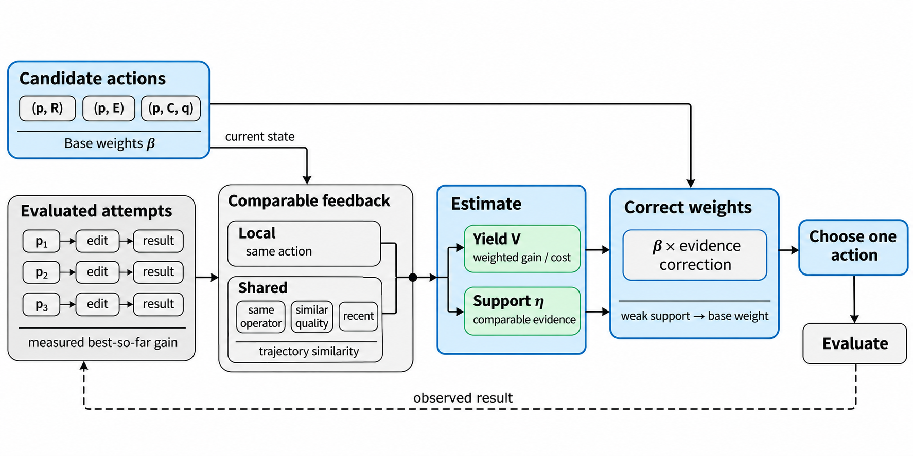
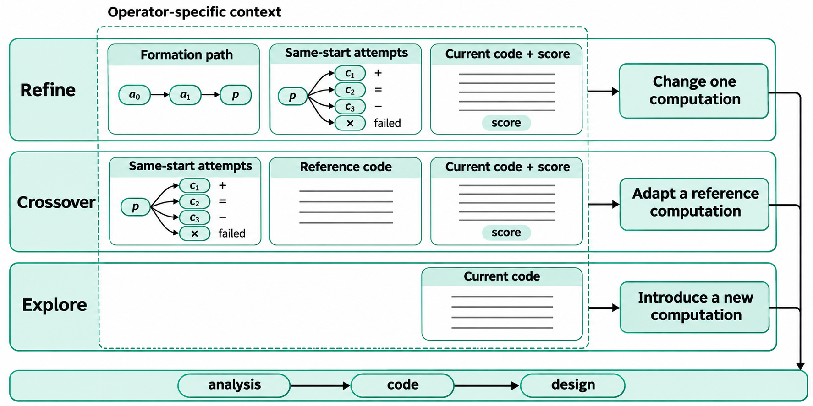
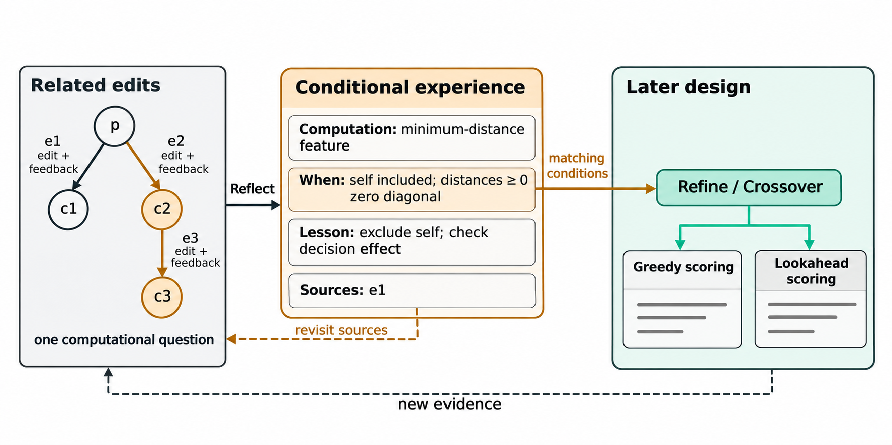

# EvoTrace 机制示意图

四张图分别解释三机制的共同信息流、预算分配、算子上下文和条件经验学习。图内使用简短英文标签，正文使用中文图注。配色为蓝色表示分配、青色表示生成、琥珀色表示经验；连线和标签共同表达关系。

## 三机制总览

评价形成轨迹；轨迹分别用于动作分配、算子上下文和经验反思。条件经验进入精炼与融合的生成。此图说明三个机制的概念配合，实际启用组合见[实现版本](../../机制设计/README.md#实现与实验版本)。

## 机制一：预算分配

本地与共享反馈共同决定收益率和证据强度，随后修正基准权重，联合选出一个实际动作。历史收益来自已兑现的冠军改善，成本来自实际评价。图中没有将收益率和证据强度分配给不同来源。

## 机制二：算子上下文

精炼读取形成路径、同起点尝试和当前代码；融合读取同起点尝试、参考和当前代码；探索只读取当前代码。`+`、`=`、`−` 分别表示相对父代的改善、持平和退步，`×` 单独表示执行失败。图中的源码线条仅示意完整代码。

## 机制三：条件经验学习

反思围绕一个计算问题比较相关修改，保存计算条件、设计含义与相连来源。后续精炼或融合在条件匹配时借鉴经验，新证据再用于回读和修订。最小距离特征的例子说明同一计算条件可以出现在不同求解结构中。

## 文件与生成说明

四张交付图均为 PNG。图像通过当前会话的 `image_gen` 工具生成；未调用 Google Imagen API。完整初始提示词保存在 [generation-prompts.json](generation-prompts.json)，修订提示词与交付文件校验信息见 [generation-record.json](generation-record.json)。

这些图是方法示意，不包含实验测量值。图中的谱系、事件编号与代码线条用于解释关系。对应方法见[总览](../../method.md)和[三个机制正文](../../机制设计/README.md#方法正文)。
