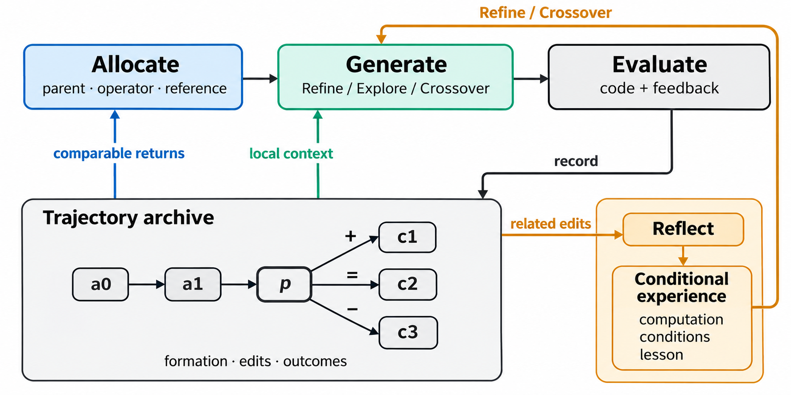

# EvoTrace 方法总览

**EvoTrace 将算法演化中的修改与反馈，用于预算选择、当前生成和跨分支经验复用。** 三个机制读取同一搜索过程，回答三个连续的问题：下一次评价投给谁，这次修改需要读什么，哪些认识可以帮助后续设计。

设训练适应度 $f$ 越小越好，总评价预算为 $B$。搜索在预算内生成并评价候选算法，最终固定训练成绩最好的程序，再进行独立测试。测试结果不回写选择或经验。

方法的核心区分是个体质量与过程信息。适应度评价算法当前已经实现的性能；形成路径、同起点修改及其反馈，记录这份性能怎样变化。EvoTrace 将这些关系保留为后续决策的共同依据，并按选择、生成和经验学习各自的问题使用它们。

*图1：三机制的概念信息流。评价形成的轨迹分别用于动作分配、算子上下文和经验反思；条件经验进入精炼与融合的生成。图中的 +、=、− 表示相对父代的改善、持平和退步。*

## 1. 以修改关系组织演化轨迹

搜索保存程序、尝试和评价。程序包含完整代码、设计描述与评价结果；一次尝试记录主父代、算子、融合参考、生成意图、实际代码改动，以及生成、修复和评价的结果。没有产出有效程序的尝试也保留其失败事实。

多个初始程序构成不同根节点。主父代链接记录每个程序的形成路径，融合额外记录参考链接。对当前程序 $p$，局部演化轨迹包含沿主父代回溯的祖先路径，以及此前从 $p$ 直接出发的有效子代和失败记录。

这些关系提供两种不同依据。形成路径说明当前设计怎样变化；同起点尝试使不同改法及结果可以直接并列。程序计算的源码差异与评价器给出的反馈是实际记录，模型生成的 `analysis` 和 `design` 是对它们的描述。

原始关系完整保存，各机制读取与其任务对应的视图。机制一读取数值反馈和形成路径特征，机制二读取算子所需的局部实现材料，机制三比较相关改进片段并保存条件经验。

## 2. 轨迹节点价值评估与预算分配

当前成绩决定基本的质量偏好，继续搜索的价值则需要结合所用算子与已经发生的尝试。机制一评价动作 $g=(p,o,q)$，联合选择父代、算子和融合参考。

一次动作的收益是相对动作开始前冠军的真实改善，评价成本包含实际发生的重新评价。历史只在同一算子内借用，并按发生时间、当时的父代与冠军成绩、形成路径的相似程度加权。本地同起点反馈与其他可比起点的共享反馈共同形成每评价收益率 $V_g$。

选择以当前成绩的Boltzmann质量权重构成基准概率 $\beta_g$，采样温度与Base共用，再按可比证据的强度 $\eta_g$ 作修正。当存在正收益证据时，

$$
P_t(g)\propto\beta_g\bigl[(1-\eta_g)+\eta_g\min\{V_g/\bar V,4\}\bigr],
$$

其中 $\bar V$ 是按 $\beta_g\eta_g$ 加权的平均收益率。没有可比证据的动作不接受经验修正；没有正收益证据时使用基准分配。每次只执行一个动作，再根据真实结果重算。

交叉参考的选择也归入机制一。Base与机制一使用相同的当前质量候选池，排除父代自身；Base均匀随机选参考，机制一的1.0版本则用当前算法与近期形成轨迹的嵌入选择语义差异最大的参考。没有合格参考时，两者均将交叉的基础机会并入探索。现有实验开关用于参考选择的消融，原有轨迹收益估计在机制一中保留。

完整定义、匹配方法与预算边界见[机制一](机制设计/机制1-轨迹节点价值评估与预算分配.md)。

## 3. 轨迹引导的上下文与算子

动作选定后，机制二围绕本次设计问题组织生成材料。

| 算子 | 设计问题 | 局部材料 |
| --- | --- | --- |
| 精炼 Refine | 在当前机制内改哪项计算？ | 紧凑形成路径、同父代各类尝试的差分与结果、当前完整代码与成绩。 |
| 融合 Crossover | 参考中是否有适合接入的计算？ | 参考Design与成绩、当前完整代码与成绩；参考源码可独立比较。 |
| 探索 Explore | 引入哪种当前代码没有执行的计算？ | 当前完整代码。 |

轨迹不要求进入每一种算子。Refine展示形成路径与同起点各类尝试的实际差分和结果，以路径顺序表达父子关系，不重复历史代码、Design或analysis；Crossover使用静态参考，Explore不读历史。当前完整代码紧邻算子指令，原始轨迹仍完整保存。

生成依次输出 `analysis → code → design`：先说明本次改变的计算，再实现完整代码，最后描述代码实际计算什么。有相关历史时可以作为依据，不要求解释历史结果的原因。三个字段在一次请求中生成。候选经评价后，其实际修改与反馈继续补入轨迹。

材料选择、算子要求与输出定义见[机制二](机制设计/机制2-轨迹引导的上下文与算子.md)。

## 4. 轨迹反思与经验学习

局部视图服务于当前修改。机制三从其他分支和较早阶段的改进经历中，提炼可供后续设计借鉴的认识。

每条经验记录一个计算问题、适用计算条件、具体认识和代表来源。反思围绕具体计算问题，比较父代实现、实际修改、同起点尝试与接续变化，说明一项计算在什么条件下怎样起作用，以及已观察到的结果意味着什么。不同分支的案例可通过共同计算条件进入同次反思，每个案例保留自己的修改与结果。

反思按周期触发，材料按相关改进片段组织，未审阅事件单独保留。新证据通过结构邻近、内容匹配和生成展示记录召回旧经验，回读来源并局部修订。经验持续保存，生成每次读取最多6条；内容匹配与轮换使旧认识能在后续再次出现。精炼与融合先确定当前计算问题或参考计算的接入，再借鉴条件经验。探索使用当前代码视图。

经验通过后续生成影响搜索。机制一的收益率仍来自实际评价，不使用模型反思替代数值反馈。经验表示、反思与复用方法见[机制三](机制设计/机制3-轨迹反思与经验学习.md)。

## 5. 三个机制的信息流

一次搜索迭代依次完成以下操作：

1. 用当前程序质量与可比轨迹反馈，选择父代、算子和必要的参考。
2. 按算子组织局部材料；精炼与融合可额外借鉴已有条件经验。
3. 生成、评价并按需修复候选，将实际代码与反馈写入轨迹。
4. 更新选择所需的数值历史；到达反思周期时，比较相关片段并修订经验。

轨迹保存发生过什么，收益率用于分配下一次评价，条件经验用于理解后续怎样实现。三者共用修改事实，但不互相替代各自的判断对象。

本文统一说明三个机制及其接口。当前代码按不同组合启用它们，组合关系见[机制设计索引](机制设计/README.md)，各版本使用哪些机制见[版本与机制](机制设计/实现说明.md)。
