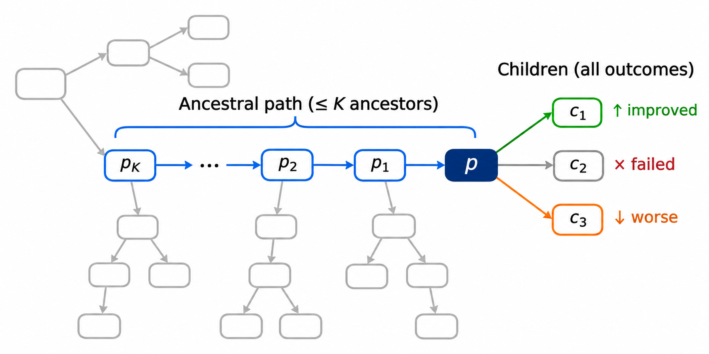

# Method

## 演化轨迹

### 为什么需要轨迹

人类专家改进算法是一个逐步精进的过程。他们从一个可行实现出发，每次做一处改动，观察效果，再决定下一步。做决定时，专家依据的不是当前算法的一个成绩，而是它的改进经历：当前设计经过哪些改动形成，每处改动带来了什么；在当前版本上试过哪些改法，哪些有效、哪些无效。前者让专家理解当前设计为何成立，后者让专家在同一起点上比较不同改法。依据这些经历，专家判断一个算法是否值得继续投入、下一步改什么，以及哪些做法可以用到别的算法上。

LLM 驱动的演化搜索同样在逐步修改算法，也产生了这样的改进经历，但现有方法只利用了其中的片段。父代选择多依据适应度，或适应度与访问次数等搜索统计 [1, 5, 6]。它们反映算法的当前质量和被探索的程度，不反映算法经历过哪些修改，也不反映从它出发的尝试结果如何。经验反思多依据一次父子或个体比较 [2, 9]，单个结果难以区分修改策略、具体实现与起点算法各自的作用。一些方法把演化历史放入生成上下文，如祖先程序 [6] 或父代的描述与性能 [8]，但这些历史只覆盖改进经历的一部分，也只服务于个别决策。我们按专家使用改进经历的方式，将其组织为以节点为中心的演化轨迹：祖先路径记录当前设计怎样形成，子代记录从它出发试过的改法及结果。轨迹作为预算分配、算法设计与经验凝练的共同依据。

### 定义

搜索中产生的程序构成一棵**演化树**。每个节点是一个程序，包括代码、算法设计的自然语言描述和适应度。初始程序是根节点。每条边连接父代与子代：子代由 LLM 在一个父代程序的基础上修改得到。边记录所用算子、LLM 给出的修改说明、程序算出的代码改动和适应度变化。

节点 \(p\) 的**演化轨迹**是演化树中以 \(p\) 为中心的局部结构，由两部分组成：

- **祖先路径**：从 \(p\) 沿父代回溯得到的有序形成路径，以及相邻节点之间的修改。它说明 \(p\) 是怎样一步步改出来的。原始关系完整保存，各机制按需要读取至多 \(K\) 条记录；非连续展示时标明省略区间。
- **子代**：此前从 \(p\) 直接产生的全部子代，无论结果好坏。它说明在 \(p\) 上试过哪些改法，效果如何。

## 基于演化轨迹的价值评估与预算分配

### 节点的价值取决于对它做什么

预算分配要决定下一次生成做什么、从哪里继续。多数方法给每个节点一个价值，如自身适应度、后代质量或访问统计，再据此选择父代 [1, 5, 6]。这隐含了一个假设：继续搜索的价值是节点本身的属性。

我们认为，继续搜索的价值取决于对节点做什么。EvoTrace 有三种算子：精炼在当前设计之内改进实现；探索引入 LLM 提出的新思想；融合引入另一个算法的思想。前者对应搜索中的利用，后两者对应探索。相应地，节点有两种价值：**精炼价值**，即在当前设计之内继续改进的价值；**拓展价值**，即在当前设计之上引入新思想的价值。两者可以完全不同。一个经过多轮精炼、增益已经递减的设计，精炼价值低，拓展价值可能高。一个刚接入新思想、还没打磨的设计，最值得精炼。专家改算法时也是这样：先判断这个算法需要打磨还是需要新思路，再决定怎么改。

轨迹中的结果也要结合产生它的算子和实际修改解读。精炼后适应度下降，说明本次实现未改善。融合后若新计算确实进入决策，小幅下降说明其接入的即时质量代价较小；后续是否值得精炼，还要结合具体实现与已有接续反馈判断。同样的成绩变化，需要结合修改目标、实际计算与后续结果理解。

因此，价值评估需要带算子标记的轨迹。一个设计是已经饱和还是刚接入新思想，取决于它最近经历了哪些修改、增益怎样变化、在它上面试过什么。适应度和访问统计都不包含这些信息。

### 先选算子，再选节点

EvoTrace 的预算分配分两步：先按固定比例抽取算子，再在该算子对应的价值下选择节点。

**先选算子，因为两种价值的兑现时间不同。** 精炼的收益在本次评价中就能看到。拓展的收益往往要经过后续精炼才显现，第一版甚至可能变差。若把两种价值放在一起比较，需要把即时收益与多步之后的收益换算到同一尺度，这要求校准的预测；预测稍有偏差，即时的精炼收益就会挤占新思想的机会。在同一种价值下比较节点则只需要相对判断：各节点的兑现时间相同，共同的预测偏差不改变它们的先后顺序。因此，算子之间的预算交给固定比例，不交给跨价值的比较。

**节点价值随算子而定，使每种修改落到适合它的节点上。** 现有方法的父代选择不读节点经历过什么修改：EoH [1] 的各提示策略共用同一个排名抽样，ReEvo [2] 的变异固定作用于当前最好，交叉随机取亲本对。在以适应度为主的选择下，精炼预算被已经饱和的高适应度设计占用；刚接入新思想的设计适应度暂时较低，反而得不到精炼。按算子选择时，两种价值各自学习同一份证据的作用：多次精炼都没有改善，会降低节点的精炼价值，也不会提高它的拓展价值。精炼预算因此离开饱和的节点，这个节点仍可以按拓展价值被选中；新设计也能得到打磨。

### 探索与融合共用拓展价值

选择节点时，探索与融合回答同一个问题：这个设计是否需要、也能够承载新思想。两者的区别在于新思想的来源。融合能否成功还取决于两个算法是否互补，这是一对算法的性质，不属于单个节点。因此，融合按拓展价值选出节点后，再选择参考算法。

## 基于演化轨迹的算法设计

每次生成都是一次决策。精炼决定在当前机制内改哪项计算，融合决定从另一个算法借哪项计算，探索决定用哪种当前代码没有执行的计算得到结果。决策不同，需要的事实也不同。EvoTrace 只提供每次决策需要的事实，而轨迹独有的事实是干预证据。

### 干预证据

成绩说明算法现在多好，说明不了哪项计算真正控制结果。这需要另一种事实：同一份代码上做了什么改动，结果如何。现有方法提供的是个体比较、模型转述或反思结论，都缺少同一起点上的改动事实。模型因此无法解释同分：它知道结果没变，但看不到改了什么。

一条干预证据由三项事实组成。起点是当前代码，改动由程序比较父子源码算出，结果由评价器测出。设计说明和修改说明仍然保留，但它们是描述，不说明结果为什么发生。代码本身是事实，所以当前算法只给代码，不给描述。

### 按决策分配材料

| 算子 | 决策 | 读到的材料 |
| --- | --- | --- |
| 精炼 | 在当前机制内改哪项计算 | 祖先路径；子代的改动与结果；失败记录；当前代码与成绩 |
| 融合 | 借哪项计算，改变哪个决策 | 子代的改动与结果；失败记录；参考算法及其最后一步的改动与结果；当前代码与成绩 |
| 探索 | 用哪种新计算得到结果 | 当前代码 |

精炼要保留当前机制，所以还要知道这个机制怎样形成。子代回答从这里试过什么：第一个名额给成绩最好者，其余给最近的尝试，段首写明全部尝试数和可见数。

探索要离开当前做法，不是在当前做法上变好。成绩和开发历史都在要求变好，所以探索不读它们，但保留当前代码。“当前代码没有执行的计算”只有相对当前代码才有定义。指令说明现在不必胜过当前代码；新计算值不值得继续发展，由预算分配判断。

融合要一份可借用的不同计算。参考池中只差常数取值的程序算作同一种计算，每种取成绩最好者，再均匀抽取一个。没有不同计算时，实际执行探索。

### 轨迹与经验

**机制三从不同节点的改进经历中，提炼带计算条件的设计经验，供后续算法借鉴。** 机制二围绕当前设计任务主动组织局部轨迹；局部视图既受上下文长度约束，也服务于不同算子的决策。机制三把其他分支和较早阶段形成的认识带入当前设计，不只是增加历史数量。

反思比较真实实现、修改及其结果，记录一项计算在什么条件下怎样起作用、受到什么限制，以及这些认识如何影响后续修改。全局共享的是经验，不是一套要求所有分支遵循的算法结构。经验可以包含性能比较，但比较结论保留对应的实现条件。后续轨迹改变条件或揭示新关系时，系统回看相关实现并修订经验。

V24.1 每完成10次有评价结果的非初始化尝试触发反思，材料按相关改进片段组织：父代完整代码、实际修改和结果、父代形成一步、同起点的最好与最近不同尝试，以及已有经验的代表来源。公共代码和重复观察合并，未装入或反思失败的材料保留待审阅。调用周期不决定证据边界。

最多6条活跃经验各保存稳定编号、计算问题、适用计算条件、具体认识和代表来源。反思只更新涉及新认识的条目，允许空更新；旧条目、版本和累计来源保留。精炼与融合只读简短的计算问题、条件和经验，利用它们改进当前计算或接入参考计算；条件也可以对应本次明确要建立的计算。探索不读经验，其新程序的后续开发仍由精炼与融合继续。V24.1 已完成小规模反思回放和训练冒烟，仍无完整搜索的效果证据；已运行 V24 的实现另行保留。

### 算法生成

算子与父代由前述预算分配机制选定。生成提示包含任务目标、接口、上述材料和本次算子的要求。提示只读有界视图：祖先至多8条，有效子代至多3条，失败至多2条。

模型依次输出修改思路、完整代码和算法设计。修改思路在代码之前，写本次决定。算法设计在代码之后，写这份代码实际计算什么。新候选的代码、说明与评价结果随后补入演化轨迹，参与后续节点价值评估、算法生成与经验凝练。

具体规格见[轨迹引导的上下文与算子](机制设计/机制2-轨迹引导的上下文与算子.md)与[轨迹反思与经验学习](机制设计/机制3-轨迹反思与经验学习.md)，分别说明生成提示与评价后的经验更新。
