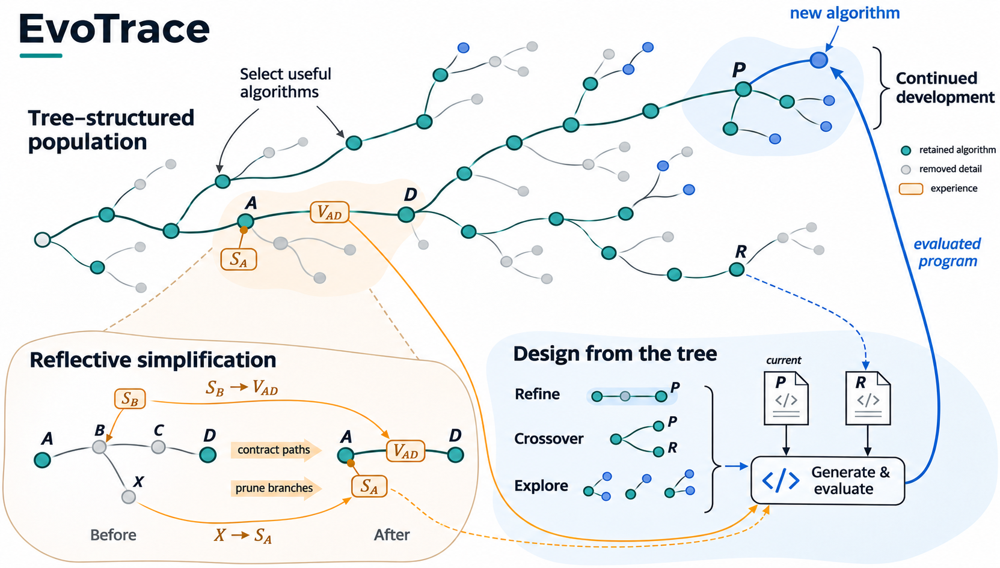
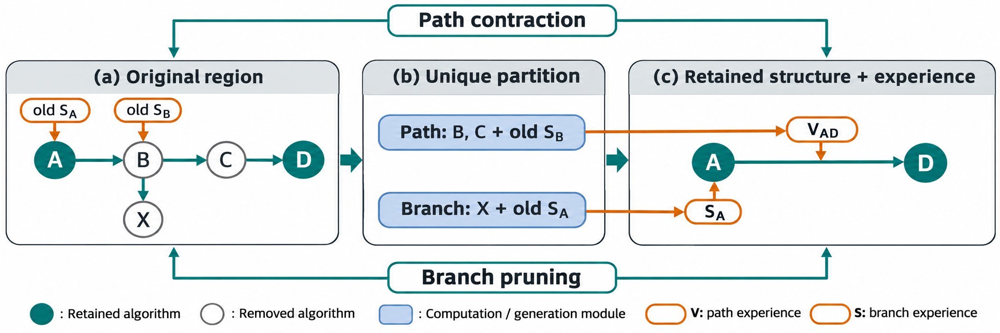

# EvoTrace：通过反思简化持续演化的树状种群

## 摘要

大语言模型通过迭代生成与评价程序，支持自动算法设计。搜索既产生候选算法，也积累关于这些算法如何发展的证据。利用这些证据，需要一种能够支持个体选择并保留发展上下文的搜索结构。本文提出EvoTrace，以树状种群统一组织算法个体、派生关系与累计经验。其核心机制是动态反思简化，将候选的存续与相关历史的表示共同更新。每次受评实现入树后，系统选出近期使用的算法与具有差异的质量代表，再保留连接这些算法所需的分叉祖先。该保留集合共同决定旁支剪枝与路径收缩：反思将被移除旁支凝练为节点上的选择经验，将收缩路径凝练为边上的变异经验。实际评价与使用次数沿相同区域交接，使历史投入仍归属于相应的发展区域。更新后的树通过结合质量与使用次数的父代采样分配后续尝试，并为改进、融合和探索提供相应尺度的上下文。EvoTrace由此在同一种群中衔接个体选择与经验积累：保留程序提供开发起点，其周围的发展经历继续为后续算法设计提供材料。

## 1. 引言

大语言模型（large language model, LLM）能够生成可执行程序，并通过评价与修改支持自动算法设计（automated algorithm design, AAD）。演化搜索将这一能力组织为迭代过程：生成候选、评价质量，再利用已有候选产生下一代。学习得到的变异算子支持程序修改与重组（[Lehman等，2022](https://arxiv.org/abs/2206.08896)；[Meyerson等，2024](https://doi.org/10.1145/3694791)）。FunSearch通过演化种群搜索程序空间（[Romera-Paredes等，2024](https://www.nature.com/articles/s41586-023-06924-6)）。EoH共同演化可执行启发式及其计算思想描述（[Liu等，2024](https://proceedings.mlr.press/v235/liu24bs.html)）。在有限评价预算下，这类搜索需要持续决定两个问题：哪些算法值得继续开发，以及已有尝试应当为下一次设计提供什么。

现有方法通过不同形式的搜索状态处理这些决策。基于种群的方法选择候选继续演化；ReEvo等反思方法进一步利用已评价算法之间的比较指导生成（[Ye等，2024](https://papers.nips.cc/paper/2024/hash/4ced59d480e07d290b6f29fc8798f195-Abstract-Conference.html)）。基于树的方法保留派生关系，并将其用于选择或生成。例如，MCTS-AHD提供专门读取树上算法路径的生成动作（[Zheng等，2025](https://proceedings.mlr.press/v267/zheng25o.html)）。PathWise和PhyloEvolve又将派生结构与种群更新或剪枝结合（[Gungordu等，2026](https://proceedings.mlr.press/v306/gungordu26a.html)；[Zhao等，2026b](https://arxiv.org/abs/2601.14523)）。这些研究使候选质量和发展上下文都能参与算法搜索。

二者的连接引出一个问题：**搜索如何共同更新候选算法及其承载的历史？** 谱系中的算法既是可继续修改的起点，也是发展过程中的一个位置。移除中间版本，会改变后代形成过程的表示；移除旁支，会改变系统仍能读取的替代尝试。两类信息承担不同作用。路径记录通向保留实现的连续修改，旁支记录从某个位置分化出去的尝试。因此，个体退出显式种群后，搜索仍需决定如何组织其周围的证据。

我们的核心洞察是，程序的存续与其设计经验的保留可以分别决定。一个实现可以退出可选种群，而其经过评价的发展经历仍可供后续设计读取。由此，我们提出同时更新算法、关系与经验的树状种群。保留节点提供后续开发的实现；保留连接维持这些实现之间的分叉关系；节点和边上的经验承接已经移除的发展区域。

本文提出**EvoTrace**，以**动态反思简化**维护这一结构。每次受评实现入树后，EvoTrace依据最近实际使用与当前质量差异，一次确定主动保留算法，再补回必要分叉。维护前拓扑决定哪些移除版本属于中间路径，哪些属于旁支。路径收缩将变异经验写入重连边；旁支剪枝将选择经验写入最近保留祖先。实际评价与使用次数沿相同区域交接。更新后的树继续支持父代选择，并为三类设计算子组织发展经历：Refine读取形成路径，Crossover读取分化路径，Explore读取不同设计方向。生长、选择与经验积累由此在同一结构上持续进行。

本文有两项贡献：

- **通过动态反思简化维护的树状种群。** 一次保留决策共同协调个体选择、必要分叉保留、旁支剪枝与路径收缩。区域反思将被移除历史放到能够说明其来源的保留节点或边上。
- **基于更新后种群的算法生成。** EvoTrace从保留算法中分配后续尝试，并为改进、融合和探索提供相关路径、已评价替代尝试及累计经验，使种群更新的结果继续参与下一次设计。

## 2. 相关工作

### 2.1. 自动算法设计

自动算法设计涉及不同搜索空间。遗传编程演化可执行程序（[Koza，1994](https://doi.org/10.1007/bf00175355)）。超启发式从已有组件中选择或构造启发式（[Burke等，2013](https://doi.org/10.1057/jors.2013.71)）；算法配置则优化已有求解器的设置，irace是其中的代表（[López-Ibáñez等，2016](https://doi.org/10.1016/j.orp.2016.09.002)）。自动元启发式设计综述按照设计空间、搜索策略和评价过程组织这一领域（[Zhao等，2024a](https://arxiv.org/abs/2303.06532)）。近期综述进一步区分LLM在优化、预测、知识提取和算法设计中的作用（[Liu等，2026](https://doi.org/10.1145/3787585)）。EvoTrace关注有限评价预算下，用于生成和选择可执行算法的搜索状态。

### 2.2. 大语言模型驱动的程序演化

Evolution through Large Models使用代码模型执行程序变异（[Lehman等，2022](https://arxiv.org/abs/2206.08896)），Language Model Crossover则从多个文本基因型生成后代（[Meyerson等，2024](https://doi.org/10.1145/3694791)）。FunSearch将程序生成、评价与岛屿种群结合（[Romera-Paredes等，2024](https://www.nature.com/articles/s41586-023-06924-6)）。EoH共同演化启发式描述和代码（[Liu等，2024](https://proceedings.mlr.press/v235/liu24bs.html)）；LLaMEA利用执行反馈生成并改进元启发式（[van Stein与Bäck，2025](https://arxiv.org/abs/2405.20132)）。AlphaEvolve将评价器引导的代码演化用于科学与计算任务（[Novikov等，2025](https://arxiv.org/abs/2506.13131)）。这些工作构成EvoTrace采用的程序生成与评价背景。

种群维护决定哪些候选继续可用。HSEvo将多样性度量、和声搜索与遗传操作结合（[Dat等，2025](https://doi.org/10.1609/aaai.v39i25.34898)）。MEoH将启发式演化建模为多目标问题（[Yao等，2025](https://arxiv.org/abs/2409.16867)）。CDEoH维护算法类别多样性（[Wang等，2026](https://arxiv.org/abs/2603.19284)），PartEvo构造生态位并执行协同搜索（[Hu与Zhang，2025](https://papers.nips.cc/paper_files/paper/2025/hash/e389b15166cf98966ba058965a8c17e3-Abstract-Conference.html)）。ShinkaEvolve研究父代采样和新颖性判断，其中加权采样结合适应度与子代次数（[Lange等，2026](https://proceedings.iclr.cc/paper_files/paper/2026/hash/7886b9bafe76c52fd568db10ff9772df-Abstract-Conference.html)）。EvoTrace适配这一采样，并研究个体选择如何同时更新发展关系与移除候选所承载的经验。

另一些方法改变生成过程或被演化的对象。CALM通过强化学习共同演化启发式与生成模型（[Huang等，2025](https://arxiv.org/abs/2505.12285)）。EvoStage将设计分为多个阶段，并提供中间反馈（[Lu等，2026](https://arxiv.org/abs/2603.07970)）。BEAM在外层演化高层算法结构，在内层通过记忆辅助的MCTS实现组件（[Xiang等，2026](https://arxiv.org/abs/2604.12898)）。这些工作处理生成模型适配与算法组合，EvoTrace聚焦种群及其发展上下文的持续维护。

### 2.3. 树、图与谱系结构

基于多臂老虎机的MCTS依据节点价值与访问统计分配搜索（[Kocsis与Szepesvári，2006](https://doi.org/10.1007/11871842_29)）。MCTS-AHD将树搜索用于启发式演化，并引入树路径推理动作（[Zheng等，2025](https://proceedings.mlr.press/v267/zheng25o.html)）。CogMCTS结合多轮认知反馈和失败结果（[Wang等，2025a](https://arxiv.org/abs/2512.08609)）。Clade-AHD将后代评价聚合为贝叶斯信念，执行谱系分支选择，并冻结评价充分且表现较差的分支（[Lai等，2026](https://arxiv.org/abs/2602.00549)）。在相关的自改进代码智能体研究中，Darwin Gödel Machine维护智能体实现档案（[Zhang等，2026](https://arxiv.org/abs/2505.22954)），Huxley-Gödel Machine则利用后代表现估计自改进潜力（[Wang等，2025b](https://arxiv.org/abs/2510.21614)）。

结构边所表达的关系也需要区分。A2DEPT在完整算法之间执行树状演化搜索（[Chen等，2026](https://arxiv.org/abs/2604.24043)）。DGA2D用有向图表示功能算子及其组合（[Zhao等，2026a](https://arxiv.org/abs/2608.00700)）；GAE通过类型化计算图执行结构感知的演化控制（[Chen与Cheng，2026](https://arxiv.org/abs/2607.10127)）。Code Evolution Graphs分析生成算法在演化中的变化（[van Stein等，2025](https://arxiv.org/abs/2503.16668)）。这些结构分别服务于候选派生、程序组合或事后分析。EvoTrace的主父代树表示可选算法的发展关系。

PathWise与PhyloEvolve直接涉及种群和派生关系的结合。PathWise维护外层种群与内层蕴含图，记录派生元数据以连接规划、生成和反思（[Gungordu等，2026](https://proceedings.mlr.press/v306/gungordu26a.html)）。PhyloEvolve维护谱系森林，结合精英池、轨迹条件生成与多尺度剪枝（[Zhao等，2026b](https://arxiv.org/abs/2601.14523)）。EvoTrace研究同一棵持续维护的树上的更新：一个保留集合共同产生路径收缩与旁支剪枝，被移除区域的经验分别交给相应的保留边或节点。

### 2.4. 反思与经验利用

Self-Refine利用自身反馈迭代修改输出（[Madaan等，2023](https://proceedings.neurips.cc/paper_files/paper/2023/hash/91edff07232fb1b55a505a9e9f6c0ff3-Abstract-Conference.html)）。Reflexion在智能体交互轮次间保留语言反馈（[Shinn等，2023](https://proceedings.neurips.cc/paper_files/paper/2023/hash/1b44b878bb782e6954cd888628510e90-Abstract-Conference.html)），ExpeL从收集的任务经历中提取可复用认识（[Zhao等，2024b](https://ojs.aaai.org/index.php/AAAI/article/view/29936)）。在算法设计中，ReEvo使用短期比较和累计长期反思（[Ye等，2024](https://papers.nips.cc/paper/2024/hash/4ced59d480e07d290b6f29fc8798f195-Abstract-Conference.html)）。EvoPH依据性能反馈反思并共同演化提示与启发式（[Liu等，2025](https://arxiv.org/abs/2509.24509)）。RefineEvo将规划与正负经验结合（[Wu等，2026](https://arxiv.org/abs/2607.11358)）；MeEvo在种群演化与共享设计历史上的反思之间交替（[Qiu等，2026](https://arxiv.org/abs/2606.14202)）。

经验也可以围绕修改或分支组织。DeltaEvolve将连续修改表示为结构化语义差分，并通过层次化上下文系统读取（[Jiang等，2026](https://arxiv.org/abs/2602.02919)）。MEMOIR结合分支内执行记忆与分支终止时凝练的全局摘要，支持跨分支迁移（[Haji等，2026](https://arxiv.org/abs/2605.17539)）。EvoTrace将经验凝练与具体种群简化相连。每份摘要对应一段被移除路径或一组旁支，并留在提供其发展上下文的保留边或祖先上。后续算子沿组织存活程序的同一棵树读取经验。

## 3. 方法

### 3.1. 问题定义与总体过程

给定任务接口，候选程序需要实现完整求解器使用的指定函数。评价器在固定搜索数据集上执行程序，返回适应度或失败反馈。全文采用适应度越小越好的约定。搜索最多使用$B$次程序评价，执行失败和修复重评均计入预算。生成、修复与反思的模型请求分别核算。

EvoTrace维护显式树状种群与完整尝试档案。树提供可选算法和生成上下文；档案保存程序、评价及种群更新。每轮选择算法、生成并评价候选、接入最终受评版本，再简化更新后的种群。搜索返回完整档案中搜索适应度最好的可行程序，同分取生成较早者。独立测试在该选择完成后进行。



**图1｜算法与经验共同演化的种群。** 保留算法提供后续开发起点。收缩路径的变异经验$V$进入重连边，被移除旁支的选择经验$S$进入保留祖先。改进、融合和探索读取维护后树的不同视图。受评候选作为主父代的新子代回到同一结构。

### 3.2. 树状种群

记当前树为$T=(\mathcal N\cup\{r\},\mathcal E)$，其中$r$是不包含实现的虚拟根。算法节点保存代码、计算过程描述、适应度$f(v)$或失败反馈，以及实际使用记录。每个节点只有一个主父代。Crossover另存参考算法来源，该来源不增加第二条结构边。全部保留的可行节点都可继续开发，内部节点与叶节点使用相同资格。

树保存两类经验。节点上的**选择经验**（selection experience）$S_v$凝练归属该位置的已移除旁支；边上的**变异经验**（variation experience）$V_{uv}$凝练保留端点之间被收缩的发展过程。虚拟根可以承接退出显式种群的初始方向经验。普通边表示一次生成尝试，收缩边明确标为一个发展阶段。

初始化与Explore创建设计方向。Refine与Crossover继承主父代方向。原始起点被移除后，后代仍保存方向编号，用于组织探索视图。

### 3.3. 动态反思简化

初始化完成后，每次有受评实现入树，系统执行三个步骤：选择算法、保留必要分叉、划分移除区域。三个步骤均基于同一份简化前快照。

**选择质量代表。** 设$\mathcal P\subseteq\mathcal N$是可行节点集合，按适应度和生成先后排序。节点的秩质量为

$$
q(v)=1-\frac{\operatorname{rank}(v)}{\max(1,|\mathcal P|-1)},
\qquad v\in\mathcal P,
\tag{1}
$$

最优节点的排名为0。系统必留冠军，再按排名检查$q(v)\geq0.50$的候选。若候选与已有质量代表的标准化源码相同，或抽象语法树（abstract syntax tree, AST）距离小于$0.08$，则视为已被覆盖。两者适应度相差不超过$10^{-9}$时，距离门槛为$0.20$。未被覆盖的候选进入质量代表集合$\mathcal R$。参与覆盖判断的已有代表，其适应度不差于当前候选。

结构距离是AST父子类型特征与遍历二元组的多重集Jaccard距离。特征保留运算类型、被调用函数名和控制结构，普通变量身份及数值取值不作为取值特征。标准化源码相同是独立判据，保留变量与常数，只忽略排版、注释和文档字符串。两种判据共同构成实现中的覆盖启发式。

**保留近期使用算法。** 评价时钟$t$按实际程序评价推进。可行节点的最近使用时刻$u(v)$在出生时刷新；产生受评尝试的主父代使用和交叉参考使用也会刷新该时刻。近期集合为

$$
\mathcal U=\{v\in\mathcal P:t-u(v)<W\},
\qquad W=40.
\tag{2}
$$

失败执行与修复重评均推进时钟。仅在提示中展示节点，或为了结构连接而保留节点，不刷新时间。近期保留维持窗口内的开发资格，实际开发机会仍由父代采样决定。

**保留必要分叉。** 最终保留集合为

$$
\mathcal K=\{r\}\cup\mathcal R\cup\mathcal U
\cup\operatorname{LCA}(\mathcal R\cup\mathcal U),
\tag{3}
$$

其中，$\operatorname{LCA}(A)$表示$A$内节点两两最近共同祖先（lowest common ancestor, LCA）的集合，保留连接已选路线所需的分叉。只有单条保留路线经过的中间祖先可以收缩。质量代表先选定，再加入近期节点和必要连接。因此，仅因近期性或连接职责而保留的节点，不会排斥更好的质量代表。一次更新只计算一次排名和代表集合。保留规模由最近使用、质量差异与分叉结构共同形成，规则不设固定容量。

**联合划分路径与旁支。** 对每个保留算法，在原树上寻找最近保留祖先，两者之间被移除的中间节点组成路径收缩区域。其余移除节点按最近保留祖先归入旁支区域；没有保留算法祖先时由虚拟根承接。每个移除节点只属于一个区域，同一承接位置的多条旁支合并处理。

同次更新可以缩短路径并剪除其旁支。例如，原树为$A\rightarrow B\rightarrow C\rightarrow D$，另有$B\rightarrow X$，只保留$A,D$时，$B,C$进入收缩路径，$X$进入由$A$承接的旁支区域。早先已附着于$B,C$的经验随原承载节点进入路径区域。



**图2｜结构简化与经验交接。** 中间版本$B,C$及其继承经验进入$V_{AD}$；本轮新移除旁支$X$进入$S_A$。$X$的材料与$B$早先承接的旁支经验分别处理。两类目标位置都在重连前由原拓扑确定。

### 3.4. 区域反思与历史投入

**按区域反思。** 每个最终路径区域与每组旁支区域各调用一次反思。路径反思读取保留端点代码、端点净差分、中间修改及其结果，以及区域内已有的节点和边经验。旁支反思读取承接位置的实现（若存在）、移除尝试相对各自真实父代的差分、评价或错误反馈，以及相关旧经验。虚拟根没有算法实现时，以任务级起点提供上下文。已经收缩的输入明确作为发展阶段展示。

模型输出简洁段落，联系实现中的计算、实际观察结果和有用旧经验。反思证据来自代码、测量结果、错误和已有摘要；生成时的设计理由不作为修改效果的证据。端点适应度变化由系统计算。同次更新中的各区域读取同一原始快照，本轮新摘要不会再次成为同轮另一份摘要的输入。

路径反思更新重连边上的$V_{uv}$。旁支反思更新承接位置的$S_u$，并吸收该位置原有的选择经验。后续更新若移除经验载体，累计经验继续归入新的对应区域。该递归过程使中间实现退出显式种群后，发展过程仍有凝练表示。文字反思是有损摘要，完整尝试档案保留可复查的原始记录。

**交接历史投入。** 每个节点分别记录自身的版本数、实际评价数、失败评价数、主父代使用数和交叉参考使用数。选择经验与变异经验分别承接这五项历史统计。结构简化时，统计沿与证据相同的唯一区域交接。路径交接包括移除节点、它们承接的历史，以及后代原入边上的历史。旁支交接包括移除节点及其历史，再与承接位置原有的选择历史合并。保留端点的自身次数保持原义。

对于每项计数，全部已记录投入等于保留节点自身计数、节点选择历史、边变异历史及虚拟根选择历史之和。聚合统计随材料进入反思，说明该区域经历的实际开发，也包含早先吸收的历史。当前算法自身的直接开发次数单独保留，用于父代采样折扣。

### 3.5. 从维护后的树继续搜索

**父代与参考选择。** EvoTrace适配ShinkaEvolve的加权父代采样（[Lange等，2026](https://proceedings.iclr.cc/paper_files/paper/2026/hash/7886b9bafe76c52fd568db10ff9772df-Abstract-Conference.html)）。对每个保留的可行节点，定义

$$
w(v)=\sigma\!\left(10\frac{m-f(v)}{s}\right)\frac{1}{1+c(v)},
\qquad
p(v)=\frac{w(v)}{\sum_{z\in\mathcal P}w(z)},
\tag{4}
$$

其中，$m$为适应度中位数，$s$为基于中位数绝对偏差的稳健尺度，$\sigma$为sigmoid函数，$c(v)$为从当前节点直接生成的受评子尝试累计次数。该计数包含失败与后来被移除的子代，结构重连和继承历史不增加它。内部算法和叶算法共用这项规则。

选定主父代后，系统以$0.45$、$0.25$、$0.30$的概率分别选择Refine、Crossover和Explore。Crossover先排除主父代和标准化源码重复项，再在实际可用参考中计算秩质量，保留不低于$0.30$的候选。系统优先考虑尚未使用的有序“主父代—参考”配对，并在其中选择AST距离最大者；同距离时依次取适应度较好、生成较早者。合格配对全部使用过后允许复用；没有合格参考时执行Refine。

**按设计任务组织上下文。** 三个算子读取同一种群的不同视图：

| 算子 | 结构上下文 | 当前设计任务 |
| --- | --- | --- |
| Refine | 当前代码与成绩；保留形成路径；节点选择经验；可见出边尝试或发展阶段 | 结合形成过程和已评价替代尝试修改当前计算 |
| Crossover | 两份实现；共同祖先与两条分化路径；相关节点和边经验；主父代的可见子尝试 | 决定迁移哪些计算以及怎样融合 |
| Explore | 不同方向的入口思想；所选方向中生成次序最新的保留版本；节点、边和根经验；一份已有实现 | 构造主要计算方式不同的替代算法 |

普通转移展示相对真实父代的差分和结果，收缩转移展示端点结果和累计变异经验。差分序列提供解释变化所需的基准代码。Crossover只展示一次共同祖先。Explore先组织思想与经验，再给出一份现有实现，使模型可以重新考虑表示或计算过程。

上下文构造先组织相关保留材料。若生成提示超过输入预算，系统依据实际释放的token数量，减少完整路径条目、尝试条目或方向条目。当前源码、参考源码及解释差分所需的基准保持可用。输入适配只改变单次提示视图，不改变树、保留决策或经验归属。每个算子返回完整实现及其计算过程描述。

### 3.6. 搜索过程

算法1给出完整过程。初始化在同一预算内获得五个可行程序。每次生成尝试最多允许一次修复，并最多贡献一个最终受评节点。修复重评另计评价预算。没有产生程序评价的尝试不入树，也不推进评价时钟。

```text
算法1：EvoTrace
输入：任务接口、评价器、大语言模型、评价预算B
建立虚拟根、空种群与尝试档案
当评价预算未耗尽且未满足停止条件时：
    若可行初始程序少于五个：
        构造初始化提示
    否则：
        采样父代与算子；需要时选择参考
        构造并适配对应的树上下文视图
    生成并评价程序，最多允许一次修复
    记录全部模型请求与评价结果
    若本次存在受评程序：
        接入最终受评版本；更新实际使用记录
        若初始化完成：
            在同一快照上选择质量代表与近期节点
            补入必要分叉祖先，确定最终保留集合
            在该快照上划分移除路径与旁支
            逐区域反思并交接历史统计
            重连保留节点并附着对应经验
    提交本次尝试与对应种群更新
返回完整档案中搜索适应度最好的可行程序
```

该过程保留当前冠军、主父代连通关系、移除区域的唯一归属，以及保留节点自身使用与继承投入的区分。更新后的树因此能够继续承担算法开发与经验读取两项职责。

## 附录A. 默认设置

| 组成 | 设置 |
| --- | --- |
| 初始化与评价预算 | 五个可行初始程序；1,000次实际程序评价 |
| 近期保留 | 距出生或实际父代／参考使用少于40次评价 |
| 质量代表 | 秩质量不低于0.50，由优到劣检查覆盖 |
| 覆盖距离 | 小于0.08；适应度相差不超过$10^{-9}$时小于0.20 |
| 父代采样 | sigmoid系数10；按自身受评直接子代累计次数折扣 |
| 算子先验 | Refine 0.45；Crossover 0.25；Explore 0.30 |
| 参考资格 | 排除主父代与相同标准化源码后，秩质量不低于0.30 |
| 方向视图筛选 | 入口标准化源码不同且AST距离不低于0.12；按最新保留版本次序组织 |
| 演化生成输入 | 30,000 tokens，必要时按完整条目缩减 |
| 生成模型 | 温度1.0，输出上限16,384 tokens |
| 反思模型 | 温度0.3，输出上限1,536 tokens；约120词的段落，证据少时更短 |

式（4）的尺度$s$为中位数绝对偏差（median absolute deviation, MAD），下限$10^{-6}$。MAD不超过$10^{-9}$时，使用大于$10^{-9}$的非零绝对偏差中位数，并保留同一下限。全部采样权重为零时均匀采样。参考池只有一个候选时，其秩质量为1。

输入长度优先使用服务tokenizer计数。没有tokenizer的独立客户端以UTF-8字节数作为保守代理，并记录计数方式。输入适配用于三类演化生成提示；必要材料仍超窗时明确报错。

反思调用或解析失败时，系统使用960字符预算的确定性摘要，继续完成结构更新与数值历史交接。完整区域输入和模型响应仍保存在档案中。连续十次尝试没有程序评价时，搜索提前停止。种群更新与产生它的尝试共同提交，恢复读取已提交更新，不重复调用对应反思。

## 参考文献

1. John R. Koza. 1994. [Genetic programming as a means for programming computers by natural selection](https://doi.org/10.1007/bf00175355). *Statistics and Computing* 4.
2. Edmund K Burke, Michel Gendreau, Matthew Hyde, et al. 2013. [Hyper-heuristics: a survey of the state of the art](https://doi.org/10.1057/jors.2013.71). *Journal of the Operational Research Society* 64, 1695–1724.
3. Manuel López-Ibáñez, Jérémie Dubois-Lacoste, Leslie Pérez Cáceres, et al. 2016. [The irace package: Iterated racing for automatic algorithm configuration](https://doi.org/10.1016/j.orp.2016.09.002). *Operations Research Perspectives* 3, 43–58.
4. Qi Zhao, Qiqi Duan, Bai Yan, et al. 2024a. [Automated Design of Metaheuristic Algorithms: A Survey](https://arxiv.org/abs/2303.06532). *arXiv:2303.06532*.
5. Fei Liu, Yiming Yao, Ping Guo, et al. 2026. [A Systematic Survey on Large Language Models for Algorithm Design](https://doi.org/10.1145/3787585). *ACM Computing Surveys* 58, 1–32.
6. Joel Lehman, Jonathan Gordon, Shawn Jain, et al. 2022. [Evolution through Large Models](https://arxiv.org/abs/2206.08896). *arXiv:2206.08896*.
7. Elliot Meyerson, Mark J. Nelson, Herbie Bradley, et al. 2024. [Language Model Crossover: Variation through Few-Shot Prompting](https://doi.org/10.1145/3694791). *ACM Transactions on Evolutionary Learning and Optimization* 4, 1–40.
8. Bernardino Romera-Paredes, Mohammadamin Barekatain, Alexander Novikov, et al. 2024. [Mathematical discoveries from program search with large language models](https://www.nature.com/articles/s41586-023-06924-6). *Nature* 625, 468–475.
9. Fei Liu, Xialiang Tong, Mingxuan Yuan, et al. 2024. [Evolution of Heuristics: Towards Efficient Automatic Algorithm Design Using Large Language Model](https://proceedings.mlr.press/v235/liu24bs.html). *Proceedings of the 41st International Conference on Machine Learning* 235, 32201–32223.
10. Niki van Stein, Thomas Bäck. 2025. [LLaMEA: A Large Language Model Evolutionary Algorithm for Automatically Generating Metaheuristics](https://arxiv.org/abs/2405.20132). *arXiv:2405.20132*.
11. Alexander Novikov, Ngân Vũ, Marvin Eisenberger, et al. 2025. [AlphaEvolve: A coding agent for scientific and algorithmic discovery](https://arxiv.org/abs/2506.13131). *arXiv:2506.13131*.
12. Pham Vu Tuan Dat, Long Doan, Huynh Thi Thanh Binh. 2025. [HSEvo: Elevating Automatic Heuristic Design with Diversity-Driven Harmony Search and Genetic Algorithm Using LLMs](https://doi.org/10.1609/aaai.v39i25.34898). *Proceedings of the AAAI Conference on Artificial Intelligence* 39, 26931–26938.
13. Shunyu Yao, Fei Liu, Xi Lin, et al. 2025. [Multi-objective Evolution of Heuristic Using Large Language Model](https://arxiv.org/abs/2409.16867). *arXiv:2409.16867*.
14. Yu-Nian Wang, Shen-Huan Lyu, Ning Chen, et al. 2026. [CDEoH: Category-Driven Automatic Algorithm Design With Large Language Models](https://arxiv.org/abs/2603.19284). *arXiv:2603.19284*.
15. Qinglong Hu, Qingfu Zhang. 2025. [Partition to Evolve: Niching-enhanced Evolution with LLMs for Automated Algorithm Discovery](https://papers.nips.cc/paper_files/paper/2025/hash/e389b15166cf98966ba058965a8c17e3-Abstract-Conference.html). *Advances in Neural Information Processing Systems* 38, Main Conference, 154771–154817.
16. Robert Lange, Yuki Imajuku, Edoardo Cetin. 2026. [ShinkaEvolve: Towards Open-Ended and Sample-Efficient Program Evolution](https://proceedings.iclr.cc/paper_files/paper/2026/hash/7886b9bafe76c52fd568db10ff9772df-Abstract-Conference.html). *International Conference on Learning Representations* 2026, 74026–74078.
17. Ziyao Huang, Weiwei Wu, Kui Wu, et al. 2025. [CALM: Co-evolution of Algorithms and Language Model for Automatic Heuristic Design](https://arxiv.org/abs/2505.12285). *arXiv:2505.12285*.
18. Chen Lu, Ke Xue, Chengrui Gao, et al. 2026. [Advancing Automated Algorithm Design via Evolutionary Stagewise Design with LLMs](https://arxiv.org/abs/2603.07970). *arXiv:2603.07970*.
19. Chuyang Xiang, Yichen Wei, Jiale Ma, et al. 2026. [BEAM: Bi-level Memory-adaptive Algorithmic Evolution for LLM-Powered Heuristic Design](https://arxiv.org/abs/2604.12898). *arXiv:2604.12898*.
20. Levente Kocsis, Csaba Szepesvári. 2006. [Bandit Based Monte-Carlo Planning](https://doi.org/10.1007/11871842_29). *Machine Learning: ECML 2006*, 282–293.
21. Zhi Zheng, Zhuoliang Xie, Zhenkun Wang, et al. 2025. [Monte Carlo Tree Search for Comprehensive Exploration in LLM-Based Automatic Heuristic Design](https://proceedings.mlr.press/v267/zheng25o.html). *Proceedings of the 42nd International Conference on Machine Learning* 267, 78338–78373.
22. Hui Wang, Yang Liu, Xiaoyu Zhang, et al. 2025a. [CogMCTS: A Novel Cognitive-Guided Monte Carlo Tree Search Framework for Iterative Heuristic Evolution with Large Language Models](https://arxiv.org/abs/2512.08609). *arXiv:2512.08609*.
23. Kezhao Lai, Yutao Lai, Hai-Lin Liu. 2026. [Beyond the Node: Clade-level Selection for Efficient MCTS in Automatic Heuristic Design](https://arxiv.org/abs/2602.00549). *arXiv:2602.00549*.
24. Bin Chen, Shouliang Zhu, Beidan Liu, et al. 2026. [A2DEPT: Large Language Model-Driven Automated Algorithm Design via Evolutionary Program Trees](https://arxiv.org/abs/2604.24043). *arXiv:2604.24043*.
25. Niki van Stein, Anna V. Kononova, Lars Kotthoff, et al. 2025. [Code Evolution Graphs: Understanding Large Language Model Driven Design of Algorithms](https://arxiv.org/abs/2503.16668). *arXiv:2503.16668*.
26. Jiale Zhao, Zimu Chen, Sirui Mao, et al. 2026a. [DGA$_2$D: Directed Graph-Guided Automated Algorithm Design with Large Language Models](https://arxiv.org/abs/2608.00700). *arXiv:2608.00700*.
27. Xuanzhou Chen, Taoli Cheng. 2026. [GAE: Graph-Augmented Evolution for Scientific Discovery via Reinforcement Optimization](https://arxiv.org/abs/2607.10127). *arXiv:2607.10127*.
28. Jenny Zhang, Shengran Hu, Cong Lu, et al. 2026. [Darwin Godel Machine: Open-Ended Evolution of Self-Improving Agents](https://arxiv.org/abs/2505.22954). *arXiv:2505.22954*.
29. Wenyi Wang, Piotr Piękos, Li Nanbo, et al. 2025b. [Huxley-Gödel Machine: Human-Level Coding Agent Development by an Approximation of the Optimal Self-Improving Machine](https://arxiv.org/abs/2510.21614). *arXiv:2510.21614*.
30. Oguzhan Gungordu, Siheng Xiong, Faramarz Fekri. 2026. [PathWise: Planning through World Model for Automated Heuristic Design via Self-Evolving LLMs](https://proceedings.mlr.press/v306/gungordu26a.html). *Proceedings of the 43rd International Conference on Machine Learning* 306, 37779–37816.
31. Leyi Zhao, Weijie Huang, Yitong Guo, et al. 2026b. [Large Language Model-Powered Evolutionary Code Optimization on a Phylogenetic Tree](https://arxiv.org/abs/2601.14523). *arXiv:2601.14523*.
32. Aman Madaan, Niket Tandon, Prakhar Gupta, et al. 2023. [Self-Refine: Iterative Refinement with Self-Feedback](https://proceedings.neurips.cc/paper_files/paper/2023/hash/91edff07232fb1b55a505a9e9f6c0ff3-Abstract-Conference.html). *Advances in Neural Information Processing Systems* 36, 46534–46594.
33. Noah Shinn, Federico Cassano, Ashwin Gopinath, et al. 2023. [Reflexion: language agents with verbal reinforcement learning](https://proceedings.neurips.cc/paper_files/paper/2023/hash/1b44b878bb782e6954cd888628510e90-Abstract-Conference.html). *Advances in Neural Information Processing Systems* 36, 8634–8652.
34. Andrew Zhao, Daniel Huang, Quentin Xu, et al. 2024b. [ExpeL: LLM Agents Are Experiential Learners](https://ojs.aaai.org/index.php/AAAI/article/view/29936). *Proceedings of the AAAI Conference on Artificial Intelligence* 38, 19632–19642.
35. Haoran Ye, Jiarui Wang, Zhiguang Cao, et al. 2024. [ReEvo: Large Language Models as Hyper-Heuristics with Reflective Evolution](https://papers.nips.cc/paper/2024/hash/4ced59d480e07d290b6f29fc8798f195-Abstract-Conference.html). *Advances in Neural Information Processing Systems* 37, 43571–43608.
36. Yihong Liu, Junyi Li, Wayne Xin Zhao, et al. 2025. [Experience-Guided Reflective Co-Evolution of Prompts and Heuristics for Automatic Algorithm Design](https://arxiv.org/abs/2509.24509). *arXiv:2509.24509*.
37. Yang Wu, Junran Pan, Yifan Zhang, et al. 2026. [RefineEvo: Planning-Guided Heuristic Evolution with Bidirectional Experience](https://arxiv.org/abs/2607.11358). *arXiv:2607.11358*.
38. Zishang Qiu, Xinan Chen, Rong Qu, et al. 2026. [MeEvo: Metacognitive Evolution Combined with Natural Evolution for Automatic Heuristic Design](https://arxiv.org/abs/2606.14202). *arXiv:2606.14202*.
39. Jiachen Jiang, Tianyu Ding, Zhihui Zhu. 2026. [DeltaEvolve: Accelerating Scientific Discovery through Momentum-Driven Evolution](https://arxiv.org/abs/2602.02919). *arXiv:2602.02919*.
40. Fatemeh Haji, Javier Delarosa Quiros, Peyman Najafirad. 2026. [Memory-Guided Tree Search with Cross-Branch Knowledge Transfer for LLM Solver Synthesis](https://arxiv.org/abs/2605.17539). *arXiv:2605.17539*.
