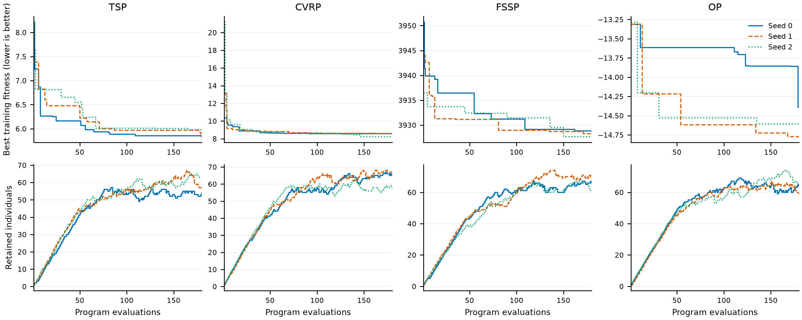

# EvoTrace：面向自动算法设计的带经验树状种群

## 摘要

种群竞争与派生树为自动算法设计提供互补的组织方式：竞争在候选之间分配评价机会，树结构连接连续修改与分支探索。本文提出EvoTrace，将两者结合于带经验的树状种群，并将反思作为搜索经历的压缩过程。节点表示受评算法，主父代边记录派生关系。反思树简化保留活跃工作集、最优个体及连接它们的分叉，将其余历史划分为路径与旁支区域，再对达到规模阈值的区域成批简化与反思。路径经验写入重连边，旁支经验写入保留祖先。后续改进、交叉与探索从同一棵树读取路径级、分支级与种群级视图，将种群的生长与竞争同算法设计经验的持续凝练和使用连接起来。

## 1. 引言

大语言模型（large language model，LLM）通过反复生成、评价与修改程序支持自动算法设计（automated algorithm design，AAD）[@funsearch; @eoh; @elm]。在有限评价预算下，搜索需要选择接下来开发哪些候选，并利用此前尝试的结果。种群竞争在算法个体之间分配评价机会；派生树组织算法如何被修改，以及搜索分支如何发展。

已有研究提供了种群演化[@funsearch; @eoh; @partevo; @shinka]、基于树或图的搜索[@mctsahd; @cladeahd; @pathwise; @phyloevolve]，以及用于后续生成的反思和记忆[@reevo; @refineevo; @deltaevolve; @memorytree]。由此引出一个共同的设计问题：**如何在同一个持续演化的搜索状态中，连接候选竞争、树的维护与经验使用？** 随着新程序和尝试不断积累，这一表示需要支持后续搜索，并为生成组织相关历史。

本文以**带经验的树状种群**结合种群竞争与派生结构。节点是参与竞争的算法个体，主父代边连接它们的发展关系。我们将**反思视为树简化中的搜索经历压缩**：共同整理相关尝试，并将经验存储在后续生成读取这些历史所经过的节点与边上。

**EvoTrace**实现了这一思路。每次受评个体入树后，反思树简化保留近期出生、被直接开发或被选作交叉参考的个体、最优个体及其最近公共祖先（lowest common ancestor，LCA）。保留骨架将其余节点划分为路径与旁支区域，只有达到规模阈值的区域才执行简化与反思。路径区域及其附属旁支凝练到重连边，其余旁支凝练到保留祖先；已有笔记随树更新继续参与后续反思。

搜索在同一棵树上完成选择与生成。全体保留的独立可行个体按适应度名次与谱系开发投入全局竞争。**Refine**读取形成路径和局部尝试；**Crossover**读取共同祖先之后的两条分支；**Explore**通览种群设计与经验。树的维护和这些视图将早期尝试的压缩同后续算法设计连接起来。

方法包含三个相互连接的部分：

1. **带经验的树状种群。** 共同表示参与竞争的算法、派生关系及节点与边上的经验。
2. **反思树简化。** 通过活跃工作集留存、分叉保留与成批区域反思，维护种群并凝练相关尝试。
3. **基于维护树的搜索。** 全局父代采样与面向算子的树视图共同使用这一表示中的算法和经验。

## 2. 相关工作

**演化种群与父代预算分配。** 遗传编程演化可执行程序结构[@koza]，超启发式与自动算法配置则在启发式组件和求解器参数空间中搜索[@hh; @irace]。LLM驱动的AAD将变异算子拓展至代码合成与重写[@survey_aad; @elm; @lmcrossover]。FunSearch结合程序生成与岛屿模型[@funsearch]，EoH协同演化自然语言思想与代码实现[@eoh]，LLaMEA与AlphaEvolve进一步推进评价反馈引导的算法演化[@llamea; @alphaevolve]。围绕多样性维护与父代分配，研究者提出了和声搜索[@hsevo]、生态位划分[@partevo]以及兼顾适应度与使用次数的加权采样[@shinka]。EvoTrace延续全局个体竞争思路，采用与种群规模无关的名次半衰期校准选择强度，按每个体保留祖先路径上的最优可行节点统计谱系开发投入，并将竞争个体嵌入派生树而非扁平集合。

**算法搜索中的谱系树与图结构。** MCTS-AHD利用蒙特卡洛树搜索[@uct]及根到叶路径推理扩展启发式[@mctsahd]，Clade-AHD进一步聚合后代评价形成分支级信念[@cladeahd]。相关研究还探索了演化程序树与有向代码演化图[@a2dept; @codegraphs; @dga2d]。PathWise结合外层种群与内层蕴含图协调规划与反思[@pathwise]；PhyloEvolve同时维护系统发育森林与独立精英池，剪除停滞子树并定期摘要轨迹以供相似度检索[@phyloevolve]。EvoTrace以树作为种群本体。工作集留存与区域规模阈值决定路径收缩和旁支剪枝，反思将选中区域凝练到保留边或祖先上。

**语言反思与经验记忆。** 迭代自我反馈[@selfrefine]与跨尝试语言反思记忆[@reflexion; @expel]启发了AAD中的经验复用机制。ReEvo结合短期成对比较与长期反思[@reevo]，RefineEvo融合规划引导与正负双向经验[@refineevo]，MeEvo交替执行自然演化与共享历史元认知反思[@meevo]，BEAM在启发式演化中自适应调整双层记忆[@beam]。在与谱系结合更紧密的记忆机制中，DeltaEvolve在层次化上下文中追踪语义代码差分[@deltaevolve]，MEMOIR在分支终止时提炼分支局部记忆[@memorytree]。EvoTrace将反思的触发范围与写入位置严格绑定到树状种群的简化操作，并在递归交接过程中持续保留带来源编号的实测比较目录。

## 3. 方法

### 3.1. 问题设定与总体流程

考虑面向固定求解器接口的自动算法设计任务。候选程序实现一个由外层优化框架调用的指定Python函数。评价器在固定训练实例集上运行候选程序，返回标量适应度$f(v)$（全文采用越小越优约定）或执行失败反馈（异常栈、非法返回值或超时诊断）。搜索受限于$B$次实际程序评价预算，初始化评价、执行失败与修复重评均计入$B$；用于生成、格式或运行修复以及区域反思的LLM调用单独记账。

EvoTrace同时维护在线树状种群$T$与只追加的完整尝试档案。树$T$提供可抽样的父代实现及结构化生成上下文；档案完整保存每次生成的程序、评价结果、模型调用与简化记录。初始化完成后，每步迭代从$T$采样主父代与演化算子，构造对应尺度的树视图，生成并评价候选程序（最多允许一次修复），将最终受评版本接入$T$，随后执行动态反思简化。预算耗尽时，系统从完整档案中选出训练适应度最优的可行程序（同分取编号较早者），在预留测试实例集上执行一次性独立评价。

### 3.2. 带经验的树状种群

记在线种群树为$T=(\mathcal N\cup\{r\},\mathcal E)$，其中$r$是不含可执行代码的虚拟根。每个节点$v\in\mathcal N$代表一个受评候选个体，保存：（1）可执行源码及简明事实性计算描述（`design`）；（2）实测适应度$f(v)$或失败反馈；（3）直接开发投入$d(v)$（`development_evaluations`），统计以$v$为主父代实际消耗的评价次数；（4）覆盖$v$及其历史后代的累计子树评价数（`subtree_evaluations`）；（5）最近活动评价时钟$u(v)$（`last_used`）；（6）节点**选择经验**$S_v$及其支撑比较目录。虚拟根$r$同样保存由已淘汰初始程序凝练而成的根选择经验$S_r$。

每个节点$v\in\mathcal N$有且仅有一条来自主父代$p(v)\in\mathcal N\cup\{r\}$的有向入边$(p(v),v)\in\mathcal E$。初始化候选挂接在$r$下；`Refine`、`Crossover`与`Explore`生成的新受评候选挂接在所选主父代下。`Crossover`额外记录只读参考节点编号`reference_id`，不增加第二条结构边，从而严格保持树拓扑。每条边保存算子标签、标记中间祖先是否已收缩的布尔标志，以及边**变异经验**$V_{p(v),v}$与对应比较目录。

**投入与活动时钟记账。** 全局时钟$t$统计已消耗的程序评价总数。当以节点$p$为主父代的一次尝试实际执行了$e\in\{1,2\}$次程序评价（首次评价加可选的修复重评）时，$d(p)$增加$e$，$u(p)$更新为$t$，同时$p$及其当前所有保留祖先的`subtree_evaluations`各增加$e$。该记账规则对`Refine`、`Crossover`与`Explore`完全一致：`Explore`表达生成任务向新主要计算机制的转向，其子代仍作为普通个体参与竞争。被选作交叉参考会刷新个体的活动时钟$u$，但不增加$d$；仅在提示中展示个体不改变计数或时钟。新接入的子节点$v$初始满足$d(v)=0$、`subtree_evaluations`为$0$且$u(v)=t$。

### 3.3. 反思树简化

获得5个可行初始程序后，每次受评个体入树都执行维护。所有决策读取同一份更新前快照。维护只使用两个参数：活跃窗口$W$（`active_evaluations`）与区域规模阈值$m$（`region_size`）。

**活跃工作集。** 设$\mathcal P$包含树中的可行节点。将标准化源码与实测分数均相同的记录折叠到最早保留记录，得到$\mathcal D=\operatorname{distinct}(\mathcal P)$。记$v^\star$为最优可行个体，同分取编号最小者。活跃集合为

$$
\mathcal A=\{v\in\mathcal D:t-u(v)<W\}\cup\{v^\star\},
\qquad W=40,
\tag{1}
$$

其中，$u(v)$在出生、直接开发或被选作交叉参考时刷新。这一规则保留近期使用的个体，无需固定质量名额。精确复制品不进入$\mathcal D$，也不获得独立的父代或交叉参考抽样机会。

**保留分叉与划分区域。** 保留虚拟根及活跃个体之间的两两最近公共祖先：

$$
\mathcal H=\{r\}\cup\mathcal A\cup\operatorname{LCA}(\mathcal A).
\tag{2}
$$

从每个非根骨架节点沿原父指针找到最近骨架祖先。两者之间的节点及其位于$\mathcal H$之外的旁支共同组成路径区域。其余骨架外节点按最近骨架祖先归集为旁支区域，得到互不相交的区域集合$\mathcal C$。骨架端点提供反思上下文，不计入区域规模。

**成批简化。** 只有达到阈值的完整区域才执行简化：

$$
\mathcal R=\bigcup_{C\in\mathcal C:\,|C|\geq m}C,
\qquad
\mathcal K=(\mathcal N\cup\{r\})\setminus\mathcal R,
\qquad m=4.
\tag{3}
$$

较小区域原样暂留，其中符合条件的可行个体可因再次使用而恢复活跃。对选中的路径区域，重连保留端点，将反思经验写入新边的$V$；对选中的旁支区域，将反思经验写入骨架祖先的$S$。已有笔记与比较目录共同参与此次更新。

全部选中区域一次性移除。重连边标记为已收缩，并清空`operator`与`reference_id`，表示其涵盖多步尝试。所有存活个体的直接投入、子树投入及活动时钟保持原值。固定骨架使各区域保持分离；没有新增搜索活动时，再次维护不产生额外简化（附录B）。

### 3.4. 区域反思与来源追溯

针对当轮产生的每个路径收缩区域与每组同承接点旁支区域，EvoTrace各发起一次结构化反思调用，全部读取维护前快照；若当轮无节点退出，则不发起任何反思调用。

**区域证据组织。** 路径反思输入包含保留起止端点源码（$a(v)\neq r$时）、首尾净代码差分与净分数变化、中间节点实现与评价结果、并入该路径的同轮旁支尝试，以及区域内节点和边携带的旧经验。旁支反思输入包含承接节点源码（$u\neq r$时）、各移除尝试相对真实父代的代码差分、实测分数或精简运行错误诊断，以及承接位置原有的$S_u$。为帮助模型理解局部得失，两类输入均附带简短的`[Related Results]`（列出各共同起点下区域之外表现最好的一个兄弟实现描述与分数）以及程序自动生成的`[Comparison Catalog]`（逐条列出原始`parent_id->child_id`、算子、`improved`/`tied`/`regressed`/`failed`实测标签与错误摘要）。

**研究笔记凝练与比较目录绑定。** 每次反思调用按严格JSON模式返回`{"experience": "..."}`，生成一段约120词的自足英文研究笔记，记录尝试过的计算思想、有信息量的结果及相关旧经验，不使用临时尝试编号。解释与假说保持试探性且非强制，旁支提示同时明确指出个体退出源于种群规模管理而非否定其算法思想。写入生成的文本摘要时，程序自动将该区域完整的`Comparison Catalog`结构化元数据（`selection_observations`或`variation_observations`）绑定至目标节点或边。若该载体在后续更新中再次被简化，系统会在旧笔记前自动标注其支撑的`comparison_id`列表，确保多轮递归交接后原始比较端点依然精确可查。若模型调用或解析失败，系统从比较目录与旧笔记确定性生成960字符以内的回退摘要，保证结构更新与来源记录完整无损。

### 3.5. 父代分配与任务对齐生成

**名次半衰期与谱系投入全局采样。** 每次演化生成前，树中全体保留的独立可行个体$\mathcal D$（含内部LCA分叉节点）在同一概率分布中竞争。将$\mathcal D$（记$M=|\mathcal D|$）按适应度$f(v)$由优到劣排序，并列个体共享所占零基名次区间的中点平均名次$\bar r(v)\in[0,M-1]$（对应归一化秩质量$q(v)=1-\bar r(v)/(M-1)$，$M=1$时取$q(v)=0.5$），记$b(v)$为从根到$v$的保留路径上适应度最优的可行节点，包含$v$自身，同分取编号最小者；记$s(b(v))$为该节点的历史子树评价数。父代权重与抽样概率为

$$
w(v)=\frac{2^{-\bar r(v)/H}}{1+s(b(v))},
\qquad
P(v)=\frac{w(v)}{\sum_{u\in\mathcal D}w(u)},
\qquad v\in\mathcal D,
\tag{4}
$$

其中，$H=10$为名次半衰期：名次每落后$H$位，质量权重减半。具有相同路径最优祖先的候选共享该祖先的投入分母；刷新路径最优分数的子代以自身为参照，其子树投入初始为零。个体的直接开发计数仍单独记录。该规则由`lineage_peaks`与`parent_probabilities`实现。

**算子抽样与结构距离交叉参考。** 选定主父代$v$后，系统按$0.45$、$0.30$、$0.25$的概率抽取`Refine`、`Explore`或`Crossover`。选中`Crossover`时，先排除$v$自身及标准化源码等价（`identity(code)`相同）的节点，在剩余互异源码可行候选中计算秩质量$q(u)$，保留满足$q(u)\geq 0.30$（`reference_quality_floor`）的参考池。系统优先挑选尚未记录在`used_crossover_pairs`中的有序配对`(v, u)`（仅当$v$与所有合格参考均已配对后才允许复用），并在其中选择AST多重集Jaccard结构距离（`code_distance`，基于剥离文档字符串后的AST父子类型对与遍历二元组，同距离依次取适应度更优、编号更早者）最大的参考$u$；若无合格参考则自动转为`Refine`。

**任务对齐的多尺度树视图。** 三种算子不再受人为路线边界截断，而是直接按各自的设计职责读取$T$的互补结构视图：

| 算子 | 树状种群$T$的结构视图 | 设计职责 |
| --- | --- | --- |
| Refine | 当前完整源码与分数；从根到当前父代的完整保留`[Evolution Path]`（含未收缩差分、已收缩阶段经验$V$及路径节点$S$）；根经验$S_r$；`[Attempts from Current Algorithm]`（父代$S_v$及保留的有效与失败子尝试） | 结合算法形成脉络与局部试错结果改进当前计算逻辑 |
| Crossover | 当前与参考两份完整源码及分数；真实`[Common Ancestor]`（或根部`[Origin Context]`）；自共同祖先分化的双支路径（`[Current Branch]`与`[Reference Branch]`）及沿途$S/V$；主父代的直接子尝试 | 对照两支谱系的分化演变，甄别并重组互补的计算机制 |
| Explore | 按适应度排序的`[Population Individuals and Experience]`（汇总全体保留可行个体的设计描述、分数、派生来源及附着$S/V$，含根$S_r$），后接`[One Existing Implementation]` | 跳出局部修补，构思核心计算过程明显不同的替代算法 |

未收缩边展示分数变化与精简标准化代码差分（必要时补齐差分基准代码）；收缩边展示端点分数变化、结果设计与阶段变异经验$V$。

当渲染后的演化提示超出输入上限`max_input_tokens`（$30{,}000$）时，系统在可选展示窗口（`max_path_steps`、`max_unconsolidated_attempts`、`max_unconsolidated_failures`、`max_population_members`、`max_experiences`）中迭代折半能够使实测词元数降至最小的维度，同时始终保留至少一条路径或种群记录、当前与参考完整源码以及解释差分所需的基准代码。上下文裁剪仅作用于当次模型输入视图，不修改树结构或经验归属。每次生成调用严格输出含`"analysis"`、`"code"`与`"design"`三个字段的JSON对象。

### 3.6. 搜索算法流程

算法1总结了EvoTrace的完整流程。初始化与演化阶段共享总评价预算$B$与单次修复上限。JSON或语法格式错误最多触发一次不消耗评价预算的格式修复；运行异常、非法输出或超时最多触发一次消耗评价预算的程序修复重评。只有实际执行过至少一次程序评价的尝试才会将最终受评节点接入$T$并推进全局时钟$t$。

```text
算法1：EvoTrace
输入：任务接口、评价器、大语言模型、评价预算 B
初始化虚拟根 r、空树状种群 T 与尝试档案 A
当 evaluations_used < B 且连续无评价尝试数 < 10 时：
    若 A 中可行初始程序少于 5 个：
        由任务接口与初始档案构造初始化提示
    否则：
        按式(4)采样主父代 v，并采样算子 {Refine, Explore, Crossover}
        若算子为 Crossover：在高质量池中选取 AST 结构距离最大的参考 u
        从 T 构造并按词元上限适配与算子对齐的树上下文视图
    生成候选程序（最多一次格式或运行修复）并执行评价
    将全部模型调用与评价结果记入档案 A
    若本次尝试至少执行过一次程序评价：
        将最终受评节点挂接至 T 中主父代；更新 d、subtree、u 与全局时钟 t
        若初始化已完成：
            计算去重集合 D、包含最优个体的活跃集合 A 及 LCA 骨架 H
            将骨架外节点划分为路径区域与旁支区域
            选取冷退节点数至少为 m 的完整区域
            反思选中区域并绑定原始比较目录
            移除选中区域、重连端点，并写回经验 V 与 S
    提交尝试记录与更新后的树快照
返回档案 A 中训练适应度最优的可行程序
```

## 4. 初步实验

本节证据来自此前使用`quality_slots = 32`、`recent_evaluations = 40`及个体直接投入采样的V3配置，早于第3.3节的工作集与区域阈值规则。冻结记录描述该配置的行为，并为成批反思提供设计依据；它们不衡量当前维护规则的搜索效果。

我们在四个标准组合优化基准任务上检验源码冻结的EvoTrace实现，并报告来自2026年11月15日源码冻结部署（北京时间15:36捕获，详见附录D）的多随机种子早期搜索快照。该部署包含12路独立运行（四项任务各取随机种子0、1、2），每路目标预算为$B=1{,}000$次实际程序评价。捕获快照时，各路已完成180至256次程序评价（对应168至247次已提交生成尝试）。我们在全部12路共同达到的最大预算横截面（180次评价）报告训练最优适应度，并对全部2,641次已提交评价中的种群维护与区域反思过程进行统计核查。

### 4.1. 基准任务与执行条件

每项基准任务都在固定外层求解器内演化一个核心决策函数：

- **旅行商问题（`tsp_construct`，TSP）：** 在50节点欧氏实例上演化逐步构造回路时的下一节点选择函数，最小化平均回路长度。
- **带容量车辆路径问题（`cvrp_aco`，CVRP）：** 为蚁群优化（30只蚂蚁、100轮迭代）演化边启发式先验矩阵，最小化平均路径总长。
- **流水车间调度问题（`fssp_gls`，FSSP）：** 为引导式局部搜索演化惩罚矩阵与作业扰动选择计算，最小化平均最大完工时间（makespan）。
- **定向越野问题（`op_aco`，OP）：** 在路径长度约束下为蚁群优化（20只蚂蚁、50轮迭代）演化边启发式先验，最小化负的平均收集奖励。

每次训练评价在16个固定实例上运行，采用最多8个工作进程并行的实例秒池化时限（总计160实例秒，单进程内存上限2 GiB，各实例随机种子由评价种子`730241`加实例序号固定生成）。执行失败与修复重评均计入预算$B$。另有50个不相交同分布实例（500实例秒总时限）预留用于1,000次评价完成后的单次独立测试。模型请求统一经由关闭原生思考的`Qwen3.8-27B`共享端点池调度：生成温度为$1.0$、输出上限$16{,}384$词元；区域反思温度为$0.3$、输出上限$1{,}536$词元（完整参数见附录A与附录D）。

### 4.2. 180次评价横截面上的搜索轨迹

表1给出各任务三个随机种子在180次评价处的训练最优适应度，以及三种子样本均值与样本标准差（SD）。图1将共同180次评价窗口内的最优训练适应度曲线（上排）与每次受评入树及简化提交后的树上保留个体数（下排）对照展示。

**表1｜180次评价处的训练最优适应度（越小越好）。**

| 任务 | 种子0 / 1 / 2 | 均值 | 标准差 |
| --- | ---: | ---: | ---: |
| TSP | 5.8527 / 5.8362 / 5.9800 | 5.8897 | 0.0787 |
| CVRP | 8.5592 / 8.5845 / 8.2413 | 8.4617 | 0.1913 |
| FSSP | 3928.81 / 3928.25 / 3927.69 | 3928.25 | 0.56 |
| OP | -14.3919 / -14.7719 / -14.6069 | -14.5902 | 0.1905 |



**图1｜12路冻结运行的搜索进展与保留种群规模。** 上排展示前180次评价共同区间内的最优训练适应度（实线为三种子均值，细线分别为种子0、1、2）。下排展示前180次评价内每次提交维护后的保留个体数$|\mathcal K\setminus\{r\}|$，并与存储的完整树快照逐一核对一致。跨过40次评价的近期窗口后，生存选择与LCA闭包使在线种群规模保持稳定有界。

在全部四项任务与12个种子上，训练适应度均显著超越5个初始可行程序的起点：前60次评价内快速下降，并在60至180次评价间通过持续改进与跨支路交叉进一步提升（例如CVRP种子2降至8.2413，OP种子1达到-14.7719）。与此同时，图1下排直观呈现了生存简化的结构调节效果：在线个体数在前40次评价的近期窗口内近似线性增长，随后迅速收敛并稳定在紧凑区间，即便到256次评价的各路观察终点，12路树的保留个体数仍严格处在54至70之间（由32个质量名额、窗口内近期个体及连接分叉共同构成）。

### 4.3. 结构简化与递归反思统计

对12路前缀全部2,481次已提交尝试（2,641次评价）的逐条审计确认，记录了冻结规则下的节点移除、区域归属与反思行为：

- **节点移除与保留状态：** 在累计接入树$T$的2,481个受评节点中，1,195次简化更新共移除1,734个实现（占$69.9\%$），在12棵活动树中保留747个显式个体。每次更新中的每个移除节点均唯一归属一个简化区域，无孤立节点或计数漂移。
- **路径收缩与旁支剪枝协同生效：** 搜索推进至远超$W=40$后，两类简化模式均充分运转：1,195次更新将1,734个移除节点划分为**509个路径收缩区域**（更新边经验$V$）与**887个旁支剪除区域**（更新节点或根经验$S$），共计1,396个简化区域。
- **增量式递归凝练：** 全部1,396个区域均正常完成结构化LLM反思，**回退摘要数为0**（无解析或模式校验失败）。按单次区域新移除的节点数统计，1,127个区域（$80.7\%$）凝练1个新退出实现，204个凝练2个，62个凝练3个，2个凝练4个，1个凝练5个，体现了每次维护将小规模新退出记录与载体已有经验增量融合的运行特征。
- **独立的反思成本核算：** 在累计2,641次程序评价过程中，1,396次反思调用共消耗4,897,554个输入词元与256,594个输出词元（平均每区域约3,508个输入词元、184个输出词元），与求解器评价预算分开透明记账。

## 5. 讨论

**竞争、结构与经验。** EvoTrace用同一棵树选择个体、组织相关尝试，并向生成提供经验。父代采样结合个体名次质量与谱系投入；工作集和LCA骨架决定哪些部分继续显式保留；区域反思凝练选中简化的相关尝试。路径级、分支级与种群级视图随后使用这一维护后的状态。

**为何成批反思。** 在第4节的早期规则下，80.7%的区域只包含一个新移除节点。当前阈值使每个反思区域至少汇集$m$个冷退节点。这改变了反思频率和可供凝练的材料；它是否改善经验或后续生成，需要直接检验。

**评价范围。** 冻结运行记录了早期保留规则下的搜索与经验交接。当前工作集简化已通过结构回放与不变量检查。附录E的完整搜索比较和固定状态经验实验将检验当前方法的搜索表现，以及凝练经验对生成的作用。

## 6. 结论

EvoTrace以带经验的树状种群结合种群竞争与派生结构。反思树简化随树更新，将路径与旁支中的相关尝试压缩为节点与边上的经验。全局父代采样与面向算子的树视图在同一状态上继续设计算法，将种群生长、经验凝练与后续生成连接起来。

## 附录 A. 默认超参数与记账细则

| 组成部分 | 默认设置 |
| --- | --- |
| 初始化与总评价预算 | 5个可行初始程序；总计$B=1{,}000$次实际程序评价 |
| 重复记录折叠 | 将`(identity(code), fitness)`均相同的可行节点合并至最小节点编号 |
| 活跃工作集（`active_evaluations`） | 距出生、直接开发或被选作交叉参考不足$W=40$次评价；始终保留最优个体 |
| 成批阈值（`region_size`） | 仅对冷退节点数达到$m=4$的完整区域执行简化与反思 |
| 结构连通 | 对$\mathcal A$取两两LCA闭包并保留虚拟根$r$ |
| 父代采样（`rank_half_life`） | 平均名次半衰期$H=10.0$；谱系投入折扣$1/(1+s(b(v)))$ |
| 算子先验权重 | `Refine` $0.45$；`Explore` $0.30$；`Crossover` $0.25$ |
| 交叉参考选择规则 | 排除相同标准化源码；秩质量$q(u)\geq 0.30$；优先未配对组合，取最大AST `code_distance` |
| 演化提示词元窗口 | `max_input_tokens` $=30{,}000$；超限时按实测词元折半缩减可选展示窗口 |
| 生成模型参数 | 温度$1.0$；`top_p` $0.8$；`top_k` $20$；`presence_penalty` $1.5$；最大输出$16{,}384$词元 |
| 反思模型参数 | 温度$0.3$；最大输出$1{,}536$词元；约120英文词的JSON `"experience"`研究笔记 |

**数值计算与边界规则。** 在`quality_scores`中，当$M$个可行候选中某并列适应度块占据零基下标`start`至`end - 1`时，若$M>1$则赋予归一化秩质量$q(v)=1-(\text{start}+\text{end}-1)/(2(M-1))$，若$M=1$则取$0.5$。`parent_probabilities`先减去当前最优并列名次再在对数空间求指数，并以`math.ulp(0.0)`作为概率下界，防止极端名次差导致数值下溢或隐式取消抽样资格。直接投入$d(v)$统计所有以$v$为主父代的受评`Refine`、`Explore`与`Crossover`尝试（含失败与修复重评），且在祖先收缩或旁支剪枝时严格不变。

**词元计数与回退保护。** 接入公共调度端点池时，`count_tokens`调用服务端聊天分词器精确计数；无分词器的独立客户端保守使用UTF-8字节长度并在`input_window`中标记`"utf8_bytes"`。若某次反思请求失败或违反JSON模式，系统从`comparison_catalog`与按分句截断的旧笔记确定性生成不超过`MAX_EXPERIENCE_CHARS = 960`字符的摘要，同时完整保留结构化`observations`列表。仅当连续`max_unevaluated = 10`次尝试均未产生任何程序评价时，搜索提前终止。

## 附录 B. 单次简化更新的结构性质

考虑有限的更新前树$T_0$，其活跃集合$\mathcal A$、骨架$\mathcal H$、候选区域$\mathcal C$及最终保留集合$\mathcal K$按第3.3节定义。虚拟根始终保留。以下性质针对固定评价时钟下的结构更新。

**树结构保持。** 每个保留的非根节点在$T_0$中都有唯一的最近保留祖先。重连至该祖先使原树深度严格下降，连续沿父指针上行必然到达根且不形成环。每个保留非根节点有且仅有一个父节点，因此更新后仍为有根树。

**区域唯一归属。** 相邻骨架节点之间的路径内点互不相交。否则两条路径在$\mathcal H$之外共享分叉，与LCA闭包矛盾。其余骨架外节点均有唯一的最近祖先位于路径内点或$\mathcal H$中：前者归入对应路径区域，后者归入该骨架节点的旁支区域。因此所有区域构成$\mathcal N\setminus\mathcal H$的划分。按规模选择完整区域不会改变互不相交性，每个移除节点只归属一个选中区域。

**最优个体与投入保持。** 最优个体属于$\mathcal A\subseteq\mathcal H\subseteq\mathcal K$。重连改变父指针与经验载体，保留节点的投入计数和活动时钟原样复制。已移除尝试的评价仍保留在全局计数与适用的保留祖先历史计数中。

**单步幂等。** 没有新的搜索活动时，原有活跃个体及其LCA骨架全部保留。如果较早的重复代表被移除，使暂留副本获得工作集资格，新骨架可以增加节点，但不会失去原有边界。因此每个剩余区域都包含在某个此前的暂留区域中：新增骨架节点可以将其拆分，保留边界则阻止跨区域合并。每个区域仍小于$m$，再次规划不产生额外移除。

## 附录 C. 反思提示模板

`evotrace_v3/reflection.py`中的两类反思提示均先给出包含任务说明`[Task]`、函数签名`[Function Interface]`与目标方向`Score direction`的公共头部，随后列出区域证据（`[Path Evidence]`或`[Branch Experiments]`，含源码、差分、同起点兄弟参照`[Related Results]`、带`[Supporting comparisons: ...]`标注的旧经验及程序生成的`[Comparison Catalog]`）。英文主稿附录C逐字收录了英文模板原文，其核心任务与输出规范对应如下：

**变异经验提示（`VARIATION_PROMPT_TEMPLATE`，对应路径收缩）。**

> **任务要求：** 为继续推进搜索的研究者压缩这段演化过渡中的算法设计经验。撰写一段简短的研究笔记，保留此次发展中值得记住的内容：计算思想、有信息量的结果以及相关的早期经验。忠实记录即可，原理解释或一般规律属于可选项；任何解释均应保持试探性，并为后续设计决策留出开放空间。
>
> **输出格式：** 返回仅含`"experience"`字符串字段的JSON对象（约120英文词的紧凑段落），说明计算过程如何演变以及中间实验有哪些值得保留的认识，指明具体计算机制而非临时尝试编号；起止端点分数由系统自动附加。

**选择经验提示（`SELECTION_PROMPT_TEMPLATE`，对应旁支剪除）。**

> **任务要求：** 为继续推进搜索的研究者压缩这组分支实验中的算法设计经验。撰写一段简短的研究笔记，保留尝试过的计算思想、有信息量的结果以及相关早期经验。忠实记录即可，解释或一般规律属于可选项；保持解释的试探性。明确指出这些分支仅因种群管理而退出，并不代表其算法思想被证伪。
>
> **输出格式：** 返回仅含`"experience"`字符串字段的JSON对象（约120英文词的自足段落），关联所尝试的计算思想与实测结果并整合有效旧经验，陪伴存活算法参与后续设计调用，保存仅靠当前源码无法传达的试错认识。

## 附录 D. 复现条件与部署记账

该早期批次采用质量名额32与近期窗口40，标识为

`20261115_115206_evotrace_v3_revised_co4`。

批次于2026年11月15日启动前冻结了源码、任务评价器与配置，共463个文件。

尝试档案`native/attempts.jsonl`中的每条已提交记录完整保存生成程序、首次及修复评价结果、采样的`parent_id`、`parent_probability`、`operator`、`reference_id`、`reference_distance`、词元适配后的上下文元数据、简化触发详情、反思提示与原始响应，以及更新后的`TreePopulation`快照。使用`--resume`从`attempts.jsonl`恢复时会确定性重放已提交树快照，绝不重复调用历史反思，并严格拒绝方法名或关键配置不一致的续跑请求。

搜索统一使用随机种子0、1、2。TSP训练集采用16个50节点欧氏实例（`seed = 2024`）；CVRP采用30只蚂蚁、100轮ACO迭代（`aco_seed = 1234`）；OP采用20只蚂蚁、50轮ACO迭代（`aco_seed = 1234`）；FSSP采用冻结配置规定的实例集与GLS参数。训练评价执行参数固定为`timeout_scope = "whole_task"`、`time_budget = "pooled_instance_seconds"`、`timeout_seconds = 160.0`（16个实例共享160实例秒，单实例均值10.0秒）、`n_workers = 8`、`memory_limit_bytes = 2147483648`及`evaluation_seed = 730241`。生成提示仅暴露任务描述、优化方向与函数模板，实例规模、数据划分与外层迭代次数严格作为外部评价条件。

对`Qwen3.8-27B`（`enable_thinking = false`）的请求由本地共享调度池在FP8与GGUF服务端点间分配，并逐次记录路由端点与返回词元用量。服务端传输异常自动重试且与候选执行失败分开统计。`paper/evidence/snapshot.json`保存各路日志路径、SHA-256校验值、脱敏配置与逐次评价序列；`paper/build.py`与`paper/validate.py`直接依据该冻结快照编译并核验中英文双稿，不会隐式刷新正在运行的实验。

## 附录 E. 完整预算与受控消融评价方案

当前维护规则需要单独冻结源码并运行搜索批次。以下方案用于该批次及其机制检验，与早期配置的结果分开报告：

1. **同预算完整搜索与独立测试比较。** 在相同的16实例训练集、160实例秒8进程并行评价限制、`Qwen3.8-27B`采样参数及$B=1{,}000$次实际评价记账口径下，运行各对比种群方法、树搜索方法与反思方法（每任务种子0、1、2）。各路搜索结束后先锁定训练最优可行程序，再在预留的50实例测试集（500实例秒）上执行一次性测试，完整报告逐种子测试分数、训练收敛曲线、失败率及生成、修复与反思词元开销。
2. **固定快照的经验表示对照（`include_experiences`消融）。** 在预先声明的评价节点抽取已提交树快照（不按后续是否改进筛选）。固定树快照、`parent_id`、`operator`、`reference_id`与输入词元预算，对比同一批已移除区域的三种表示：（a）省略经验（`include_experiences = False`）；（b）提供相同移除区域的原始代码差分与评价结果；（c）提供EvoTrace凝练的$S/V$笔记。以快照为配对单位重复采样，按算子统计子代可行率、相对父代胜率、适应度变化与实测输入词元。
3. **结构化定位与扁平经验列表对照。** 在相同快照上固定已选$S/V$笔记文本与输入词元上限，对比EvoTrace按路径边和祖先节点原位呈现的方式与保留来源编号的共享时间序列表，分离“谱系结构定位”相对“纯文本可见性”的独立作用。
4. **多轮交接保真度抽检。** 按任务、区域类型（路径收缩与旁支剪除）及累计交接轮数分层随机抽取已记录的反思样本，对照`attempts.jsonl`及绑定的`Comparison Catalog`逐条核查实测涨跌方向准确性、代码改动描述忠实度以及是否存在过度引申的因果归因。

## 参考文献

PDF从共享的`paper-references.bib`生成参考文献列表。
