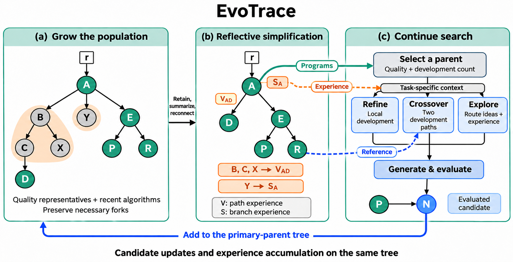
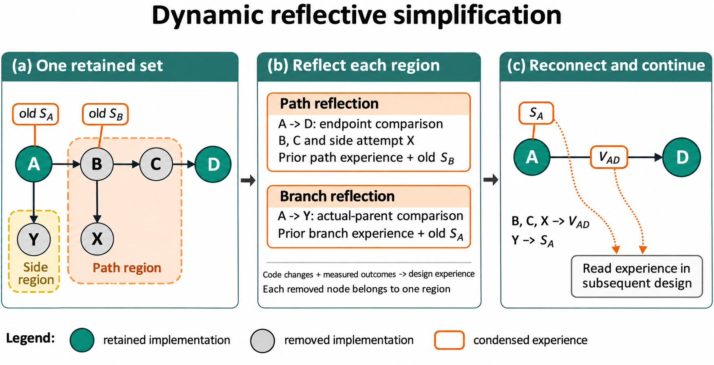
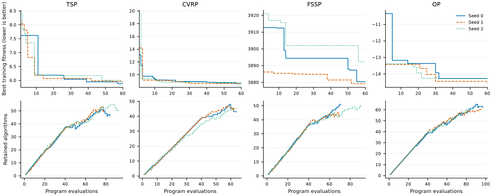

# EvoTrace: Evolving Tree-Structured Populations through Reflective Compression

## Abstract

Evaluated programs have two distinct forms of value in automated algorithm design: they provide starting points for further search, and their development provides evidence for subsequent revisions. A program can lose the first value while its history retains the second. We introduce EvoTrace, which couples population updates with the reflective compression of search experience. EvoTrace maintains a tree-structured population of executable candidates, derivation relationships, and condensed experience. A retention decision jointly determines the programs that remain explicit, the regions of history to summarize, and the retained locations that receive their experience. Contracted paths and their removed side attempts contribute experience to reconnected edges; other removed branches contribute experience to retained ancestors. Later updates carry this experience forward as the tree evolves. Refinement, crossover, and exploration read complementary views of the same structure. EvoTrace makes the population an evolving representation of both available programs and their design history, with selection and reflection jointly determining how past evaluations remain available to future search.

## 1. Introduction

Large language models (LLMs) enable automated algorithm design (AAD) through repeated program generation, evaluation, and revision [@funsearch; @eoh; @elm]. Under a limited evaluation budget, each trial produces two useful objects: an executable candidate and evidence about a computational choice. The candidate supplies a starting point for further search. The comparison with its parent can inform how a later candidate should change. Search must continually decide which implementations to develop and which experiences to bring into the next design.

These decisions concern different forms of value. A program may be superseded by a better descendant, while the revisions and alternatives explored along its development remain informative. A regressed trial may be a poor starting point, while its outcome helps interpret a later modification of its parent. Candidate retention and experience retention therefore need not select the same material. The central question is **how a population can keep accumulating useful design experience as its executable members change**.

Existing search states offer several ways to organize this material. Evolutionary populations maintain candidates for variation [@funsearch; @eoh; @partevo]. Reflective methods transform evaluations into language feedback [@reevo], and memory-based methods organize experience across revisions or branches [@deltaevolve; @memorytree]. Tree and lineage methods preserve derivation relationships for selection, generation, and pruning [@mctsahd; @pathwise; @phyloevolve]. These approaches establish the value of both candidate competition and developmental context. We focus on the update connecting these decisions: using the retained candidate structure to determine both the scope and the placement of experience compression.

We view population update as a decision about how search history is represented. Some implementations remain explicit because the search may develop them further. Related history can instead continue as condensed experience. **Reflection performs this compression, and a tree-structured population gives it a scope and a location.** The tree combines competition among executable candidates with the relationships linking their development. Once the retained candidates are known, the same structure identifies the intermediate histories between them and the alternative branches around them. Those regions specify what to summarize and where the result belongs.

We instantiate this idea in **EvoTrace**, an experience-bearing tree-structured population maintained through **dynamic reflective simplification**. Each update selects quality representatives and recently developed implementations, then preserves the forks needed to connect them. Removed intermediate versions and their side attempts become experience on the reconnected edge. Other removed branches become experience at a retained ancestor. Existing experience travels with its carrier when a later update simplifies that carrier. Subsequent generation draws both its starting program and its relevant history from the maintained tree.

One retention decision specifies the surviving candidates, the regions to compress, and their receivers. This supplies a structural link between selection and experience accumulation: every removed region has a definite recipient in the retained population. Parent sampling allocates evaluations over the surviving candidates, and operator-specific views provide local development for refinement, two development paths for crossover, and route-level ideas for exploration.

Our contributions are twofold:

1. **An experience-bearing tree-structured population.** We organize executable candidates, derivation relationships, and condensed design experience in one evolving structure, so that the population supplies both development starting points and their relevant history.
2. **Dynamic reflective simplification.** We couple population updates with experience compression. The retained structure jointly determines the history regions to summarize and their receiving nodes or edges, connecting removed attempts to subsequent generation.

## 2. Related Work

**Program evolution and candidate competition.** Genetic programming evolves executable programs [@koza], while hyper-heuristics and algorithm configuration search over heuristic components and solver settings [@hh; @irace]. LLM-driven AAD extends the variation process to program synthesis and revision [@survey_aad]. Evolution through Large Models uses a code model for mutation [@elm], and language-model crossover recombines text-based genotypes [@lmcrossover]. FunSearch combines program generation with an island population [@funsearch]; EoH evolves heuristic descriptions together with implementations [@eoh]. LLaMEA and AlphaEvolve further develop evaluator-guided algorithm and code evolution [@llamea; @alphaevolve]. Candidate diversity and allocation are addressed through harmony search [@hsevo], niches [@partevo], and fitness-and-usage-based parent sampling [@shinka]. EvoTrace adapts the latter sampler and couples candidate maintenance to the compression of the associated design history.

**Derivation structure in algorithm search.** MCTS-AHD uses a search tree and a tree-path reasoning action for heuristic generation [@mctsahd]. Clade-AHD aggregates descendant evaluations into beliefs for clade-level selection [@cladeahd]. PathWise combines an outer population with an inner entailment graph and coordinated planning, generation, and reflection [@pathwise]. PhyloEvolve maintains a phylogenetic forest, an elite pool, trajectory-conditioned generation, and structural pruning; its Summarizer periodically distills trajectories into summaries retrieved by semantic similarity [@phyloevolve]. These methods connect current candidates to their derivations. EvoTrace uses the retained derivation structure to define a joint update: path contraction and branch removal determine the regions of reflection, and the resulting summaries remain on the retained connections or ancestors that inherit those regions.

**Reflection and experience reuse.** Self-Refine iterates on self-feedback [@selfrefine]; Reflexion and ExpeL retain language experience across attempts [@reflexion; @expel]. In AAD, ReEvo combines short-term comparisons with long-term reflection [@reevo]. RefineEvo uses planning and positive and negative experience [@refineevo], while MeEvo alternates population evolution with reflection over shared history [@meevo]. DeltaEvolve organizes changes as semantic deltas in a hierarchical context system [@deltaevolve]. MEMOIR combines branch-local memory with summaries distilled at branch termination [@memorytree]. EvoTrace connects the scope and placement of reflection to the same retained structure used for candidate maintenance. Its recursive handoff lets a summary remain part of that structure as its original implementations leave the online population.

## 3. Method

### 3.1. Problem and Overview

We consider AAD for a specified task interface. A candidate program implements a designated function used by an enclosing solver. The evaluator executes the program on a fixed search dataset and returns a fitness value or failure feedback. We use the convention that lower fitness is better. The search has a budget of $B$ program evaluations, including unsuccessful executions and repair evaluations. Model calls for generation, repair, and reflection are accounted for separately.

EvoTrace maintains an explicit tree-structured population alongside a complete attempt archive. The tree supplies selectable algorithms and context for generation; the archive records generated programs, evaluations, and population updates. Each iteration selects an algorithm, generates and evaluates a candidate, attaches the final evaluated version, and simplifies the updated population. The returned program is the feasible archived program with the best search fitness, with earlier creation order breaking ties. Any held-out evaluation is performed after this choice.



**Figure 1. EvoTrace.** A retained set determines how the population is simplified and where removed history becomes experience. The maintained tree supplies programs for selection and experience for task-specific context. Each attempt samples one operator; the evaluated candidate returns to the primary-parent tree. Dashed arrows show information inputs, including the crossover reference.

### 3.2. Tree-Structured Population

Let $T=(\mathcal N\cup\{r\},\mathcal E)$ be the current tree, where $r$ is a virtual root without an implementation. Each algorithm node stores code, a description of its computation, fitness $f(v)$ or failure feedback, and usage records. Every node has one primary parent. Crossover also records a reference algorithm as an auxiliary input; this reference does not add a second edge to the maintained tree. All retained feasible nodes, including internal nodes, can be selected for further development.

The tree carries two forms of experience. **Selection experience** $S_v$, attached to a node, condenses side branches removed around that location. **Variation experience** $V_{uv}$, attached to an edge, condenses the intermediate development and its removed side attempts between retained endpoints. The names identify the simplification operations that produce the summaries. Both types can describe improvements, ties, regressions, and failures; a contracted path can have a net regression. Selection experience informs generation and later reflection, while parent sampling uses fitness and development counts. The virtual root can carry selection experience from removed initial routes. An ordinary edge represents one generation attempt. A contracted edge represents a developmental stage and is marked accordingly.

Initialization and exploration start development routes; refinement and crossover inherit the route of the primary parent. A route groups implementations by their Init/Explore origin. Its identifier remains with descendants when the original entry is removed. Routes organize parent allocation and local context. An Explore entry may contract into a descendant; a reconnected edge between different routes retains the Explore label.

### 3.3. Dynamic Reflective Simplification

Once initialization is complete, EvoTrace checks the population after every evaluated addition. The update has three steps: select algorithms, retain necessary forks, and partition the removed regions. All three steps use the same tree snapshot before simplification.

**Selecting quality representatives.** Let $\mathcal P\subseteq\mathcal N$ contain the feasible nodes, ranked by fitness and then creation order. Define rank quality as

$$
q(v)=1-\frac{\operatorname{rank}(v)}{\max(1,|\mathcal P|-1)},
\qquad v\in\mathcal P,
\tag{1}
$$

where the best node has rank zero. EvoTrace retains the best node and considers the remaining candidates with $q(v)\geq0.50$ in ranked order. A candidate is superseded only by a strictly better descendant in the same route; a superseded candidate does not join the representative set, but can remain through recent use or fork retention. If removed, its history enters the region determined by the final retained set. A candidate is covered if an already selected representative has identical normalized source or an abstract syntax tree (AST) distance below $0.08$. When the fitness values differ by at most $10^{-9}$, the distance threshold is $0.20$. Otherwise, the candidate joins the representative set $\mathcal R$. Every representative used for coverage has fitness no worse than the candidate being considered.

The distance is a multiset Jaccard distance over AST parent–child type features and traversal bigrams. It retains operator types, called function names, and control structure while omitting ordinary variable identities and numerical values as feature values. Normalized-source identity is a separate check that preserves variables and constants while ignoring formatting, comments, and docstrings.

**Retaining recently used algorithms.** The evaluation clock $t$ counts actual program evaluations. Each feasible node has a last-use time $u(v)$, refreshed at birth or when an evaluated Refine or Crossover attempt uses it as primary parent. Explore and read-only reference use do not refresh this time. Let $p(v)$ denote the parent of $v$ in the tree. The recent set is

$$
\mathcal U=\{v\in\mathcal P:t-\max(u(v),u(p(v)))<W\},
\qquad W=40,
\tag{2}
$$

where only $u(v)$ is used when the parent is the virtual root or belongs to a different route. Attempts from the same route may lose recent eligibility together; quality representatives and necessary forks remain retained.

Failed executions and repair evaluations advance the clock. Displaying a node in context or retaining it as a structural connector does not refresh its time. Recent retention preserves a candidate's eligibility for continued development during the window; the parent sampler determines its actual opportunities.

**Preserving necessary forks.** The retained set is

$$
\mathcal K=\{r\}\cup\mathcal R\cup\mathcal U
\cup\operatorname{LCA}(\mathcal R\cup\mathcal U),
\tag{3}
$$

Here, $\operatorname{LCA}(A)$ denotes the set of lowest common ancestors of pairs of nodes in $A$, retaining the forks needed to connect the selected nodes. Unary intermediate ancestors are eligible for contraction. Quality representatives are determined before recent retention and structural completion are added. Thus, a node retained solely for recency or connectivity does not exclude a better candidate from the representative set. The update computes ranks and representatives once. The number of retained nodes follows recent use, quality differences, and branching structure; the rule imposes no fixed population cap.

**Partitioning paths and side branches.** For each retained algorithm, EvoTrace finds its nearest retained ancestor in the original tree. Removed intermediate nodes on this connection form a path-contraction region. For each remaining removed node, the algorithm walks upward to the first ancestor outside the remaining side-node set. If that ancestor is a contracted intermediate, the side node joins its path region; otherwise, its retained ancestor or the root receives a side-branch region. Each removed node belongs to exactly one region in that update. Multiple side branches assigned to the same receiver are processed together.

This partition can shorten a path and remove its side branches in the same update. Consider $A\rightarrow B\rightarrow C\rightarrow D$, with branches $B\rightarrow X$ and $A\rightarrow Y$, when only $A$ and $D$ remain. Nodes $B,C$ belong to the contracted path, and $X$ joins that same path region, contributing to $V_{AD}$. Branch $Y$ updates $S_A$ at $A$. Earlier experience attached to $B$ or $C$ travels with those nodes into the path region.



**Figure 2. Experience follows the retained structure.** With A and D retained, intermediate versions B and C and side attempt X form one path region, summarized on the reconnected edge as $V_{AD}$. The separate branch Y updates $S_A$. Earlier experience travels with its carrier: old $S_B$ enters the path summary, while old $S_A$ merges with Y.

### 3.4. Region Reflection

**Region-specific reflection.** EvoTrace makes one reflection call for each final contraction region and each grouped side-branch region. A path reflection receives retained endpoint implementations, their net difference, intermediate implementations and outcomes, their removed side attempts, and inherited node and edge experience. A side-branch reflection receives the receiver's implementation when available, the removed attempts and their actual parent-relative differences, evaluation or error feedback, and earlier relevant experience. The virtual root supplies a task-level origin when there is no retained algorithm receiver. Contracted inputs are explicitly presented as stages of development. Side-branch comparisons use each trial's actual parent. Current comparisons are supplied as program-computed outcome labels; raw scores remain in the archive and the program attaches endpoint scores to path experience. Both prompts distinguish an Explore draft from local tuning and attribute each observed outcome to the evaluated implementation.

The reflection prompt asks for a concise account of the tested computations and their observed outcomes, followed by a tentative explanation when supported. It distinguishes net start-to-end changes from intermediate comparisons and treats jointly modified components as a combined change. The prompt asks the model to keep earlier experience where it remains consistent with the measured comparisons; the comparison labels themselves are computed by the program. Generated design rationales are excluded from the evidence. All regions in one update read the same original snapshot; newly produced summaries are not reused within that pass.

Path reflection updates $V_{uv}$ on the reconnected edge. Side-branch reflection updates $S_u$ at the receiver, incorporating its existing selection experience. When a later update removes a carrier, its accumulated experience enters the appropriate new region. This recursion retains a condensed account of development while allowing intermediate implementations to leave the explicit population. The tree stores these textual summaries alongside retained implementations; the attempt archive preserves the complete underlying evidence.

### 3.5. Search from the Maintained Tree

**Parent and reference selection.** EvoTrace adapts the weighted parent sampler of ShinkaEvolve [@shinka]. Let $D(v)$ denote the route containing $v$, identified by its original Init/Explore identifier. Each nonempty route contains its retained feasible nodes. Their weights and sampling probabilities are

$$
w(v)=\sigma\!\left(10\frac{m-f(v)}{s}\right)\frac{1}{1+c(v)},
\tag{4}
$$

$$
P(D)\propto\max_{u\in D}w(u),\qquad P(v\mid D)=\frac{w(v)}{\sum_{u\in D}w(u)},
\tag{5}
$$

where $\sigma$ is the sigmoid function, $c(v)$ counts evaluated Refine and Crossover attempts using $v$ as primary parent, and $m$ and $s$ are the median and median-absolute-deviation scale of fitness over quality representatives, recomputed on the current tree before each sampling step. All retained feasible nodes remain eligible, with probability $P(D(v))P(v\mid D(v))$. At fixed weights, adding a version whose weight does not exceed its route maximum leaves the route probability unchanged. In an actual search update, probabilities can change through a new maximum, further development of a parent, or a shift in the representative set and its normalization.

After selecting a parent, EvoTrace samples Refine, Crossover, or Explore with probabilities $0.45$, $0.25$, and $0.30$, respectively. Crossover first excludes the parent and normalized-source duplicates, then applies the rank-quality rule to the available references. Candidates with quality at least $0.30$ are eligible. EvoTrace prefers an unused ordered parent–reference pair and chooses the largest AST distance within that pool, breaking ties by fitness and creation order. It permits pair reuse once all eligible pairs have been used and uses Refine when no eligible reference exists.

**Context at the scale of the design decision.** The three operators read different views of the same population:

| Operator | Structural context | Current design task |
| --- | --- | --- |
| Refine | Current code and fitness; formation path within the current route and a brief account of its source; node selection experience; visible outgoing trials or developmental stages | Revise the current computation using its development and evaluated alternatives |
| Crossover | Both implementations; their common ancestor and diverging paths within a route, or separate local development paths across routes; relevant node and edge experience; outgoing trials from the primary parent | Decide which computations to transfer and how to integrate them |
| Explore | Distinct route-entry ideas; the most recently generated retained version in each selected route; node and edge experience; root experience; one existing implementation | Construct an alternative with a different main computation |

An ordinary transition supplies a difference relative to its actual parent and its outcome. A contracted transition supplies endpoint outcomes and accumulated variation experience. Difference sequences include the baseline code needed to interpret them. Within a route, Crossover presents the common ancestor once. Across routes, it summarizes shared provenance without expanding earlier routes. Explore labels the source of each experience without repeating the full design description. Exploration organizes ideas and experience before showing an existing implementation, allowing the model to reconsider its representation or procedure.

The context builder first assembles the relevant retained material. If a generation prompt exceeds its input budget, it reduces complete entries from path, trial, or route views according to the actual tokens released. Current code, reference code, and required difference baselines remain available. Context fitting changes a prompt view; it does not change the tree, retention decisions, or experience ownership. Each operator returns a complete implementation and a description of its computation.

### 3.6. Search Procedure

Algorithm 1 summarizes the search. Initialization creates five feasible programs under the same evaluation budget. Each generation attempt has at most one repair opportunity and contributes at most one final evaluated node. Repair re-evaluation consumes budget separately. Attempts that produce no program evaluation do not enter the tree or advance its clock.

```text
Algorithm 1: EvoTrace
Input: task interface, evaluator, LLM, evaluation budget B
Create a virtual root, an empty population, and an attempt archive
while evaluation budget remains and the stopping rule is not met:
    if fewer than five feasible initial programs have been obtained:
        build an initialization prompt
    else:
        sample a parent and operator; choose a reference when needed
        build and fit the corresponding tree-context view
    generate and evaluate a program, allowing at most one repair
    record all requests and evaluation outcomes
    if the attempt contains an evaluated program:
        attach its final evaluated version; update actual-use records
        if initialization is complete:
            select representatives and recent nodes on one snapshot
            add necessary branching ancestors to obtain the retained set
            partition removed paths and side branches on that snapshot
            reflect on each region
            reconnect retained nodes and attach the resulting experience
    commit the attempt and its population update
return the feasible archived program with the best search fitness
```

The update preserves the best current algorithm and reconnects every retained node to its nearest retained ancestor. Pairwise fork closure ensures that contracted intermediate paths are disjoint; the remaining removed nodes have a unique receiving region. Appendix B gives the argument for these structural properties.

## 4. Preliminary Evaluation

We examine the implementation on four combinatorial optimization tasks and report a frozen early-search snapshot. The snapshot contains 12 independent runs, with seeds 0, 1, and 2 for each task, from the source-frozen deployment of 14 November 2026. Each run has a target budget of 1,000 evaluations. At the snapshot, runs have completed 62–97 evaluations. We report training fitness at the common 60-evaluation checkpoint and analyze the population updates committed in each observed prefix. Held-out performance and complete-search comparisons require the completed runs.

### 4.1. Tasks and Evaluation Conditions

Each task evolves a function within a fixed solver. TSP evolves next-node selection in sequential tour construction. CVRP and OP evolve edge priors for ant colony optimization. FSSP evolves the matrix and job-selection computation used by guided local search. Objectives are mean tour length, mean route length, mean makespan, and negative mean collected reward, respectively. All four objectives are minimized.

Search uses 16 training instances per task. A disjoint set of 50 same-scale instances is reserved for testing the final selected program. Each complete training evaluation has a shared 160-second time limit and a 2 GiB process memory limit; the evaluator uses one worker. Failures consume evaluation budget, and repair re-evaluations are counted separately. The model pool serves Qwen3.8-27B with native thinking disabled. Generation uses temperature 1.0 and at most 16,384 output tokens; reflection uses temperature 0.3 and at most 1,536 output tokens. Appendix D records the remaining task and sampling settings.

After search, the best feasible training program is fixed before testing. Test results do not affect selection. Model requests and reported token usage are accounted for separately from program evaluations. This separates the cost of experience compression from the evaluation budget used for search.

### 4.2. Training Fitness at a Common Budget

Table 1 reports the best training fitness after 60 evaluations. Standard deviations are sample standard deviations over the three independent search seeds. Scores retain their native units; OP is negative because the evaluator minimizes the negative collected reward.

**Table 1. Best training fitness at 60 evaluations. Lower is better.**

| Task | Seeds 0 / 1 / 2 | Mean | SD |
| --- | ---: | ---: | ---: |
| TSP | 5.8774 / 5.9590 / 5.9229 | 5.9198 | 0.0409 |
| CVRP | 8.5584 / 8.6008 / 8.7791 | 8.6461 | 0.1171 |
| FSSP | 3880.31 / 3879.12 / 3892.25 | 3883.90 | 7.26 |
| OP | -14.2787 / -14.5994 / -14.2663 | -14.3815 | 0.1888 |



**Figure 3. Early search under the frozen deployment.** The upper panels show best training fitness over the first 60 evaluations, using the common observed horizon for all three seeds. The lower panels show retained algorithms after each committed evaluated insertion and any associated removals, reconstructed through each run's observed endpoint and checked against the stored tree snapshots. Thin lines identify individual seeds. These trajectories describe search and population maintenance at this early stage.

### 4.3. How the Population Compresses History

The frozen prefixes contain 951 evaluations and 894 committed generation attempts. Across them, 207 updates simplify the tree. These updates assign 286 removed implementations to 47 path regions and 175 side regions. An audit of the recorded plans confirms that each removed node appears in exactly one region in its update. At the observed endpoints, the populations contain 42–62 algorithms; across runs, 608 of the 894 attached nodes remain explicit. The 40-evaluation recency window is substantial relative to these 62–97-evaluation prefixes. Most recorded regions are side regions (175 of 222), so the early simplification is predominantly branch-based.

The 222 regions produce 222 model reflections, with no fallback summaries in this snapshot. Of these regions, 186 contain one newly removed implementation; the largest contains five. Thus, compression commonly proceeds incrementally: a region can combine a single new removal with experience already accumulated at its carrier. The number of newly removed nodes measures the current update, rather than the total history represented by the resulting summary.

Reflection calls report 505,171 input tokens and 29,283 output tokens in total. These are model-call costs: inputs include task instructions, endpoint code, comparisons, and inherited experience. Their ratio is not a measure of semantic preservation. These records establish the structural handoff from explicit implementations to node and edge experience. The planned fixed-state comparison in Appendix E tests the utility of that experience by holding the tree snapshot, parent, operator, and reference fixed and changing the representation of the same removed regions.

## 5. Discussion

**The population as a representation of experience.** EvoTrace maintains two forms of search history together. Retained programs remain available for execution and development. Removed regions continue through summaries whose locations preserve their developmental relationships. A later update can change the representation again, carrying earlier experience into a new node or edge summary. This gives candidate maintenance a second role: organizing what subsequent generation can learn from the search.

**Incremental compression and fidelity.** The observed region sizes show that reflective compression often accumulates through repeated small updates. This makes summary fidelity important across successive handoffs. The prompts preserve explicit comparison outcomes, actual-parent relationships, and the distinction between observations and possible explanations. The archive provides the code and evaluations needed to audit those accounts. An explanation of a combined modification still concerns that tested combination; attributing its outcome to one component requires a separate comparison.

**Scope.** The current evidence covers early search on four tasks with one model family. It establishes the operation of structural simplification and experience handoff. Final held-out comparisons and controlled history-reading experiments will determine the effects on algorithm quality and the contribution of compression.

## 6. Conclusion

EvoTrace connects candidate competition with the accumulation of design experience. Its starting point is the distinction between an implementation's value for further development and the value of its history for subsequent design. A tree-structured population makes that distinction operational: one retention decision determines the explicit candidates, the regions to compress, and the locations that inherit the resulting experience. Dynamic reflective simplification carries these summaries forward as the population changes, and operator-specific views make them available to later generation. The resulting search state combines executable algorithms with a condensed account of their development.

## Appendix A. Default Settings

| Component | Setting |
| --- | --- |
| Initialization; evaluation budget | Five feasible initial programs; 1,000 actual program evaluations |
| Recent retention | Fewer than 40 evaluations since birth or local development of the node or its same-route tree parent |
| Quality representatives | Rank quality at least 0.50; best-first test that excludes candidates superseded within their route or covered by a representative |
| Coverage distance | Below 0.08; below 0.20 when fitness differs by at most $10^{-9}$ |
| Parent sampling | Sigmoid coefficient 10; local-development discount; route maximum and within-route normalization |
| Operator prior | Refine 0.45; Crossover 0.25; Explore 0.30 |
| Reference eligibility | Rank quality at least 0.30 after excluding the parent and identical normalized source |
| Route-view filtering | Distinct normalized entry source and AST distance at least 0.12; latest retained version order |
| Evolution-prompt input | 30,000 tokens; whole-entry reduction when needed |
| Generation | Temperature 1.0; maximum output 16,384 tokens |
| Reflection | Temperature 0.3; maximum output 1,536 tokens; a paragraph of about 120 words, shorter for sparse evidence |

The count $c(v)$ includes evaluated Refine/Crossover attempts with $v$ as primary parent, including failed and subsequently removed attempts. Repairs within the same attempt, Explore, read-only reference use, reconnection, and inherited historical uses do not increment it.

The scale $s$ in Equation (4) is the median absolute deviation with a floor of $10^{-6}$. If the deviation is at most $10^{-9}$, EvoTrace uses the median of absolute deviations larger than $10^{-9}$, with the same floor. If no nonzero deviation exists, the scale is the floor. The implementation normalizes log weights at both levels; final probabilities that underflow are represented by the smallest positive float. A reference pool with one candidate assigns it rank quality one.

Input tokens are counted by the serving tokenizer when supplied. A standalone client without a tokenizer uses UTF-8 byte length as a conservative proxy and records this choice. Context fitting applies to the three evolutionary generation prompts. Required material that still exceeds the budget produces an explicit error.

Reflection-call or parsing failures use a deterministic summary with a 960-character budget. This fallback preserves the structural update. Full region inputs and model responses remain archived. The search stops early after ten consecutive attempts without a program evaluation. Population updates are committed with their generating attempts; restoration reads committed updates without repeating their reflection calls.

## Appendix B. Structural Properties of One Update

Let $K$ contain the virtual root, the actively retained nodes, and their pairwise lowest common ancestors in a finite rooted tree. Reconnect each retained non-root node to its nearest ancestor in $K$.

**Connectivity and acyclicity.** Every retained node has a unique nearest retained ancestor because its ancestor chain is totally ordered and contains the virtual root. Every reconnected edge follows this chain strictly upward. Repeatedly following such edges therefore reaches the root and cannot form a cycle. The result is a rooted tree on $K$.

**Disjoint contracted paths.** Suppose a removed node lay strictly inside two distinct connections between retained endpoints. If the corresponding descendant endpoints diverge below it, their lowest common ancestor lies on the overlap and must belong to $K$, contradicting an unbroken removed interior. If one descendant endpoint is an ancestor of the other, that retained endpoint interrupts the other connection. Hence each removed intermediate belongs to one contracted path.

**Unique region assignment.** Remove these path interiors from the set of removed nodes. Each remaining node has a unique first ancestor outside this remaining set. That ancestor is either a path interior or a retained node, including the root. In the first case, the node joins the unique path region; in the second, it joins the ancestor's side region. Every removed node is covered exactly once within the update. The argument concerns ownership of removed implementations. Retained endpoint code may appear as comparison context in multiple reflection inputs.

**Best-candidate retention.** The representative selection begins with the best feasible current node and never removes it from that set. It therefore belongs to $K$. This property applies to the current population; the attempt archive independently stores the best feasible program used for final selection.

These properties concern structure and assignment. The content of the language summaries is determined by the reflection model and the evidence provided to it.

## Appendix C. Reflection Prompts

Both prompts begin with a task header (problem, interface, score direction). The evidence section lists implementations, step differences, program-computed comparison labels, errors, and earlier experience. The task and output sections are reproduced from `evotrace_v2/reflection.py`.

**Path reflection.**

> Summarize the development from retained start to retained endpoint. The program has computed each comparison label. Use these labels; do not reconstruct scores or numerical differences. Retention does not imply improvement. Earlier prose summaries may be wrong; current measured comparisons take precedence.
>
> Return one JSON object with an "experience" string containing a short factual account: 1. Start with the net start-to-end outcome and name the computational changes together. Do not substitute a last-step gain for the net outcome. 2. Include an intermediate or side comparison only when informative. Name both compared computations and preserve that comparison's measured outcome label. Never say "improved" without specifying which starting implementation it improved upon. 3. If the code suggests an explanation, begin it with "One possible explanation for this comparison is". Keep it specific to the implementations tested. Combined changes do not isolate individual contributions. If the cause cannot be distinguished, say so; no explanation is required. Explore is an initial implementation of a new computational approach, not local tuning of its parent. Its result concerns this draft, not the potential of its entire approach. An unchanged score does not prove two programs equivalent or numerically safe. Successful evaluation does not show that faster code bought extra solver iterations. Do not conclude with general advice, requirements, or future design instructions. Normally use no more than 120 words; sparse evidence warrants fewer.

**Side reflection.**

> Summarize the experiments associated with [receiver]. Compare each trial only to its actual parent in the evidence, never to an independent champion or a different trial's parent. The program has computed each comparison label; do not reconstruct scores or numerical differences. Initial implementations without an algorithm parent have a measured score but no parent-relative improvement. Earlier prose summaries may be wrong; current measured comparisons take precedence.
>
> Return one JSON object with an "experience" string containing a short factual account: 1. Name the starting computation, the tested changes together, and the observed outcome using the measured comparison label. Explore is an initial implementation of a new computational approach, not local tuning of its parent. Its result concerns this draft, not the potential of its entire approach. 2. If the code suggests an explanation, begin it with "One possible explanation for this comparison is". Keep it specific to the implementations tested. Combined changes do not isolate individual contributions. If the cause cannot be distinguished, say so; no explanation is required. Preserve useful earlier observations only when their comparison and conditions are clear. An unchanged score does not prove two programs equivalent or numerically safe. Successful evaluation does not show that faster code bought extra solver iterations. Do not conclude with general advice, requirements, or future design instructions. Normally use no more than 120 words; sparse evidence warrants fewer.


## Appendix D. Reproducibility and Accounting

The current deployment freezes the method source, task definitions, evaluator, and sampling configuration before launch. Every committed attempt records its generated program, all evaluations including repair, the parent and reference identifiers, the context view, and the population update. Recorded updates include the removed regions, reflection responses, and the resulting tree. Recovery replays committed updates without repeating their model calls. The final evaluated version of an attempt enters the online tree; earlier repair versions remain in the attempt archive.

The experiment uses seeds 0, 1, and 2 for search. TSP training uses 50-node Euclidean instances with data seed 2024. CVRP uses 30 ants and 100 ACO iterations; OP uses 20 ants and 50 iterations. Both ACO tasks use solver seed 1234. The training evaluator seed is 730241. The complete frozen task configuration determines FSSP instances and solver settings. Search prompts expose the interface and objective; instance counts, dataset splits, and solver iteration settings remain evaluation conditions rather than generation instructions.

Generation sampling additionally sets top-p to 0.8, top-k to 20, and presence penalty to 1.5. The shared serving pool routes calls among endpoints; returned model identifiers include both `Qwen3.8-27B` and `qwen3.8-27b-awq`. Endpoint identifiers alone do not establish identical numerical inference. Request metadata records the selected endpoint and returned usage for each call. Provider errors are accounted for separately from candidate execution failures.

The supplied evidence snapshot stores per-run source paths, SHA-256 hashes of the committed attempt files, capture time, configurations without credentials, and the exact evaluation prefixes used in Section 4. The score table and Figure 3 are generated from this snapshot. Updating the snapshot is an explicit operation; rebuilding the paper does not refresh experimental data.

## Appendix E. Evaluation Design for the Core Claim

The following protocol specifies the remaining tests. The results in Section 4 comprise the observed deployment snapshot.

**Complete search.** Freeze all compared methods before running three search seeds per task. Align task interfaces, datasets, candidate-evaluation limits, generation settings, evaluation accounting, and final selection. Record native budget conventions for methods whose published procedure counts generations rather than evaluations. Report best training trajectories, test scores of the training-selected program, all seed-level values, failures, and generation, repair, and reflection costs.

**Fixed-state history representation.** Sample states from declared evaluation checkpoints without selecting for later success. Hold the parent, operator, reference, current code, and task instructions fixed. Compare omitted history, raw material from the same removed regions, and the actual reflected summaries. Use repeated samples per condition and treat the snapshot as the pairing unit; descendants sampled from one snapshot are not independent search runs. Report fitness, execution success, improvement over the parent, and measured input tokens by task and operator. Report raw histories that exceed the input window separately.

**Experience placement.** Keep the selected summaries and the input budget fixed, then compare their original structural presentation with a shared list that preserves source labels. This comparison separates the effect of explicit structural grouping from the mere availability of text.

**Summary fidelity.** Select reflections by a recorded random sample across task, region type, and number of earlier handoffs. Check comparison direction against the evaluation archive and computational descriptions against code. Distinguish errors in measured outcomes, code descriptions, and proposed explanations. Trace later prompt exposure separately from any claim that the experience caused an improvement.

## References

References are rendered from `paper-references.bib` in the accompanying PDF.
