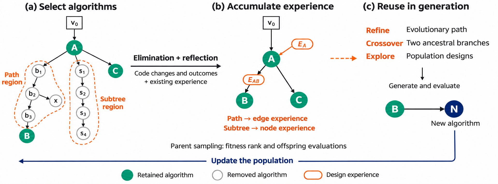
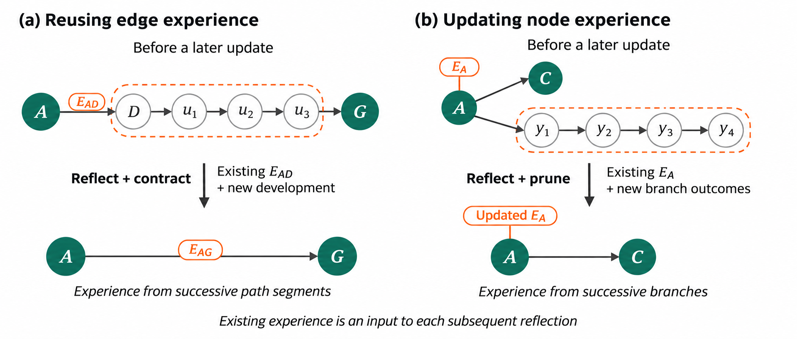
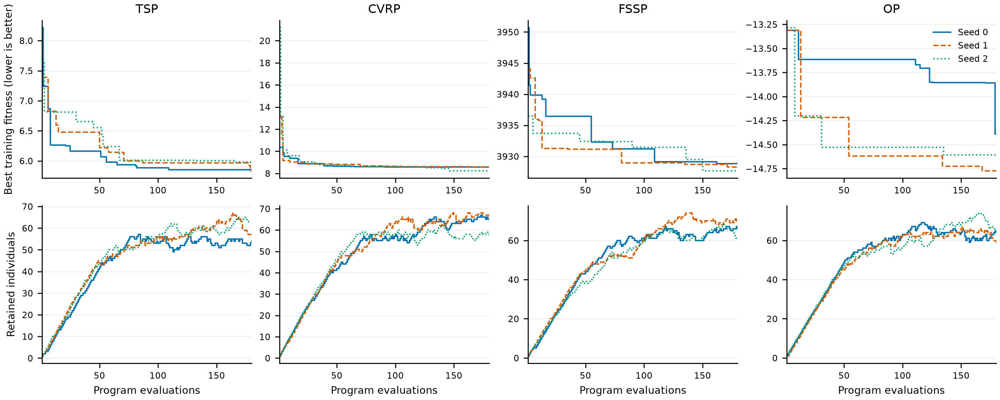

# EvoTrace: Experience-Bearing Tree-Structured Populations for Automated Algorithm Design

## Abstract

Evolutionary algorithm design produces code changes and evaluation results that can inform subsequent design, yet population selection does not by itself retain experience from eliminated algorithms. We study how to accumulate and reuse this experience as the population evolves. We introduce EvoTrace, a tree-structured population that makes algorithm survival and elimination a process of accumulating algorithm-design experience. Its core mechanism couples elimination with reflection: path contraction stores experience on the edge between retained endpoints, while subtree pruning stores experience at the retained ancestor. Later reflections integrate existing experience with new development, and the maintained population supplies representatives for budget allocation and evolutionary trajectories for refinement, crossover, and exploration. We establish structural properties of the update and analyze early search records to characterize experience accumulation and reflection cost.

## 1. Introduction

Evolutionary algorithm design improves a population by generating and evaluating offspring and selecting individuals to retain. Large language models (LLMs) generate and revise executable programs, allowing this process to explore beyond a fixed set of mutation rules [@funsearch; @eoh]. As the population evolves, changes between parent and offspring algorithms and their evaluation results record how the algorithms develop. These records provide a basis for accumulating algorithm-design experience.

Learning from evolution requires relating these records to algorithm derivations. A parent-offspring comparison shows the performance change following a modification. A sequence of parent-offspring relationships records how an algorithm developed, while branches from a shared ancestor record different evolutionary processes. Retaining only current algorithms and their scores does not expose these processes, whereas retaining every historical algorithm makes the population grow continuously. ReEvo uses reflection on algorithm differences and performance comparisons to guide generation [@reevo]. Recent methods further organize search history through algorithm lineages, semantic differences, and branch memories [@phyloevolve; @deltaevolve; @memorytree]. This raises a question: as algorithms are selected and eliminated, how can their evolutionary processes be condensed into design experience that remains associated with the current population?

A tree-structured population provides a way to organize this process. Nodes represent algorithms, and parent-child relationships record their evolutionary trajectories. Once retained nodes have been selected, the nodes to be removed form path regions connecting retained nodes or subtree regions extending from them. These regions record evolution between retained algorithms and evolution along branches from an algorithm, respectively. Their relationships determine both which algorithms reflection examines and where the resulting experience is stored. This motivates our central idea: **a tree-structured population can make algorithm survival and elimination a process of accumulating and reusing algorithm-design experience**.

EvoTrace implements this idea through a population update that combines elimination with reflection. Path contraction removes intermediate nodes and reconnects the retained endpoints; reflection on the corresponding evolutionary process produces edge experience stored on the new edge. Subtree pruning removes discarded branches; reflection produces node experience stored at the retained node from which those branches extend. Reflection analyzes code changes, evaluation results, and existing experience within each region. Later updates continue to integrate this experience. An algorithm can therefore leave the population while experience from its evolution remains available within it.

This population supplies algorithms and their design experience for subsequent generation. Refinement consults the current algorithm's evolutionary trajectory and experience from generating its offspring. Crossover consults the two algorithms' trajectories after their common ancestor and the associated experience. Exploration consults algorithm designs and experience across the population. Budget allocation uses representatives' fitness ranks and the evaluations already spent with each as the primary parent. Evaluated offspring enter the population and participate in further selection, elimination, and reflection.

Our contributions are:

- A tree-structured population that combines algorithm selection and elimination with experience accumulation, organizing algorithms and their design experience through evolutionary relationships.
- A population update that couples elimination with reflection, producing edge experience during path contraction and node experience during subtree pruning, and integrating this experience in subsequent updates.
- A search procedure that uses this population to allocate evaluation budgets and guide refinement, crossover, and exploration with evolutionary trajectories and design experience.

## 2. EvoTrace

### 2.1. Algorithms, Evolutionary Trajectories, and Design Experience

We consider a fixed task interface and evaluator. A candidate program $v$ implements a function used by an enclosing solver. An evaluation invokes the evaluator on the training instances and returns an objective $f(v)$, with lower values preferred, or failure feedback. We call a program feasible when it passes the evaluator's checks and returns a finite objective. Search is limited to $B$ program evaluations, including failures and re-evaluations after runtime repair. The output is the feasible program with the best observed training objective; held-out evaluation follows this selection.

EvoTrace represents its population as a rooted tree $T=(\mathcal N\cup\{v_0\},\mathcal E)$. Each generation attempt that reaches evaluation contributes one node: the final evaluated program after any repair, with its code, evaluation result, and model-generated design description. Programs that fail evaluation also enter the tree. The virtual root $v_0$ has no algorithm or score and connects initial individuals. Subsequent offspring connect to their selected primary parent. Crossover additionally records a reference algorithm, preserving one structural parent per node. These edges record generation relationships; after path contraction, an edge records ancestry across the removed nodes.

Parent-child relationships form evolutionary trajectories. Paths record successive algorithm changes, and branches record different evolutionary processes from a shared ancestor. Reflection uses the code changes, evaluation results, and existing experience in these processes to produce algorithm-design experience expressed in natural language. Experience produced during path contraction is stored on an edge as $E_{u\to v}$; experience produced during subtree pruning is stored at a retained node as $E_u$. Subsequent generation reads this experience together with the relevant algorithms and trajectories.



**Figure 1. Algorithm evolution and experience accumulation in the tree-structured population.** After selecting representatives and retaining their branching nodes, EvoTrace reflects on path and subtree regions that meet the simplification threshold. Algorithm nodes are removed, and the resulting experience is stored on new edges or retained nodes. Representatives participate in budget allocation; trajectories and experience inform refinement, crossover, and exploration. Evaluated offspring enter the population and participate in subsequent updates.

### 2.2. Selecting Algorithms and Simplifying the Tree

A population update selects algorithms for subsequent generation and preserves the branching relationships that organize their trajectories. EvoTrace first selects representative algorithms using fitness and code distance, then retains the common ancestors connecting them. Ancestors retained only to connect representatives do not participate in parent sampling.

Let $\mathcal P$ be the feasible nodes in $T$. Exact duplicates with identical normalized source and fitness are represented by their earliest node, yielding $\mathcal D$. Order these nodes by increasing fitness, breaking ties by node ID, as $(v_1,\ldots,v_{|\mathcal D|})$. Starting from $R_0=\varnothing$, select at most $K$ representatives:

$$
\begin{aligned}
R_k &= R_{k-1} \cup \bigl\{v_k : |R_{k-1}| < K,\\
&\qquad d(v_k,u)\geq\delta\quad\forall u\in R_{k-1}\bigr\},\\
R &= R_{|\mathcal D|}.
\end{aligned}
\tag{1}
$$

Here $d$ is a multiset Jaccard distance over abstract syntax tree (AST) features, and $\delta$ is the coverage distance threshold. Algorithms with better fitness are selected first; later candidates at distance less than $\delta$ from a selected representative are excluded. If a feasible algorithm exists, the best one enters $R$, with ties resolved by node ID. Appendix A gives the feature construction and default parameters.

Let $\operatorname{LCA}_T(R)$ denote the set of pairwise lowest common ancestors (LCAs) of representatives. The additional branching nodes $F$ and the retained skeleton $\mathcal H$ are

$$
\begin{aligned}
F &= \operatorname{LCA}_T(R)\setminus(R\cup\{v_0\}),\\
\mathcal H &= \{v_0\}\cup R\cup F.
\end{aligned}
\tag{2}
$$

The skeleton $\mathcal H$ determines how to simplify the rest of the tree. Two skeleton nodes are adjacent along a path when no other skeleton node lies strictly between them. A nonempty intervening chain and its off-chain branches form a path region. The remaining non-skeleton branches are grouped at their nearest skeleton ancestor into subtree regions. Retaining the common ancestors makes these regions disjoint, so each non-skeleton node belongs to exactly one region.

To let each reflection examine the evolution of multiple algorithms, EvoTrace simplifies only regions containing at least $m$ non-skeleton nodes. Let $\mathcal C$ be the region partition, $\mathcal U$ the nodes selected for removal, and $\mathcal K$ the retained nodes:

$$
\begin{aligned}
\mathcal U &= \bigcup_{C\in\mathcal C:\,|C|\geq m} C,\\
\mathcal K &= (\mathcal N\cup\{v_0\})\setminus\mathcal U.
\end{aligned}
\tag{3}
$$

Nodes in a path region are removed, and its retained endpoints are connected by a new edge. Nodes in a subtree region are pruned, while their skeleton ancestor remains. The associated experience is written to the new edge or retained node as described below. Smaller regions remain in the tree; they lie outside $R$ and do not participate in parent sampling.

This update preserves the rooted tree and leaves the selected representatives unchanged, $R(T')=R(T)$. Repeating the update without inserting a new individual produces no further simplification. Simplification preserves ancestry among retained nodes while replacing removed path segments with single edges. Appendix B provides the proofs.

### 2.3. Reflection as Experience Accumulation

The two simplification operations correspond to two evolutionary processes. A path region contains the evolution from one retained algorithm to another, together with branches from intermediate algorithms. A subtree region contains discarded branches extending from a retained ancestor. EvoTrace reflects on each region before removing its algorithm nodes.

For a path $u\leadsto v$, the reflector receives the endpoint code, intervening algorithm changes and evaluation results, branches from intermediate nodes, and experience already stored in the region. Edge experience $E_{u\to v}$ summarizes the development along this path and its branches. For a subtree region attached to retained node $u$, the reflector receives the code of $u$, code differences from each node's parent in the pre-update tree, evaluation results, and existing experience. Node experience $E_u$ summarizes the designs and outcomes in these branches. Reflection also receives design descriptions and scores of selected feasible nodes sharing the relevant parents. When $u=v_0$, no starting implementation or score is supplied; subtree experience is stored at the virtual root.

Experience accumulates through successive reflections. If edge $u\to v$ later becomes part of a longer contracted path, its experience is read together with newly added algorithms' changes and evaluation results. If additional branches extending from $u$ are pruned, their results are integrated with the existing node experience $E_u$. Algorithms change as the population evolves, while experience is carried forward through these summaries. The reflection prompts ask for faithful accounts of computational ideas and observed outcomes, with any explanation of their causes kept tentative. Structured comparison records retain the underlying evaluation results separately from the generated text; Appendix C gives the prompts.



**Figure 2. Existing experience enters subsequent reflection.** (a) When a later path contraction removes $D$ and the intervening algorithms, the existing edge experience $E_{AD}$ is integrated with the new development into $E_{AG}$. (b) Pruning additional branches from $A$ integrates their designs and outcomes with the existing node experience $E_A$. Each illustrated region contains four nodes selected for removal; retained endpoints remain outside the region.

### 2.4. Searching with the Maintained Population

The maintained population contains representative algorithms for offspring generation, together with their evolutionary trajectories and design experience. Budget allocation determines which representatives generate offspring. Each operator draws its context from the relevant parts of the tree, subject to the input limit described in Appendix A.

Only representatives in $R$ are sampled as primary parents. Let $n_r$ count program evaluations spent generating offspring with $r$ as the primary parent, including execution failures and re-evaluations after repair. With average fitness rank $\bar\rho_R(r)$ for ties and rank difference $\Delta\bar\rho_R(r)=\bar\rho_R(r)-\min_{u\in R}\bar\rho_R(u)$, define

$$
\begin{aligned}
w(r) &= \frac{2^{-\Delta\bar\rho_R(r)/H}}{1+n_r},\\
P(r) &= \frac{w(r)}{\sum_{u\in R}w(u)}.
\end{aligned}
\tag{4}
$$

The half-life $H$ controls how quickly sampling weight decreases with fitness rank. The denominator reduces the weight of algorithms whose offspring generation has consumed more evaluations. Newly inserted nodes start at $n_r=0$, and simplification preserves the counts of retained nodes. Evaluations attributed to ancestors do not contribute to $n_r$, while algorithm changes and experience along the ancestral path remain available for generation context. The defaults and crossover-reference rule appear in Appendix A.

**Refinement.** The context includes the current algorithm's code, its evolutionary path from the root, and branches attached to it in the maintained tree. Uncontracted edges provide code differences, contracted edges provide edge experience, and nodes along the displayed path provide node experience. This context lets the generator consider the current algorithm's evolution when proposing an improvement.

**Crossover.** The context includes the primary and reference algorithms' code, their LCA's design description and score, the two subsequent paths, and associated experience. If the LCA is the virtual root, the paths instead begin at their initial lineages, with root experience supplied when available. The prompt asks the generator to combine useful aspects of both designs; if no useful combination emerges, it permits improving the primary algorithm through the comparison. The offspring connects to its primary parent and records the reference algorithm.

**Exploration.** The context presents design descriptions, scores, and associated experience of feasible algorithms across the maintained population, including nodes outside $R$. The selected primary parent's code provides an implementation reference. The prompt asks for a different core computation, using the population's designs and outcomes to inform the proposal.

Each generated algorithm is evaluated and inserted into the tree. Selection identifies the next representatives, and regions that meet the simplification threshold are reflected on and then contracted or pruned. Algorithm 1 summarizes this process; repair handling, context limits, and numerical details are given in Appendix A.

```text
Algorithm 1: EvoTrace
Input: task interface, evaluator, LLM, evaluation budget B, initial size I
Initialize tree T with a virtual root
while evaluation budget remains and the stopping rule is not met:
    If fewer than I feasible initial programs have been collected, choose Init at the root
    Otherwise, select a representative parent and generation operator
    Construct the corresponding generation context
    Generate a candidate; evaluate it with at most one repair
    If no program was evaluated, continue
    Attach the final evaluated program to its primary parent
    If fewer than I feasible initial programs have been collected, continue
    Select representatives R and their branching skeleton H
    Partition non-skeleton nodes into path and subtree regions
    Reflect on each eligible region using the pre-update tree
    Contract paths and prune subtrees; store experience on new edges and retained nodes
return the best feasible algorithm evaluated during search
```

## 3. Analysis of Population Updates and Experience Accumulation

### 3.1. Search Tasks and Scope of Analysis

We examine experience accumulation during population updates on four combinatorial optimization tasks: next-node selection for the traveling salesman problem (TSP), an edge heuristic for ant colony optimization on capacitated vehicle routing (CVRP), processing-time perturbation and job selection for permutation flow-shop scheduling (FSSP), and an edge heuristic for ant colony optimization on orienteering (OP). Each task uses three search seeds and 16 fixed training instances per evaluation. Generation and reflection use `Qwen3.8-27B`; Appendix D gives the solver and execution settings.

The analysis uses records from 12 searches at the time their snapshots were saved, containing 2,641 program evaluations in total and 180–256 per run. These searches use an earlier retention rule: among deduplicated feasible individuals, retain up to 32 by fitness and those created or used as primary parents within the preceding 40 evaluations, then retain their branching ancestors. A single-node region can trigger simplification. The records characterize path contraction, subtree pruning, and successive reflection under that configuration. They do not establish the performance of the representative-cover and batched simplification rules in Section 2.2.

### 3.2. Algorithm Elimination and Experience Formation

Across 2,481 algorithm nodes inserted into the trees, 1,195 simplifying updates removed 1,734 nodes ($69.9\%$). The 12 trees retained 747 algorithm nodes when the snapshots were saved. Every removed node belonged to exactly one simplification region, and removal counts matched the resulting node counts.

These nodes belonged to 509 path regions and 887 subtree regions. The former contain evolution between retained algorithms; the latter contain evolution along branches extending from retained ancestors. Reflection on these 1,396 regions produced edge or node experience, respectively. Both types of experience therefore arise in successive population updates, with their storage locations determined by the corresponding evolutionary relationships.

### 3.3. Reflection Frequency and Cost

The number of nodes removed per reflected region varies. Of the 1,396 regions, 1,127 ($80.7\%$) contained only one newly removed node but could also carry experience from earlier reflections. A reflection can therefore integrate existing experience while removing a single node. The simplification threshold in Eq. (3) specifies the minimum number of nodes to be removed in each reflected region.

All 1,396 reflection calls returned experience text in the required format without triggering a fallback summary. They consumed 4,897,554 input tokens and 256,594 output tokens, averaging 3,508 input and 184 output tokens per region. These token costs exclude algorithm-generation calls. Appendix D reports the full region-size distribution and the accounting conditions.

### 3.4. Population Size During Search



**Figure 3. Best training fitness and population size during search.** The upper panels show best training fitness over the first 180 evaluations. The lower panels show the number of retained algorithms after each update. Each curve corresponds to one random seed. These runs use the earlier retention rule described in Section 3.1.

All 12 runs improve their best training objective between evaluations 5 and 180. During the recorded searches, new algorithms continue to enter the population while simplification removes algorithm nodes. When the snapshots were saved, the trees contained 54–70 algorithms each. Table 1 reports the training objectives at evaluation 180 for each run.

**Table 1. Best training fitness at evaluation 180 for each run (lower is better).** Mean and sample standard deviation (SD) are computed across the three search seeds.

| Task | Seeds 0 / 1 / 2 | Mean | SD |
| --- | ---: | ---: | ---: |
| TSP | 5.8527 / 5.8362 / 5.9800 | 5.8897 | 0.0787 |
| CVRP | 8.5592 / 8.5845 / 8.2413 | 8.4617 | 0.1913 |
| FSSP | 3928.81 / 3928.25 / 3927.69 | 3928.25 | 0.56 |
| OP | -14.3919 / -14.7719 / -14.6069 | -14.5902 | 0.1905 |

## 4. Related Work

**Evolutionary algorithm design.** Genetic programming searches over executable structures [@koza]. Hyper-heuristics search over heuristics [@hh], while algorithm configuration selects parameter settings for a given algorithm [@irace]. LLM-based methods extend program variation through generated mutations and combinations [@elm; @survey_aad; @lmcrossover]. FunSearch searches over programs within an island population [@funsearch], and EoH evolves natural-language design descriptions together with code [@eoh]. LLaMEA and AlphaEvolve further develop evaluation-guided evolutionary coding [@llamea; @alphaevolve]. HSEvo uses harmony search to balance diversity and convergence [@hsevo]; PartEvo maintains niches [@partevo]; ShinkaEvolve combines fitness and sampling frequency in parent selection [@shinka]. EvoTrace incorporates experience accumulation into population updates, allowing the evolution of eliminated algorithms to inform subsequent design.

**Tree and graph representations.** MCTS-AHD uses Monte Carlo tree search [@uct] and path context for heuristic generation [@mctsahd], while Clade-AHD uses descendant evaluations for clade selection [@cladeahd]. A2DEPT organizes search with evolutionary program trees [@a2dept], and Code Evolution Graphs support analysis of evolving code [@codegraphs]. DGA2D uses graphs for a different purpose: nodes represent functional operators, and walks compose algorithmic pipelines [@dga2d]. PhyloEvolve maintains phylogenetic trajectories and an elite pool for cross-lineage reuse [@phyloevolve]. PathWise uses an entailment graph as memory for planning and reflection [@pathwise]. In EvoTrace, derivation relationships determine which algorithms reflection examines and where the resulting experience is stored.

**Reflection and experience.** Self-Refine uses iterative self-feedback [@selfrefine], Reflexion carries verbal reflections across attempts [@reflexion], and ExpeL extracts reusable insights from task experience [@expel]. ReEvo incorporates comparative reflection into evolutionary search [@reevo], RefineEvo combines planning with positive and negative experience pools [@refineevo], and MeEvo interleaves evolution with shared-history reflection [@meevo]. BEAM combines bi-level algorithm optimization with adaptive memory [@beam]. DeltaEvolve stores semantic modifications in a multi-level database [@deltaevolve]. MEMOIR maintains branch-local memory and transfers condensed experience into global memory when a branch terminates [@memorytree]. EvoTrace couples reflection with population simplification, producing design experience during path contraction and subtree pruning and storing it on new edges and retained nodes. Subsequent generation reads this experience with the relevant algorithms and evolutionary trajectories.

## 5. Discussion

The tree associates design experience with algorithms and their evolutionary relationships. Edge experience refers to the development between its retained endpoints and along the removed branches; node experience refers to branches pruned from its retained ancestor. These associations let refinement and crossover access experience along the relevant evolutionary paths. Selection and elimination determine the regions examined by reflection, while the generation operator and input limit determine which algorithms, trajectories, and experience enter the context.

Simplification removes algorithm nodes and their code from the active population; the implementation retains them in the search archive. A non-representative cannot be selected as a primary parent, including while its region awaits simplification. Reflection carries forward experience from removed regions as a lossy natural-language summary, which may contain uncertain explanations of performance changes. Its effect on subsequent generation requires controlled comparison; the present analysis describes how experience is formed and the associated reflection cost.

## 6. Conclusion

EvoTrace makes algorithm selection and elimination a process of accumulating and reusing algorithm-design experience. A tree-structured population records evolutionary relationships, and reflection during path contraction and subtree pruning preserves experience from the corresponding processes on edges and nodes. The resulting population supports budget allocation and supplies evolutionary trajectories and design experience for subsequent generation. Algorithm evolution and experience accumulation thus proceed together within the population.

## AI Use Statement {.unnumbered}

Generative AI tools assisted with literature synthesis, manuscript drafting and revision, checks against the implementation, and mechanism-figure preparation. The LLMs used within EvoTrace are described in Sections 2 and 3 and Appendix D. The authors remain responsible for the manuscript and its claims.

## Impact Statement {.unnumbered}

This work studies automated algorithm design. Its potential benefits include reducing the manual effort required to develop computational methods. The broader consequences of the generated algorithms depend on the tasks and applications in which they are used.

## References

References are rendered from `paper-references.bib` in the accompanying PDF.

## Appendix A. Implementation Details

**Table 2. Default settings of the current EvoTrace method.** The frozen traces in Section 3 use the earlier retention rule described in Appendix D.

| Component | Default setting |
| --- | --- |
| Initialization and budget | Target of 5 feasible initial programs within $B=1{,}000$ total program evaluations |
| Representative-candidate deduplication | For feasible nodes sharing `(identity(code), f(v))`, consider only the earliest node ID during representative selection |
| Representative cover (`K`, `delta`) | `max_representatives` $K=24$; `cover_distance` $\delta=0.15$ in $(f,\operatorname{id})$ order |
| Skeleton connectivity | $F=\operatorname{LCA}_T(R)\setminus(R\cup\{v_0\})$; $\mathcal H=R\cup F\cup\{v_0\}$ |
| Batch threshold (`region_size`) | Simplify and reflect complete path or subtree regions with $|C|\geq m=4$ |
| Parent sampling (`rank_half_life`) | Over $R$ only: half-life $H=10.0$ rank steps; offspring-evaluation factor $1/(1+n_r)$ |
| Operator weights | `Refine` $0.45$; `Explore` $0.30$; `Crossover` $0.25$ |
| Crossover reference rule | Within $R\setminus\{p\}$, distinct `identity(code)`, $q(u)\geq 0.30$, unused pair first, max $d(p,u)$ |
| Evolution prompt window | `max_input_tokens` $=30{,}000$; iterative halving of optional display windows |
| Generation LLM settings | Temperature $1.0$; `top_p` $0.8$; `top_k` $20$; `presence_penalty` $1.5$; max output $16{,}384$ tokens |
| Reflection LLM settings | Temperature $0.3$; max output $1{,}536$ tokens; ~120 words of experience in the JSON `"experience"` field |

**Code representation.** After removing docstrings, EvoTrace counts AST parent-child tag pairs and bigrams from a depth-first traversal. Tags encode node kinds, operator types, and called function or attribute names. Other identifier names and constant values are omitted from these features. The distance $d(u,v)$ is their multiset Jaccard distance. Duplicate detection instead compares parsed source while ignoring layout, comments, and docstrings, and also requires equal measured fitness. Zero AST-feature distance alone does not imply duplication.

**Evaluation and repair.** Feasible initial programs are collected within the total budget. Each generation attempt permits at most one repair in total, either for output format or for a program that fails evaluation. Runtime repair is attempted only if evaluation budget remains. A repaired program consumes another evaluation when evaluated; format repair itself does not. Only the final evaluated program becomes a tree node. All evaluator calls count toward $B$ and, outside initialization, the primary parent's $n_r$.

**Reference selection and updates.** Crossover references exclude the primary parent and identical normalized source. The remaining representatives receive fitness-rank scores in $[0,1]$, using average ranks for ties; a single candidate receives $0.5$. Candidates below $0.30$ are excluded. Among eligible references, unused ordered pairs are preferred, followed by larger AST distance, better fitness, and smaller node ID. If none is eligible, the operator becomes refinement. All reflections in one update read the same pre-update tree. Each contracted edge is marked as contracted and has its operator and reference fields cleared. Retained nodes keep their offspring evaluation counts.

**Numerical details.** In `quality_scores`, a tied fitness block spanning zero-based indices `start` through `end - 1` among $M$ candidates receives $q(v)=1-(\text{start}+\text{end}-1)/(2(M-1))$ for $M>1$, and $0.5$ for $M=1$. For parent sampling, $M_R=|R|$, $q_R$ denotes these scores over $R$, and $q_{\max}=\max_{r\in R}q_R(r)$. Then $(q_{\max}-q_R(r))(M_R-1)=\Delta\bar\rho_R(r)$ for $M_R\geq1$. The implementation subtracts the largest log-weight before exponentiation, ensuring a positive normalization denominator. It floors normalized weights at `math.ulp(0.0)`, the smallest positive representable float, to prevent underflow from making a representative ineligible. Duplicate detection applies only to the retained tree; an eliminated implementation regenerated later enters as a new node.

**Generation context windows.** Uncontracted edges supply score changes and normalized-code diffs with the required baseline; contracted edges supply endpoint scores, the resulting design, and edge experience. If a prompt exceeds `max_input_tokens` ($30{,}000$), the system tests halving each optional display window (`max_path_steps`, `max_child_attempts`, `max_failed_attempts`, `max_population_members`, and `max_experiences`) and chooses the largest reduction in prompt length. Truncation retains at least one path or population entry where present, the current and reference implementations, and required diff baselines. Thus a prompt may contain only part of a trajectory. If no further reduction fits the limit, prompt construction raises an error. At a fixed tree state, `include_experiences = False` hides node and edge experience without changing parent probabilities. Generation requests JSON fields `"analysis"`, `"code"`, and `"design"`.

**Token counting, fallback, and stopping.** Under the scheduled serving pool, `count_tokens` queries the endpoint chat tokenizer. Without a tokenizer, the implementation uses UTF-8 byte length as a conservative proxy and records `"utf8_bytes"` in `input_window`. If a reflection call fails or violates the output schema, EvoTrace forms a deterministic summary from formatted comparisons and truncated prior experience. The `MAX_EXPERIENCE_CHARS = 960` parameter controls truncation of these components, not the total summary length; the full structured `observations` list is retained. In addition to budget exhaustion, search has a stopping rule for `max_unevaluated = 10` consecutive attempts without any program evaluation.

## Appendix B. Structural Properties of One Simplification Update

Consider a finite rooted tree $T_0=(\mathcal N_0\cup\{v_0\},\mathcal E_0)$ with representative set $R(T_0)$, branching-node set $F(T_0)$, skeleton $\mathcal H(T_0)$, region partition $\mathcal C(T_0)$, removed union $\mathcal U$, and post-update tree $T_1$ on surviving nodes $\mathcal K=(\mathcal N_0\cup\{v_0\})\setminus\mathcal U$. Assume $K,m\geq1$ and $\delta\in[0,1]$. Code, fitness, node IDs, and offspring evaluation counts of surviving nodes are unchanged during simplification.

**Rooted-tree preservation.** Because $v_0\in\mathcal H(T_0)\subseteq\mathcal K$, every surviving node $v\in\mathcal K\setminus\{v_0\}$ has a unique nearest surviving ancestor $a(v)\in\mathcal K$ along its $T_0$-ancestry path. Reconnecting unkept parents to $a(v)$ strictly decreases $T_0$-depth at every step, preventing cycles and guaranteeing a unique incoming edge per node in $\mathcal K\setminus\{v_0\}$. Thus $T_1$ is a valid rooted tree.

**Exact disjoint region partitioning.** Interior chains $C_{\text{chain}}(u,v)$ between adjacent skeleton nodes $u,v\in\mathcal H(T_0)$ are pairwise disjoint: if two chains shared an off-skeleton node, their deepest shared node would be the LCA of two distinct subtrees containing elements of $R(T_0)$, contradicting $\operatorname{LCA}_{T_0}(R(T_0))\subseteq\mathcal H(T_0)$. Every remaining node $w\in\mathcal N_0\setminus\mathcal H(T_0)$ outside all chain interiors has a unique first ancestor in $\mathcal H(T_0)\cup\bigcup C_{\text{chain}}$: if that ancestor lies in $C_{\text{chain}}(u,v)$, $w$ joins the path region for $(u,v)$; otherwise that ancestor lies in $\mathcal H(T_0)$ and $w$ joins its subtree region. Hence $\mathcal C(T_0)$ partitions $\mathcal N_0\setminus\mathcal H(T_0)$, and thresholding by $|C|\geq m$ removes disjoint regions where each removed node belongs to exactly one region.

**Champion retention and representative invariance.** When $\mathcal P_0\neq\varnothing$, its best node under the fitness-and-ID ordering enters $R(T_0)\subseteq\mathcal K$. Every representative remains the earliest surviving node for its `(identity(code), f)` key, so it remains a candidate in $\mathcal D(T_1)$. Consider the greedy scan of $\mathcal D(T_1)$ in order. By induction, suppose its accepted nodes so far are exactly the preceding representatives of $T_0$. An original representative is accepted because it encounters the same accepted prefix as before. For any other candidate $w$, let $w_0$ be the earliest node with its key in $T_0$, possibly $w$ itself. Node $w_0$ was rejected in the original scan and occurs no later than $w$. Its rejecting condition was either coverage by an earlier representative or exhaustion of the $K$ slots. Those representatives all survive and still precede $w$; identical normalized code gives $w$ the same AST features as $w_0$. Thus $w$ is rejected as well. Induction gives $R(T_1)=R(T_0)$. Fitness ranks and counts $n_r$ remain unchanged, so Eq. (4) gives the same parent probabilities before and after simplification whenever $R$ is nonempty.

**Strict single-step idempotence.** Because $R(T_1)=R(T_0)$ and contracting non-skeleton chains preserves pairwise LCAs among nodes of $R(T_0)$, we obtain $F(T_1)=F(T_0)$ and $\mathcal H(T_1)=\mathcal H(T_0)$. Consequently, $\mathcal N_1\setminus\mathcal H(T_1)=(\mathcal N_0\setminus\mathcal H(T_0))\setminus\mathcal U$ decomposes into the exact deferred regions $\{C\in\mathcal C(T_0):|C|<m\}$. Every region in $\mathcal C(T_1)$ therefore satisfies $|C|<m$, and re-running maintenance on $T_1$ without new insertions removes zero nodes and triggers zero reflection calls.

## Appendix C. Verbatim Reflection Prompt Templates

Both templates in `evotrace_v3/reflection.py` begin with a shared `[Problem]` header specifying the task description, score direction, and `Function interface`, followed by `[Path Evidence]` or `[Explored Branches]` (containing endpoint/baseline code, normalized code diffs, `[Related Results]`, `[Earlier Algorithm-Design Experience]`, and the current region's `[Comparison Catalog]`). Their `[Task]` and `[Output]` blocks are reproduced verbatim below.

**Edge experience prompt (`EDGE_PROMPT_TEMPLATE`, path contraction).**

> `[Task]`
> Compress the algorithm-design experience along this transition for a researcher continuing the search.
> Write a short research note preserving what is worth remembering from this development: the computational ideas, informative outcomes, and relevant earlier experience. A faithful account is enough; an explanation or general principle is optional. Keep any interpretation tentative and leave future design decisions open.
>
> `[Output]`
> Return one JSON object with an "experience" string: a concise paragraph, about 120 words, explaining how the computation developed and what is worth remembering from the intervening experiments. Include informative outcomes and earlier experience. The paragraph will accompany the surviving implementation in later design calls; name computations rather than trial numbers. The system supplies endpoint scores.

**Node experience prompt (`NODE_PROMPT_TEMPLATE`, subtree pruning).**

> `[Task]`
> Compress the algorithm-design experience from these explored branches for a researcher continuing the search.
> Write a short research note preserving what is worth remembering from these experiments: the computational ideas, informative outcomes, and relevant earlier experience. A faithful account is enough; an explanation or general principle is optional. Keep any interpretation tentative and leave future design decisions open. These branches were simplified out of the active population; their ideas are not thereby disproved.
>
> `[Output]`
> Return one JSON object with an "experience" string: a concise paragraph, about 120 words, relating the computational ideas tried and their informative outcomes, including earlier experience. It will accompany an algorithm in later design calls, preserving experiences its code alone cannot convey. The paragraph must stand on its own without trial numbers.

## Appendix D. Experimental Settings and Frozen Traces

### D.1. Tasks and Evaluation

Each evaluation uses 16 fixed training instances. Execution has a shared budget of 160 instance-seconds across up to 8 workers, measured as the sum of elapsed instance times, including running instances. On Linux, each worker's data-segment limit is set to its initial usage plus 2 GiB, subject to any tighter existing limit. Instance $i$, indexed from zero, uses evaluation seed $730241+i$. The solver settings are:

**Table 3. Evolved functions and solver conditions in the four tasks.**

| Task | Function evolved | Solver conditions |
| --- | --- | --- |
| TSP (`tsp_construct`) | Next-node selection for constructive tours | 50-node Euclidean instances; training instance seed `2024` |
| CVRP (`cvrp_aco`) | Edge heuristic matrix for ant colony optimization | 50 customers and a depot; capacity 50; 30 ants, 100 iterations; ACO seed `1234` |
| FSSP (`fssp_gls`) | Perturbed processing-time matrix and selected job IDs | 50 jobs, 20 machines; NEH initialization; 200 search iterations; up to 3 local-descent passes per iteration |
| OP (`op_aco`) | Edge heuristic matrix for ant colony optimization | 50 nodes including the depot; route-length limit 3; 20 ants, 50 iterations; ACO seed `1234` |

TSP returns the index of the next unvisited node. FSSP instances use seeded integer processing times from 1 to 99. Its evolved function returns a perturbed processing-time matrix and one to five distinct job IDs for the perturbation step; the objective is always evaluated using the original processing times. The objectives are mean tour length, mean route length, mean makespan, and negative mean collected reward, respectively. Lower is better in every reported task. The search budget is $B=1{,}000$ program evaluations, including failures and re-evaluations after repair. A disjoint 50-instance test split with 500 pooled instance-seconds is reserved for evaluation after selecting the best training program. Section 3 reports training prefixes, not these held-out results.

All searches use seeds 0, 1, and 2 and `Qwen3.8-27B` with native thinking disabled. Generation uses temperature $1.0$ and at most $16{,}384$ output tokens; reflection uses temperature $0.3$ and at most $1{,}536$ output tokens. Requests were scheduled across FP8 and GGUF endpoints, with the endpoint and token usage recorded for each call. Transport retries are distinguished from candidate execution failures. Prompts expose the task, score direction, and function signature; solver instance counts and iteration budgets are external conditions.

### D.2. Configuration and Source Records

The frozen batch `20261115_115206_evotrace_v3_revised_co4` was launched on 15 November 2026 after freezing 463 source files together with the evaluators and configuration. The manuscript snapshot was captured at 15:36 Beijing time. Its retention configuration uses `quality_slots = 32`, `recent_evaluations = 40`, and single-node simplification. The 12 captured runs contain 168–247 committed attempts and 180–256 program evaluations each. The shared reporting horizon is 180 evaluations.

Archived records contain generated programs, evaluations, parent and operator choices, reflection inputs and outputs, and the updated tree. The accompanying `snapshot.json` contains per-run source hashes, configurations, evaluation sequences, and tree sizes; `training_scores.csv` records the common-horizon scores.

The reflection region sizes were 1,127 regions of size 1, 204 of size 2, 62 of size 3, 2 of size 4, and 1 of size 5. Their sum is 1,396 regions and 1,734 newly removed algorithms. These sizes count new removals; a region can additionally carry experience from earlier simplifications.
