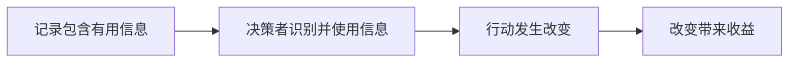

# 当前怎样理解算法搜索

**当前最有用的区分是：程序现在有多好、继续搜索能改善多少、一次尝试能提供什么信息。**

本页起始于 2026-10-16 的讨论，保存概念区分与推理。它没有继承旧文档的实验结论。后续实测认识应链接具体记录，并随新证据修正。[形成记录](记录/2026-W42.md)

## 1. 程序质量与行动价值不同

| 对象 | 回答什么问题 |
| --- | --- |
| 当前程序质量 | 这份实现在给定条件下表现怎样？ |
| 后续搜索收益 | 使用某种修改方式和预算，还能取得多少改善？ |
| 一次尝试提供的信息 | 这次结果能否改善以后的生成、参考或机会分配？ |

三者可能相关，但不能直接替代。落后程序可能有容易修正的缺陷，也可能很难变得有竞争力。连续改善说明程序仍在变化；是否值得继续投入，还取决于其他预算用途。

“可开发性”需要相对于生成模型、修改方式、上下文和预算来理解。同一个程序使用不同改法，后续结果可能不同。关键问题是：哪些观察能帮助预测或改善这种结果？

## 2. 总分需要结合实际改动解释

计算改动经过程序实现和实际求解，才产生评价结果。一次失败可能来自计算本身、实现错误、部件交互或资源约束。总分通常不能独自区分原因。

解释一次尝试时，依次核对：

1. 实际代码改了什么。
2. 改动怎样影响求解决策。
3. 评价使用了什么条件。
4. 观察结果支持哪一种解释。

模型的设计说明需要用代码与行为核对。当前代码已经暴露的缺陷，可以直接诊断。历史的额外价值取决于它是否提供了代码与成绩尚未表达的信息。

这与**系统辨识**的思路相通：根据操作及其响应，理解系统怎样变化。在本项目中，要辨清的是不同改动在不同起点上的作用。这个视角不要求建立完整的动力学模型。

## 3. 保存历史只是经验起效的第一步

历史可能记录被放弃的修改、失败原因、计算之间的依赖，以及重复尝试的结果。同一份当前代码可能对应不同的已知经验，因此合理的下一步也可能不同。

需要分别观察哪个环节成立。记录更完整、提示更长或解释更详细，本身不能证明搜索更有效。

固定当前程序、评价条件和修改目标后，历史至少可能有两种作用：补充过去修改及其结果，帮助判断下一步；示范过去采用的修改方式，使模型继续沿用它。加入历史后的收益不能独自区分这两种解释。设计历史的研究变量可以写成生成器可用的信息及其组织方式，观察对象是下一步实际修改和收益分布。

已有方法直接研究了部分问题：MCTS-AHD 使用祖先路径生成，PhyloEvolve 提供修改序列与收益，RefineEvo 比较真实父子经验与种群配对，MEMOIR 区分分支内记录与跨分支总结。因此，仅把历史接入生成、保存父子对应或按动作使用记忆，不能自动成为本项目的独立贡献。当前更具体的线索是历史对修改方式的约束，以及这种约束与当前修改目标是否匹配。这是待检验的解释，尚不是已建立的普遍规律。[原文比较与历史重放核对](记录/2026-W43.md#10月22日形成历史的研究变量与已有工作的关系)

经验能否跨程序使用，取决于它的适用条件。例如，某种计算对相对权重的影响可能适用于多个程序；某个参数值的效果可能依赖特定实现。程序类别、代码相似度和来源关系可以帮助寻找材料，具体作用决定材料是否适用。

**预测状态表示**提供了一个相关视角：用行动条件下的未来观察刻画状态。对本项目的启发是，可以根据历史是否帮助判断后续响应，评价历史的表示方式。这是文献启发，尚不是本项目采用的方法。[Predictive Representations of State](https://proceedings.neurips.cc/paper_files/paper/2001/hash/1e4d36177d71bbb3558e43af9577d70e-Abstract.html)

## 4. 一次尝试的价值取决于后续用途

一次尝试可能改善成绩，产生便于后续修改或组合的程序，也可能帮助辨清某个改动是否有效。这些作用可以同时存在，不能仅用一步成绩概括，也不宜直接相加。

判断继续投入时，要与相同预算的其他用途比较。剩余预算也影响信息价值：以后利用这条信息的机会越少，仅靠未来用途支撑的投入就越难成立。

| 相关视角 | 对本项目的启发 |
| --- | --- |
| [元推理：Selecting Computations](https://proceedings.mlr.press/r10/hay12a.html) | 按计算对后续决策的价值，判断下一次尝试是否值得。 |
| [双重控制：Dual Control](https://arxiv.org/abs/1510.03591) | 同时考虑行动改变系统和提供信息的作用。 |

这些框架帮助提出问题。具体算法是否适用，仍取决于本项目的状态、行动与反馈条件。

## 5. 搜索轨迹受当时的选择规则影响

某个程序获得更多机会，既影响它的结果，也影响我们对它的了解。成功路径可以展示形成过程。要判断当时哪个选择更好，还需要同类失败、未获机会的对象，或可比较的重新尝试。

因此，观察到“被持续选择的程序后来更好”，不能独自证明当时的选择规则有效。需要辨清起点差异、机会数量与实际改动分别起了什么作用。

## 6. 在共同条件下保留方法机制

我集成基线的目的是在本项目的 task、固定预算和统一模型配置下使用各方法。task 不是复现对象。方法内部优先对齐固定官方源码，包括提示、解析、重试、父代选择和更新；不能由公共解析器悄悄扩大或缩小候选集合。

CALM 不训练、Shinka 单模型是已经确定的比较条件。源码与论文不一致时，先保留源码行为。搜索结束后直接固定训练成绩最好的有效程序，再做独立测试，不增加前 5 名重评与重新选择。本轮已修正已确认的解析、图更新和灵感采样等偏差，具体依据与验证范围见[机制移植记录](记录/2026-10-17-基线实现差异核对.md)。DeltaEvolve 的官方实现仍未公开，未披露部分继续明确标为本地选择。

## 下一步最值得寻找的联系

**哪条经验，在什么条件下，改变哪个行动，并带来什么收益？**

经验的存在、可利用性和净收益需要分别建立。生成方式、历史表示和选择规则都可以成为研究对象。下一步由实际瓶颈决定。
