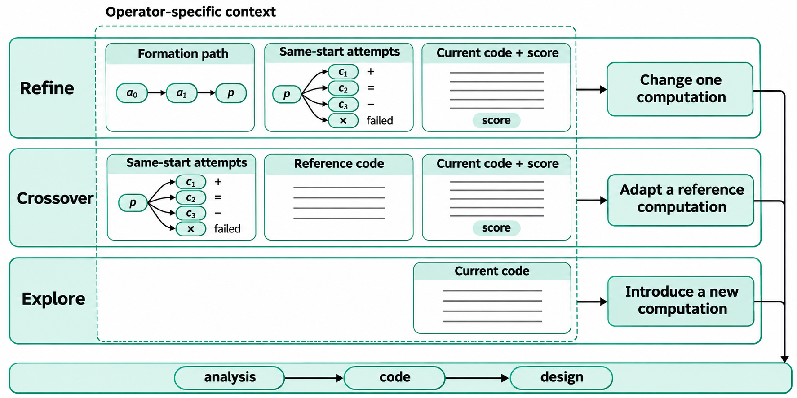

# 机制二：轨迹引导的上下文与算子

**EvoTrace 根据本次生成要解决的设计问题，组织当前程序、形成路径和同起点的修改结果。** 精炼据此决定改哪项计算，融合决定怎样接入参考计算，探索则只以当前代码界定要离开的做法。

*图1：按算子的设计问题组织局部上下文。当前完整代码紧邻指令；探索只读取代码。+、=、− 分别表示改善、持平和退步，× 单独表示执行失败，源码线条仅示意完整代码。*

## 1. 让历史回答当前设计问题

一份程序及其成绩说明当前实现做到了什么，却不说明它怎样形成，也不说明从这里出发的哪些改法已经尝试过。生成器若只读程序和成绩，就需要重新猜测这些关系。

演化轨迹补充两类信息。祖先路径记录当前设计的形成过程。直接子代记录同一起点上的不同修改及其结果。前者帮助理解需要保留的机制，后者提供下一次修改可以比较的实际依据。

不同算子使用这些信息的目的不同。精炼需要接续当前机制，融合需要理解参考计算的接入，探索需要引入当前程序尚未执行的计算。将同一批历史材料用于所有算子，会混淆这些设计目标。因此，本机制同时规定每种算子的任务和材料。

## 2. 将实际修改与评价结果放在一起

以父代 $p$ 为起点的一条修改记录表示为

$$
e_i=(p,o_i,q_i,\Delta_i,f(p),f(c_i),s_i),
$$

其中 $o_i$ 是实际算子，$q_i$ 是融合参考，$\Delta_i$ 是程序比较父子源码得到的改动，$s_i$ 是评价状态。设计说明与生成时的修改意图作为附加描述保留。

生成器由此能同时看到“从哪份代码出发、实际改了什么、结果怎样”。本文将这种联合记录称为**干预证据（intervention evidence）**。它把修改与结果对应起来；当一次修改涉及多项计算时，该记录本身并不能确定每一项各自的因果作用。

有效结果始终相对该记录自己的父代比较，按原始训练成绩标为改善、持平或退步。结果放在模型描述之前。模型写的 `analysis` 表示当时的修改意图，`design` 表示其对程序的解释，两者都不能替代实际代码。

例如，生成器可能将一项新增特征描述为“候选节点到其余节点的最小距离”，实际代码却将候选自身纳入最小值。在非负距离矩阵中，对角线零使该特征恒为零。将实际改动与持平结果并列，能让模型检查新增计算是否影响候选排序；只读“加入了一个新特征”和“持平”，则缺少这一检查的具体对象。

源码在展示前去掉注释与文档字符串，并按 AST 统一格式，保留常数取值。对子代展示规范化源码的改动行及必要上下文。当前程序始终给出完整代码，不给其自然语言设计描述，使本次修改直接以实际实现为起点。

## 3. 按算子的决策组织上下文

设当前父代为 $p$，祖先材料为 $A(p)$，有效直接子代为 $O(p)$，执行失败记录为 $F(p)$，参考程序材料为 $Q(q)$。三种算子读取的局部视图为

$$
\mathcal C_R(p)=[A(p),O(p),F(p),p],\qquad
\mathcal C_C(p,q)=[O(p),F(p),Q(q),p],\qquad
\mathcal C_E(p)=[p].
$$

方括号表示提示中的呈现顺序。当前完整代码放在局部材料最后，紧邻算子指令。R/C 保留当前成绩，E 省略成绩。

| 算子 | 本次设计问题 | 指令要求 |
| --- | --- | --- |
| 精炼 Refine | 当前机制内，哪项计算需要改变？ | 找到一项具体限制，增加、替换或删除对应计算，保留主要机制。 |
| 融合 Crossover | 参考程序的哪项计算能改变当前决策？ | 选一项参考计算，说明它改变哪个决策，并完成表示与实现上的接入。 |
| 探索 Explore | 用哪种当前代码没有执行的计算得到结果？ | 完整实现该计算，不要求首个实现立即胜过当前程序。 |

### 精炼：形成路径与同起点比较

精炼要保留主要机制，所以需要理解当前代码怎样形成。祖先按真实父代链接回溯，并按从早到晚的路径顺序展示。最近 3 条优先保留，用于衔接当前实现；其余名额优先给相对自身父代成绩变化较大的节点，用于覆盖路径上的明显转折。路径中的省略区间明确标出，避免将非相邻记录当作直接修改。

同起点子代回答“在这里已经试过什么”。最好子代展示迄今最有效的修改，近期子代展示最新尝试。生成器据此选择下一项计算，而非仅凭当前分数重复提出已有改法。指令明确允许删除计算，避免将改进等同于不断添加组件。

### 融合：参考计算与接入位置

融合接收已经选定的主父代和参考程序。参考程序提供完整代码，以及可获得的最后一次父子修改与结果。完整实现用于理解可借用的计算，最后一步的记录用于考察它在来源中的具体表现。

融合还读取当前父代的直接子代与失败记录，以了解从这里出发已经尝试过哪些接入。它不读取当前父代的祖先段，设计重点放在参考计算如何影响当前决策。指令要求借用一项有用计算，并按需要调整表示；不要求机械保留两份程序的全部组件。

参考的选择与材料的组织是两个接口。启用机制一时，参考随动作 $g=(p,C,q)$ 一次选定，提示构造不再更换参考；单独使用本机制时的参考抽样规则见[实现说明](实现说明.md#机制二)。

### 探索：以当前代码界定新的计算

探索需要知道当前程序执行了哪些计算，才能提出不同的求解方式。它保留当前完整代码，但不读成绩、祖先、子代、失败记录或共享经验。

这一材料选择服务于明确的设计目的：让模型实现新的计算，而不是沿当前成绩继续局部优化。提示给出基于不同信息决策、估计后果、改进完整解、分解和重启等通用方向，但不替模型指定任务算法。

新计算的首个实现可以较弱。探索负责提出并实现它；后续是否继续发展，由选择与真实反馈决定。省略历史材料是对生成任务的划分，不是对新程序后续开发的排除。

## 4. 在有界视图中保留比较关系

原始程序与尝试完整保存，生成器每次读取有界的局部视图。默认最多展示 8 条祖先、3 条有效子代和 2 条失败记录。所有材料都来自本轮之前已经完成的尝试。

直接尝试先按规范化源码、评价状态、成绩和失败摘要合并重复记录。有效子代首先保留成绩最好者，其余名额取最近尝试，再按发生顺序呈现。失败记录取最近的不同观察。段首同时说明全部尝试数和展示数，使模型知道可见材料并非全部历史。

子代差分保留全部改动行，每处带一行上下文。规范化源码相同时明确说明未改变；大幅替换时只说明替换范围，不展示接近两份完整程序长度的差分。祖先提供关系、结果与描述，不附源码差分。这样的材料分配将代码差异集中在可直接对照当前程序的同起点子代上。

失败记录提供执行状态与错误摘要，不给性能优劣结论。指令要求处理已报告的实现问题，避免将一次执行失败扩展为对整类计算的否定。反思机制需要更完整的实现背景，其材料组织另见[机制三](机制3-轨迹反思与经验学习.md)。

## 5. 将设计决定、实现和描述分开

一次生成依次返回三个字段：

$$
\texttt{analysis}\ \longrightarrow\ \texttt{code}\ \longrightarrow\ \texttt{design}.
$$

`analysis` 在代码之前简述本次决定：精炼改哪项计算，融合借什么并改变哪个决策，探索引入什么计算。`code` 给出完整可执行实现。`design` 在代码之后描述该实现的表示、主要计算及其如何决定输出。

这一顺序给两段文字各自确定对象：前者说明计划，后者描述已经生成的代码。描述仍可能与实际计算不符，所以后续轨迹保留实际源码改动与评价结果，不把模型说明当作行为事实。

候选经过评价后，完整实现、修改意图、实际改动和反馈补入轨迹。下一次生成由此既能接续形成过程，也能比较同起点的不同改法。机制二的作用落在这一步：把已经发生的试错组织成当前算子可以直接使用的设计材料。

实现入口为 [context.py](../../traceaad_v21/context.py)、[representation.py](../../traceaad_v21/representation.py) 与 [prompts.py](../../traceaad_v21/prompts.py)。参考抽样、完整提示协议见[实现说明](实现说明.md#机制二)，独立比较的条件与判据见[V21](V21.md#比较口径)，过程证据见[研究记录](../记录/2026-W45.md)。
