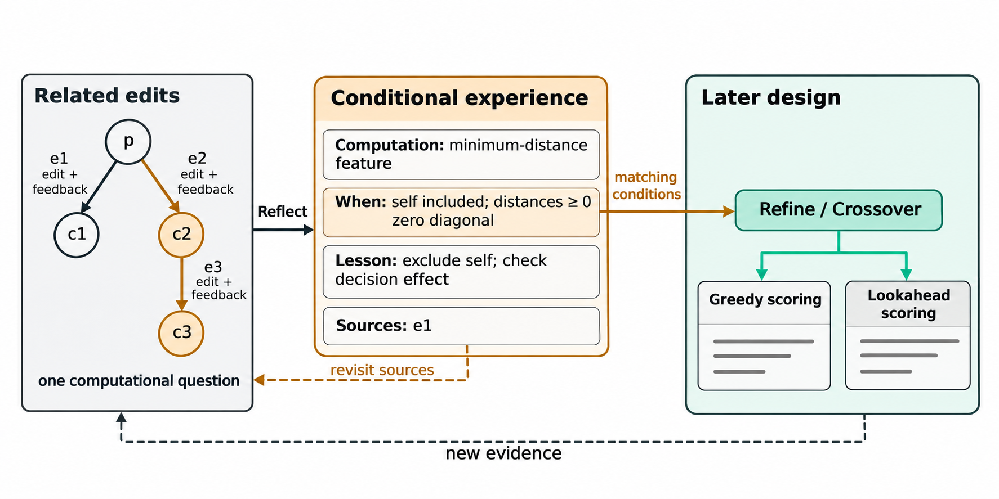

# 机制三：轨迹反思与经验学习

**EvoTrace 从不同分支和较早阶段的改进经历中，提炼带计算条件的设计经验，并随新轨迹修订，供后续算法借鉴。** 局部轨迹描述当前程序周围发生了什么，经验则保留这些经历对其他实现有什么设计含义。

*图1：围绕一个计算问题比较相关修改，保存条件、设计含义与来源，再供后续精炼或融合借鉴。最小距离特征的例子说明同一计算条件可以出现在不同求解结构中；新证据用于回读和修订。*

## 1. 从局部修改记录到可复用认识

机制二围绕当前算子组织局部材料。它能展示当前程序怎样形成、从这里试过什么，却不会在每次生成时重读其他分支和整段搜索历史。一项在别处暴露的计算问题，因而可能在新程序中被重新引入。

直接汇总“哪种算法更好”也不能解决这一问题。一次结果同时依赖起点、具体实现和配套计算。若把某个实现的优劣扩展成所有分支都应遵循的设计偏好，经验就会丢失原本的计算条件。

因此，本机制凝练的对象是**有条件的计算认识**：一项计算在什么条件下怎样起作用，已观察到什么结果，这些认识怎样影响后续实现。经验可以记录性能比较，但比较必须保留对应的实现变化和条件。全局共享的是经验的可见范围，适用范围由计算条件决定。

## 2. 将经验表示为条件、认识与来源

经验条目表示为

$$
\epsilon_j=(j,I_j,W_j,L_j,S_j),
$$

其中 $j$ 是稳定编号，$I_j$ 是计算问题，$W_j$ 是适用计算条件，$L_j$ 是具体认识及其设计含义，$S_j$ 是支撑当前认识的一组相连父子事件。系统同时保留累计来源和条目的历史版本。

条件需要能从当前代码或计划引入的计算中判断。例如，在非负距离矩阵上，对包含候选自身的集合取最小距离，会因对角线零而得到恒零特征。对应经验可以指出排除自身，并检查该特征是否进入实际决策。它能用于不同求解结构，因为条件指向相同的计算关系。

性能经验采用同样的表示。如果改变某项打分权重取得较好结果，经验记录实际比较过的构造方式、改动和结果，供同类实现选择候选设定。这个结果不自动给出不同算法结构的普遍排序。

反思据此区分三种情况：计算没有影响决策、程序执行失败、有效执行后性能改变。三者对应不同的后续动作，分别是检查作用路径、修正实现，以及比较计算条件和接续修改。经验不要求为每次结果编造完整原因；一条可定位的计算事实也可以独立保留。

## 3. 以相关改进片段组织反思材料

反思读取的基本单位是一次尝试的最终已评价版本及其父代。经过修复的尝试使用最终实际评价代码和结果，仍作为一个事件；实际发生的全部评价分别计入预算。

一次修改、同起点的不同实现和接续发展，能够回答不同的问题。单次修改可以暴露恒零特征一类计算事实；同起点比较可以检验不同实现的表现；接续发展可以考察一项计算是否在后续调整中被保留，以及配套变化后结果怎样改变。

因此，每次反思围绕一个具体计算问题组织材料。系统从待审阅修改出发，寻找同起点上涉及相同源码位置的不同修改，或通过父子链接相连的接续修改，并补充形成起点所需的实现背景。源码位置与父子关系用于缩小比较范围，计算问题的含义仍由模型阅读实际实现后判断。

与这组修改相关的旧经验及其来源可以进入同次反思。新结果由此能与旧认识对应的实际实现比较，而非仅在旧结论上继续改写。无关经验保持原样，不要求模型每轮重读整份经验池。

每条经验保留解释其认识所需的最小相连事件组，最多 3 个事件。一项静态计算事实可以只用一个事件；依赖同起点比较或配套调整的认识保留对应的多次尝试。输入同时提供任务与评价定义，使模型能区分候选函数控制的计算和调用方已经保证的条件。

实现材料保留理解计算所需的内容。每段使用稳定的程序编号和尝试编号，先展示同一起点的完整代码，再紧接各次修改与其结果，不另设临时的代码编号总表。小幅修改提供完整差分；差分更长或代码大幅替换时直接给出子代完整代码；执行失败提供实际评价代码及错误反馈。共同代码只展示一次，连续修改保持显式父子链接。不同代码即使同分，也不合并为同一观察。

反思还需理解候选函数的作用位置。例如，OP候选函数生成一次性边先验，ACO在每步采样前另外施加动态可行性掩码。先验影响可行动作之间的相对权重，不能越过该掩码。经验不能把调用方已经保证的可行性归功于候选函数；性能差异可以保留，而原因应与实际作用路径对应。

只有父子源码及其评价反馈都相同的记录才合并展示，并保留事件编号、链接与次数。重复发生的相同观察不作为多份独立证据。

## 4. 按周期调用，按新认识修订

反思每完成 10 次有评价结果的非初始化尝试触发一次，以分摊模型调用成本。执行失败计入周期，没有评价结果的生成或格式失败不计入。调用周期只决定何时审阅，不决定证据边界。

系统单独保存尚未审阅的不同修改。没有改变代码的尝试和完全重复的观察仍留档，但不重复进入待审阅集合。每轮选取一个能够完整装入的计算问题及其相关材料，其余继续保留。请求或更新失败时不消耗未审阅事件。

经验池最多保留 6 条活跃条目。反思比较真实实现、同起点尝试与接续修改，再提出三类操作：新增认识、修订相关条目、归档不再有用的条目。未涉及的经验原样保留；没有新认识时允许不更新。

已有条目采用稳定编号，避免把同一个问题反复追加为多条经验。新证据改变适用条件或揭示新的计算关系时，反思回读来源并修订对应条目。修订可以更换当前代表来源，累计来源仍保存。只有本轮相关且实际展示的条目可以修订或归档；容量满而没有合适条目可更新时，保留本轮分析，不强行用新条目挤掉无关经验。

整组更新通过字段、编号、来源和容量检查后一次应用。来源必须出现在本轮材料中；未通过检查则保留此前经验状态。该检查保证记录可追溯，经验内容仍由模型对实现与结果的比较产生。

## 5. 让经验服务于当前算子的计算问题

生成器读取全部活跃经验的简短计算问题、条件与认识，不读取事件编号、累计来源或历史版本。经验放在局部轨迹之前，当前完整代码仍紧邻指令。不增加检索器、信用分或生成前的模型调用。

**精炼先明确当前代码的计算问题，再借鉴经验。** 采用经验时，模型说明其条件怎样对应当前代码或计划修改。精炼保留当前主要机制；同起点、同关键条件下已经评价的相同实现不重复提出，限制条件、实现方式或配套计算改变时可以重新尝试。

**融合先明确借用的参考计算和接入位置，再借鉴经验。** 经验用于处理表示、尺度、作用位置或计算顺序，使已有认识服务于当前接入，而非替代对参考代码的理解。

**探索不读取经验。** 它继续引入当前代码没有执行的计算。新程序进入后续精炼或融合时，经验再用于解决它的具体实现问题。经验的适用性由计算条件判断，不由它是否接近当前最好程序判断。

没有活跃经验时，生成完全沿用机制二的上下文与算子指令。有经验时，输出仍为 `analysis → code → design`，不增加字段或强制引用来源编号。

## 6. 经验与轨迹的持续更新

一次评价产生新的修改事实。周期反思将其中可复用的认识写入条件经验；后续生成在匹配的计算问题上借鉴它，再产生新的实现与结果。新结果既扩充轨迹，也可以改变旧经验的条件和含义。

机制三维护的是可回读、可修订的设计认识。它与机制二分工明确：局部轨迹用于理解这次修改，条件经验用于引入其他分支和较早阶段形成的认识。经验通过改变后续生成影响搜索，不直接替代机制一的数值反馈或进入其收益率估计。

实现入口为 [evidence.py](../../traceaad_v24_1/evidence.py)、[notes.py](../../traceaad_v24_1/notes.py) 与 [context.py](../../traceaad_v24_1/context.py)。装入、调用与恢复约定见[实现说明](实现说明.md#机制三)，实现组合见[V24.1](V24.1.md)，历史行为与各自冻结条件下的验证见[研究记录](../记录/2026-11-09-V24.1修正与小规模实验.md)。
