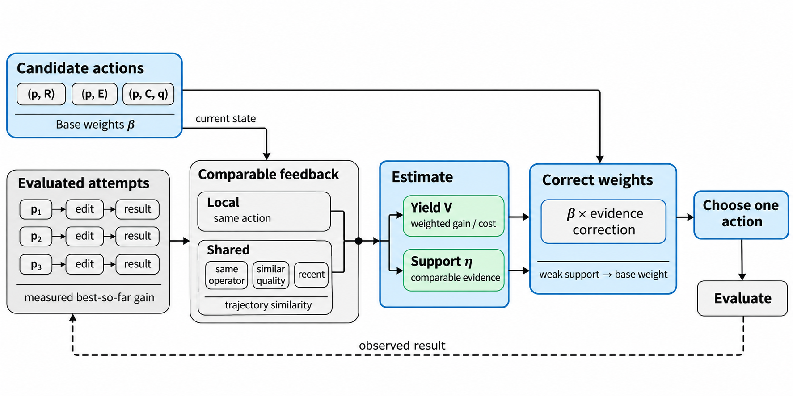

# 机制一：轨迹节点价值评估与预算分配

**机制1利用演化轨迹决定开发机会及交叉参考。** 可比轨迹中已经兑现的收益用于估计一次父代—算子选择能带来多少冠军改善，并调整下一次评价的分配；交叉参考1.0利用轨迹嵌入，从质量合格的候选中选择形成经历差异较大的参考。当前适应度决定基本质量偏好。Base使用相同参考候选池，但均匀随机选参考，不读取形成轨迹。

*图1：本地与共享反馈共同估计收益率与证据强度，修正基准权重后归一化，联合选出一个实际动作。反馈收益来自已兑现的冠军改善，成本来自实际评价。*

## 1. 从当前质量转向继续搜索的收益

一个程序当前有多好，与从它出发继续修改能得到多少收益，是两个不同的问题。当前成绩较好的程序可能已经经历多次无效修改；成绩稍差的程序也可能产生更大的改善。只按成绩选择父代，无法利用这些已经发生的差别。

继续搜索的收益还取决于所用算子。精炼（Refine，R）修改当前机制，探索（Explore，E）引入新的计算，融合（Crossover，C）接入参考程序的计算。同一父代在三个算子下的历史结果不能合并为一个节点分数。因此，本机制评价的是动作

$$
g=(p,o,q),
$$

其中 $p$ 是主父代，$o\in\{R,E,C\}$ 是算子，$q$ 是融合参考，R/E 时为空。每轮联合选择这三个量，实际执行一个动作，再用新结果更新分配。

选择池保留有效、成绩有限且抽象语法树（AST）源码不同的程序，包括退步版本。同源码使用最早的有效代表。参考候选需不劣于当前候选成绩中位数，且不是主父代自身。Base与机制1共用该筛选规则，不再以family限制参考。每个父代都有R/E/C三个动作。初始化后合格参考总是存在；若某个父代没有参考，搜索直接报错，不把C的机会改给E。参考在本轮提出，动作选定后不再更换。

**机制1的交叉参考1.0。** V22.2/V23.2的统一实验入口默认启用，也可显式设置`--trajectory-reference-embedding`；启用后，在共同候选池中选择轨迹向量余弦相似度最小的参考。每个向量的输入是当前设计、规范化源码，以及主父代链上最近三步实际代码差异和改善／退步／不变的观察结果；每步最多展示24行差异，不新增模型总结请求。改善幅度与评价成本继续使用原有显式数值统计，不由向量距离替代。

该1.0检验“质量过关且形成经历不同的参考可能提供新计算”这一简单假设，未学习额外的配对价值模型。原有动作收益估计、经验强度与预算修正保持不变。向量按输入和模型设置缓存，用量单独记录。未开启嵌入时，机制1在同一池中均匀随机提出参考，作为参考选择的消融；不再回退到family规则。只关闭该开关仍保留轨迹收益估计；同时关闭收益修正和轨迹参考选择，基础联合分布才退化为Base。

历史结果也不能跨质量水平直接搬用。将成绩从 200 改到 190，与在当前冠军为 100 时继续搜索，是不同的机会。EvoTrace 先匹配动作发生时的质量状态，再用形成路径调整历史的可比程度。

## 2. 用真实冠军改善定义动作收益

设训练适应度 $f$ 越小越好。动作 $i$ 开始前的最好成绩为 $f_i^*$，最终产生的程序为 $c_i$。动作收益定义为

$$
Y_i=
\begin{cases}
\max\{f_i^*-f(c_i),0\},&c_i\text{ 有效、成绩有限且源码不与动作开始前的选择池重复},\\
0,&\text{其他情况}.
\end{cases}
$$

该定义直接对应搜索目标：改善已经找到的最好算法。若当时冠军为 100，120→110 的父子改进记为 0，100→99 记为 1，105→95 记为 5。动作的评价成本 $c_i^{\mathrm{eval}}$ 是实际评价次数，包含修复后的重新评价。同一次动作只记一次最终收益。

这一区分使即时收益与程序保留各有明确职责。120→110 没有刷新冠军，但有效且源码不同的子代仍进入选择池，后续可以继续发展。程序进入选择池不要求本次获得正收益。

没有发生实际评价的动作不进入收益率估计，其模型调用仍计入父代的已用调用数。收益估计衡量每次评价的产出，模型调用成本另行记录。

## 3. 从可比轨迹借用反馈

### 近期、同算子的质量匹配

设总评价预算为 $B$，当前已用评价数为 $E_t$。只使用与候选动作算子相同、至少评价过一次、且开始于最近 $H=\min(B,256)$ 次评价范围内的历史。近期窗口限制搜索阶段变化带来的影响。

候选动作的质量状态为

$$
x_g=
\begin{cases}
(f(p),f_t^*),&o\in\{R,E\},\\
(f(p),f(q),f_t^*),&o=C.
\end{cases}
$$

历史状态 $x_i$ 使用当时的实际成绩。以 $d_i(g)=\|x_i-x_g\|_\infty$ 衡量差别，使父代、参考和冠军中的任一显著差异都影响匹配。

历史分为两部分。**本地记录** $L_g$ 来自完全相同的 $(p,o,q)$。**共享记录** $S_g$ 来自同算子的其他动作，按质量距离取最近的至多 32 条。共享记录补充尚未充分尝试的动作，本地记录反映从这个确切起点实际发生了什么。

共享记录的匹配半径由其状态间严格为正的两两距离确定：

$$
h_g=2\operatorname{median}\{\|x_i-x_j\|_\infty:\ i,j\in S_g,\ i<j,\ \|x_i-x_j\|_\infty>0\}.
$$

共享集合为空时，以质量状态离当前动作最近的至多 32 条本地记录计算半径；没有正距离时取 $h_g=0$。共享样本的质量权重为

$$
k_{Q,i}=\begin{cases}
\max\{1-d_i(g)/h_g,0\},&h_g>0,\\
\mathbf1[d_i(g)=0],&h_g=0.
\end{cases}
$$

因此，即使存在同算子历史，也可能没有可借用的共享样本。本地记录取 $k_{Q,i}=1$：它们来自同一父代和参考，不应仅因一次突破改变了冠军成绩，就失去这次成功反馈。其阶段陈旧程度仍由近期权重处理。

### 用形成路径调整相似程度

质量状态相近的节点，形成过程仍可能不同。EvoTrace 用四个量描述父代的形成路径：出生算子、出生时的成绩变化、沿路径的符号动量，以及相对祖先最好成绩的回撤。

对非根节点 $p$，记主父代为 $a$，融合参考为 $r$，定义

$$
\delta_p=f(a)-f(p),\qquad
M_p=\tfrac12\operatorname{sign}(\delta_p)+\tfrac12 M_a,
$$

$$
T_p=\min\{f(p),T_a,T_r\},\qquad D_p=f(p)-T_p.
$$

无参考时省略 $T_r$。根节点取 $\delta_p=M_p=0$、$T_p=f(p)$。$M_p$ 保留近期改进与退步的方向，$D_p$ 记录当前程序离其来源中最好成绩的距离。

用当前匹配半径定义 $s_h(z)=z/(h+|z|)$；$h=0$ 时取 $s_0(z)=\operatorname{sign}(z)$，且 $s_0(0)=0$。令 $u_p=s_{h_g}(\delta_p)$、$v_p=s_{h_g}(D_p)$，则当前父代与历史父代 $p_i$ 的轨迹距离为

$$
d_{\mathrm{tr},i}=\frac14\left[
\mathbf1[o_p^{\mathrm{birth}}\ne o_{p_i}^{\mathrm{birth}}]
+\frac{|u_p-u_{p_i}|}{2}
+\frac{|M_p-M_{p_i}|}{2}
+|v_p-v_{p_i}|
\right],\qquad
k_{\mathrm{tr},i}=\frac{1}{1+d_{\mathrm{tr},i}}\in[0.5,1].
$$

当前与历史节点使用同一个 $h_g$。轨迹相似度只在质量匹配之后作温和修正，最多造成两倍样本权重差；它不预设正动量适合精炼，或回撤适合探索。

若历史动作开始时已用评价数为 $E_i$，近期权重为

$$
k_{T,i}=\max\{1-(E_t-E_i)/H,0\},\qquad
w_i=k_{Q,i}k_{\mathrm{tr},i}k_{T,i}.
$$

本地记录的父代相同，轨迹权重为 1。它们只随评价时间衰减。

## 4. 合成收益率与经验强度

对 $A\in\{L_g,S_g\}$，分别计算加权样本量、收益和评价成本：

$$
n_A=\sum_{i\in A}w_i,\qquad
Y_A=\sum_{i\in A}w_iY_i,\qquad
C_A=\sum_{i\in A}w_ic_i^{\mathrm{eval}}.
$$

共享反馈可以来自许多其他起点。为限制它压过当前起点的直接反馈，令其最多贡献 $\kappa=16$ 条等效尝试：$a_S=\min\{1,\kappa/n_S\}$，$n_S=0$ 时取 0。动作的经验收益率为

$$
V_g=\frac{Y_L+a_SY_S}{C_L+a_SC_S}.
$$

分母为 0 时令 $V_g=0$。这里先汇总收益与成本，再相除，而非对各次收益率作简单平均。

收益率之外，还需要表达可比证据有多少。定义

$$
\widetilde n_g=n_L+\min\{n_S,\kappa\},\qquad
\eta_g=\frac{\widetilde n_g}{\lambda+\widetilde n_g},\quad\lambda=16.
$$

$\eta_g$ 控制经验修正的强度。样本越少、越远或越陈旧，修正越弱。只有共享反馈时，$\eta_g\le 0.5$；本地反馈逐步积累后，动作可以更多依赖自身经历。$\eta_g$ 是收缩系数，不是成功概率。

## 5. 在质量偏好上修正联合选择概率

在可行动作集 $\mathcal G_t$ 上，先定义基准概率

$$
\beta_g\propto
\exp\!\left[-\frac{f(p)-f_t^*}{\tau}\right]b_o,
\qquad\sum_{g\in\mathcal G_t}\beta_g=1,
$$

其中 $\tau=\texttt{Config.selection\_temperature}>0$，与Base共用同一个Boltzmann质量权重函数，默认值为1.0，单位与成绩相同。默认算子权重为 $(b_R,b_E,b_C)=(0.45,0.30,0.25)$。每个父代都有合格参考；没有时搜索报错，与Base一致。基础权重只偏好当前质量，不再按排名或已投入调用降权。调用成本仍保存在历史记录中。

每轮每父代先提出至多一个C参考，再在实际动作上分配。随机提出参考时，对参考随机性取平均，未修正的联合分布与Base一致；轨迹嵌入参考则有意改变参考分布，这是机制1的一部分。此处的一致指分布，不要求两种实现对同一个随机种子逐次抽到完全相同的动作。

令

$$
m=\sum_g\beta_g\eta_g,\qquad
Z=\sum_g\beta_g\eta_gV_g,\qquad
\bar V=Z/m.
$$

当 $Z>0$ 时，用相对收益率修正基准：

$$
P_t(g)=\frac{\beta_g[(1-\eta_g)+\eta_g\min\{V_g/\bar V,\rho\}]}{
\sum_{h\in\mathcal G_t}\beta_h[(1-\eta_h)+\eta_h\min\{V_h/\bar V,\rho\}]},\qquad\rho=4.
$$

当 $Z=0$ 时，直接取 $P_t(g)=\beta_g$。没有可比经验的动作取 $\eta_g=0$，其归一化前权重保持 $\beta_g$。有正收益证据时，较高收益率的动作获得更多机会；已有零收益反馈的动作让出部分机会。修正幅度随可比证据积累而增加。

$\rho$ 限制的是归一化前的相对收益率项，避免单次罕见突破过度主导再分配。它不是最终概率与基准概率之比的上界。没有封顶时，上式分母恰为 1；封顶触发后统一归一化，未修正动作的最终概率也会随之变化。

## 6. 在剩余预算内逐次执行

每次选择后，只执行一个动作。评价结果进入轨迹，更新冠军、选择池和历史，再计算下一轮分配。机制不需要额外的模型评分请求。

剩余评价至少为 2 时，收益估计使用包含一次可能修复的完整动作结果，成本取实际 1 或 2 次评价。只剩 1 次评价时，改用历史首评结果与单位成本，使估计对应当前能够执行的动作。首评按第一次实际评价识别，首评前的格式修复不改变这一定义。

本机制估计的是可比条件下、已经兑现的冠军改善率。尚未发生的多步收益不提前计入；新程序的后续发展通过其进入选择池后的实际反馈体现。轨迹在这里承担两项作用：提供同起点的直接反馈，以及限定其他起点经验的借用范围。

实现入口为 [selection.py](../../../traceaad_v22_2/selection.py) 与 [runtime.py](../../../traceaad_v22_2/runtime.py)。使用本机制的版本见[实验条件与版本对照](../../../experiments/PROTOCOL.md)，实现条件见 [V22.2实现](../../../traceaad_v22_2)，生成流程对照见 [V23.2实现](../../../traceaad_v23_2)。
