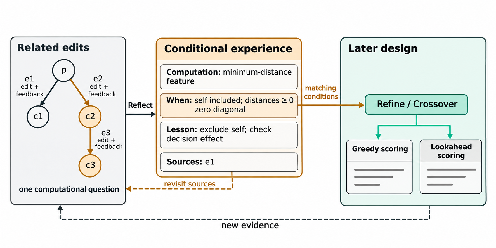

# 机制三：轨迹反思与经验学习

**EvoTrace 从不同分支和较早阶段的改进经历中，提炼带计算条件的设计经验，并随新轨迹修订，供后续算法借鉴。** 局部轨迹描述当前程序周围发生了什么，经验则保留这些经历对其他实现有什么设计含义。

*图1：围绕一个计算问题比较相关修改，保存条件、设计含义与来源，再供后续精炼或融合借鉴。最小距离特征的例子说明同一计算条件可以出现在不同求解结构中；新证据用于回读和修订。*

## 1. 从局部修改记录到可复用认识

机制二围绕当前算子组织局部材料，展示当前程序怎样形成、从这里试过什么。机制三将其他分支和较早阶段形成的认识带入当前设计，使新实现能够借鉴已经观察到的计算条件。

一次结果同时依赖起点、具体实现和配套计算。反思因此保留实际修改与结果之间的关系，并说明这些关系适用于哪些计算条件。

因此，本机制凝练的对象是**有条件的计算认识**：一项计算在什么条件下怎样起作用，已观察到什么结果，这些认识怎样影响后续实现。经验可以记录性能比较，但比较必须保留对应的实现变化和条件。全局共享的是经验的可见范围，适用范围由计算条件决定。

## 2. 将经验表示为条件、认识与来源

经验条目表示为

$$
\epsilon_j=(j,I_j,W_j,L_j,S_j),
$$

其中 $j$ 是稳定编号，$I_j$ 是计算问题，$W_j$ 是适用计算条件，$L_j$ 是具体认识及其设计含义，$S_j$ 是支撑当前认识的一组已评价事件。每个事件保留自己的父代实现、实际修改和结果。多个案例可来自不同分支，由共同的计算条件联系起来。系统同时保留累计来源和条目的历史版本。

条件需要能从当前代码或计划引入的计算中判断。例如，在非负距离矩阵上，对包含候选自身的集合取最小距离，会因对角线零而得到恒零特征。对应经验可以指出排除自身，并检查该特征是否进入实际决策。它能用于不同求解结构，因为条件指向相同的计算关系。

性能经验采用同样的表示。如果改变某项打分权重取得较好结果，经验记录实际比较过的构造方式、改动和结果，供同类实现选择候选设定。跨分支比较先解释各分支内部的修改与结果，再提炼共同条件和关键差异。

反思据此区分三种情况：计算没有影响决策、程序执行失败、有效执行后性能改变。三者对应不同的后续动作，分别是检查作用路径、修正实现，以及比较计算条件和接续修改。经验可以保留一条可定位的计算事实，也可以形成有条件的性能取舍或配套设计认识。

## 3. 以相关改进片段组织反思材料

反思读取的基本单位是一次尝试的最终已评价版本及其父代。经过修复的尝试使用最终实际评价代码和结果，仍作为一个事件；实际发生的全部评价分别计入预算。

一次修改、同起点的不同实现和接续发展，能够回答不同的问题。单次修改可以暴露恒零特征一类计算事实；同起点比较可以检验不同实现的表现；接续发展可以考察一项计算是否在后续调整中被保留，以及配套变化后结果怎样改变。

因此，每次反思围绕一个具体计算问题组织材料。系统从待审阅修改出发，寻找同起点上涉及相同源码位置的不同修改，或通过父子链接相连的接续修改，并补充形成起点所需的实现背景。源码位置与父子关系用于缩小比较范围，计算问题的含义仍由模型阅读实际实现后判断。

旧经验从三个入口进入候选：代表来源与当前修改结构相邻；经验内容与当前计算的词项相似；经验曾在这些尝试的生成上下文中展示。候选从全部有效经验中选取，包含本次生成未展示的旧条目。系统将能完整装入的候选及其代表来源加入反思，模型再根据实际实现判断共同计算条件。

生成时展示过的经验提供一条反馈入口。反思进一步定位该计算在最终评价代码中的作用，再决定保留、细化或修订经验。不同分支的新结果由此可以回到同一条认识。

每条经验保留解释其认识所需的最小案例组，最多 3 个事件。一项静态计算事实可以只用一个事件；同起点比较、配套调整或跨分支条件修订保留对应的多次尝试。每个案例的实现与结果完整呈现。输入同时提供任务与评价定义，说明候选函数与调用方各自负责的计算。

实现材料保留理解计算所需的内容。每段使用稳定的程序编号和尝试编号，先展示同一起点的完整代码，再紧接各次修改与其结果，不另设临时的代码编号总表。小幅修改提供完整差分；差分更长或代码大幅替换时直接给出子代完整代码；执行失败提供实际评价代码及错误反馈。共同代码只展示一次，连续修改保持显式父子链接。不同代码即使同分，也不合并为同一观察。

反思还需理解候选函数的作用位置。例如，OP候选函数生成一次性边先验，ACO在每步采样前另外施加动态可行性掩码。先验影响可行动作之间的相对权重，可行性由调用方的掩码保证。反思沿这一作用路径解释先验变化与性能差异。

父子源码及其评价反馈都相同的记录合并展示，并保留事件编号、链接与次数。这些重复事件共同表示一份观察。

## 4. 按周期调用，按新认识修订

反思每完成 10 次有评价结果的非初始化尝试触发一次，以分摊模型调用成本。执行失败计入周期，没有评价结果的生成或格式失败不计入。调用周期只决定何时审阅，不决定证据边界。

系统单独保存尚未审阅的不同修改。没有改变代码的尝试和完全重复的观察仍留档，但不重复进入待审阅集合。每轮选取一个能够完整装入的计算问题及其相关材料，其余继续保留。请求或更新失败时不消耗未审阅事件。

经验持续保存，展示预算独立管理。每次生成最多读取 6 条经验；新认识可以直接写入经验库。暂时未展示的条目继续保留，并可在后续生成或反思中再次入选。

反思提出三类操作：新增认识、修订已展示的相关条目、归档已被替代或合并的条目。已有条目采用稳定编号；新证据改变适用条件或揭示新的计算关系时，回读来源并修订对应条目。修订可以更换当前代表来源，累计来源仍保存。归档表示知识内容已被整合或替代，暂时退出展示由选取过程处理。未涉及的经验原样保留，观察也可以对应一次空更新。

整组更新通过字段、编号、来源和单次操作数量检查后一次应用。来源使用本轮完整展示的 1–3 个不同观察，允许来自不同分支。更新与归档针对已展示的有效条目。校验失败时保留此前经验与待审阅事件。内容判断由模型结合计算条件、实现和结果完成。

## 5. 让经验服务于当前算子的计算问题

生成器读取最多 6 条经验的简短计算问题、条件与认识。经验库超过 6 条时，系统按当前程序的代码、设计与分析选取 5 条词项相似的经验，融合同时使用已选参考程序的内容；另 1 条按稳定编号轮换。词项比较使用逆文档频率（IDF）加权的余弦相似度，轮换推进次数由已记录的经验展示尝试恢复。这个过程在本地完成。

经验放在局部轨迹之前，当前完整代码仍紧邻指令。来源与版本保存在研究记录中，生成上下文聚焦计算内容。较早的经验可以通过内容匹配重新入选，轮换也为其他保留条目提供展示机会。

**精炼先明确当前代码的计算问题，再借鉴经验。** 采用经验时，模型说明其条件怎样对应当前代码或计划修改。精炼保留当前主要机制；再次发展一个想法时，说明改变的条件、实现方式或配套计算。

**融合先明确借用的参考计算和接入位置，再借鉴经验。** 经验用于处理表示、尺度、作用位置或计算顺序，使已有认识服务于当前接入，而非替代对参考代码的理解。

**探索不读取经验。** 它继续引入当前代码没有执行的计算。新程序进入后续精炼或融合时，经验再用于解决它的具体实现问题。经验的适用性由计算条件判断，不由它是否接近当前最好程序判断。

V24.1 沿用机制二的材料选择与算子职责，提示用正面行动说明阅读、比较与实现任务。有经验时补充条件对应的用法，输出保持 `analysis → code → design`。

## 6. 经验与轨迹的持续更新

一次评价产生新的修改事实。周期反思将其中可复用的认识写入条件经验；后续生成在匹配的计算问题上借鉴它，再产生新的实现与结果。新结果既扩充轨迹，也可以改变旧经验的条件和含义。

机制三维护可回读、可修订的设计认识。它与机制二分工明确：局部轨迹用于理解这次修改，条件经验用于引入其他分支和较早阶段形成的认识。经验通过改变后续生成影响搜索；机制一继续从实际评价计算收益率。

实现入口为 [evidence.py](../../../traceaad_v24_1/evidence.py)、[notes.py](../../../traceaad_v24_1/notes.py) 与 [context.py](../../../traceaad_v24_1/context.py)。使用本机制的版本见[实验条件与版本对照](../../../experiments/PROTOCOL.md)，实现条件见[V24.1实现](../../../traceaad_v24_1)，历史行为与各自冻结条件下的验证见[研究记录](../../记录/2026-11-09-V24.1修正与小规模实验.md)。
