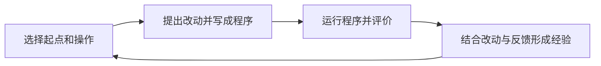

# 我们在研究什么

**在有限试错预算下，一个算法设计系统怎样从自己的尝试中积累经验，让后续的生成、修改与选择更有效？**

最终目标是更高效地发现和改进优质算法。搜索产生候选程序，也产生关于怎样得到更好程序的信息。我们关注这些信息怎样改变后续行动，以及收益是否值得其成本。

## 从尝试到下一次决策

一次行动可以是修改计算、精炼实现、组合已有计算，也可以是选择参考、继续投入或转向。具体研究对象由当前问题决定。

**搜索轨迹**记录多轮尝试的顺序、程序来源、评价反馈、机会分配和后续响应。它与以下两类记录不同：

| 记录 | 描述什么 |
| --- | --- |
| 模型一次回答中的推理文本 | 模型怎样描述或解释这次设计。 |
| 程序求解一个实例时的运行轨迹 | 程序怎样执行并产生解。 |

这两类记录都可能帮助解释某次尝试。当前程序保存了已经采用的计算，但未必说明哪些修改试过、为什么放弃、哪些计算必须配合使用。搜索轨迹可能补足这些信息。

## 三个理解角度

| 核心问题 | 需要辨清的关系 |
| --- | --- |
| 从一次成败中能学到什么？ | 实际改动、实现与评价条件，怎样共同产生结果。 |
| 哪些经验可用于下一次判断？ | 什么信息值得保留，它在什么程序和条件下仍然适用。 |
| 下一次尝试应当用在哪里？ | 已有经验、剩余预算与其他用途，怎样影响行动价值。 |

这三个角度用于组织问题。它们不要求三个独立模块，也不预先决定学习或搜索方法。

## 当前最需要辨清什么

**相对于当前代码和成绩，过去的哪条事实能改善下一次生成、修改或选择？**

要回答这个问题，需要建立一条具体联系：

> 哪条经验 → 改变哪个行动 → 在什么条件下产生什么收益。

收益可以是更好的计算改动、更合适的参考、更少的重复无效尝试，或更有效的预算分配。

目前尚未确定哪类经验或哪种机制最值得采用。已有区分见[当前认识](当前认识.md)，本次讨论见[2026-W42 记录](记录/2026-W42.md)。
