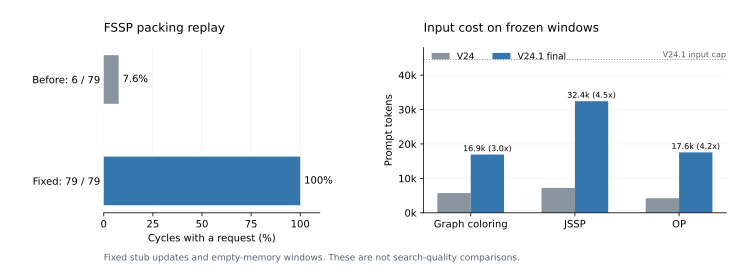

# V24.1 修正与小规模实验

记录时间：2026-11-09 14:21（北京时间）。

**我修复了审查发现的默认装入停摆和无经验时的指令差异。六任务真实档案的515个反思周期均发出请求。真实模型回放仍出现跨结构排序，现有证据不支持宣称经验质量或完整搜索收益已经改善。**

## 为什么修改

Opus 5.5的对比审查指出，32256字节被作为输入上界，实际只利用约四分之一的token空间，旧来源又每轮必装。我修正前独立复现了FSSP：79周期仅6次反思，最后成功在尝试65，末尾782个未读。此前短程序测试没有验证持续吞吐，不能作为真实材料规模下可运行的证据。

本轮保留每10次触发、6条活跃经验、Explore隔离、未读材料与失败保留，不改V21/V24和Base的选择、生成修复、评价或最终选择规则。修正包括：

- 按服务端分词器（tokenizer）与相同聊天模板计数，取消字节估算；计数失败保留事件，不静默换估计器。
- 反思单独预留4096 tokens输出和512格式余量，49152上下文下可装44544输入tokens；生成输出仍为16384。
- 每条经验当前回读一个代表父子事件，累计来源与归档保留。正常周期一次尝试整批装入；超限时先给最老未读事件一个位置，再装本周期事件，最后补旧事件。
- 无经验时，Refine/Crossover完整沿用V21指令。有经验才加入条件经验用法。
- 连续片段中，某子代已作为下一步父代展示完整代码时，仍显示本次小改的完整差分。首轮回放后发现并补上了这处遗漏。

## 条件与原始证据

源代码分别冻结在server4的 `/home/fzy/code/LLM4AD/TraceAAD_runs/20261109c_traceaad_v24_1_validation` 与 `20261109d_traceaad_v24_1_validation`。c为输入计量等首轮修正；d另补连续差分与条件表述。两处使用原公共调度器和Qwen3.8-27B，关闭思考，温度1；没有覆盖运行中的旧批次源码。

完整参数、代码SHA-256、冻结源记录前缀SHA-256、输出经验和用量见[精简原始摘要](2026-11-09-V24.1验证/summary.json)。完整提示与回复、逐周期装入情况、token计数缓存位于本地 `experiments_result/traceaad_v24_1_validation/`，按仓库既有约定不提交大体积原始运行目录：

- `packing_20261109/`：c输入版本的六任务装入重放。
- `packing_final_20261109/`：d最终输入版本的六任务装入重放，本文表格使用这一版。
- `reflection_20261109/`：c与V24的三窗口×两次重复，共12次真实模型反思。
- `reflection_final_20261109/`：d在相同窗口的两次重复，共6次真实模型反思。
- `tsp_construct/20261109_v24_1_smoke_tsp/` 与 `20261109d_v24_1_smoke_tsp/`：两次训练冒烟。

复跑脚本为 [validate_v24_1.py](../../experiments/traceaad/validate_v24_1.py)。`--pack-root`只调用tokenizer；`--live`才请求模型反思。源档案只读，不使用独立测试数据，也不回写源搜索。

## 实验一：真实档案的材料吞吐

使用V21正式批次 `20261105c_v21_co6` 六任务第1路，重放V24.1实际的 `finish/_reflect/build`。不调用生成模型；固定模拟反思器每轮新增或修订一条经验，最多6条，每条仅引用一个新读事件。经验文字明确标为模拟，不当作算法认识。输入使用真实服务端token计数。

| 任务 | 周期 / 发请求 | 已读 / 新事件 | 末尾保留未读 | 输入tokens中位 | 输入tokens最大 |
| --- | ---: | ---: | ---: | ---: | ---: |
| tsp_construct | 92 / 92 | 920 / 930 | 10 | 28,573 | 43,951 |
| cvrp_aco | 96 / 96 | 960 / 961 | 1 | 33,762 | 43,373 |
| fssp_gls | 79 / 79 | 790 / 800 | 10 | 30,367 | 41,864 |
| graph_colouring | 76 / 76 | 727 / 770 | 43 | 43,170 | 44,518 |
| jssp_construct | 78 / 78 | 764 / 782 | 18 | 42,357 | 44,531 |
| op_aco | 94 / 94 | 927 / 941 | 14 | 37,503 | 44,456 |

**观察。** 515/515个周期发出反思请求，共读5088/5184个事件，没有重现旧来源导致整轮持续停摆。剩余96个仍保留，其中包含搜索终止时按规定不再反思的窗口尾部，也包含上下文不足时延后的事件；图着色仍有43个未读，不能把这轮称为全量审阅完成。

**认识。** 默认输入空间确实不足是先前停摆的重要原因。修正后能继续处理新事实，但有限上下文仍限制复杂任务的覆盖率。这是实现吞吐证据，不是学习效果证据；固定来源策略也不代表真实模型一定按同样方式选来源。

## 实验二：冻结窗口的真实模型反思

选取旧V24曾出现跨结构否定的三个位置：图着色第1路尝试85、JSSP第1路136、OP第3路245。两版均从空经验开始，取截至该位置最后10个已评价非初始化事件。V24读简略卡片；V24.1另补实际实现和相关片段。两版反思输出统一限制4096 tokens，其余模型和调度设置相同。这里没有顺序重放之前的笔记，不能用来证明长期修订行为。

c与V24各采样两次，12/12解析成功。补齐连续差分后d各窗口再采样两次，6/6解析成功。全部18次冻结窗口加两次冒烟反思，输入计数均与服务返回的 `usage.prompt_tokens` 相同；计数不再用经验字节比例代替。

| 窗口 | V24输入tokens | 最终V24.1输入tokens | 倍数 |
| --- | ---: | ---: | ---: |
| 图着色85 | 5,733 | 16,922 | 2.95 |
| JSSP136 | 7,221 | 32,433 | 4.49 |
| OP245 | 4,221 | 17,559 | 4.16 |

输入完全由窗口材料决定，同窗口两次重复的token数相同。首轮c的V24.1输入分别为14489、29480、16368；d增加连续差分后的成本如表，不能沿用V24的轻量成本估计。

**内容观察，没有按正负词计数判定好坏。**

- 图着色的部分条目开始限定到DSATUR中相同饱和度与度数的平局处理，这是比“局部搜索不如贪心”更具体的计算条件。但仍出现“主要收益来自随机重启而非后处理”的扩大判断。
- JSSP在c与d的两次重复中都出现相反方向：一份说应严格限制最小完成时间集合，另一份说较宽候选集合更好。它们读取相同窗口，说明代码与条件字段本身不足以保证稳定、正确的比较。这里没有依据把某份模型解释直接当成事实。
- OP有条目能明确比较 `p_j/d^2` 与 `p_j/d`，但也有条目继续把静态启发式概括为普遍优于模拟；部分 `when` 仍引用局部 `Code` 编号，离开原输入后不完整。

**判断。** 这轮验证了接口和运行链路，未验证经验内容已经合格。完整实现和 `when` 是必要输入与表示，但当前模型仍会混合局部性能比较、跨结构排序和未经验证的原因解释。没有据此启动正式批次。

## 实验三：真实搜索训练冒烟

条件沿用统一入口：TSP、种子0、5个有效初始化、训练16例、共享160秒评价总时限、2GiB内存、原模型调度和采样。两路都跳过主测试，分别使用c和d，预算不同，不构成性能配对比较。

| 版本 | 评价 / 生成修复调用 | 评价状态 | 成功反思 | 训练最好 | 最好出现时机 |
| --- | ---: | --- | ---: | ---: | --- |
| c | 26 / 26 | 23成功、3错误 | 1 | 6.8202115 | 尝试6，经验产生前 |
| d | 20 / 20 | 20成功 | 1 | 6.1898951 | 尝试8，经验产生前 |

两次反思均形成2条经验；随后分别有7次与5次Refine/Crossover实际读取经验。所有Explore均不读经验。复制两份真实运行记录后，恢复出的经验、未读队列和计数与快照完全一致，恢复没有调用模型或tokenizer。

d在尝试6的Explore引入新计算，尝试8的Refine进一步改善，但它们都发生在第一次经验产生之前。因此，这次成绩不能归因于机制三。生成说明也不等于实际代码；这里只按评价记录报告训练目标值。

## 检查与当前结论

本地最终 `uv run pytest -q`：448 passed、6条既有Python fork弃用提示。定向检查64项通过。新增回归覆盖空经验时完整V21指令、反思独立输出预算、必须提供token计数器、真实规模的六条来源、连续源码复用时仍有差分，以及tokenizer不申请GPU槽位。`git diff --check`与文档链接检查通过。

我保留V24.1作为条件经验的实现主线，也保留旧V24代码和报告。当前能确认默认吞吐与接口问题已修正，并有真实模型链路证据。不能确认经验已帮助新方向开发，更不能宣称完整搜索优于V21或V24。最值得继续检验的是在固定父代、固定算子下，一次只比较一种明确的计算修改，判断批量读多种机制是否促使模型把实现比较扩大为结构排序。

## 追加认识修正：先建立实现、修改与结果的对应

复核本报告的原始输出后，我把问题进一步定位到事实对应。JSSP的相反建议不能只解释为模型偏保守；模型可能尚未稳定地区分候选池限制、优先规则与配套计算分别属于哪个程序。图着色的回复把事件或程序编号混写成不存在的`Code`编号，也说明共享代码总表增加了远距离连接负担。有些局部认识已经更具体，不能把本轮结果一概表述为条件经验没有改善；不稳定的是它与过度扩张结论的混合。

OP中有一项原因解释可以由调用方直接否定。评价器的每步采样权重乘以动态可行性掩码，超预算动作不能因启发式较高而被采样。因此，硬掩码与软惩罚的成绩差异不能解释成后者让蚂蚁采样非法路线。可保留已观察到的实现比较，但原因必须符合候选函数生成固定先验、ACO逐步控制可行性的实际分工。

据此，本轮V24.1改为每周期聚焦一个计算问题，先把相关实现、具体改动与成绩方向对应，再提炼经验。材料使用稳定的程序与尝试编号，代码、改动和结果相邻；来源保存能表达认识的最小相连关系，只回读相关旧经验。固定的是问题，材料仍可包含同起点的不同尝试与必要的接续修改。代码见[V24.1实现](../../traceaad_v24_1)。

本次没有运行模型回放、训练冒烟或完整搜索。本报告原有数字和原始输出仍对应d7c238a所记录的冻结实现，不作为此次聚焦修订的内容验证。下一步应先核对JSSP案例中的具体计算与结果，检查聚焦材料是否仍导致事实方向相反，再决定是否检验经验对固定父代修改的作用。
