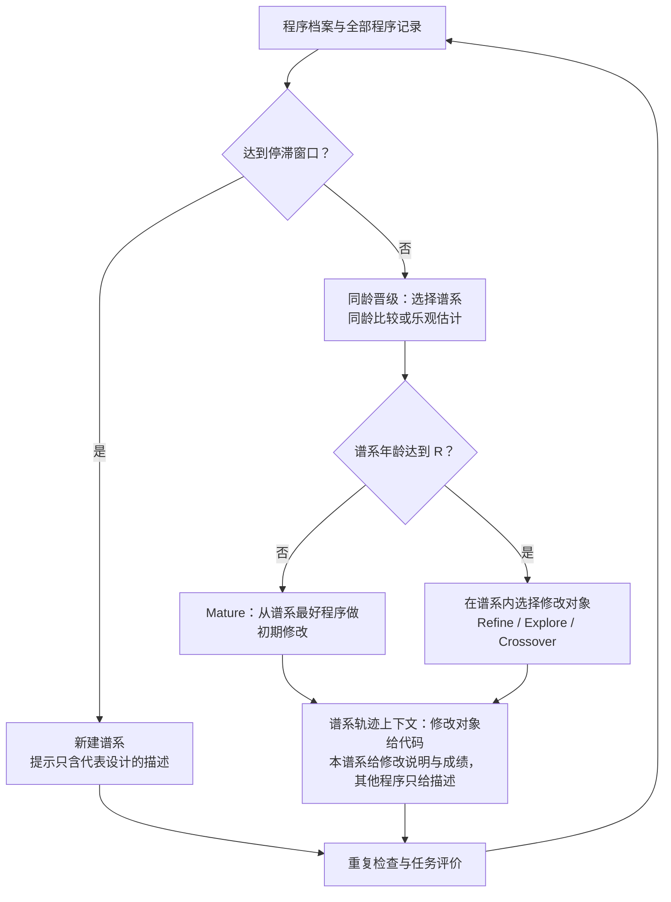

# TraceAAD：将 LLM 自动算法设计建模为臂通过提示耦合的递增收益老虎机

**TraceAAD: LLM-Driven Algorithm Design as a Rising Bandit with Prompt-Coupled Arms**

## 摘要

自动算法设计让大语言模型（LLM）直接编写和改进求解算法，已在组合优化和数学问题上找到优于人工设计的算法。然而，现有方法按当前成绩选择要改写的程序，并在提示中以代码展示已有程序；随着搜索推进，生成越来越集中于已有程序的重复和小幅变体。我们认为，这种保守主要来自开发在谱系之间的分配方式，而不是 LLM 写不出不同的程序。一个从零写出的程序及其后代构成一个谱系。谱系间的开发分配可以建模为 rested 递增收益老虎机，且老虎机的臂通过提示耦合。这一模型给出保守的两个来源：按当前成绩分配，让新谱系与已充分开发的谱系直接竞争，新谱系在成熟前就被放弃；以代码展示其他谱系，使模型沿用这些代码，开发一个谱系变成复制另一个谱系。据此，我们提出 TraceAAD。它用同龄晋级在相同尝试数下比较谱系，并对仍在快速改进的谱系做乐观估计，不需要额外评价；用谱系轨迹上下文只以代码展示被修改的程序，其他程序只以文字描述出现，使谱系共享思路而不共享实现。我们在六项组合优化任务上将 TraceAAD 与 12 种已有方法比较，并分析搜索后期重复与小幅变体的比例和各组成部分的作用。

**关键词：** 自动算法设计；大语言模型；递增收益老虎机；设计固着；程序搜索；组合优化

## Abstract

Automatic algorithm design with large language models (LLMs) lets a model write and improve solvers directly, and has found algorithms that outperform human designs in combinatorial optimization and mathematics. However, existing methods choose which program to rewrite by its current score and show existing programs to the model as code; as the search proceeds, generation concentrates on duplicates and small variants of existing programs. We argue that this conservatism comes mainly from how development is allocated across lineages, not from what the LLM can write. A lineage is a program written from scratch together with its descendants. Allocating development among lineages can be modeled as a rested rising bandit whose arms are coupled through the prompt. The model identifies two sources of conservatism: allocating by current score pits new lineages against heavily developed ones, so new lineages are abandoned before they mature; and showing other lineages as code lets the LLM copy them, so developing one lineage turns into copying another. We therefore propose TraceAAD. *Age-matched promotion* compares lineages at the same number of attempts and projects the progress of lineages that are still improving, at no extra evaluation cost. *Lineage-trajectory context* shows only the program being modified as code and describes all other programs in words, so lineages share ideas but not implementations. We compare TraceAAD with 12 existing methods on six combinatorial optimization tasks and analyze the late-search share of duplicates and small variants and the role of each component.

**Keywords:** automatic algorithm design; large language models; rising bandits; design fixation; program search; combinatorial optimization

## 1 引言

自动算法设计在可执行程序空间中搜索求解算法。早期方法用遗传编程和超启发式组合预定义的算法部件 [1, 2]，或在给定的参数空间中配置已有算法 [3, 4]。大语言模型（LLM）使搜索不再局限于预定义的部件与参数：模型可以直接改写计算公式、控制流程和算法结构 [5–7]。FunSearch、EoH、ReEvo 与 AlphaEvolve 等方法反复执行同一循环 [8–11]：搜索按成绩选出程序，把它们及其反馈写入提示；模型据此生成新程序；评价器在任务实例上给出成绩。LLM 在这一循环中承担变异与交叉算子的角色 [12]。这类方法已在组合优化和数学问题上找到优于人工设计的算法 [8, 9, 11]。

LLM 能写出结构迥异的程序，这一循环却随进程趋于保守。我们分析了 11 种方法在六项任务、三个随机种子上的 198 条搜索轨迹（附录 A）。在搜索进程的 10%–20% 区间，平均 32.8% 的候选是已有程序的重复、只改数值常数的变体或很小的代码修改；到 90%–100% 区间，这一比例升至 47.5%，远离已有程序的修改则由 45.2% 降至 29.4%。重复已有程序几乎不带来改进。搜索仍在生成程序，但越来越多的预算花在已有实现附近。

我们从搜索分配什么来解释这一现象。一次无父代生成得到的程序及其全部后代构成一个谱系，对应一个算法设计及其修改版本。搜索的每次尝试都在开发某个谱系，而谱系的最好成绩只随它自身获得的尝试改进。以谱系为臂、以一次尝试为一次拉动，谱系间的开发分配可以建模为 rested 递增收益老虎机 [13–15]。这一模型指出现有搜索的两个缺陷。

**第一，按当前成绩分配，比较的是年龄不同的谱系。** 谱系已获得的尝试数称为它的年龄。当前最好的谱系可能已获得数百次尝试，新谱系只有几次；两者的成绩差异混合了设计本身的差异与开发程度的差异。进化计算中的保护创新针对的正是这一问题 [16, 17]。在我们的基础搜索中，211 个达到五次尝试的新谱系有 49 个落后于当前最好谱系的成绩，却不差于该谱系在同一年龄的成绩；其中 26 个此后再没有获得尝试。

**第二，谱系之间通过提示耦合，老虎机的臂因此不独立。** 这是 LLM 搜索与标准老虎机的关键区别。设计者看过示例后会沿用示例的特征，设计认知研究称之为设计固着 [18, 19]。LLM 有同样的倾向，并且有机制层面的原因：Transformer 中的归纳头会整段复制上下文中出现过的序列 [20]，一段内容在上下文中重复得越多，模型越容易再次生成它 [21]。多数方法以代码展示修改对象以外的程序，例如交叉的参考程序和修改历史中的代码差异。用另一个谱系的代码开发一个谱系时，模型可能直接返回另一个谱系的实现，开发就变成了复制。在基础搜索拒绝的 800 次重复回复中，64.3% 与提示中以代码或代码差异出现的程序相同；最多的一类是交叉的参考程序，共 301 次。

现有方法分别缓解了其中一个缺陷，但没有处理谱系之间的耦合。分配方面，MCTS-AHD 用树搜索继续修改暂时较差的节点 [22]，Clade-AHD 按分支聚合后代评价来分配探索机会 [23]。它们给暂时落后的候选更多开发机会；但以 MCTS-AHD 为例，提示仍以代码展示其他启发式，耦合依然存在。上下文方面，EoH 同时演化算法思路与代码 [9]，ReEvo 从程序表现差异中提取反思 [10]，DeltaEvolve 用语义差分代替完整的代码历史，提示中只保留父代的代码 [24]，MEMOIR 在分支之间只传递压缩摘要 [25]。这些方法改变经验的形式，动机是提高信息密度或节省上下文，而不是阻止谱系之间的复制。BaSE 用递增收益老虎机在平行轨迹之间分配 LLM 调用，各轨迹只看自身历史 [26]；这消除了耦合，也阻断了知识传递。因此，多数现有搜索处在两端之一：谱系共享代码而相互复制，或谱系完全隔绝而不传递知识（表 1）。

我们提出 **TraceAAD**，它用两个组成部分分别处理这两个缺陷。

- **同龄晋级**在相同年龄比较谱系，据此分配尝试。当前最好程序所在的谱系称为参考谱系，它在各年龄的最好成绩构成参考曲线。挑战谱系在年龄每翻一倍时，与参考曲线在同一年龄的值比较；未通过时，再用最近一半尝试的平均改进外推到下一个比较点。前者借鉴逐次拒绝 [15, 27]，后者借鉴递增收益老虎机的乐观估计 [14]。参考曲线来自已有记录，比较不需要额外评价。
- **谱系轨迹上下文**让谱系共享设计而不共享实现。提示中只有修改对象以代码出现。本谱系的历史以修改说明及实测成绩排成轨迹，这与 OPRO 的带成绩解轨迹和 DeltaEvolve 的语义差分相近 [24, 28]。其他程序只给设计描述或修改说明及成绩，交叉的参考程序取自其他谱系；以抽象形式呈现示例可以减轻设计固着 [29, 30]。模型因此可以借用其他谱系的计算，但必须在当前代码中重新实现。

两个组成部分相互依赖。同龄晋级假设每个谱系由自身的尝试推进；若提示中有其他谱系的代码，受保护的谱系可能靠复制通过比较。谱系轨迹上下文让谱系保持独立；但若分配仍按当前成绩，独立的新谱系依然会在充分开发前被放弃。我们在六项组合优化任务上将 TraceAAD 与 12 种已有方法比较，并用 $2\times2$ 析因实验检验两部分的交互。

本文的贡献如下：

1. **问题建模。** 我们把 LLM 自动算法设计中的开发分配建模为谱系上的 rested 递增收益老虎机，并指出它与标准老虎机的区别：LLM 沿用提示中的代码，使臂通过提示耦合。跨方法轨迹、重复回复的来源、初始化对照与谱系统计为这一模型提供证据（第 2 节）。
2. **方法。** 我们提出 TraceAAD。同龄晋级按同一年龄的参考曲线与乐观估计分配开发；谱系轨迹上下文使谱系共享设计而不共享实现（第 3 节）。
3. **实验。** 我们在六项组合优化任务上与 12 种已有方法比较，用 $2\times2$ 析因实验与乐观估计的消融分离各部分的作用，并测量谱系独立性与开发分配的变化（第 4 节）。

## 2 问题建模

本节先给出搜索循环（第 2.1 节），再把谱系开发建模为递增收益老虎机（第 2.2 节），然后说明谱系如何通过提示耦合（第 2.3 节），最后导出对搜索的两项要求（第 2.4 节）。

### 2.1 搜索循环

给定程序接口、任务实例分布和评价函数 $f$，搜索在 $B$ 次生成回复的预算内寻找评价值尽量小的程序。评价函数返回训练实例上的平均目标值；未通过合法性或计算预算检查的程序记为无效。第 $t$ 次生成前，有效程序档案为 $\mathcal A_t$，包含失败、修复与父子关系的完整记录为 $\mathcal R_t$。搜索选出修改对象 $x_t$ 和上下文集合 $H_t$，构造提示 $P_t$，再由参数固定的语言模型生成候选：

$$
(x_t,H_t)=\pi(\mathcal A_t,\mathcal R_t),\qquad
P_t=C(x_t,H_t),\qquad
x'_{t+1}\sim p_\theta(\cdot\mid P_t).
$$

修改对象是本次被改写的程序。上下文集合是提示中修改对象以外的程序，例如交叉的参考程序、修改历史中的祖先和此前的尝试；它们连同评价结果出现在提示中。提示构造 $C$ 规定这些程序以代码还是设计描述出现。无父代生成只使用任务说明和上下文集合。有效候选进入档案，搜索最终返回训练评价值最好的程序。

这一循环与经典进化算法有一处关键差别。在使用固定变异核 $q(x'\mid x_t)$ 的进化算法中，选择只改变修改对象 $x_t$ 的分布；给定修改对象后，子代分布不变。在 LLM 搜索中，子代分布 $p_\theta(\cdot\mid C(x_t,H_t))$ 还依赖 $H_t$ 及其表示 $C$，而 $H_t$ 同样由选择产生；DeltaEvolve 已把上下文对候选分布的这种作用写入形式化 [24]。因此，选择在 LLM 搜索中决定两件事：哪个设计得到开发（第 2.2 节），以及开发时模型看到哪些程序（第 2.3 节）。

### 2.2 把谱系开发建模为递增收益老虎机

初始化和停滞后的无父代生成建立谱系。普通子代归入修改对象所在的谱系；修复和重问沿原回复归入同一谱系。记谱系 $D$ 中按生成顺序排列的程序记录为 $\mathcal P_D$，其年龄为 $e_D=|\mathcal P_D|$。有效程序、评价失败和被拒绝的重复回复都计入年龄。谱系前 $e$ 个记录中的最好评价值为

$$
b_D(e)=\min\{f(p):p\in\mathcal P_D[1:e],\ p\text{ 有效}\},
$$

空集合的最小值取 $+\infty$。当前最好有效程序所在的谱系称为参考谱系，记为 $C$；函数 $e\mapsto b_C(e)$ 称为参考曲线。其余谱系称为挑战谱系。

$b_D(e)$ 随 $e$ 不增，并且只随谱系 $D$ 自身的尝试变化。它的改进有两个来源，需要分开。第一个来源是取最好值：即使每次尝试的成绩分布不变，前 $e$ 次的最好成绩也会随 $e$ 改进；以最好单次结果为目标、在多个随机搜索启发式之间分配运行的问题称为最大值老虎机 [31, 32]。第二个来源是开发：修改从谱系的最好程序出发，每次尝试的成绩分布本身随开发移动；这对应 rested 递增收益老虎机，即臂的收益只随自身被拉动的次数改善 [13, 14, 33]。谱系开发同时具有这两种改进。在最小化问题中，收益改善对应 $b_D(e)$ 下降。

适应度选择按当前成绩分配，即比较 $b_C(e_C)$ 与 $b_D(e_D)$。参考谱系的年龄 $e_C$ 通常远大于挑战谱系的 $e_D$，因此这一比较混合了设计本身的差异与开发程度的差异。只要各谱系的成绩曲线可能交叉，按当前成绩分配就会系统地低估年轻的谱系。

我们的数据支持这一分析中的三个判断。

- **新设计在少量修改后可以大幅改进。** 附录 D.1 的一个 CVRP 新谱系，初版平均路线总长为 11.567，一次修改后降到 8.236，超过了该谱系出现前的最好成绩 8.536。
- **成绩曲线会交叉。** 在同龄晋级下，每个初始谱系先修改到年龄 5。早期实现（第 4.2 节）的 18 次运行中有 6 次，年龄 1 时领先的初始谱系在年龄 5 时不再领先（表 B8）。
- **适应度选择把尝试集中到参考谱系，并放弃可能被低估的谱系。** 基础搜索 18 条轨迹中有 16 条的最大谱系获得了 60%–90% 的尝试（表 B5）。211 个达到五次尝试的新谱系有 49 个落后于出生时参考谱系的当前成绩，但不差于参考谱系自身前五次尝试的最好成绩；其中 26 个没有获得第六次尝试，而所属搜索此后仍产生了 19–873 条其他程序记录（表 B6）。

### 2.3 谱系之间通过提示耦合

标准老虎机假设拉动一个臂不改变其他臂。LLM 搜索不满足这一假设，因为模型会沿用提示中的代码。本节先说明这一倾向的来源，再给出它在谱系上的后果与证据。

设计固着指设计者的方案沿用其看过的示例的特征。Jansson 与 Smith 让工程设计者在看过或没有看过示例的条件下设计同一产品，看过示例的一组更多地复现了示例的特征 [18]；Smith 等人在创造性生成任务中得到同样的结果 [34]。这类实验把固着定义为相对于对照组的一致性。LLM 的生成机制使这种一致性很容易出现。Transformer 中的归纳头会找到当前词元在上下文中的先前出现，并预测它后面的词元，从而整段复制已出现的序列 [20]。文本生成中的重复退化 [35] 与一种自我强化有关：一段内容在上下文中重复得越多，模型再次生成它的概率越高 [21]。在进化搜索中，LLM 生成的子代与提示中的示例相近 [12]；即使没有选择，反复用 LLM 修改程序也会收敛到少数结构 [36]。

在谱系框架下，这意味着开发谱系 $D$ 的结果取决于提示中出现了哪些谱系的代码。若提示中有参考谱系的代码，模型可能沿用参考谱系的实现，$D$ 的这次尝试就成了参考谱系的重复或近邻变体。谱系之间因此通过提示耦合：选择决定哪些代码进入提示，复制使这些代码进入其他谱系。适应度选择又使参考谱系的程序最常进入提示，因此被复制的主要是参考谱系的实现。

基础搜索的轨迹支持这一点。基础搜索按当前成绩选择修改对象，并以代码展示上下文中的程序（附录 B）。它拒绝了 800 次重复回复，即规范化代码与此前已评价程序相同的回复。其中 301 次与交叉的参考程序相同，51 次与修改对象相同，162 次与修改历史中以代码差异出现的祖先相同，三者合计 64.3%（表 B1）。参考程序的重复最多：模型被要求把参考程序中有用的计算并入修改对象，却原样返回了参考程序。参考程序从全档案中抽取，可以来自其他谱系，因此这类重复可以跨越谱系。

初始化提供了一个没有选择的对照。两种条件生成后续初始程序时，分别以代码或设计描述展示先前的初始程序，其余设置相同。先前的初始程序各自属于不同的谱系，因此这一对照直接比较了其他谱系以代码或设计描述出现时的差别。以设计描述展示时，六项任务上初始程序的平均两两代码距离都更大（0.75–0.90 对 0.54–0.71）；最好初始成绩在三项任务上更好、两项相近、一项变差（表 B7）。这一对照说明，谱系之间的复制来自代码的出现，而不来自信息的共享：去掉代码后，生成更分散，初始质量没有系统下降。

### 2.4 两项要求

上述分析给出对搜索的两项要求。

- **要求一：在相同年龄比较谱系，并照顾仍在上升的谱系。** 按当前成绩比较会低估年轻的谱系（第 2.2 节）。
- **要求二：谱系的实现彼此独立，设计层面的信息可以传递。** 其他谱系的计算思路对开发有用，其代码却会使谱系相互复制（第 2.3 节）。

要求一以要求二为前提。若谱系之间可以复制代码，同龄比较保护的可能是参考谱系的副本。表 1 对比三类搜索怎样处理要求二。

表 1：三类搜索中，提示里其他谱系的程序以什么形式出现。

| 搜索方式 | 修改对象 | 其他谱系的程序 | 谱系之间的关系 |
| --- | --- | --- | --- |
| 基础搜索与多数已有方法 | 代码 | 代码，例如交叉的参考程序 | 可以相互复制 |
| BaSE 的平行轨迹 [26] | 代码 | 不出现 | 不传递知识 |
| TraceAAD | 代码 | 设计描述与成绩 | 共享设计，实现独立 |

## 3 TraceAAD

### 3.1 总体框架

TraceAAD 由两个组成部分构成。同龄晋级决定下一次尝试开发哪个谱系，满足要求一（第 3.2 节）；谱系轨迹上下文决定这次尝试的提示中出现什么，满足要求二（第 3.3 节）。第 3.4 节说明两部分如何配合，第 3.5 节说明新建谱系与完整的搜索循环。把两部分换回适应度选择与代码上下文，TraceAAD 即为基础搜索。图 1 给出一次生成的流程。



图 1：TraceAAD 的生成循环。同龄晋级读取各谱系成绩随年龄的变化；谱系轨迹上下文只以代码展示修改对象。重复后的重问与失败修复共用一次重试机会，并消耗总预算。

### 3.2 同龄晋级

同龄晋级满足要求一。它把老虎机与进化计算中两种已有的比较方式用于谱系。固定预算的最优臂识别在相同拉动次数下比较各臂：逐次拒绝每轮给存活的臂相同的拉动次数，再淘汰估计最差的臂 [27]；在递增收益设定下，它的错误概率与下界只差常数倍 [15]。乐观估计用近期的改进速度外推臂的未来收益，避免过早放弃仍在上升的臂 [14]。进化计算以相同的思路保护创新：ALPS 按年龄分层，只让年龄相近的个体竞争 [17]。

本节沿用第 2.2 节的谱系、年龄、参考谱系与参考曲线。交叉子代归入修改对象所在的谱系。无法解析为程序的回复只消耗总生成预算，不计入年龄（附录 C.4）。

**比较点。** 比较点设在年龄每翻一倍的位置：

$$
r_k=R\,2^k,\qquad k=0,1,2,\ldots,
$$

默认 $R=5$，即在 5、10、20、40……次尝试时比较。

**晋级条件。** 对至少包含一个有效程序的挑战谱系 $D$：若 $e_D<R$，它处于初期修改阶段，保持活跃。否则取它已达到的最高比较点 $r=r(D)$。要求 $b_D(r)<+\infty$，并满足下面两个条件之一：

$$
\text{同龄比较：}\quad b_D(r)\leq_\varepsilon b_C\!\left(\min\{r,e_C\}\right);
$$

$$
\text{乐观估计：}\quad \hat b_D(2r)=b_D(r)-s_D\,r\ \leq_\varepsilon\ b_C\!\left(\min\{2r,e_C\}\right).
$$

其中 $s_D$ 是 $D$ 在窗口 $[h,r]$ 上每次尝试的平均改进：

$$
s_D=\frac{b_D(h)-b_D(r)}{r-h},\qquad h=\max\{a_D,\lceil r/2\rceil\},
$$

$a_D$ 为 $D$ 首个有效记录的年龄；$h=r$ 时 $s_D=0$，乐观估计退化为与参考曲线在 $2r$ 处的比较。$\leq_\varepsilon$ 表示带浮点容差的比较（附录 C.1）。满足条件的谱系称为晋级，可以继续获得尝试，直到下一个比较点；不满足的谱系暂停。

**分配。** 下一次尝试分给年龄最小的活跃挑战谱系，年龄相同时选择较早建立的谱系；没有活跃挑战谱系时，分给参考谱系。年龄最小者优先，使活跃的挑战谱系依次到达下一个比较点。这与逐次拒绝的做法相似：存活的臂先达到相同的拉动次数，再做比较。每次分配都按当前的参考谱系重新判断，因此参考谱系更替后，暂停的谱系可以重新参与。

**谱系内的修改。** 选中谱系的年龄不足 $R$ 时，从其最好有效程序执行初期修改 Mature：保留主决策规则，修补薄弱步骤、参数和辅助计算。年龄达到 $R$ 后，按固定概率执行 Refine、Explore 或 Crossover；修改对象从该谱系的有效程序中抽样，权重同时使用训练成绩和以往产生改进子代的频率（附录 C.1）。

**两个条件针对的谱系。** 同龄比较针对这样的挑战谱系：设参考谱系的年龄 $e_C\geq r$，

$$
b_C(e_C)<b_D(r)\leq b_C(r).
$$

它落后于参考谱系的当前成绩，但不差于参考谱系在同一年龄的成绩。适应度选择常放弃这类谱系（第 2.2 节），同龄晋级让它继续获得尝试。乐观估计针对另一类谱系：它在 $r$ 处落后于参考曲线，但最近的改进速度足以在 $2r$ 处追上。若谱系的改进逐渐变慢，即 $b_D$ 是凸的下降曲线，线性外推给出的 $\hat b_D(2r)$ 不高于实际的 $b_D(2r)$，因此是乐观估计。

**与 R-ed-UCB 的关系。** 这一估计沿用 R-ed-UCB 的构造：R-ed-UCB 假设收益单调上升且增量递减，用最近若干次拉动上的平均增量线性外推臂的未来收益；窗口长度与该臂已被拉动的次数成正比，且小于其一半 [14]。同龄晋级的窗口长度为 $\lfloor r/2\rfloor$，取这一范围的上端；外推只到下一个比较点，即 $r$ 次尝试之后，并且不加置信项。窗口从 $\lceil r/2\rceil$ 开始，以排除初版到首次修改之间的跳变；若从首个有效记录开始，约一半的比较事件都会晋级，比较点失去筛选作用（附录 C.3）。

**为 LLM 自动算法设计所做的适配。** 上述比较方式原本用于彼此独立、数目固定的臂或个体。用于谱系时，同龄晋级做了五点调整。

1. **臂是谱系。** 谱系在初始化和停滞后陆续产生，参考谱系也会更替。每次分配都重新判断全部谱系。
2. **年龄计入全部程序记录。** 失败和被拒绝的重复同样消耗开发机会，因此计入年龄。
3. **比较基准是参考曲线。** 逐次拒绝要求给每个存活的臂补齐相同的拉动次数 [15, 27]。同龄晋级直接读取参考谱系在同一年龄的已有记录，不需要额外预算。超参数优化中的中位数停止规则同样在同一训练步把一次试验与已完成试验的曲线比较 [37]；同龄晋级以参考谱系代替中位数。
4. **比较点按年龄翻倍。** 这与逐次减半和 Hyperband 的资源调度相同 [38–40]：越成熟的谱系，比较越少。
5. **目标是最终返回的最好程序。** 这与最大值老虎机的目标一致 [31, 32]，而不同于识别最优臂或最小化累积遗憾。

因此，TraceAAD 借鉴这些方法的比较方式，不继承其理论保证。

### 3.3 谱系轨迹上下文

谱系轨迹上下文满足要求二：谱系之间传递设计，不传递实现。它包含三层信息，只有第一层是代码。

1. **修改对象。** 给出完整代码与设计描述。修改需要可以直接编辑的代码；子代与修改对象相近，正是谱系内开发所需的遗传 [12]。
2. **本谱系的轨迹。** 包括修改对象的形成路径，以及此前从修改对象出发的尝试。每一步给出修改说明和实测结果，失败步骤另给失败信息。修改说明写明这一步改动的计算或参数值，以及改前与改后的取值。模型由此看到“改了什么，效果如何”。
3. **其他程序。** 包括交叉的参考程序及其形成路径、全局最好成绩的改进记录，以及初始化和新建谱系时的已有设计。参考程序取自其他谱系。完整的程序以设计描述出现，改进步骤以修改说明出现，都附成绩，不出现代码。其他谱系的思路只经由这一层进入提示。

表 2 列出各操作的提示内容。

表 2：谱系轨迹上下文在各操作中的内容。完整代码只属于本次的修改对象。形成路径的起点与无父代的程序以设计描述代替修改说明。改进记录可来自任一谱系，参考程序来自其他谱系。

| 操作 | 代码 | 本谱系的轨迹 | 其他程序 |
| --- | --- | --- | --- |
| Refine、Mature | 修改对象 | 形成路径（至多 8 步）与已有尝试的修改说明及结果 | — |
| Explore | 修改对象 | 已有尝试的修改说明及结果 | 全局最好成绩改进记录的修改说明及结果 |
| Crossover | 修改对象 | 形成路径（至多 4 步）与已有尝试的修改说明及结果 | 参考程序的设计描述与成绩，及其形成路径的修改说明 |
| 后续初始化 | 无 | — | 先前初始程序的设计描述与成绩 |
| 新建谱系 | 无 | — | 代表设计的描述；近期新建谱系的首个设计与当前最好成绩 |
| 失败修复 | 失败程序 | 报错或约束失败信息 | — |

**设计描述与修改说明的生成。** 二者与代码在同一次模型回复中生成。修改操作的回复依次包含分析、代码、设计描述和修改说明。设计描述写明决定输出的计算量、公式和参数值，至多 200 词。修改说明写明相对修改对象改动的计算或参数值，以及改前与改后的取值，至多 60 词；这与 DeltaEvolve 以新旧对照记录相对父代的修改相近 [24]。二者写在代码之后，因此以已写成的实现为对象。评价器随后补充实测成绩或失败信息。修复程序沿用原程序的设计描述与修改说明，并单独记录修复结果。

**本谱系保留轨迹，并只写修改说明。** 经验本身对开发有用。OPRO 把此前的解与其成绩按序放入提示，让 LLM 从中推断改进方向 [28]；Reflexion 与 ExpeL 也以文字形式把过去尝试的结果带入后续决策 [41, 42]。谱系轨迹上下文对同一谱系做相同的事：每一步记录修改说明及其实测效果。模型可以看到哪些修改有效、哪些失败，而不需要看到每一步的代码。轨迹只给修改说明，不重复每个程序的完整设计描述：在早期实现（第 4.2 节）中，轨迹各步给完整设计描述，修改本身埋在大段相同的文字里，Refine 回复中有 8.1% 与提示列出的此前尝试训练成绩相同（表 B10）。已有尝试的列表因此还附有一条说明：这些程序已经评价过，重复其中之一不会带来新结果。

**轨迹不使用代码差异。** 代码差异仍是代码。基础搜索的 800 次重复回复中，有 162 次与修改历史中以代码差异出现的祖先相同，其中 141 次发生于 Refine，21 次发生于 Crossover（表 B1）。DeltaEvolve 以语义差分代替完整代码历史，提示中只保留父代的代码 [24]；本谱系的轨迹采用同样的做法。

**其他谱系只给设计描述。** 去固着研究发现，以抽象类别而非具体实例呈现示例，可以减少设计者对示例的沿用 [29]；先对已有设计做抽象或重新表征，再提出新设计，所得方案的原创性更高 [30]。代码生成中也有相应的结果：在自然语言计划层面搜索，比直接在代码层面搜索得到更多样的解 [43]。对 LLM 而言，设计描述保留了计算思路，却不含可直接复制的代码。模型要使用其他谱系的计算，只能在当前代码中重新实现。第 4.4 节用固着指数与成绩重复检验这一点。

**交叉的参考程序取自其他谱系。** Crossover 的作用是把另一个设计中的计算带入当前谱系。基础搜索从全档案中抽取参考程序。参考谱系占据档案的大部分；在 TSP、CVRP、FSSP 与 OP 上，78% 的参考程序与修改对象属于同一谱系（表 B9）。这类参考程序通常与修改对象共享主决策规则，交叉容易退化为照搬参考程序：参考程序来自同一谱系时，23.2% 的 Crossover 回复与参考程序代码相同或训练成绩相同，14.7% 优于修改对象；参考程序来自其他谱系时，两项分别为 14.8% 与 17.6%（表 B9）。早期实现以设计描述展示参考程序，同一谱系参考程序的成绩相同仍占 18.9%。TraceAAD 因此只从其他谱系中抽取参考程序。

**交叉保留当前的主决策规则。** 设计描述写明公式与参数值，模型可以据此重写出与参考程序结果相同的程序。早期实现中，参考程序来自其他谱系时，仍有 8.8% 的 Crossover 回复与参考程序训练成绩相同（表 B9）。这样的回复归入修改对象的谱系，实际却是参考程序的副本。TraceAAD 的 Crossover 指令因此要求保留当前算法的主决策规则，只把参考设计中的计算实现到当前代码中。

### 3.4 两部分如何配合

两个组成部分分别满足一项要求。只使用其中一个时，另一项要求得不到满足。

- **只用同龄晋级。** 新谱系得到开发。但 Crossover 的参考程序以代码出现，并且可以来自参考谱系；挑战谱系可以复制参考实现而通过比较点。开发发生了，受保护的却可能是参考谱系的副本。
- **只用谱系轨迹上下文。** 谱系的实现保持独立。但修改对象仍按当前成绩选择，新谱系以尚未充分开发的版本与参考谱系竞争，多数很快失去修改机会。独立的谱系产生了，却得不到开发。
- **两者结合。** 新谱系得到开发，而受保护的谱系只能以重新实现的方式借用其他谱系的思路。

附录 D.2 给出两者结合的一例。在早期实现（第 4.2 节）的一次 CVRP 运行中，一个新谱系在年龄 5 时落后于参考谱系的当前成绩，但优于参考曲线在同一年龄的值，因此晋级；它在第 33 个程序记录超过了原参考谱系。期间，它的一次 Crossover 只看到参考谱系程序的设计描述，并在自身代码中实现了其中的若干计算。它的最终程序与自身初版的代码距离为 0.83，与此前其他谱系任一有效程序的距离都不小于 0.86。

这一分析给出三个可检验的预测。第一，两部分的交互为负，即同龄晋级在谱系轨迹上下文下带来更大的成绩改善（第 4.5 节）。第二，只用同龄晋级时，晋级的挑战谱系更接近参考谱系（第 4.4、4.5 节）。第三，存在一项代价：在谱系轨迹上下文下，Crossover 需要重新实现参考设计中的计算，首次有效率和改进率可能下降（第 4.6 节）。

### 3.5 新建谱系与搜索循环

当距最近一次全局最好成绩改进或最近一次新建谱系达到 $W=40$ 次生成回复时，TraceAAD 发起无父代生成。提示列出代表设计：从有效档案按成绩由好到差贪心选取程序，要求任意两个代表之间的代码距离至少为 0.3，最多保留八个。代表设计只以描述出现；另附最近四个新建谱系的首个设计与当前最好成绩。模型据此生成主决策规则不同的程序。

新谱系获得有效程序后进入同一分配循环：年龄达到 $R$ 前执行初期修改，随后参加同龄晋级。所有有效程序在评价后立即加入档案。规范化代码与此前已评价程序相同的回复记为重复回复，不再评价；系统在原请求后附加重复提示并重问一次。评价失败则获得一次修复，两种情况共用一次重试。初始化、修改、新建谱系、修复与重问都消耗总预算。

算法 1 汇总搜索过程。初始化、父代权重、提示长度和预算记账的完整设置见附录 C。

```text
算法 1：TraceAAD
输入：任务与评价器，生成预算 B，首个比较点 R，停滞窗口 W
生成初始谱系，保存有效档案 A 与全部程序记录
当剩余生成预算为正且 A 非空时：
    若达到停滞窗口 W：
        以代表设计的描述构造无父代生成请求
    否则：
        确定参考谱系 C 及参考曲线 b_C
        对每个挑战谱系 D：
            若 e_D < R，D 活跃
            否则取最高比较点 r；同龄比较或乐观估计成立时 D 活跃
        选择年龄最小的活跃挑战谱系；若不存在则选择 C
        若所选谱系年龄小于 R：从其最好程序构造 Mature 请求
        否则：在该谱系内抽样修改对象，构造 Refine、Explore 或 Crossover 请求
            Crossover 的参考程序从其他谱系中抽取
        以谱系轨迹上下文构造提示：只有修改对象给出代码
    生成候选，执行重复检查、评价及至多一次重试
    保存全部程序记录，将有效程序加入 A
返回 A 中训练评价值最好的程序
```

## 4 实验

实验回答三个问题。第一，TraceAAD 在共同预算下的测试成绩如何（第 4.3 节）。第二，它是否保持了谱系独立，并改变了开发分配（第 4.4 节）。第三，两个组成部分与乐观估计各自起什么作用（第 4.5 节）。第 4.6 节报告生成效率与计算成本。

### 4.1 任务、评价与搜索预算

实验覆盖六项组合优化任务。每项任务使用 16 个固定训练实例和 50 个同规模测试实例，训练与测试集合不重叠。TSP、CVRP、FSSP 和 OP 搜索固定求解框架中的一个函数；图着色和 JSSP 搜索完整求解函数。任务接口复用并扩展 LLM4AD 平台 [44]。表 3 给出搜索对象和评价目标，数据分布见附录 E.1。

表 3：任务设置。所有评价值均按越小越好解释。

| 任务 | 实例规模 | 搜索对象 | 评价目标 |
| --- | --- | --- | --- |
| TSP | 50 个节点 | 构造路线时的下一节点选择 | 平均回路长度 |
| CVRP | 50 个客户，车辆容量 50 | ACO 的边启发式矩阵 | 平均路线总长 |
| FSSP | 50 个作业、20 台机器 | GLS 的矩阵更新与作业选择 | 平均最大完工时间 |
| JSSP | 20 个作业、20 台机器 | 完整排程求解函数 | 平均最大完工时间 |
| 图着色 | 300 个顶点 | 完整着色求解函数 | 平均颜色数 |
| OP | 50 个节点，路径预算 3 | ACO 的边启发式矩阵 | 负的平均奖励 |

评价对实例等权聚合。TSP、CVRP、FSSP 和 OP 的生成函数平均 CPU 上限为每实例 2 秒；图着色和 JSSP 为 10 秒。单实例墙钟上限为 120 秒。合法性、时间与内存约束的执行方式见附录 E.2。

每个方法、任务组合设置三个独立搜索种子 0、1、2，生成预算上限为 1000 次回复。各方法依其记录规则计入初始化、解析失败、重复和修复。最终程序按训练成绩选择，同分时取记录编号较小者，再在测试集上评价一次。测试结果不参与搜索或程序选择。

### 4.2 比较方法与统计口径

比较包括 EoH、FunSearch、ReEvo、HSEvo、MCTS-AHD、OpenEvolve、ShinkaEvolve、CALM、Clade-AHD、DeltaEvolve、RefineEvo 和 PathWise [8–10, 22–24, 45–50]。CALM 使用固定语言模型、关闭 GRPO 的搜索版本。各方法使用共同的任务接口与数据划分，并保留各自的搜索操作和历史组织方式。

为分离各部分的作用，我们另报告 TraceAAD 的三个变体。基础搜索关闭两个组成部分，即适应度选择加代码上下文。无乐观估计的 TraceAAD 只用同龄比较决定晋级。早期实现同样只用同龄比较，并使用谱系轨迹上下文的早期形式：本谱系的轨迹以完整设计描述代替修改说明，已有尝试不附不重复的说明，参考程序从全档案抽取，Crossover 指令不要求保留主决策规则。四者共用重复检查、停滞后新建谱系与代表设计。基础搜索与 TraceAAD 的差异衡量两个组成部分的联合作用；无乐观估计的版本与 TraceAAD 的差异衡量乐观估计的作用；早期实现与无乐观估计的版本的差异衡量上下文改进的作用。

所有方法使用同一 Qwen3.8-27B 模型家族，温度均为 0.7。文献基线共 216 条运行，各方法的部署、top-p 与输出上限见表 E1。TraceAAD 及其变体使用 AWQ 部署、top-p 0.8、输出上限 8192 词元，关闭原生思考；方法参数见表 C1。

测试成绩报告有效运行的均值和样本标准差，同时报告有效运行数。主表只纳入标准评价条件；测试失败计入有效率分母，放宽时限的补评单独保存。文献基线的 216 条运行中，205 条形成有效标准测试；九条超出标准测试的 CPU 预算，一条只有不同 CPU 限额的测试，一条没有标准测试记录（附录 E.4）。学习曲线以生成回复数为横轴，模型请求数、输入输出词元及任务评价成本分别统计。

### 4.3 测试集结果

表 4：标准评价条件下的测试成绩，格式为均值 ± 样本标准差。每个单元格默认包含三次有效独立运行；不足三次时注明 $n$，单次结果只列成绩与 $n$。粗体表示已报告文献基线中的最低均值。所有列均越小越好。

| 方法 | TSP | CVRP | FSSP | JSSP | 图着色 | OP |
| --- | ---: | ---: | ---: | ---: | ---: | ---: |
| EoH | 6.501 ± 0.193 | 8.595 ± 0.029 | 3882.6 ± 23.5 | 1871.7 ± 6.7（n=2） | 40.82 ± 0.00（n=2） | −14.991 ± 0.088 |
| FunSearch | 6.300 ± 0.130 | 8.682 ± 0.027 | 3862.8 ± 31.4 | 1840.3 ± 27.2 | 40.23 ± 1.00 | −14.910 ± 0.251 |
| ReEvo | 6.331 ± 0.533 | 8.775 ± 0.504 | 3837.5 ± 6.1 | 1776.6（n=1） | 40.78（n=1） | −14.697 ± 0.311 |
| HSEvo | 6.383 ± 0.297 | 8.648 ± 0.120 | 3837.6 ± 5.7 | 1847.8 ± 103.5 | 40.47 ± 1.52 | −14.886 ± 0.158 |
| MCTS-AHD | 6.452 ± 0.272 | **8.339 ± 0.068** | 3874.5 ± 33.6 | 1771.3 ± 11.5 | 41.40（n=1） | −15.065 ± 0.102 |
| OpenEvolve | 6.406 ± 0.257 | 8.788 ± 0.104 | 3897.1 ± 3.6 | 1826.6 ± 35.1 | 40.89 ± 0.04（n=2） | **−15.069 ± 0.013** |
| ShinkaEvolve | 6.238 ± 0.163 | 8.571 ± 0.145 | 3856.1 ± 39.0 | 1844.9 ± 33.9 | **39.55 ± 1.98** | −14.994 ± 0.113 |
| CALM | 6.354 ± 0.058 | 8.641 ± 0.128 | 3901.9 ± 1.4 | 1929.0 ± 74.0 | 42.83 ± 0.34 | −15.025 ± 0.173 |
| Clade-AHD | 6.525 ± 0.310 | 8.726 ± 0.054 | **3834.4 ± 6.1** | **1760.1 ± 19.9** | 40.85 ± 0.27 | −15.004 ± 0.064 |
| DeltaEvolve | **6.133 ± 0.036** | 8.687 ± 0.140 | 3851.6 ± 32.8 | 1872.5 ± 25.8（n=2） | 40.74 ± 0.36 | −14.946 ± 0.312 |
| RefineEvo | 6.484 ± 0.024 | 8.528 ± 0.065 | 3835.4 ± 1.8 | 1789.7 ± 64.1 | 41.16 ± 0.06（n=2） | −15.034 ± 0.137 |
| PathWise | 7.147 ± 0.074 | 9.140 ± 0.174 | 3838.4 ± 4.4 | 1894.4 ± 24.8 | 41.85 ± 0.76 | −14.394 ± 0.082 |
| 基础搜索 | 6.189 ± 0.194 | 8.148 ± 0.082 | 3843.4 ± 8.4 |  |  | −15.046 ± 0.065 |
| **TraceAAD** | | | | | | |

文献基线在不同任务上表现出不同优势。DeltaEvolve 的 TSP 平均回路长度最低，MCTS-AHD 的 CVRP 平均路线总长最低，Clade-AHD 在 FSSP 和 JSSP 上取得最低平均最大完工时间，ShinkaEvolve 在图着色上使用的平均颜色数最少，OpenEvolve 的 OP 平均奖励最高。基础搜索在 CVRP 上已低于全部文献基线。

### 4.4 谱系独立性与开发分配

本节检验 TraceAAD 是否按第 3 节的设想改变了搜索过程。

**谱系独立性。** 对每次普通操作的有效首次回复，计算它到提示上下文中程序的最小代码距离 $d_{\text{shown}}$。作为对照，从同一时刻未出现在该提示中的有效程序里，为每个上下文程序选出训练成绩排名最接近的程序，计算回复到这些程序的最小代码距离 $d_{\text{unshown}}$。固着指数取 $d_{\text{unshown}}-d_{\text{shown}}$ 在回复间的中位数；值越大，回复越偏向提示中出现过的程序。谱系轨迹上下文中，这些程序的代码没有出现在提示中，但距离仍按其代码计算。

**成绩重复与其他指标。** 模型按设计描述重写程序时，代码可以不同而结果相同，代码距离不反映这种情形。我们因此另报告成绩重复：有效回复的训练成绩与提示中某个程序相同的比例，只在目标值很少偶然相同的 TSP、CVRP、FSSP 与 OP 上计算（附录 B.8）。另报告重复回复中与修改对象或上下文程序相同的比例、Crossover 回复到参考程序的代码距离与成绩相同的比例，以及晋级的挑战谱系的最好程序到参考谱系各程序的最小代码距离。最后一项直接衡量受保护的谱系是否变成了参考谱系的副本。

**开发分配。** 以谱系为单位，记录达到各比较点的谱系数、继续获得的尝试和此后的全局最好成绩改进。重点分析第 3.2 节的两类谱系。对同龄比较针对的谱系，只在首次进入该情形时计数，记录其后是否继续获得尝试、消耗多少尝试，以及是否超过进入时参考谱系的最好成绩。对只因乐观估计而晋级的比较事件，记录该谱系在 $2r$ 时是否达到了参考曲线。

生成行为使用附录 A 的近重复定义，分别统计回复 101–200 与 801–900 的区间值；只纳入已完成相应区间的运行。尝试集中度报告最大谱系的尝试占比。

表 5：谱系独立性与开发分配。近重复、重复回复率和固着指数先按运行计算，再对运行等权平均；谱系数与后续事件比例按谱系汇总；后续尝试与代码距离在谱系间取中位数，最大谱系尝试占比在运行间取中位数。各项同时按任务分解。

| 指标 | 基础搜索 | TraceAAD |
| --- | ---: | ---: |
| 回复 101–200 的代码近重复占比 | | |
| 回复 801–900 的代码近重复占比 | | |
| 重复回复数 / 程序记录数 | | |
| 重复回复中与修改对象或上下文程序相同的比例 | | |
| 固着指数 | | |
| 有效回复与提示中程序成绩相同的比例 | | |
| Crossover 回复到参考程序的代码距离中位数 | | |
| Crossover 回复与参考程序成绩相同的比例 | | |
| 晋级的挑战谱系到参考谱系的最小代码距离 | | |
| 落后于参考谱系、但同龄不差的挑战谱系数 | | |
| 上述谱系继续获得尝试的比例 | | |
| 上述谱系超过进入时最好成绩的比例 | | |
| 上述谱系的后续尝试中位数 | | |
| 只因乐观估计晋级的比较事件数 | — | |
| 上述事件中在 $2r$ 时达到参考曲线的比例 | — | |
| 最大谱系尝试占比的中位数 | | |
| 最好程序来自新建谱系的运行数 | | |

### 4.5 消融

**两个组成部分的析因对照。** 第 3.4 节预测，两个组成部分的作用相互依赖。对照在 TSP、CVRP 和 OP 上采用 $2\times2$ 设计，每个条件运行种子 0、1、2。第一个因素是开发分配：适应度选择或同龄晋级。第二个因素是上下文形式：代码上下文或谱系轨迹上下文。四个条件共享任务、模型、预算、普通操作、重复检查和代表设计。两种分配的精确定义见附录 C.4。

表 6：两个组成部分的析因对照。测试目标值报告三次独立运行的均值 ± 标准差。

| 开发分配 | 上下文形式 | TSP ↓ | CVRP ↓ | OP ↓ |
| --- | --- | ---: | ---: | ---: |
| 适应度选择 | 代码上下文 | | | |
| 适应度选择 | 谱系轨迹上下文 | | | |
| 同龄晋级（仅同龄比较） | 代码上下文 | | | |
| 同龄晋级（仅同龄比较） | 谱系轨迹上下文 | | | |

对同一任务、同一种子，记四种条件的测试成绩为 $y_{00},y_{01},y_{10},y_{11}$。第一个下标表示是否采用同龄晋级，第二个下标表示是否采用谱系轨迹上下文。交互对比定义为

$$
I=(y_{11}-y_{01})-(y_{10}-y_{00}).
$$

由于目标为最小化，$I<0$ 表示同龄晋级在谱系轨迹上下文下带来更大的成绩改善；第 3.4 节预测 $I<0$。逐任务报告各种子的 $I$ 及其均值，并在四个条件上分别计算表 5 的过程指标，以判断差异来自开发分配还是生成行为。按第 3.4 节的分析，只用同龄晋级时，晋级的挑战谱系应更接近参考谱系；只用谱系轨迹上下文时，固着指数应下降，最大谱系的尝试占比却仍应较高。

**乐观估计与上下文改进。** 在全部六项任务上比较早期实现、无乐观估计的 TraceAAD 与 TraceAAD。前两者只在上下文形式上不同；后两者只在比较点的晋级条件上不同，在所有谱系达到首个比较点之前，两者的分配相同。

表 7：乐观估计与上下文改进的消融。测试目标值报告三次独立运行的均值 ± 标准差；后两列来自 TraceAAD 的运行。

| 任务 | 早期实现 | 无乐观估计 | TraceAAD | 只因乐观估计晋级的事件数 | 其中在 $2r$ 时达到参考曲线的比例 |
| --- | ---: | ---: | ---: | ---: | ---: |
| TSP | | | | | |
| CVRP | | | | | |
| FSSP | | | | | |
| JSSP | | | | | |
| 图着色 | | | | | |
| OP | | | | | |

### 4.6 生成效率与计算成本

对 Refine、Explore、Crossover 和 Mature 分别统计首次回复有效率、优于修改对象的比例、修复或重问后的有效率，以及平均输入词元数。首次回复的两个比例均以该操作的全部首次回复为分母；后续修复与重问归入原尝试。第 3.4 节预测，谱系轨迹上下文下的 Crossover 首次有效率和改进率可能下降。整体成本另报告全部模型请求、生成回复、输入输出词元和任务评价次数。谱系比较与提示构造只读取本地记录，其时间计入搜索控制时间。

表 8：各操作的生成效率。每个操作分别报告基础搜索与 TraceAAD。

| 操作 | 方法 | 首次有效率 | 首次优于修改对象比例 | 含重试有效率 | 平均输入词元 |
| --- | --- | ---: | ---: | ---: | ---: |
| Refine | 基础搜索 | | | | |
| Refine | TraceAAD | | | | |
| Explore | 基础搜索 | | | | |
| Explore | TraceAAD | | | | |
| Crossover | 基础搜索 | | | | |
| Crossover | TraceAAD | | | | |
| Mature | 基础搜索 | | | | |
| Mature | TraceAAD | | | | |

## 5 相关工作

### 5.1 LLM 驱动的程序与算法搜索

LLM 驱动的程序搜索始于把语言模型用作遗传算子：ELM 首先用代码模型实现遗传编程中的变异 [5]，LMX 用少样本提示实现交叉 [12]。此后，FunSearch、EoH 与 AEL、ReEvo、LLaMEA 和 LLM GP 在组合优化、元启发式与通用程序演化中采用同一循环 [6, 8–10, 51, 52]。EvoPrompting、Eureka 与 LLM-SR 把这一循环用于神经结构、奖励函数与科学方程 [53–55]；AlphaEvolve、ShinkaEvolve 与 OpenEvolve 把它用于更广泛的程序优化 [11, 45, 48]；EvoPrompt 与 Promptbreeder 用它演化提示 [56, 57]。Zhang 等人的大规模基准表明，进化搜索是 LLM 启发式设计中不可缺少的部分 [58]；LLM4AD 平台与综述整理了这一方向的方法与任务 [7, 44]。

后续方法改进循环中的不同环节。HSEvo 加入多样性度量与和声搜索 [47]；MCTS-AHD 与 Clade-AHD 用树搜索组织候选 [22, 23]；RefineEvo 与 PathWise 用经验和规划指导修改 [46, 50]；CALM 通过微调共同演化算法与语言模型 [49]。TraceAAD 保持模型参数固定，沿用同一循环，只改变开发分配与上下文形式。

### 5.2 上下文与经验表示

LLM 优化与智能体研究用多种形式把过去的尝试带入后续生成。OPRO 把带成绩的解轨迹放入提示 [28]；Reflexion、Self-Refine 与 ExpeL 以文字反馈、反思或经验总结代替原始轨迹 [41, 42, 59]。

在自动算法设计中，EoH 同时演化思路与代码 [9]，ReEvo 从程序表现差异中提取反思 [10]，DeltaEvolve 用语义差分代替完整的代码历史：提示中只有父代以代码出现，其余历史程序以相对父代的修改摘要与修改计划出现；它还形式化了上下文对候选分布的影响 [24]。PACEvolve 通过分层上下文管理、回溯和协作控制持续搜索 [60]。MEMOIR 在分支之间只传递压缩摘要 [25]，知识优先的搜索把设计知识作为搜索对象 [61]。

DeltaEvolve、MEMOIR 与知识优先的搜索都已在部分或全部位置以文字代替代码，动机分别是提高上下文的信息密度、避免调试细节污染上下文和使知识可以迁移。在代码生成中，PlanSearch 表明，在自然语言计划层面搜索比直接在代码层面搜索得到更多样的解 [43]。

TraceAAD 的本谱系轨迹沿用了语义差分的表示。它与上述方法的区别在于组织上下文的依据：谱系之间的独立。修改对象以外的代码会被复制，使一个谱系向另一个谱系的实现靠拢。TraceAAD 因此按谱系组织上下文：本谱系给修改说明与实测效果，其他谱系只给设计描述，交叉的参考程序专门取自其他谱系。上下文形式与开发分配一起设计。

### 5.3 开发分配：递增收益、最大值与多保真度

收益随拉动变化的老虎机已有系统研究。改进与衰减老虎机 [13, 62]、rested 与 restless 的递增收益老虎机 [14, 33] 分析了遗憾；Mussi 等人研究了递增收益下的最优臂识别 [15]。逐次拒绝与逐次减半在相同拉动次数下淘汰较差的臂 [27, 38]。最大值老虎机只关心各臂的最好单次结果，最初用于在随机搜索启发式之间分配运行 [31, 32]。递增收益老虎机也已用于 AutoML 中的算法选择 [63]。

多保真度超参数优化把训练资源看作拉动。逐次减半、Hyperband、BOHB 与 ASHA 在资源翻倍处比较试验 [39, 40, 64, 65]；中位数停止规则在同一训练步比较试验曲线 [37]；学习曲线外推与 Freeze-thaw 用部分曲线预测最终表现 [66, 67]；PBT 在训练中用表现好的试验替换表现差的试验 [68]。这些方法中的试验彼此独立，一个试验的训练不改变另一个试验的曲线。

在 LLM 自动算法设计中，BaSE 与本文最接近：它用递增收益老虎机在平行轨迹之间分配 LLM 调用 [26]。BaSE 的臂从同一起点出发，各自只看自身历史，彼此不传递知识，因此满足臂的独立。TraceAAD 的谱系在搜索中陆续产生，并通过设计描述共享思路；它用谱系轨迹上下文维持实现层面的独立，用参考曲线代替补齐拉动次数。

### 5.4 保护创新与多样性

进化计算用多种方式防止新个体过早被淘汰。适应度共享按相似度降低拥挤区域的适应度 [69]；NEAT 用物种划分保护新结构 [16]；ALPS 按年龄分层，HFC 按适应度水平分层，二者都只让同层个体竞争 [17, 70]；AFPO 把年龄作为与适应度并列的选择目标 [71]。新颖性搜索与质量多样性方法把行为差异作为目标，MAP-Elites 按特征空间保留各区域的最好解 [72–74]，QDAIF 用 LLM 反馈度量多样性 [75]。在 LLM 自动算法设计中，HSEvo 用多样性度量调整搜索，ShinkaEvolve 用代码新颖性做拒绝采样，OpenEvolve 提供多样性档案与岛式搜索 [45, 47, 48]。

这些方法在保留或替换个体时保护新设计与多样性。TraceAAD 作用于两个更早的环节：哪个谱系得到下一次 LLM 尝试，以及这次尝试的提示中出现什么。代码距离只用于选取新建谱系时的代表设计。

### 5.5 固着、复制与生成同质化

设计固着研究发现，看过示例的设计者会沿用示例的特征 [18, 19, 34]。这一现象在工程设计教师中同样存在 [76]，相关研究的综述见 [77]。以抽象形式呈现示例，或先对已有设计做抽象与重新表征，可以减轻固着并提高原创性 [29, 30]。生成式 AI 与固着的关系也开始受到关注：使用图像生成器构思的参与者更固着于初始示例 [78]；IDEAFix 在 LLM 的开放式构思中观察到固着与同质化，并发现去固着提示可以提高原创性 [79]。更一般地，与 LLM 共同创作的内容在群体层面更相似 [80, 81]，RLHF 训练也会降低模型输出的多样性 [82]。

第 2.3 节已说明 LLM 复制上下文的机制 [20, 21]。在进化搜索中，LMX 把这种倾向用作遗传：子代与提示中的示例相近 [12]。Gurkan 等人在没有选择压力的 LLM 变异链中观察到程序向少数结构收敛 [36]；Pelleriti 等人研究了进化编码代理中新增、删除与重新引入代码的关系 [83]。Ren 等人用迭代学习解释 LLM 的反复交互如何放大先验偏差，并指出对生成结果的筛选会改变放大的方向 [84]。本文研究选择与复制在同一循环中的结合：选择决定提示中出现哪些代码，复制使这些代码进入其他谱系。

## 6 局限

**理论保证。** 同龄晋级借鉴逐次拒绝与乐观估计的比较方式，但谱系陆续出现、参考谱系会更替、谱系之间仍通过设计描述相互影响，已有的理论保证不直接适用。乐观估计的窗口与比较点间隔按轨迹回放设定，没有对其他取值做系统搜索。

**谱系独立性的测量。** 谱系独立性以代码距离与成绩重复测量。代码距离衡量实现层面的词元重合；成绩重复衡量训练实例上的结果是否相同。二者都不判断两个程序在算法层面是否等价。设计描述写明公式与参数值，模型可以据此重写出与参考程序结果相同的程序。TraceAAD 用跨谱系的参考程序和保留主决策规则的指令减少这种情况，但不在生成前检查。设计描述与修改说明由模型在代码之后写出，评价器不检查它们与代码是否相符；描述不准确时，其他谱系得到的设计信息也不准确。

**模型与预算。** 全部实验使用同一模型家族与 1000 次回复的预算。更强的模型或更长的预算可能改变复制倾向与谱系曲线的形状。

## 7 结论

我们把 LLM 自动算法设计中的开发分配建模为谱系上的 rested 递增收益老虎机，并指出它与标准老虎机的区别：LLM 沿用提示中的代码，使臂通过提示耦合。这一模型解释了搜索为何趋于保守：按当前成绩分配会低估尚未充分开发的新谱系，而以代码共享的经验会把新谱系拉回已有实现。TraceAAD 据此结合同龄晋级与谱系轨迹上下文。前者按同一年龄的参考曲线与乐观估计决定哪些谱系继续得到开发；后者只以代码展示修改对象，本谱系的历史以修改说明与实测成绩呈现，其他程序只以文字描述出现。

## 参考文献

1. Koza, J. R. *Genetic Programming: On the Programming of Computers by Means of Natural Selection*. MIT Press, 1992.

2. Burke, E. K., Gendreau, M., Hyde, M., Kendall, G., Ochoa, G., Özcan, E., and Qu, R. [Hyper-heuristics: A Survey of the State of the Art](https://doi.org/10.1057/jors.2013.71). *Journal of the Operational Research Society*, 64(12):1695–1724, 2013.

3. Hutter, F., Hoos, H. H., and Leyton-Brown, K. [Sequential Model-Based Optimization for General Algorithm Configuration](https://doi.org/10.1007/978-3-642-25566-3_40). In *Learning and Intelligent Optimization (LION)*, 507–523, 2011.

4. López-Ibáñez, M., Dubois-Lacoste, J., Pérez Cáceres, L., Birattari, M., and Stützle, T. [The irace Package: Iterated Racing for Automatic Algorithm Configuration](https://doi.org/10.1016/j.orp.2016.09.002). *Operations Research Perspectives*, 3:43–58, 2016.

5. Lehman, J., Gordon, J., Jain, S., Ndousse, K., Yeh, C., and Stanley, K. O. [Evolution through Large Models](https://arxiv.org/abs/2206.08896). arXiv:2206.08896, 2022.

6. Hemberg, E., Moskal, S., and O'Reilly, U.-M. [Evolving Code with a Large Language Model](https://doi.org/10.1007/s10710-024-09494-2). *Genetic Programming and Evolvable Machines*, 25(2), 2024.

7. Liu, F., Yao, Y., Guo, P., Yang, Z., Zhao, Z., Lin, X., Tong, X., Mao, K., Lu, Z., et al. [A Systematic Survey on Large Language Models for Algorithm Design](https://arxiv.org/abs/2410.14716). arXiv:2410.14716, 2024.

8. Romera-Paredes, B., Barekatain, M., Novikov, A., et al. [Mathematical discoveries from program search with large language models](https://www.nature.com/articles/s41586-023-06924-6). *Nature*, 625:468–475, 2024.

9. Liu, F., Tong, X., Yuan, M., Lin, X., Luo, F., Wang, Z., Lu, Z., and Zhang, Q. [Evolution of Heuristics: Towards Efficient Automatic Algorithm Design Using Large Language Model](https://proceedings.mlr.press/v235/liu24bs.html). In *Proceedings of the 41st International Conference on Machine Learning*, PMLR 235:32201–32223, 2024.

10. Ye, H., Wang, J., Cao, Z., Berto, F., Hua, C., Kim, H., Park, J., and Song, G. [ReEvo: Large Language Models as Hyper-Heuristics with Reflective Evolution](https://arxiv.org/abs/2402.01145). In *Advances in Neural Information Processing Systems*, 2024.

11. Novikov, A., Vũ, N., Eisenberger, M., et al. [AlphaEvolve: A Coding Agent for Scientific and Algorithmic Discovery](https://arxiv.org/abs/2506.13131). arXiv:2506.13131, 2025.

12. Meyerson, E., Nelson, M. J., Bradley, H., Gaier, A., Moradi, A., Hoover, A. K., and Lehman, J. [Language Model Crossover: Variation through Few-Shot Prompting](https://doi.org/10.1145/3694791). *ACM Transactions on Evolutionary Learning and Optimization*, 4(4):27, 2024.

13. Heidari, H., Kearns, M., and Roth, A. [Tight Policy Regret Bounds for Improving and Decaying Bandits](https://dblp.org/rec/conf/ijcai/HeidariKR16). In *Proceedings of the 25th International Joint Conference on Artificial Intelligence*, 1562–1570, 2016.

14. Metelli, A. M., Trovò, F., Pirola, M., and Restelli, M. [Stochastic Rising Bandits](https://proceedings.mlr.press/v162/metelli22a.html). In *Proceedings of the 39th International Conference on Machine Learning*, PMLR 162:15421–15457, 2022.

15. Mussi, M., Montenegro, A., Trovò, F., Restelli, M., and Metelli, A. M. [Best Arm Identification for Stochastic Rising Bandits](https://proceedings.mlr.press/v235/mussi24b.html). In *Proceedings of the 41st International Conference on Machine Learning*, PMLR 235:36953–36989, 2024.

16. Stanley, K. O., and Miikkulainen, R. [Evolving Neural Networks through Augmenting Topologies](https://doi.org/10.1162/106365602320169811). *Evolutionary Computation*, 10(2):99–127, 2002.

17. Hornby, G. S. [ALPS: The Age-Layered Population Structure for Reducing the Problem of Premature Convergence](https://doi.org/10.1145/1143997.1144142). In *Proceedings of the 8th Annual Conference on Genetic and Evolutionary Computation*, 815–822, 2006.

18. Jansson, D. G., and Smith, S. M. [Design Fixation](https://www.sciencedirect.com/science/article/pii/0142694X9190003F). *Design Studies*, 12(1):3–11, 1991.

19. Purcell, A. T., and Gero, J. S. [Design and Other Types of Fixation](https://doi.org/10.1016/S0142-694X%2896%2900023-3). *Design Studies*, 17(4):363–383, 1996.

20. Olsson, C., Elhage, N., Nanda, N., et al. [In-context Learning and Induction Heads](https://arxiv.org/abs/2209.11895). *Transformer Circuits Thread*, 2022. arXiv:2209.11895.

21. Xu, J., Liu, X., Yan, J., Cai, D., Li, H., and Li, J. [Learning to Break the Loop: Analyzing and Mitigating Repetitions for Neural Text Generation](https://arxiv.org/abs/2206.02369). In *Advances in Neural Information Processing Systems*, 2022.

22. Zheng, Z., Xie, Z., Wang, Z., and Hooi, B. [Monte Carlo Tree Search for Comprehensive Exploration in LLM-Based Automatic Heuristic Design](https://proceedings.mlr.press/v267/zheng25o.html). In *Proceedings of the 42nd International Conference on Machine Learning*, PMLR 267:78338–78373, 2025.

23. Lai, K., Lai, Y., and Liu, H.-L. [Beyond the Node: Clade-level Selection for Efficient MCTS in Automatic Heuristic Design](https://arxiv.org/abs/2602.00549). arXiv:2602.00549, 2026.

24. Jiang, J., Ding, T., and Zhu, Z. [DeltaEvolve: Accelerating Scientific Discovery through Momentum-Driven Evolution](https://proceedings.mlr.press/v306/jiang26g.html). In *Proceedings of the 43rd International Conference on Machine Learning*, PMLR 306:52188–52212, 2026.

25. Haji, F., Delarosa Quiros, J., and Najafirad, P. [Memory-Guided Tree Search with Cross-Branch Knowledge Transfer for LLM Solver Synthesis](https://arxiv.org/abs/2605.17539). arXiv:2605.17539, 2026.

26. Xing, S., He, H., Wu, K., Yang, Z., Luo, H., Fu, T., and Nagarajan, A. [Compute Allocation in Evolutionary Search: From Depth–Breadth to Multi-Armed Bandits](https://arxiv.org/abs/2605.29268). arXiv:2605.29268, 2026.

27. Audibert, J.-Y., Bubeck, S., and Munos, R. [Best Arm Identification in Multi-Armed Bandits](https://enpc.hal.science/hal-00654404). In *Proceedings of the 23rd Conference on Learning Theory (COLT)*, 2010.

28. Yang, C., Wang, X., Lu, Y., Liu, H., Le, Q. V., Zhou, D., and Chen, X. [Large Language Models as Optimizers](https://arxiv.org/abs/2309.03409). In *International Conference on Learning Representations (ICLR)*, 2024.

29. Ezzat, H., Agogué, M., Le Masson, P., Weil, B., and Cassotti, M. [Specificity and Abstraction of Examples: Opposite Effects on Fixation for Creative Ideation](https://ideas.repec.org/p/hal/journl/halshs-01797385.html). *Journal of Creative Behavior*, 54(1):115–122, 2020.

30. Zahner, D., Nickerson, J. V., Tversky, B., Corter, J. E., and Ma, J. [A Fix for Fixation? Rerepresenting and Abstracting as Creative Processes in the Design of Information Systems](https://www.tc.columbia.edu/faculty/jec34/faculty-profile/files/2010_Zahner_Nickerson_Tversky_Corter_Ma.PDF). *Artificial Intelligence for Engineering Design, Analysis and Manufacturing*, 24(2):231–244, 2010.

31. Cicirello, V. A., and Smith, S. F. [The Max K-Armed Bandit: A New Model of Exploration Applied to Search Heuristic Selection](https://citeseerx.ist.psu.edu/viewdoc/summary?doi=10.1.1.330.8033). In *Proceedings of the 20th National Conference on Artificial Intelligence (AAAI)*, 1355–1361, 2005.

32. Streeter, M. J., and Smith, S. F. [A Simple Distribution-Free Approach to the Max k-Armed Bandit Problem](https://doi.org/10.1007/11889205_40). In *Principles and Practice of Constraint Programming (CP)*, 560–574, 2006.

33. Fiandri, M., Metelli, A. M., and Trovò, F. [Rising Rested Bandits: Lower Bounds and Efficient Algorithms](https://doi.org/10.1016/j.artint.2026.104638). *Artificial Intelligence*, 361:104638, 2026.

34. Smith, S. M., Ward, T. B., and Schumacher, J. S. [Constraining Effects of Examples in a Creative Generation Task](https://doi.org/10.3758/BF03202751). *Memory & Cognition*, 21(6):837–845, 1993.

35. Holtzman, A., Buys, J., Du, L., Forbes, M., and Choi, Y. [The Curious Case of Neural Text Degeneration](https://arxiv.org/abs/1904.09751). In *International Conference on Learning Representations*, 2020.

36. Gurkan, C., Stonedahl, F., and Wilensky, U. [Mutation Without Variation: Convergence Dynamics in LLM-Driven Program Evolution](https://arxiv.org/abs/2606.05408). arXiv:2606.05408, 2026.

37. Golovin, D., Solnik, B., Moitra, S., Kochanski, G., Karro, J., and Sculley, D. [Google Vizier: A Service for Black-Box Optimization](https://doi.org/10.1145/3097983.3098043). In *Proceedings of the 23rd ACM SIGKDD International Conference on Knowledge Discovery and Data Mining*, 1487–1495, 2017.

38. Karnin, Z., Koren, T., and Somekh, O. [Almost Optimal Exploration in Multi-Armed Bandits](https://proceedings.mlr.press/v28/karnin13.html). In *Proceedings of the 30th International Conference on Machine Learning*, PMLR 28:1238–1246, 2013.

39. Jamieson, K., and Talwalkar, A. [Non-stochastic Best Arm Identification and Hyperparameter Optimization](https://proceedings.mlr.press/v51/jamieson16.html). In *Proceedings of the 19th International Conference on Artificial Intelligence and Statistics*, PMLR 51:240–248, 2016.

40. Li, L., Jamieson, K., DeSalvo, G., Rostamizadeh, A., and Talwalkar, A. [Hyperband: A Novel Bandit-Based Approach to Hyperparameter Optimization](https://jmlr.org/papers/v18/16-558.html). *Journal of Machine Learning Research*, 18(185):1–52, 2018.

41. Shinn, N., Cassano, F., Gopinath, A., Narasimhan, K., and Yao, S. [Reflexion: Language Agents with Verbal Reinforcement Learning](https://arxiv.org/abs/2303.11366). In *Advances in Neural Information Processing Systems* 36, 2023.

42. Zhao, A., Huang, D., Xu, Q., Lin, M., Liu, Y.-J., and Huang, G. [ExpeL: LLM Agents Are Experiential Learners](https://arxiv.org/abs/2308.10144). In *Proceedings of the 38th AAAI Conference on Artificial Intelligence*, 2024.

43. Wang, E., Cassano, F., Wu, C., Bai, Y., Song, W., Nath, V., Han, Z., Hendryx, S., Yue, S., and Zhang, H. [Planning in Natural Language Improves LLM Search for Code Generation](https://arxiv.org/abs/2409.03733). In *International Conference on Learning Representations*, 2025.

44. Liu, F., Zhang, R., Xie, Z., et al. [LLM4AD: A Platform for Algorithm Design with Large Language Model](https://arxiv.org/abs/2412.17287). arXiv:2412.17287, 2024.

45. Lange, R., Imajuku, Y., and Cetin, E. [ShinkaEvolve: Towards Open-Ended and Sample-Efficient Program Evolution](https://proceedings.iclr.cc/paper_files/paper/2026/hash/7886b9bafe76c52fd568db10ff9772df-Abstract-Conference.html). In *International Conference on Learning Representations*, 2026.

46. Wu, Y., Pan, J., Zhang, Y., Xu, N., Zeng, F., and Cheng, J. [RefineEvo: Planning-Guided Heuristic Evolution with Bidirectional Experience](https://proceedings.mlr.press/v306/wu26ap.html). In *Proceedings of the 43rd International Conference on Machine Learning*, PMLR 306:136582–136624, 2026.

47. Dat, P. V. T., Doan, L., and Binh, H. T. T. [HSEvo: Elevating Automatic Heuristic Design with Diversity-Driven Harmony Search and Genetic Algorithm Using LLMs](https://ojs.aaai.org/index.php/AAAI/article/view/34898). In *Proceedings of the AAAI Conference on Artificial Intelligence*, 39(25):26931–26938, 2025.

48. OpenEvolve contributors. [OpenEvolve: An Open-Source Evolutionary Coding Agent](https://github.com/algorithmicsuperintelligence/openevolve). Software repository, accessed October 27, 2026.

49. Huang, Z., Wu, W., Wu, K., Lee, W.-B., and Wang, J. [CALM: Co-evolution of Algorithms and Language Model for Automatic Heuristic Design](https://proceedings.iclr.cc/paper_files/paper/2026/hash/75ed738c083f8941cfc990245e4f6265-Abstract-Conference.html). In *International Conference on Learning Representations*, 2026.

50. Gungordu, O., Xiong, S., and Fekri, F. [PathWise: Planning through World Model for Automated Heuristic Design via Self-Evolving LLMs](https://proceedings.mlr.press/v306/gungordu26a.html). In *Proceedings of the 43rd International Conference on Machine Learning*, PMLR 306:37779–37816, 2026.

51. Liu, F., Tong, X., Yuan, M., and Zhang, Q. [Algorithm Evolution Using Large Language Model](https://arxiv.org/abs/2311.15249). arXiv:2311.15249, 2023.

52. van Stein, N., and Bäck, T. [LLaMEA: A Large Language Model Evolutionary Algorithm for Automatically Generating Metaheuristics](https://doi.org/10.1109/TEVC.2024.3497793). *IEEE Transactions on Evolutionary Computation*, 29(2):331–345, 2025.

53. Chen, A., Dohan, D., and So, D. [EvoPrompting: Language Models for Code-Level Neural Architecture Search](https://arxiv.org/abs/2302.14838). In *Advances in Neural Information Processing Systems* 36, 2023.

54. Ma, Y. J., Liang, W., Wang, G., Huang, D.-A., Bastani, O., Jayaraman, D., Zhu, Y., Fan, L., and Anandkumar, A. [Eureka: Human-Level Reward Design via Coding Large Language Models](https://arxiv.org/abs/2310.12931). In *International Conference on Learning Representations*, 2024.

55. Shojaee, P., Meidani, K., Gupta, S., Barati Farimani, A., and Reddy, C. K. [LLM-SR: Scientific Equation Discovery via Programming with Large Language Models](https://arxiv.org/abs/2404.18400). In *International Conference on Learning Representations*, 2025.

56. Guo, Q., Wang, R., Guo, J., Li, B., Song, K., Tan, X., Liu, G., Bian, J., and Yang, Y. [Connecting Large Language Models with Evolutionary Algorithms Yields Powerful Prompt Optimizers](https://arxiv.org/abs/2309.08532). In *International Conference on Learning Representations*, 2024.

57. Fernando, C., Banarse, D., Michalewski, H., Osindero, S., and Rocktäschel, T. [Promptbreeder: Self-Referential Self-Improvement via Prompt Evolution](https://proceedings.mlr.press/v235/fernando24a.html). In *Proceedings of the 41st International Conference on Machine Learning*, PMLR 235:13481–13544, 2024.

58. Zhang, R., Liu, F., Lin, X., Wang, Z., Lu, Z., and Zhang, Q. [Understanding the Importance of Evolutionary Search in Automated Heuristic Design with Large Language Models](https://doi.org/10.1007/978-3-031-70068-2_12). In *Parallel Problem Solving from Nature (PPSN XVIII)*, 185–202, 2024.

59. Madaan, A., Tandon, N., Gupta, P., Hallinan, S., Gao, L., Wiegreffe, S., Alon, U., Dziri, N., Prabhumoye, S., Yang, Y., et al. [Self-Refine: Iterative Refinement with Self-Feedback](https://arxiv.org/abs/2303.17651). In *Advances in Neural Information Processing Systems* 36, 2023.

60. Yan, M., Peng, B., Coleman, B., et al. [PACEvolve: Enabling Progress-Aware Consistent Evolution](https://arxiv.org/abs/2601.10657). arXiv:2601.10657, 2026.

61. Kiet, N. V. T., Pham, B. D., Tung, D. V., Dao, T. C., and Binh, H. T. T. [Back to the Beginning of Heuristic Design: Bridging Code and Knowledge with LLMs](https://arxiv.org/abs/2605.06123). arXiv:2605.06123, 2026.

62. Levine, N., Crammer, K., and Mannor, S. [Rotting Bandits](https://arxiv.org/abs/1702.07274). In *Advances in Neural Information Processing Systems* 30, 2017.

63. Li, Y., Jiang, J., Gao, J., Shao, Y., Zhang, C., and Cui, B. [Efficient Automatic CASH via Rising Bandits](https://doi.org/10.1609/aaai.v34i04.5910). In *Proceedings of the 34th AAAI Conference on Artificial Intelligence*, 4763–4771, 2020.

64. Falkner, S., Klein, A., and Hutter, F. [BOHB: Robust and Efficient Hyperparameter Optimization at Scale](https://proceedings.mlr.press/v80/falkner18a.html). In *Proceedings of the 35th International Conference on Machine Learning*, PMLR 80:1437–1446, 2018.

65. Li, L., Jamieson, K., Rostamizadeh, A., Gonina, E., Ben-tzur, J., Hardt, M., Recht, B., and Talwalkar, A. [A System for Massively Parallel Hyperparameter Tuning](https://proceedings.mlsys.org/paper_files/paper/2020/hash/a06f20b349c6cf09a6b171c71b88bbfc-Abstract.html). In *Proceedings of Machine Learning and Systems*, 2, 2020.

66. Domhan, T., Springenberg, J. T., and Hutter, F. [Speeding Up Automatic Hyperparameter Optimization of Deep Neural Networks by Extrapolation of Learning Curves](https://www.ijcai.org/proceedings/2015/487). In *Proceedings of the 24th International Joint Conference on Artificial Intelligence*, 2015.

67. Swersky, K., Snoek, J., and Adams, R. P. [Freeze-Thaw Bayesian Optimization](https://arxiv.org/abs/1406.3896). arXiv:1406.3896, 2014.

68. Jaderberg, M., Dalibard, V., Osindero, S., Czarnecki, W. M., Donahue, J., Razavi, A., Vinyals, O., Green, T., Dunning, I., et al. [Population Based Training of Neural Networks](https://arxiv.org/abs/1711.09846). arXiv:1711.09846, 2017.

69. Goldberg, D. E., and Richardson, J. [Genetic Algorithms with Sharing for Multimodal Function Optimization](https://dblp.org/rec/conf/icga/GoldbergR87). In *Proceedings of the Second International Conference on Genetic Algorithms*, 41–49, 1987.

70. Hu, J., Goodman, E., Seo, K., Fan, Z., and Rosenberg, R. [The Hierarchical Fair Competition (HFC) Framework for Sustainable Evolutionary Algorithms](https://doi.org/10.1162/1063656054088530). *Evolutionary Computation*, 13(2):241–277, 2005.

71. Schmidt, M., and Lipson, H. [Age-Fitness Pareto Optimization](https://doi.org/10.1007/978-1-4419-7747-2_8). In *Genetic Programming Theory and Practice VIII*, 129–146. Springer, 2010.

72. Lehman, J., and Stanley, K. O. [Abandoning Objectives: Evolution Through the Search for Novelty Alone](https://doi.org/10.1162/EVCO_a_00025). *Evolutionary Computation*, 19(2):189–223, 2011.

73. Pugh, J. K., Soros, L. B., and Stanley, K. O. [Quality Diversity: A New Frontier for Evolutionary Computation](https://doi.org/10.3389/frobt.2016.00040). *Frontiers in Robotics and AI*, 3:40, 2016.

74. Mouret, J.-B., and Clune, J. [Illuminating Search Spaces by Mapping Elites](https://arxiv.org/abs/1504.04909). arXiv:1504.04909, 2015.

75. Bradley, H., Dai, A., Teufel, H., Zhang, J., Oostermeijer, K., Bellagente, M., Clune, J., Stanley, K., Schott, G., and Lehman, J. [Quality-Diversity through AI Feedback](https://arxiv.org/abs/2310.13032). In *International Conference on Learning Representations*, 2024.

76. Linsey, J. S., Tseng, I., Fu, K., Cagan, J., Wood, K. L., and Schunn, C. [A Study of Design Fixation, Its Mitigation and Perception in Engineering Design Faculty](https://doi.org/10.1115/1.4001110). *Journal of Mechanical Design*, 132(4), 2010.

77. Crilly, N., and Cardoso, C. [Where Next for Research on Fixation, Inspiration and Creativity in Design?](https://doi.org/10.1016/j.destud.2017.02.001). *Design Studies*, 50:1–38, 2017.

78. Wadinambiarachchi, S., Kelly, R. M., Pareek, S., Zhou, Q., and Velloso, E. [The Effects of Generative AI on Design Fixation and Divergent Thinking](https://doi.org/10.1145/3613904.3642919). In *Proceedings of the CHI Conference on Human Factors in Computing Systems*, 1–18, 2024.

79. Carichon, F., Sharma, S., Girard, M., Rampa, R., and Farnadi, G. [IDEAFix: Evaluation Framework for Creative Defixation Prompting in LLMs](https://arxiv.org/abs/2606.00875). arXiv:2606.00875, 2026.

80. Doshi, A. R., and Hauser, O. P. [Generative AI Enhances Individual Creativity but Reduces the Collective Diversity of Novel Content](https://doi.org/10.1126/sciadv.adn5290). *Science Advances*, 10(28):eadn5290, 2024.

81. Padmakumar, V., and He, H. [Does Writing with Language Models Reduce Content Diversity?](https://arxiv.org/abs/2309.05196). In *International Conference on Learning Representations*, 2024.

82. Kirk, R., Mediratta, I., Nalmpantis, C., Luketina, J., Hambro, E., Grefenstette, E., and Raileanu, R. [Understanding the Effects of RLHF on LLM Generalisation and Diversity](https://arxiv.org/abs/2310.06452). In *International Conference on Learning Representations*, 2024.

83. Pelleriti, N., Nelaturu, S. H., Zhou, Z., Li, Z., Zimmer, M., Han, B., and Pokutta, S. [What Do Evolutionary Coding Agents Evolve?](https://arxiv.org/abs/2605.20086). arXiv:2605.20086, 2026.

84. Ren, Y., Guo, S., Qiu, L., Wang, B., and Sutherland, D. J. [Bias Amplification in Language Model Evolution: An Iterated Learning Perspective](https://arxiv.org/abs/2404.04286). In *Advances in Neural Information Processing Systems*, 2024.

85. Kassis, T., Agarwal, V., He, Y., Patel, D., and Brueckner, A. M. [Scientific Agent Skills: A Library of Procedural Knowledge for Research Agents](https://arxiv.org/abs/2609.00065). arXiv:2609.00065, 2026.

## 附录 A 跨方法轨迹的测量与统计

### A.1 数据范围与分析单位

轨迹数据包含 EoH、FunSearch、ReEvo、HSEvo、MCTS-AHD、OpenEvolve、ShinkaEvolve、CALM、Clade-AHD、DeltaEvolve 和 RefineEvo，共 11 种方法。每种方法覆盖六项任务和三个随机种子，共 198 条轨迹。CALM 使用关闭 GRPO 的搜索版本。模型均属于 Qwen3.8-27B 家族，其中 186 条使用 AWQ 部署，12 条使用 GGUF 部署。

分析采用提取时已记录的候选序列，按各条序列长度归一化搜索进程。前 10% 之后共有 134,720 个有效且可与此前记录比较的程序。表 A1 的指标先在单条轨迹的指定区间内计算，再对轨迹等权平均。

### A.2 代码距离与分类

代码规范化首先去除注释和文档字符串。代码身份按规范化后的完整表示比较；常数变体按数值常数统一后的语法树比较。距离计算将代码转为词元序列，把数值表示为 `NUM`，取连续五词元片段的集合 $S(x)$，定义

$$
d(x,y)=1-\frac{|S(x)\cap S(y)|}{|S(x)\cup S(y)|}.
$$

这一距离衡量实现层面的词元重合，因此适合测量复制；它不衡量两个程序在算法层面是否相似。分类使用候选到此前全部有代码记录程序的最小距离。按下表顺序判断，类别互斥。

| 类别 | 判定条件 |
| --- | --- |
| 规范化重复 | 规范化代码与此前某个程序相同 |
| 仅改常数 | 数值常数统一后的语法树与此前某个程序相同 |
| 近距离修改 | 最小代码距离小于 0.1 |
| 中等距离修改 | 最小代码距离属于 $[0.1,0.3)$ |
| 远距离修改 | 最小代码距离至少为 0.3 |

代码近重复为前三类的并集。固定窗口距离另取此前最近 100 个有代码记录的程序作为参照；与当前最好程序的距离取生成当时的最好有效程序作为参照。

### A.3 搜索进程与修改收益

表 A1：跨轨迹平均代码变化。

| 指标 | 10%–20% | 90%–100% |
| --- | ---: | ---: |
| 代码近重复占比 | 32.8% | 47.5% |
| 远距离修改占比 | 45.2% | 29.4% |
| 到此前最近 100 个程序的平均最小距离 | 0.309 | 0.231 |
| 与当时最好有效程序的平均距离 | 0.619 | 0.468 |

单次改进取候选刷新该次搜索历史最好成绩的幅度，按该轨迹前 10% 之后的总改进归一化。对每个修改类别，将归一化增益之和除以该类有效候选数，再乘以 1000，得到单位收益。

表 A2：不同代码变化类别的候选占比与单位收益。

| 类别 | 占比 10%–50% | 占比 50%–100% | 单位收益 10%–50% | 单位收益 50%–100% |
| --- | ---: | ---: | ---: | ---: |
| 规范化重复 | 14.8% | 18.1% | 0.06 | 0.02 |
| 仅改常数 | 10.7% | 12.0% | 2.99 | 0.73 |
| 近距离修改 | 13.7% | 15.9% | 2.77 | 1.06 |
| 中等距离修改 | 22.2% | 22.5% | 2.94 | 1.03 |
| 远距离修改 | 38.6% | 31.4% | 2.47 | 0.94 |

后半程，近距离修改的单位收益为 1.06，与远距离修改的 0.94 相当；规范化重复只有 0.02。因此，问题不在于局部修改本身，而在于越来越多的尝试重复已有程序。

### A.4 各方法的代码变化

表 A3：各方法的平均代码近重复占比，按末段占比升序排列。进程区间基于各轨迹的已记录长度。

| 方法 | 10%–20% | 90%–100% |
| --- | ---: | ---: |
| DeltaEvolve | 7.5% | 14.1% |
| RefineEvo | 14.6% | 20.0% |
| Clade-AHD | 12.5% | 22.0% |
| MCTS-AHD | 16.3% | 34.1% |
| EoH | 21.0% | 34.9% |
| ShinkaEvolve | 29.9% | 46.9% |
| CALM | 45.8% | 47.1% |
| OpenEvolve | 55.9% | 51.8% |
| FunSearch | 33.2% | 73.3% |
| HSEvo | 53.1% | 84.1% |
| ReEvo | 70.9% | 93.8% |

## 附录 B 谱系与初始化分析

### B.1 数据范围

基础搜索即两个组成部分均关闭的 TraceAAD，配置为 `allocation=fitness`、`exposure=code`。它在全档案中选择修改对象，以代码展示上下文中的程序，并保留重复检查、停滞后新建谱系和新建谱系的预留初期修改。表 B1–B5 采用 2026 年 10 月 27 日 11:40（北京时间）的 18 条轨迹快照。十条轨迹已用完预算；CVRP 两条、图着色三条和 JSSP 三条处于中间进度。这些表中的“观测最好成绩”指各条轨迹在该快照内的最好成绩。表 B6–B8 使用保存的初始化与早期比较快照，范围见 B.5–B.7。

谱系按第 2.2 节与第 3.2 节的父子和重试关系构造。阶段统计只纳入至少达到该年龄、且对应前缀中存在有效程序的谱系。

### B.2 重复回复的来源与操作距离

表 B1：800 次重复回复与之相同的程序。类别按分析程序的判定顺序互斥归类。

| 相同的程序 | 次数 | 占比 |
| --- | ---: | ---: |
| Crossover 参考程序 | 301 | 37.6% |
| 祖先 | 164 | 20.5% |
| 修改对象 | 51 | 6.4% |
| 同一修改对象此前的子代 | 177 | 22.1% |
| 其他位置 | 107 | 13.4% |
| 合计 | 800 | 100.0% |

参考程序与修改对象以完整代码出现在对应提示中。祖先重复中，141 次发生于 Refine，21 次发生于 Crossover，2 次发生于 Explore。前两类的祖先距修改对象至多五代，位于提示中的修改历史内，以代码差异出现；Explore 的提示不含修改历史。

表 B2：有效首次回复到此前程序的最小代码距离，不含修复和重问。

| 操作 | 提示中修改对象以外的代码 | 有效首次回复数 | 距离中位数 | 远距离占比 |
| --- | --- | ---: | ---: | ---: |
| Crossover | 参考程序代码及双方修改历史的代码差异 | 2499 | 0.155 | 21.7% |
| Refine | 修改历史的代码差异 | 4310 | 0.186 | 26.9% |
| Explore | 无 | 2965 | 0.344 | 58.7% |
| Mature | 修改历史的代码差异 | 785 | 0.523 | 79.9% |
| 新建谱系 | 无父代，无其他程序的代码 | 158 | 0.831 | 100.0% |

各操作的指令也不同，例如 Explore 和新建谱系要求写出不同的计算。因此表 B2 只描述各操作的距离分布，不单独衡量代码上下文的作用；后者由表 B7 的初始化对照衡量。

### B.3 同一年龄的成绩

设本次搜索在快照内的最好评价值为 $f^*$。谱系前 $e$ 个记录的相对差距为 $(b_D(e)-f^*)/|f^*|$。表 B3 合并任务后报告中位数，表 B4 按任务报告 $e=5$ 的结果。

表 B3：不同年龄的相对差距，中位数（谱系数）。

| $e$ | 初始化谱系 | 新建谱系 |
| ---: | ---: | ---: |
| 1 | 0.149（83） | 0.222（158） |
| 3 | 0.100（72） | 0.134（210） |
| 5 | 0.093（57） | 0.118（209） |
| 10 | 0.064（41） | 0.015（14） |
| 20 | 0.062（32） | 0.015（11） |

新建谱系的初始失败可以在修复后得到有效程序，因此较大前缀对应的有效谱系数可能增加。年龄超过初期修改阶段后，谱系还需在修改对象的选择中获得机会；表中各年龄的谱系数随实际修改路径变化。

表 B4：前五个程序记录后的相对差距，中位数（谱系数）。

| 任务 | 初始化谱系 | 新建谱系 |
| --- | ---: | ---: |
| TSP | 0.154（8） | 0.194（48） |
| CVRP | 0.175（9） | 0.202（42） |
| FSSP | 0.014（10） | 0.014（43） |
| JSSP | 0.079（9） | 0.097（9） |
| 图着色 | 0.067（12） | 0.098（21） |
| OP | 0.114（9） | 0.128（46） |

### B.4 尝试分配与观测最好程序的来源

表 B5：各条基础搜索的谱系与尝试分布。阶段排名使用谱系前五个记录的最好成绩，在本次搜索达到五个记录且前缀有效的谱系中计算；并列成绩取相同排名。尝试占比以全部程序记录为分母。

| 任务 | 种子 | 谱系数 | 尝试最多的谱系：来源，占比 | 获得 ≥ 30 次尝试的谱系数 | 观测最好程序的谱系：来源 | 5 次尝试时的排名 | 该谱系的尝试占比 |
| --- | ---: | ---: | --- | ---: | --- | ---: | ---: |
| TSP | 0 | 22 | 初始化，0.81 | 2 | 初始化 | 4/20 | 0.81 |
| TSP | 1 | 21 | 初始化，0.89 | 1 | 初始化 | 13/18 | 0.89 |
| TSP | 2 | 24 | 初始化，0.88 | 1 | 初始化 | 4/18 | 0.88 |
| CVRP | 0 | 18 | 初始化，0.62 | 2 | 新建谱系 | 1/15 | 0.29 |
| CVRP | 1 | 18 | 新建谱系，0.36 | 3 | 新建谱系 | 1/17 | 0.36 |
| CVRP | 2 | 21 | 初始化，0.73 | 3 | 新建谱系 | 1/19 | 0.12 |
| FSSP | 0 | 22 | 初始化，0.73 | 4 | 新建谱系 | 1/20 | 0.04 |
| FSSP | 1 | 26 | 新建谱系，0.37 | 5 | 新建谱系 | 1/18 | 0.37 |
| FSSP | 2 | 23 | 初始化，0.88 | 1 | 初始化 | 8/15 | 0.88 |
| JSSP | 0 | 12 | 初始化，0.84 | 1 | 初始化 | 2/8 | 0.84 |
| JSSP | 1 | 10 | 初始化，0.80 | 2 | 初始化 | 2/4 | 0.80 |
| JSSP | 2 | 14 | 初始化，0.62 | 3 | 初始化 | 2/6 | 0.62 |
| 图着色 | 0 | 13 | 初始化，0.60 | 2 | 初始化 | 2/9 | 0.60 |
| 图着色 | 1 | 16 | 初始化，0.75 | 1 | 初始化 | 3/12 | 0.75 |
| 图着色 | 2 | 14 | 初始化，0.74 | 2 | 初始化 | 6/12 | 0.74 |
| OP | 0 | 19 | 初始化，0.90 | 1 | 初始化 | 3/16 | 0.90 |
| OP | 1 | 22 | 初始化，0.86 | 2 | 初始化 | 9/21 | 0.86 |
| OP | 2 | 22 | 初始化，0.90 | 1 | 初始化 | 6/18 | 0.90 |

### B.5 同龄比较针对的谱系

该统计使用 `early.json` 保存的基础搜索快照。每条运行截取其中记录的前 $n$ 个程序，沿父子与重试关系构造谱系。令 $C_D^{(0)}$ 为谱系 $D$ 出生前的参考谱系，$q_D^{(0)}$ 为其当时的最好成绩。对至少包含五个程序记录的新谱系，检查

$$
q_D^{(0)}<b_D(5)\leq b_{C_D^{(0)}}(5).
$$

满足该条件的谱系有 49 个，其参考谱系的前五个记录均在谱系出生前产生。后续超过出生时最好成绩的判定为：在该快照范围内，谱系产生过评价值小于 $q_D^{(0)}$ 的有效程序。年龄取各谱系截至观测终点的程序记录数。对恰有五个记录的 26 个谱系，从其第五个记录到所属搜索的观测终点，仍有 19–873 个其他谱系的程序记录。

表 B6：基础搜索中落后于参考谱系、但在同一年龄不差的新谱系。最后一列以各谱系出生时的最好成绩为固定参照。

| 任务 | 达到五次尝试的新谱系 | 落后但同龄不差 | 年龄恰为五 | 年龄中位数 | 后来超过出生时最好成绩 |
| --- | ---: | ---: | ---: | ---: | ---: |
| TSP | 48 | 15 | 9 | 5 | 0 |
| CVRP | 43 | 3 | 3 | 5 | 0 |
| FSSP | 43 | 16 | 4 | 6 | 1 |
| JSSP | 10 | 2 | 0 | 9 | 0 |
| 图着色 | 21 | 1 | 0 | 7 | 0 |
| OP | 46 | 12 | 10 | 5 | 0 |
| 合计 | 211 | 49 | 26 | 5 | 1 |

### B.6 初始化中的上下文形式对照

每个条件在每项任务包含三个搜索种子，每条搜索生成五个有效初始程序。对初始化谱系取首个有效版本，必要时使用修复后的版本；在单条搜索内计算十个程序对的平均代码距离，再对三个种子取均值和样本标准差。距离采用附录 A.2 的定义。最好初始成绩取这些首个有效版本中的最小训练评价值。

两个条件的模型、采样设置、任务与初始化目标数相同。基础搜索以代码展示先前初始程序；TraceAAD 以设计描述和成绩展示它们，并按第 3.3 节的顺序生成描述。初始程序在修改对象的选择和谱系比较开始前生成，因此这一对照不受选择影响。

表 B7：两种上下文形式下的初始程序，三个种子的均值 ± 标准差。两两距离越大，初始程序越分散；最好初始成绩越小越好。

| 指标与上下文形式 | TSP | CVRP | FSSP | 图着色 | JSSP | OP |
| --- | ---: | ---: | ---: | ---: | ---: | ---: |
| 两两距离：代码 | 0.57 ± 0.12 | 0.60 ± 0.10 | 0.69 ± 0.11 | 0.71 ± 0.02 | 0.65 ± 0.08 | 0.54 ± 0.17 |
| 两两距离：设计描述 | 0.83 ± 0.01 | 0.75 ± 0.06 | 0.85 ± 0.03 | 0.90 ± 0.01 | 0.89 ± 0.01 | 0.80 ± 0.04 |
| 最好初始成绩：代码 | 7.324 ± 0.699 | 9.279 ± 0.391 | 3937.4 ± 3.0 | 42.04 ± 0.14 | 2034.5 ± 17.3 | −13.340 ± 0.049 |
| 最好初始成绩：设计描述 | 7.450 ± 0.666 | 8.945 ± 0.082 | 3938.6 ± 1.4 | 42.65 ± 0.28 | 1997.1 ± 54.6 | −13.864 ± 0.357 |

### B.7 初始谱系的同龄开发

同龄晋级让每个初始谱系执行初期修改，直到年龄达到 $R=5$。`early.json` 保存的是早期实现的 18 次运行快照。所有初始谱系达到年龄 5 之前，早期实现与 TraceAAD 的分配规则相同，只有提示形式不同。快照中所有初始谱系都达到了这一年龄。表 B8 比较各初始谱系在年龄 1 与年龄 5 的排名。相对改进为 $(b_D(1)-b_D(5))/|b_D(1)|$，先在单次运行的初始谱系间取中位数，再在三次运行间取中位数。

表 B8：初始谱系在年龄 1 与年龄 5 的领先者是否一致。

| 任务 | 年龄 1 的领先谱系在年龄 5 不再领先的运行 | 从年龄 1 到年龄 5 的相对改进 |
| --- | ---: | ---: |
| TSP | 1/3 | 0.083 |
| CVRP | 1/3 | 0.044 |
| FSSP | 2/3 | 0.001 |
| 图着色 | 1/3 | 0.012 |
| JSSP | 0/3 | 0.001 |
| OP | 1/3 | 0.006 |
| 合计 | 6/18 | — |

### B.8 交叉参考程序所在的谱系与成绩重复

表 B9 与表 B10 使用 2026 年 10 月 27 日 17:56（北京时间）的快照。基础搜索的 18 条轨迹中，12 条已用完预算，其余达到 602–758 次生成回复；早期实现的 18 条轨迹达到 280–845 次生成回复。两表只纳入 TSP、CVRP、FSSP 与 OP，这四项任务的平均目标值很少偶然相同。代码相同指规范化代码与该程序相同，回复在评价前被拒绝。成绩相同指有效回复（必要时经修复或重问）的训练成绩与该程序相同，相对差不超过 $10^{-12}$；它说明两个程序在训练实例上的结果相同，不说明代码相同。优于修改对象指训练成绩严格更好。比例的分母为对应的全部首次尝试。

表 B9：Crossover 参考程序所在的谱系与回复结果。

| 方法 | 参考程序所在谱系 | Crossover 尝试数 | 与参考程序代码相同 | 与参考程序成绩相同 | 优于修改对象 |
| --- | --- | ---: | ---: | ---: | ---: |
| 基础搜索 | 同一谱系 | 1916 | 10.4% | 12.8% | 14.7% |
| 基础搜索 | 其他谱系 | 546 | 6.2% | 8.6% | 17.6% |
| 早期实现 | 同一谱系 | 1203 | 0.4% | 18.9% | 16.1% |
| 早期实现 | 其他谱系 | 455 | 0.0% | 8.8% | 23.1% |

以设计描述展示参考程序后，代码相同的回复几乎消失，跨谱系 Crossover 的照搬（代码相同或成绩相同）由 14.8% 降至 8.8%，改进比例由 17.6% 升至 23.1%。同一谱系参考程序的照搬只由 23.2% 降至 19.3%，并且主要从代码相同转为成绩相同。

表 B10：首次尝试中，有效回复与提示列出的修改对象此前尝试训练成绩相同的比例。与修改对象本身成绩相同的回复先归入修改对象，不计入此表。

| 操作 | 基础搜索 | 早期实现 |
| --- | ---: | ---: |
| Refine | 5.8% | 8.1% |
| Explore | 4.8% | 5.9% |
| Crossover | 3.3% | 3.4% |
| Mature | 2.9% | 3.1% |

表 B10 只计入提示中列出的尝试，因此这些回复重复的是模型在同一提示中看到的程序。

## 附录 C 方法实现细节

### C.1 谱系内的父代权重

设当前候选父代集合为 $\mathcal E$，程序 $i$ 的训练成绩为 $q_i$，$q_{\min}=\min_{i\in\mathcal E}q_i$。令 $n_i$ 为从程序 $i$ 出发的普通操作首次尝试数，$k_i$ 为其中得到优于父代结果的次数。普通操作包括 Refine、Explore 和 Crossover；修复或重问后的结果归入原尝试。全搜索的平滑改进率及程序 $i$ 的改进频率为

$$
\rho=\frac{1+\sum_i k_i}{2+\sum_i n_i},\qquad
s_i=\frac{k_i+3\rho}{n_i+3}.
$$

父代选择概率为

$$
\Pr(i\mid\mathcal E)=
\frac{\exp[-\beta(q_i-q_{\min})]s_i}
{\sum_{j\in\mathcal E}\exp[-\beta(q_j-q_{\min})]s_j}.
$$

$\beta$ 根据 $\mathcal E$ 中不同分数上的质量权重计算，使其有效样本数等于 $\min(8,\text{不同分数个数})$；不同分数不超过八个时，$\beta=0$。适应度选择下的 $\mathcal E$ 为全档案，同龄晋级下的 $\mathcal E$ 为选中谱系内的有效程序。因此，$q_{\min}$ 与 $\beta$ 在当前候选集合内计算，$\rho$ 使用全搜索记录。

严格改进的判定为 $q_{\mathrm{parent}}-q_{\mathrm{child}}>10^{-9}\max(1,|q_{\mathrm{parent}}|)$。比较点上的同龄比较与乐观估计使用同一容差规则。

### C.2 普通操作与提示内容

Refine 改进当前决策过程中的计算，Explore 引入不同的计算并保留有用部分，Crossover 保留修改对象的主决策规则，并把参考设计中的有用计算实现到修改对象中。三者抽样概率分别为 0.45、0.30 和 0.25。所有普通操作附带修改对象近期至多八次尝试的修改说明与评价结果，并说明这些尝试已经评价过、不应重复。

Refine 和 Mature 展示至多八步修改历史；Crossover 展示修改对象与参考程序各至多四步修改历史；Explore 展示至多八条全局最好成绩改进记录。Crossover 的参考程序从其他谱系的有效程序中、成绩不劣于其中位数者里均匀抽取；没有其他谱系的有效程序时，从全档案中抽取。基础搜索与早期实现从全档案中成绩不劣于中位数、且不同于修改对象的程序中均匀抽取。

修改历史按父子关系组织。若一次失败经修复得到有效程序，该步连接至修复版本，并保留首次失败信息。谱系轨迹上下文以修改说明表示每一步及其结果；修改对象、形成路径的起点、参考程序和无父代的程序以设计描述表示；修改对象以外的程序不出现完整代码或代码差异。回复缺少修改说明时，以设计描述代替。

### C.3 默认参数

表 C1：TraceAAD 的方法参数。

| 参数 | 默认值 |
| --- | ---: |
| 有效初始程序目标数 | 5 |
| 初始化尝试上限 | 16 |
| 首个比较点 $R=1+m$，$m=4$ | 5 |
| 后续比较点 | 10、20、40、80…… |
| 乐观估计的窗口 | $[\max(a_D,\lceil r/2\rceil),\,r]$ |
| 乐观估计的外推位置 | $2r$ |
| 停滞窗口 $W$ | 40 次生成回复 |
| 代表设计数 | 至多 8 |
| 代表设计间最小代码距离 | 0.3 |
| 近期新建谱系展示数 | 至多 4 |
| Refine / Explore / Crossover 概率 | 0.45 / 0.30 / 0.25 |
| Refine 与 Mature 修改历史长度 | 至多 8 步 |
| Crossover 单侧修改历史长度 | 至多 4 步 |
| 修改对象近期尝试展示数 | 至多 8 |
| Explore 最好成绩改进记录数 | 至多 8 |
| 设计描述长度 | 至多 200 词 |
| 修改说明长度 | 至多 60 词 |
| Crossover 参考程序的来源 | 其他谱系中成绩不劣于中位数的有效程序 |
| 代表设计单条描述截断长度 | 900 字符 |
| 一次原始请求的重试上限 | 1 |

乐观估计的窗口按轨迹回放设定。我们在早期实现的 18 条轨迹上回放挑战谱系到达比较点的事件，共 215 次，其中 32 次通过同龄比较。若窗口从首个有效记录开始，乐观估计另外放行 76 次，合计约占全部事件的一半，比较点几乎失去筛选作用。原因是初版到首次修改之间的跳变进入了斜率。例如附录 D.2 的谱系在年龄 1 为 14.499、年龄 5 为 8.758；按全窗口斜率外推到年龄 10，估计值为 1.58，远低于该任务任何已观测的成绩。窗口从 $\lceil r/2\rceil$ 开始时，乐观估计另外放行 39 次。在基础搜索的轨迹上回放得到相同的方向：312 次事件中同龄比较通过 92 次，两种窗口分别另外放行 95 次与 40 次。回放沿用原轨迹，因此只说明规则放行多少事件，不说明被放行的谱系继续开发后能否追上参考曲线；后者由表 7 衡量。

### C.4 预算记账与对照实现

总预算按模型返回的生成回复计数。谱系年龄按成功构建的程序记录计数。表 C2 给出二者的关系。

表 C2：生成预算与谱系年龄的记账。

| 事件 | 消耗总生成预算 | 计入所属谱系年龄 | 执行任务评价 |
| --- | :---: | :---: | :---: |
| 可解析的首次程序回复 | 是 | 是 | 通过重复检查后执行 |
| 程序评价失败 | 已在回复时计入 | 是 | 是 |
| 规范化代码重复 | 是 | 是 | 否 |
| 可解析的修复或重问回复 | 是 | 是 | 通过重复检查后执行 |
| 回复无法解析为程序记录 | 是 | 否 | 否 |
| 未返回生成回复的接口故障 | 否 | 否 | 否 |

初始化和后续生成均受总预算限制。年龄达到首个比较点前，所选谱系执行 Mature；失败、重复和修复记录同样推进年龄。没有有效程序的谱系不参与后续分配。若总预算在一次原始请求后耗尽，则不再执行重试。

适应度选择对应 `allocation=fitness`：普通修改对象在全档案中抽样；停滞后新建的谱系预留四次 Mature 首次尝试，修复和重问另外消耗回复；初始化谱系按普通选择竞争。同龄晋级对应 `allocation=effort`：初始化谱系与后续新建谱系统一按程序记录数参加比较。乐观估计对应 `projection=True`，关闭后晋级只用同龄比较。代码上下文与谱系轨迹上下文分别对应 `exposure=code` 与 `exposure=info`；修改说明对应 `changes=True`，跨谱系参考程序对应 `foreign_reference=True`。本地实现中，完整方法位于 `traceaad/v16/`；无乐观估计的版本为 `traceaad/v16/` 加 `projection=False`；早期实现位于 `traceaad/v15/`，等价于 `traceaad/v16/` 同时关闭 `projection`、`changes` 与 `foreign_reference`；两个组成部分均关闭的基础搜索位于 `traceaad/v14/`。

同龄晋级下的停滞由全局生成序号计算：从当前最好程序出现时与最近一次原始新建谱系回复时两者的较晚位置起，经过 $W$ 次生成回复后触发。适应度选择下的停滞从最近一次最好成绩改进与最近一个预留修改回合结束时的较晚位置计算。谱系状态由程序记录重新计算；比较不另设持久化状态。

### C.5 关键生成指令

新建谱系在任务说明、目标接口、代表设计和近期谱系结果之后使用以下指令：

> The designs above have already been developed in this search. Write a new algorithm whose main decision rule differs from every one of them: decide the output with a different kind of computation, not by reweighting, extending or combining the listed designs. Write it from scratch and aim for good solution quality.

Mature 保留当前代码及修改历史，使用以下指令，其中 `{best}` 为当前全局最好训练成绩：

> The current algorithm is a new design written from scratch; it has not been tuned yet. A few attempts are reserved for developing it before it competes with the established algorithms of this search, whose best score is {best}. Keep its main decision rule. Make it stronger: fix weak steps, choose better parameter values and add the supporting computations it needs.

Crossover 指令为：

> Improve the current algorithm with computations from the reference design. Keep the current algorithm's main decision rule. The reference is described, not shown: implement the parts you take from it in the current code, so that they work with its existing computations.

修改操作的回复为 JSON 对象，字段顺序为 `analysis`、`code`、`design`、`change`；初始化与新建谱系的回复没有 `change`。设计描述与修改说明的指令分别为：

> describe the code you returned: its main computations, naming the quantities, formulas and parameter values that decide its output; at most 200 words

> state what the returned code changed from the current algorithm, naming each changed computation or value before and after; at most 60 words

修改对象此前尝试的列表开头附有：

> These programs are already evaluated, so repeating one of them gives no new result. Make a change that none of them made; you may keep a change that improved the score and add to it.

早期实现的 Crossover 指令以 “Combine useful computations from the current algorithm and the reference design to improve solution quality.” 开头，不含保留主决策规则的要求；其设计描述指令另含 “and, when modifying an algorithm, the main change”。

## 附录 D 新建谱系的两条修改路径

### D.1 基础搜索中的初期修改

基础搜索的一次 CVRP 运行给出了一条可逐步检查的修改路径。新建该谱系前，训练集最好平均路线总长为 8.53646。首个程序用基于节省值的路线合并构造边启发式矩阵，评价值为 11.56733。随后四次初期修改均通过任务评价，成绩见表 D1。

表 D1：同一 CVRP 谱系的初版与四次初期修改。评价值越小越好。

| 程序编号 | 生成方式 | 修改对象 | 平均路线总长 |
| --- | --- | ---: | ---: |
| 627 | 新建谱系 | — | 11.56733 |
| 628 | 第一次修改 | 627 | 8.23593 |
| 629 | 第二次修改 | 628 | 8.23472 |
| 630 | 第三次修改 | 629 | 8.16581 |
| 631 | 第四次修改 | 630 | 9.89385 |

第一次修改就超过了新建谱系前的最好成绩。后续程序修改了路线合并条件与启发式边权，增加了候选路线的构造，并加入 2-opt 和 Or-opt 局部搜索。第三次修改达到该段路径的最好值；第四次修改退化，谱系仍保留程序 630。这个例子说明，新设计初版的成绩可能远低于它经过少量修改后的成绩。

### D.2 同龄晋级下的一次接管

早期实现的一次 CVRP 运行给出了一条同龄晋级下的接管路径。第 161 次生成产生无父代程序 154，训练成绩为 14.49866。四次初期修改后，程序 158 把该谱系前五个记录的最好成绩提高到 8.75769。此时参考谱系的当前最好成绩为 8.52865，参考曲线在年龄 5 的值为 9.03195。新谱系落后于参考谱系的当前成绩，但优于参考曲线在同一年龄的值，因此在比较点 5 晋级，并继续在比较点 10 和 20 晋级。第 193 次生成、该谱系的第 33 个程序记录产生程序 186，训练成绩为 8.45834，超过了原参考谱系的最好成绩。

这条路径中，程序 161 以程序 158 为修改对象，与参考谱系的程序 76 做 Crossover。提示只给出程序 158 的代码和程序 76 的设计描述；生成的代码采用了描述中的若干计算。程序 186 沿 154 → 156 → 158 → 161 → 167 → 170 → 174 → 186 产生。它不再包含程序 154 的高斯密度计算，改用距离、仓库位置、方向连续性与需求等计算。程序 186 与程序 154 的代码距离为 0.830，与此前其他谱系任一有效程序的距离都不小于 0.857。受保护的是一条开发路线，而不是初版的具体计算；这条路线借用了参考谱系的思路，却形成了不同的实现。

## 附录 E 实验条件与结果来源

### E.1 数据分布

TSP 节点坐标独立均匀采样于单位正方形，训练与测试生成种子分别为 2024 和 2025。CVRP 使用单位正方形内的客户坐标，仓库固定于 $(0.5,0.5)$，需求为 1 至 9 的离散均匀整数，车辆容量为 50；训练和测试采用种子 1234 的固定数据流中不重叠的片段。OP 在单位正方形中生成 50 个节点，以节点 0 为仓库，奖励根据节点到仓库的距离离散化并归一化；训练与测试种子分别为 1234 和 4567。

FSSP 的处理时间独立均匀取自整数 1 至 99。JSSP 中每个作业按随机排列访问全部 20 台机器，工序时长独立均匀取自整数 1 至 99。图着色使用 $G(300,0.5)$ 随机图。三项任务通过基种子 20261007、任务编号、划分编号与实例编号构造独立随机流。

CVRP 的固定 ACO 使用 30 只蚂蚁和 100 次迭代；OP 使用 20 只蚂蚁和 50 次迭代；ACO 种子为 1234。各程序读取相同的任务说明、函数接口和返回值用途，实例规模由运行时输入提供。

### E.2 评价约束

每个实例在独立进程中执行，BLAS 与 OpenMP 使用单线程。CPU 计量覆盖生成函数及其调用的辅助计算；四个局部接口任务的固定外层框架不计入生成函数 CPU 时间。全部实例合法完成后，以累计生成函数 CPU 时间除以实例数，检查 2 秒或 10 秒的平均上限。单实例墙钟上限从实例进程启动起计算，包括启动与固定框架，调度等待时间单独记录。

任一实例返回非法解、运行错误或超过墙钟上限，整次评价失败。平均 CPU 超限同样使整次评价失败。2026 年 10 月 21 日起的实验还通过 `RLIMIT_DATA` 将实例进程可新分配的内存限制为 2 GiB；更早批次沿用其保存配置。程序成绩始终取完整实例集的平均目标值。

### E.3 模型配置与预算

表 E1：表 4 文献基线的实际模型配置。共 216 条运行，其中 204 条采用 AWQ 部署，12 条采用 GGUF 部署。所有运行温度为 0.7，总生成预算上限为 1000 次；括号为运行数。

| 方法 | 部署 | top-p | 最大输出词元数 |
| --- | --- | --- | ---: |
| EoH | AWQ（18） | 0.8 | 8192 |
| FunSearch | AWQ（12）、GGUF（6） | 0.8 | 8192 |
| ReEvo | AWQ（12）、GGUF（6） | 0.8 | 8192 |
| HSEvo | AWQ（18） | 0.8 | 16384 |
| MCTS-AHD | AWQ（18） | 0.8 | 8192 |
| OpenEvolve | AWQ（18） | 0.8 | 16384 |
| ShinkaEvolve | AWQ（18） | 0.8 | 16384 |
| CALM | AWQ（18） | 0.8 | 16384 |
| Clade-AHD | AWQ（18） | 0.8 | 16384 |
| DeltaEvolve | AWQ（18） | 0.95（12）、0.8（6） | 8192 |
| RefineEvo | AWQ（18） | 0.8 | 16384 |
| PathWise | AWQ（18） | 0.8 | 16384 |

模型请求与生成回复分别计数。反思、辅助推理和接口重试可能增加请求数。词元成本优先使用接口返回的 `usage`；基于提示计数或输出上限回填的用量单独标为估算。评价成本分别累计搜索与独立测试的执行次数和时间。

### E.4 基线测试的有效运行数

标准测试选取每条运行 `heldout.json` 中 `variant` 为空、与任务主测试划分对应，且 CPU 与墙钟上限均符合第 4.1 节的记录。表 E2 列出文献基线中有效运行数不足三次的组合，其余 64 个方法、任务组合均有三次有效标准测试。基础搜索的已报告标准测试覆盖 TSP、CVRP、FSSP 和 OP，每项任务三个种子。

表 E2：有效标准测试不足三次的文献基线组合。

| 方法与任务 | 有效测试数 | 其余运行状态 |
| --- | ---: | --- |
| EoH，JSSP | 2/3 | 1 次平均 CPU 超限 |
| EoH，图着色 | 2/3 | 1 次平均 CPU 超限 |
| ReEvo，JSSP | 1/3 | 1 次标准测试平均 CPU 超限；1 次仅有 11 秒 CPU 限额测试 |
| ReEvo，图着色 | 1/3 | 1 次平均 CPU 超限；1 次无标准测试记录 |
| MCTS-AHD，图着色 | 1/3 | 2 次平均 CPU 超限 |
| OpenEvolve，图着色 | 2/3 | 1 次平均 CPU 超限 |
| DeltaEvolve，JSSP | 2/3 | 1 次平均 CPU 超限 |
| RefineEvo，图着色 | 2/3 | 1 次平均 CPU 超限 |

均值与样本标准差只使用有效标准测试。ReEvo 的一条 JSSP 记录使用 11 秒平均 CPU 限额，实测均值为 10.878 秒，作为单独条件保存。另有平均 CPU 120 秒、单实例墙钟 600 秒的补评，同样按独立条件保存。

### E.5 复现材料

方法实现、测量程序与结果来源分别对应以下材料。

| 内容 | 材料 |
| --- | --- |
| 同龄晋级与谱系轨迹上下文 | [同龄晋级、乐观估计与参考程序选择](../traceaad/v16/search.py)、[谱系轨迹上下文的提示](../traceaad/v16/prompts.py)、[早期实现](../traceaad/v15/) |
| 附录 C.3 窗口校准 | [比较点事件回放](../experiments_result/analysis/v15_20261027/slope_projection.json) |
| 父代选择与基础生成循环 | [父代权重](../traceaad/selection.py)、[基础搜索](../traceaad/traceaad.py) |
| 任务接口、数据与评价预算 | [任务注册](../benchmarks/tasks.py)、[实验条件](../experiments/PROTOCOL.md) |
| 表 A1–A3 | [跨方法轨迹分析](../experiments_result/analysis/conservatism_20261026/) |
| 表 B1–B2 | [重复回复与操作距离统计](../experiments_result/analysis/v14_20261027/returns_and_distance.json) |
| 表 B3–B5 | [谱系年龄与阶段成绩统计](../experiments_result/analysis/v14_20261027/maturity.json) |
| 表 B9–B10 | [参考程序谱系与成绩重复统计](../experiments_result/analysis/v16_context_20261027/context_reuse.json) |
| 表 B6–B8、表 3 基础搜索行 | [初始化与早期比较快照](../experiments_result/analysis/v15_20261027/early.json)、[目标谱系与基础搜索测试汇总](../experiments_result/analysis/paper_20261027/review_support.json) |
| 表 D1 | [CVRP 程序与评价记录](../experiments_result/traceaad_v14/cvrp_aco/20261027_v14_co6_cvrp_traceaad_v14_rep1/) |
| 附录 D.2 | [CVRP 程序、提示与分配记录](../experiments_result/traceaad_v15/cvrp_aco/20261027_v15_co6_cvrp_traceaad_v15_rep3/)、[接管程序的代码距离](../experiments_result/analysis/v15_20261027/takeover_distance.json) |
| 表 3、表 E1–E2 | [基线运行清单](../experiments_result/traceaad_v14/launch_20261027/primary_runs_before.json)、[标准测试汇总](../experiments_result/analysis/paper_20261027/primary_baselines.json) |

## 附录 F 写作辅助工具

稿件结构调整、语言修订及引用和结果一致性检查使用了 OpenAI Codex 与 Claude Code，并参考 Scientific Agent Skills 的科学写作流程 [85]。
