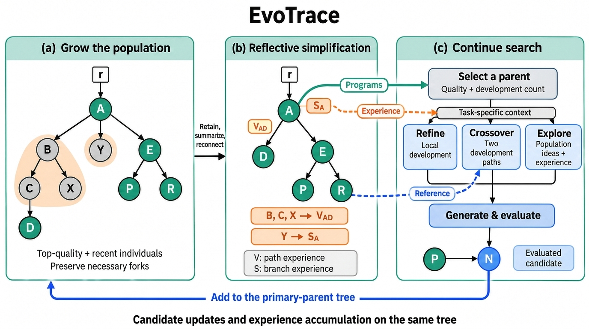
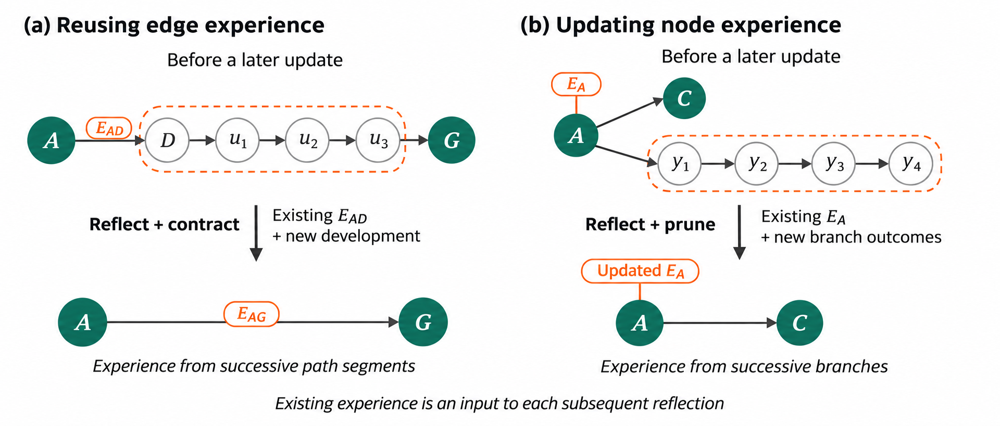
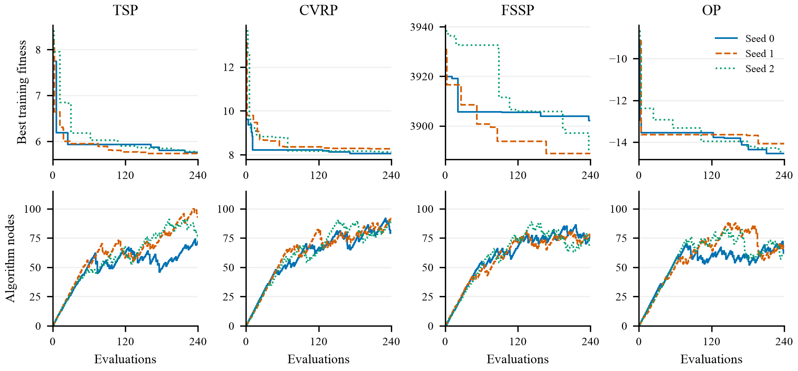
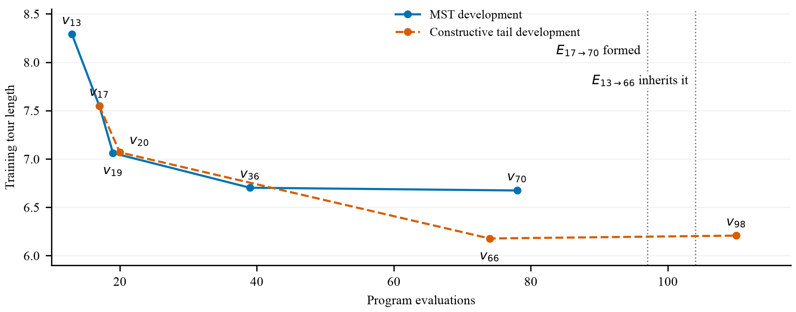

# 反思式淘汰：在树状算法种群中积累设计经验

## 摘要

基于大语言模型的自动启发式设计（AHD）通过演化可执行程序求解优化问题。然而，固定规模种群在淘汰低分启发式时一并丢弃了其修改记录，完整搜索树的节点规模随评价预算持续增长，而全局反思池又使经验脱离了产生它的父代代码。本文提出**TREES（Tree-structured Reflective Evolutionary Search，树状反思式演化搜索）**及其种群更新方法**反思式淘汰（reflective elimination）**，在控制树规模的同时将被删候选的修改过程总结到保留节点与边上。每次更新选出目标值较优且代码结构有别的代表启发式，补齐其最近公共祖先构成保留骨架，并将骨架外节点划分为连接骨架节点的路径区域与位于骨架节点下方的子树区域。节点数少于 $m$ 的区域留在树中继续参与父代抽样，使暂时退化的启发式仍有机会改进；节点数达到 $m$ 的区域被移除。反思将收缩路径总结为边经验，将算法节点下被剪去的旁支总结为节点经验，并纳入区域内原有的经验。精化、交叉与探索算子进而在可行树节点中抽样父代并读取相关经验生成新启发式。理论分析证明该更新保持代表集不变，且在任意评价预算下使算法节点数不超过紧上界 $4Km-2K-m$。四项组合优化问题上的12次搜索表明，TREES将树规模稳定控制在100个节点以内并持续改善训练目标值，490次反思中有147次（$30.0\%$）继承了更早更新生成的经验。

## 1. 引言

自动启发式设计（automatic heuristic design，AHD）旨在自动构造求解复杂优化问题的决策规则，减少人工设计与调参成本[@hh; @irace]。近年来，大语言模型（large language model，LLM）与演化计算结合，直接在代码空间中生成、修改和评价可执行启发式函数，在组合优化等任务上取得了显著效果[@funsearch; @eoh; @llamea; @survey_aad]。在演化过程中，每次父子评价都记录了一次具体的代码修改及其实测目标值：沿路径的连续修改展示了较优启发式如何逐步形成，从同一父代分出的多个子代则展示了哪些修改有效、哪些修改退化或运行失败。除当前最优程序外，这些搜索记录同样为后续生成提供了直接依据。

现有方法在保存和利用这些搜索记录时面临明显权衡。以FunSearch[@funsearch]和EoH[@eoh]为代表的种群方法仅保留固定数量的较优启发式：一旦低分候选被淘汰，搜索既失去了继续改进该方案的机会，也丢掉了这次修改揭示的结果。MCTS-AHD[@mctsahd]将所有生成过的启发式保存在搜索树中，使暂时低分的节点仍可扩展，但树规模随评价预算持续增长，长路径上的原始代码也难以全部放入提示词。ReEvo[@reevo]和RefineEvo[@refineevo]通过LLM反思将比较结果提炼为全局语言提示，使经验脱离了所修改的具体父代程序；近期工作进一步引入系统发育森林[@phyloevolve]、外部蕴含图[@pathwise]、代码差分数据库[@deltaevolve]或分支结束后压入全局池的局部记忆[@memorytree]，但仍需额外部署外部结构，或在分支移除后脱离树上保留的父子位置。

针对这一问题，本文用一棵有根树维护启发式种群，并由保留节点在树上的位置直接决定历史整理范围与经验存放位置。树上每个节点保存一个已评价的启发式函数，有向边记录子代由哪个父代派生。每次更新先选出至多 $K$ 个目标值较优且代码结构有别的**代表启发式**，再补齐它们两两之间的最近公共祖先（lowest common ancestors，LCAs）构成保留骨架。由此，树上其余节点自然划分为两类互不相交的区域：连接相邻骨架节点的**路径区域**，以及位于某个骨架节点下方且不含保留后代的**子树区域**。阈值 $m$ 控制区域移除时机：节点数少于 $m$ 的区域留在树上，其中的可行启发式继续参与父代抽样；节点数达到 $m$ 的区域执行**反思式淘汰**，由**路径收缩**将中间修改步骤总结为重连边上的**边经验**，由**子树剪枝**将算法节点下被删的旁支尝试总结为该节点上的**节点经验**。

在此基础上，本文提出**TREES**搜索方法（图1）。区域反思对照各项尝试的设计意图、实际实现和实测结果，概括设计经验。一个区域原有的经验可随新近尝试一起进入反思，并写回保留节点或重连边。每次生成前，TREES依据目标值名次和已投入的子代评价次数，在树上全部可行节点中抽样主父代。精化与交叉读取父代的形成路径和源码，以修改或组合计算。探索读取父代和多样代表的实现与局部经验，以构思不同的主要计算。

本文的主要贡献如下：

- 提出树状种群上的反思式淘汰更新，结合阈值 $m$ 的短期保留、路径收缩与子树剪枝维护边经验与节点经验，并证明代表集不变性、更新幂等性以及与评价预算无关的节点数紧上界 $4Km-2K-m$。
- 设计面向全树可行节点的父代抽样规则，以及按算子职责组织形成路径、尝试记录与个体卡片的精化、交叉与探索上下文。
- 在TSP、CVRP、OP与FSSP四项组合优化问题上分析TREES的搜索过程，考察树规模控制、反思词元开销与跨轮经验传递行为。

## 2. TREES

### 2.1. 问题设置与树状种群

遵循标准基于LLM的AHD设置[@eoh; @mctsahd]，本文在固定的外层求解框架（如逐步贪心构造、蚁群优化或引导式局部搜索）内设计一个关键启发式函数。每个候选启发式 $v$ 是一个符合给定函数签名的Python函数，通过在一组训练实例上运行外层求解器获得平均目标值 $f(v)$（越小越优）。正常执行并返回有限目标值的程序称为可行启发式，抛出异常或超时的程序记录失败信息。搜索在至多 $B$ 次程序评价预算内返回训练目标值最小的可行启发式（单次修复与评价细节见附录E）。

TREES将种群维护为有根树 $T=(\mathcal V\cup\{v_0\},\mathcal E)$，其中 $\mathcal V$ 为树中当前保留的已评价启发式节点集，$v_0$ 为不含代码与分数的虚拟根。每个节点 $v\in\mathcal V$ 记录生成分析、源码 $c_v$、设计简述 $d_v$、评价结果，以及以 $v$ 为主父代已消耗的子代评价次数 $n_v$；树中全部可行节点构成当前可行集 $\mathcal P\subseteq\mathcal V$。初始启发式接入 $v_0$ 之下；此后精化、交叉与探索均从选定的主父代 $p\in\mathcal P$ 生成子代 $v$ 并添加有向边 $p\to v$（交叉另记录参考启发式编号）。树简化后，收缩边 $u\to w$ 直接连接保留祖先 $u$ 与保留后代 $w$。TREES在边上保存**边经验** $E_{u\to w}$（图中记为 $E_{uw}$），在算法节点上保存**节点经验** $E_u$（图1）。



**图1｜TREES的种群维护与启发式生成流程。** （a）选定保留节点 $A$、$B$、$C$ 与虚拟根 $v_0$ 后，其余节点划分为路径区域（$b_1,b_2,b_3,x$）和子树区域（$s_1$–$s_4$）。（b）两区域均达到阈值 $m=4$：路径收缩将前者总结为边经验 $E_{AB}$，子树剪枝将后者总结为节点经验 $E_A$。（c）可行节点按目标值名次与已消耗子代评价次数抽样作为父代；精化、交叉与探索读取树上相应信息生成新启发式 $N$，评价后接入父代之下。

### 2.2. 种群维护与反思式淘汰

集齐 $N_0$ 个可行初始启发式后，每当新受评节点加入树中，TREES按以下三步更新种群。

**第一步：选取代表集与保留骨架。** 为选出至多 $K$ 个目标值较优且代码结构有别的代表启发式 $R$，先在可行集 $\mathcal P$ 中去除重复：若多个节点去掉注释和文档字符串后的抽象语法树（abstract syntax tree，AST）相同且目标值相等，仅保留最早入树的节点，记所得候选集为 $\mathcal D$。将 $\mathcal D$ 按目标值由小到大排序（目标值相同时按节点编号排序）记为 $(v_1,\ldots,v_{|\mathcal D|})$，从 $R_0=\varnothing$ 开始依次贪心选取：

$$
\begin{aligned}
R_k &= R_{k-1} \cup \bigl\{v_k : |R_{k-1}| < K,\\
&\qquad d(v_k,u)\geq\delta\quad\forall u\in R_{k-1}\bigr\},\\
R &= R_{|\mathcal D|}.
\end{aligned}
\tag{1}
$$

其中 $d(\cdot,\cdot)\in[0,1]$ 为AST结构特征上的多重集Jaccard距离，$\delta$ 为最小距离阈值。再取 $R$ 中节点在树 $T$ 上两两之间的最近公共祖先 $\operatorname{LCA}_T(R)$，记其中不属于 $R\cup\{v_0\}$ 的分叉节点集为 $F$，构成保留骨架 $\mathcal H$：

$$
\begin{aligned}
F &= \operatorname{LCA}_T(R)\setminus(R\cup\{v_0\}),\\
\mathcal H &= \{v_0\}\cup R\cup F.
\end{aligned}
\tag{2}
$$

**第二步：划分非骨架区域。** 对骨架节点 $u,w\in\mathcal H$，若 $u$ 是 $w$ 的祖先且两者路径内部不含其他骨架节点，则称 $u$ 与 $w$ 在树上相邻。每对含非空中间链的相邻骨架节点确定一个**路径区域**，由该中间链及链上内部节点引出的全部非骨架侧枝组成。其余非骨架节点均位于不含任何代表后代的旁支上，按各自最近的骨架祖先 $u\in\mathcal H$ 归并为 $u$ 处的一个**子树区域**。记全部非空区域的集合为 $\mathcal C$，每次更新仅移除节点数不少于 $m$ 的区域，定义待移除节点集 $\mathcal U$ 与保留节点集 $\mathcal K$：

$$
\begin{aligned}
\mathcal U &= \bigcup_{C\in\mathcal C:\,|C|\geq m} C,\\
\mathcal K &= (\mathcal V\cup\{v_0\})\setminus\mathcal U.
\end{aligned}
\tag{3}
$$

节点数少于 $m$ 的区域保留在树中，其中的可行节点继续留在 $\mathcal P$ 内参与父代抽样。因此，即使子代目标值暂时劣于父代，或与已有代表的AST距离小于 $\delta$，在该局部区域累积满 $m$ 个节点前仍有机会派生出更优后代。

**第三步：区域反思与移除。** TREES移除所有满足 $|C|\geq m$ 的区域。执行**路径收缩**时，LLM读取中间链及其侧枝、保留终点 $w$，以及起点算法 $u$（当 $u\neq v_0$）。改动、实测结果和已有经验凝练为重连边上的**边经验** $E_{u\to w}$。在算法节点 $u$ 下执行**子树剪枝**时，LLM将被删尝试与 $u$ 的已有经验一起凝练，更新**节点经验** $E_u$。虚拟根下的子树区域直接剪除。每次反思均使用同一棵更新前的树，对照各尝试的生成分析、代码和实测结果。对比分析随记录存档，设计经验写回保留树（附录E.5及图2）。



**图2｜连续种群更新中的经验传递。** （a）原保留节点 $D$ 与 $u_1$–$u_3$ 一同落入路径区域被收缩时，原有边经验 $E_{AD}$ 与后续修改步骤合并总结为新边上的 $E_{AG}$。（b）节点 $A$ 下方新长出的旁支 $y_1$–$y_4$ 被剪除时，其结果与原有节点经验 $E_A$ 合并更新。原节点移除后，先前总结的经验仍保留在树上。

**命题1（树更新的结构性质）。** 设有限有根树 $T=(\mathcal V\cup\{v_0\},\mathcal E)$ 满足 $K,m\geq 1$ 且 $\delta\in[0,1]$，执行一次反思式淘汰后得到 $T'=(\mathcal V'\cup\{v_0\},\mathcal E')$。则：（i）$T'$ 仍为有根树并保持 $\mathcal K$ 中节点间的祖先关系，$\mathcal C$ 构成 $\mathcal V\setminus\mathcal H$ 的互不相交划分；（ii）当前最优可行启发式必保留，且 $R(T')=R(T)$、$\mathcal H(T')=\mathcal H(T)$；（iii）无新节点加入时重复执行更新不会移除任何节点（幂等性）；（iv）对于执行反思的区域，移除或替换的经验文本均进入该区域的反思输入，且对任意评价预算 $B$，更新后在树算法节点数满足紧上界 $|\mathcal V'|\leq 4Km-2K-m$（$K=24,m=4$ 时为332）。证明与紧性构造见附录C。

### 2.3. 父代选择

每次生成前，TREES从当前全部可行节点 $\mathcal P$（包括代表集 $R$、可行的分叉节点以及节点数少于 $m$ 区域内的可行节点）中抽样一个主父代 $p$。将 $\mathcal P$ 按目标值由小到大排序并从 $0$ 起计名次，并列节点取所占名次的平均值，记为 $r(p)\in\tfrac{1}{2}\mathbb Z_{\geq 0}$。记 $n_p\in\mathbb Z_{\geq 0}$ 为以 $p$ 为主父代已消耗的子代评价次数（新节点入树时 $n_v=0$，树简化保留存活节点原有的 $n_p$）。主父代 $p$ 的抽样概率定义为

$$
\begin{aligned}
w(p) &= \frac{2^{-r(p)/h}}{1+n_p},\\
P(p) &= \frac{w(p)}{\sum_{u\in\mathcal P}w(u)}.
\end{aligned}
\tag{4}
$$

其中 $h>0$ 为排名半衰期：在 $n_p$ 相同时，名次每落后 $h$ 位权重减半，使评价预算偏向表现更好的启发式；在名次相近时，$1/(1+n_p)$ 随抽样次数增加降低旧节点的权重，使新生成的节点（$n_v=0$）获得继续改进的机会。

### 2.4. 搜索算子与提示上下文

选定主父代 $p\in\mathcal P$ 后，按固定概率 $(\pi_{\text{ref}},\pi_{\text{cross}},\pi_{\text{exp}})$ 抽样精化、交叉或探索算子。模型依次生成 `analysis`、`code` 和 `design`。`analysis` 依据任务结构规划具体计算及其选择偏好，并供区域反思读取。`code` 给出完整实现 $c_v$。`design` 概括同一次调用实现的计算和关键参数，记为 $d_v$ [@eoh; @mctsahd]。公共模板见附录E.3。

**精化（Refine）** 针对主父代 $p$ 调整表示方式、所用输入信息、计算步骤或参数。提示词依次给出 $p$ 的形成路径，包括各步评价结果、设计简述与经验，随后给出 $p$ 的节点经验 $E_p$ 及仍在树上的直接子代结果，最后给出 $p$ 的源码 $c_p$。

**交叉（Crossover）** 结合主父代 $p$ 与参考启发式 $q$ 的有效机制。参考候选集 $\mathcal Q_p$ 取 $R\setminus\{p\}$ 中标准化AST与 $p$ 不同的代表；若为空则改从 $\mathcal D\setminus\{p\}$ 中选取AST不同的节点；若仍为空则改用精化。记 $r_{\mathcal Q_p}(q)$ 为 $q$ 在 $\mathcal Q_p$ 内从 $0$ 起算的平均名次，按名次衰减与结构距离联合抽样 $q$：

$$
P(q\mid p) = \frac{2^{-r_{\mathcal Q_p}(q)/h}\,d(p,q)}{\sum_{u\in\mathcal Q_p}2^{-r_{\mathcal Q_p}(u)/h}\,d(p,u)}.
\tag{5}
$$

若 $\mathcal Q_p$ 中候选与 $p$ 的 AST 距离全为零，则仅按 $2^{-r_{\mathcal Q_p}(q)/h}$ 抽样。交叉在 $p$ 的源码之前插入参考个体 $q$ 的卡片，给出其目标值、设计简述、自身的入边与节点经验以及源码 $c_q$。形成路径上已经出现的 $q$ 的经验不再重复。若 $q$ 也是 $p$ 的直接子代，其信息由参考卡片展示。

**探索（Explore）** 根据主父代 $p$ 及至多 $M$ 个异质代表的个体卡片重新构思主要计算。每张卡片包含目标值、设计简述、局部经验及源码。在 $R\setminus\{p\}$ 中排除标准化 AST 与 $p$ 相同的个体后，按 $2^{-r(q)/h}\min_{u\in\{p\}\cup S}d(q,u)$ 不放回地抽取代表。其中 $r(q)$ 是池内名次，$S$ 为已抽中的代表集。候选与已选集合的最小距离须大于零。提示将 $p$ 放在首位，其余展示的代表按目标值排序。子代评价后接入 $p$ 之下。算法1给出整体搜索流程。默认参数为 $N_0=5,K=24,\delta=0.15,m=4,h=6,M=5$，算子概率为 $(0.50,0.30,0.20)$。

```text
算法1：TREES
输入：任务接口、评价器、LLM、预算 B、初始规模 N_0
初始化仅含虚拟根 v_0 的树 T
当评价预算尚有剩余且未满足停止条件时：
    若可行初始启发式不足 N_0 个或 P 为空，在虚拟根 v_0 下生成初始启发式
    否则，从 P 中抽样父代 p 与搜索算子
    从树 T 构造提示上下文
    生成候选程序并评价（至多修复一次）
    若没有候选程序进入评价，则继续下一轮
    将最终受评节点 v 接入父代下并更新评价计数
    若已获得的可行初始启发式不足 N_0 个，则继续下一轮
    选出代表集 R 并补齐骨架 H
    将非骨架节点划分为路径区域与子树区域
    基于更新前的树 T 反思 |C| >= m 的路径区与非根子树区
    收缩路径并剪除子树，保存边经验 E_{u->w} 与节点经验 E_u
返回搜索中评价过的最优可行启发式
```

## 3. 搜索中的经验积累分析

### 3.1. 实验设置与分析范围

我们在四项组合优化问题上检验反思式淘汰在搜索过程中的实际行为：旅行商问题（TSP）逐步贪心构造中的下一节点选择、带容量车辆路径问题（CVRP）与定向越野问题（OP）蚁群优化中的静态边启发式矩阵，以及置换流水车间调度问题（FSSP）引导式局部搜索中的扰动函数。各任务固定外层求解器，在16个训练实例上评价候选程序，统一使用Qwen3.8-27B、随机种子0–2，以及 $K=24,\delta=0.15,m=4$（本节12次早期搜索记录采自在 $R$ 上抽样父代的变体；完整1,000次评价评测协议与外部对比方法见附录D）。12次运行各记录前243–363次程序评价（共3,519次）；目标值与节点数曲线统一对齐至第240次评价，反思统计使用各运行的完整记录前缀。

### 3.2. 经验生成与跨轮传递

12次运行共向树中接入3,271个受评节点，经490次区域反思移除2,301个非骨架节点，其中路径收缩192次、子树剪枝298次。记录结束时，各棵树保留66–99个算法节点，远低于命题1给出的上界332。在全部490次反思中，有147次（$30.0\%$）的输入经验完整包含了更早更新步生成的反思文本，含路径收缩87次、子树剪枝60次（匹配规则见附录D.5）。这表明被删节点形成的经验在原承接节点或边再次被简化时能够继续并入后续总结。

TSP种子2的一条分支具体展示了这一过程。第97次评价后，路径收缩将一段中间修改总结为边经验 $E_{17\to70}$；第104次评价后，节点70随外层区域一同移除，$E_{17\to70}$ 进入该次反思并合并进重连边 $13\to66$ 的新总结；随后对节点66的精化调用在提示词中读取了这段合并后的总结，调整了候选宽度与剩余路径的2-opt步数（附录F给出完整代码、分数变化与反思原文，并如实报告该子代目标值由6.1775轻微退化至6.2072）。

### 3.3. 反思区域规模与词元开销

每次反思移除的区域包含4–12个节点，中位数为4，均值为4.70。全部490次反思调用均返回合法结果，累计消耗3,959,071个输入词元与88,604个输出词元，平均每次区域反思消耗8,080个输入词元和181个输出词元。以阈值 $m=4$ 成批总结局部相关尝试，使每次反思的输出开销保持在较低水平。

### 3.4. 树规模与训练目标值



**图3｜反思式淘汰下的最优训练目标值与在树节点数。** 上排为当前最优训练目标值，下排为每次含评价尝试结束后的在树算法节点数（种子0–2，前240次程序评价，$K=24,\delta=0.15,m=4$）。

如图3所示，随着新候选不断入树、达到阈值的区域被收缩或剪除，在树算法节点数全程保持在100以内，四项任务的最优训练目标值均随评价次数稳步下降。第240次评价时，TSP、CVRP、FSSP与OP三次运行的平均训练目标值分别为5.7574、8.1584、3893.60与-14.3552（表1）。

**表1｜第240次评价时的最优训练目标值（越小越优）。** 均值与样本标准差（SD）由3个随机种子计算。

| 任务 | 种子0 / 1 / 2 | 均值 | 标准差 |
| --- | ---: | ---: | ---: |
| TSP | 5.7530 / 5.7372 / 5.7820 | 5.7574 | 0.0227 |
| CVRP | 8.0656 / 8.2830 / 8.1266 | 8.1584 | 0.1122 |
| FSSP | 3902.12 / 3888.88 / 3889.81 | 3893.60 | 7.39 |
| OP | -14.5419 / -14.0794 / -14.4444 | -14.3552 | 0.2438 |

## 4. 相关工作

**基于LLM的演化启发式设计。** 传统遗传编程[@koza]、超启发式[@hh]与自动算法配置[@irace]在预设算子或参数空间中搜索。LLM使演化算法能够直接生成和修改可执行代码[@elm; @lmcrossover; @survey_aad]：FunSearch在岛屿种群中演化评分函数[@funsearch]，EoH同时维护自然语言思路与Python实现[@eoh]，LLaMEA与AlphaEvolve进一步将评价引导的代码演化推广至元启发式与通用算法设计[@llamea; @alphaevolve]。围绕种群多样性与父代选择，HSEvo结合和声搜索[@hsevo]，PartEvo按个体相似性划分生态位[@partevo]，ShinkaEvolve联合适应度与抽样次数分配繁殖机会[@shinka]。上述方法在淘汰低分个体时直接将其丢弃，TREES则在移除节点时把具体代码修改与结果总结到保留树上。

**启发式搜索中的树与图结构。** MCTS-AHD在MCTS树中保留全部已生成启发式[@uct; @mctsahd]，Clade-AHD依据后代统计冻结低潜力分支的后续扩展[@cladeahd]，A2DEPT使用演化程序树组织候选算法[@a2dept]。PhyloEvolve维护多棵系统发育树与跨树精英池，并结合剪枝与轨迹摘要指导演化[@phyloevolve]；PathWise在种群之外引入蕴含图、世界模型与评论器智能体[@pathwise]。与保留整棵历史树或维护独立规划图不同，TREES仅维护一棵有根树，利用代表集及其两两LCA将非骨架节点唯一划分为路径区域与子树区域，在严格限制节点规模的同时确定每段总结的存放位置。

**反思与搜索经验复用。** 语言智能体常借助自我反馈[@selfrefine]、语言强化[@reflexion]与跨任务经验归纳[@expel]改进后续决策。在AHD中，ReEvo对比成对启发式提取短期与长期语言反思[@reevo]，RefineEvo维护正负双向经验池并配合算子规划器[@refineevo]，MeEvo与BEAM分别引入共享历史反思与双层记忆[@meevo; @beam]。DeltaEvolve在外部数据库中存储代码语义差分[@deltaevolve]；MEMOIR记录分支局部记忆，并在分支终止时将其压缩并入全局记忆[@memorytree]。相比脱离具体父代代码的全局经验池，TREES将经验保存在对应的重连边与父节点上，并在这些位置日后被简化时将原有经验并入下一轮反思。

## 5. 讨论与局限

阈值 $m$ 在TREES中同时调节短期父代保留与区域反思粒度：当局部区域少于 $m$ 个节点时，目标值暂时下降或作局部调整的新启发式留在 $\mathcal P$ 中继续参与抽样；当路径区域或算法节点下的子树区域达到 $m$ 个节点时，单次反思即可合并总结同一起点或同一演化段上的多次尝试，并将所得边经验与节点经验留在后续算子读取的路径和父节点上。此外，代表集选择、骨架划分和父代抽样仅依赖AST特征、目标值与评价次数，不读取经验文本；因此可固定树状态与展示的算法，切换是否展示经验文本，检验经验对生成的影响。

本文方法仍有三方面局限。第一，AST特征距离忽略数值常数，以便代表集 $R$ 保留控制流与算子结构不同的实现；虽然未满 $m$ 区域内的变体仍可短期调整常数并在剪枝时记录结果，但当性能高度依赖连续参数时，专门的参数调优器[@irace]仍具互补价值。第二，每个执行反思的区域需一次LLM调用；若单次程序评价极快而模型调用受限，可增大 $m$ 以降低反思频率。第三，与主流AHD基准一致，本文仅在固定外层求解器内设计单个启发式函数，尚未联合演化完整求解器的多个模块。

## 6. 结论

本文面向基于LLM的自动启发式设计提出了树状反思式演化搜索方法TREES及其反思式淘汰更新。TREES围绕目标值较优、结构有别的代表启发式及其最近公共祖先划分路径区域与子树区域，在树中短期保留少于 $m$ 个节点的局部区域，并通过路径收缩与子树剪枝将达到 $m$ 个节点的区域总结为重连边上的边经验和保留父节点上的节点经验。理论证明该更新保持代表集不变且在树算法节点数不超过紧上界 $4Km-2K-m$，四项组合优化问题上的搜索过程验证了树规模受控与跨轮经验传递。

## AI使用声明 {.unnumbered}

生成式AI工具用于辅助文献整理、文稿起草与修改、代码核对及机制示意图制作。TREES搜索内部调用的LLM见第2、3节与附录D。作者对论文全部内容与结论负责。

## 影响声明 {.unnumbered}

本文研究自动启发式设计方法，旨在降低为复杂优化问题人工设计启发式算法的负担。所生成算法的实际社会影响取决于其具体部署场景。

## 参考文献

PDF从共享的`references.bib`生成参考文献列表。

## 附录 A. 研究背景与相关方法

附录A–B补充研究背景、代表性方法对比与关键设计说明；附录C给出命题1的完整证明；附录D–E列出任务协议、默认参数与提示词原文；附录F追踪一条TSP搜索分支中的经验传递过程。

### A.1. 固定求解框架内的自动启发式设计

AHD针对给定问题类别自动搜索可执行启发式函数，而非直接针对单个实例求解路径或调度方案。每个候选Python函数嵌入固定外层求解器后，在一组训练实例上运行并以平均目标值作为评价指标，搜索结束后在独立的同规模与更大规模测试实例上检验泛化表现。附录D中的四项任务遵循同一范式，分别设计逐步贪心构造中的节点选择函数、蚁群优化中的边启发式矩阵函数以及引导式局部搜索中的扰动函数。相比依赖人工预设算子原语的遗传编程与传统超启发式[@koza; @hh]，基于LLM的AHD直接在通用编程语言中生成与修改程序[@funsearch; @eoh]。

### A.2. 代表性方法对比

表2从种群结构、节点规模是否有界、低分候选保留能力、经验总结范围与保存位置，以及节点移除后的经验传递五个方面对比代表性基于LLM的AHD方法。

**表2｜代表性基于LLM的启发式演化方法对比。** 各行依据对应论文公开的方法描述整理。

| 方法 | 种群结构 | 规模是否有界 | 保留低分候选 | 经验范围与保存位置 | 节点移除后经验传递 |
| --- | --- | --- | --- | --- | --- |
| EoH [@eoh] | 扁平种群 | 是（固定大小） | 否（按排名截断） | 无反思总结（仅保留存活思路与代码） | 不适用 |
| ReEvo [@reevo] | 扁平种群 | 是（按代更替） | 有限（单代内） | 成对短期反思 + 全局长期反思文本 | 累入全局文本，脱离原父代代码 |
| RefineEvo [@refineevo] | 种群 + 规划器 | 是 | 有限 | 全局正负双向经验池 + 算子规划 | 存入全局池，不存于树边或父节点 |
| MCTS-AHD [@mctsahd] | MCTS搜索树 | 否（持续增长） | 是（保留全树） | 直接读取根到叶路径，无移除总结 | 节点不移除 |
| Clade-AHD [@cladeahd] | 子树搜索树 | 否（冻结分支） | 是（后代统计） | 子树后代分数统计，无文字总结 | 不适用 |
| PathWise [@pathwise] | 种群 + 蕴含图 | 依图维护策略 | 是 | 世界模型与评论器维护蕴含图反思 | 由外部图结构维护 |
| PhyloEvolve [@phyloevolve] | 系统发育森林 | 是（多层剪枝） | 有限 | 分支轨迹摘要 + 跨树精英池 | 摘要随保留分支维护 |
| DeltaEvolve [@deltaevolve] | 多级差分库 | 数据库持续增长 | 是（检索历史） | 代码修改记录与结果 | 存于外部数据库 |
| MEMOIR [@memorytree] | 分支搜索树 | 依分支终止条件 | 是（分支活跃期） | 分支内局部记忆；终止时压入全局池 | 分支结束后并入全局池 |
| **TREES（本文）** | **有根树** | **是（$4Km-2K-m$）** | **是（$<m$ 暂留）** | **路径区域存边 $E_{u\to w}$，子树区域存父节点 $E_u$** | **是（并入外层区域新反思）** |

### A.3. 与树搜索及经验池方法的具体区别

MCTS-AHD与Clade-AHD在搜索树中保留全部已生成启发式，通过UCT或后代统计分配扩展机会[@mctsahd; @cladeahd]，但不收缩中间节点或剪除旁支；PathWise在种群之外维护策略、世界模型与评论器智能体[@pathwise]，而TREES仅维护单棵有根树并用式(4)直接抽样父代。与将长期经验汇总至全局文本或全局经验池的ReEvo、RefineEvo及MEMOIR[@reevo; @refineevo; @memorytree]不同，TREES围绕保留骨架将被删节点划分为路径区域与子树区域，使中间演进过程留在重连边上、旁支尝试留在父节点上，后续算子始终结合对应路径或父代读取这些经验。

## 附录 B. 关键设计的补充说明

### B.1. 最近公共祖先保留与全树父代抽样

若仅保留代表集 $R$ 而不补齐两两最近公共祖先 $F$，一个被移除的分叉区域下方可能同时通向多个保留代表，总结出的演进过程便不存在唯一对应的重连边。先选出 $R$ 再补齐 $F$，既保证每个路径区域唯一连接两个相邻骨架节点、每个子树区域唯一归属一个最近骨架祖先，又不占用 $R$ 的 $K$ 个代表名额。

与此同时，TREES在全部可行节点 $\mathcal P$ 上抽样父代，而非仅在 $R$ 中抽样。正如MCTS-AHD所观察到的，有效启发式往往需要先经历一步分数暂时下降的结构修改，或在已有代表附近（$d<\delta$）继续调整细节与参数[@mctsahd]。只要局部区域节点数未达 $m$，这些新节点便以 $n_v=0$ 留在 $\mathcal P$ 中按式(4)参与竞争：若派生出更优后代即可进入 $R$；若累积满 $m$ 个节点仍无保留后代，则被剪除并总结至父节点经验。

### B.2. 边经验与节点经验

边经验 $E_{u\to w}$ 记录保留后代 $w$ 如何从祖先 $u$ 经中间尝试演变而来。节点经验 $E_u$ 记录从 $u$ 出发、随后被剪去的旁支尝试及其实测结果。起自虚拟根的收缩边记录相应初始设计的形成过程。若带有节点经验或入边经验的节点后来落入另一个执行反思的区域，其已有经验进入新一轮反思（图2）。

### B.3. 分析、代码与设计描述的输出顺序

模型先在 `analysis` 中规划具体计算，再写出 `code`。分析用于后续区域反思，以对照设计意图、代码和结果。程序写成后，模型在同一次调用中用 `design` 概括其实际计算与关键参数 [@mctsahd]。探索读取的个体卡片同时给出设计简述与源码。

## 附录 C. 命题 1 的证明

设有限有根树 $T_0=(\mathcal V_0\cup\{v_0\},\mathcal E_0)$ 的可行集为 $\mathcal P_0$，去重候选集为 $\mathcal D_0$，代表集为 $R(T_0)$，分叉节点集为 $F(T_0)$，保留骨架为 $\mathcal H(T_0)=\{v_0\}\cup R(T_0)\cup F(T_0)$，非空区域集合为 $\mathcal C(T_0)$，待删节点集为 $\mathcal U=\bigcup_{C\in\mathcal C(T_0):|C|\geq m}C$，更新后的树 $T_1=(\mathcal V_1\cup\{v_0\},\mathcal E_1)$ 定义在保留节点集 $\mathcal K=(\mathcal V_0\cup\{v_0\})\setminus\mathcal U$ 上（其中 $\mathcal V_1=\mathcal K\setminus\{v_0\}$）。设 $K,m\geq 1$，$\delta\in[0,1]$；存活节点的代码、目标值、编号与评价计数 $n_v$ 在更新中保持不变。

**有根树性质与祖先关系保持。** 因 $v_0\in\mathcal H(T_0)\subseteq\mathcal K$，任一存活节点 $v\in\mathcal V_1$ 沿 $T_0$ 的父边向上回溯时，必唯一首次遇到最近存活祖先 $a(v)\in\mathcal K$。路径收缩将原父节点属于 $\mathcal U$ 的存活终点 $w$ 重连至 $a(w)$，其余存活节点保持原入边。每条重连边均严格减小节点在 $T_0$ 中的深度，故不产生环且每个 $v\in\mathcal V_1$ 恰有一条入边。因此 $T_1$ 仍是以 $v_0$ 为根的有根树，且 $\mathcal K$ 中任意两节点在 $T_1$ 与 $T_0$ 中的祖先关系一致。

**区域的互不相交划分。** 假设两对不同相邻骨架节点的内部中间链 $C_{\text{chain}}(u_1,w_1)$ 与 $C_{\text{chain}}(u_2,w_2)$ 含有公共非骨架节点，取其中深度最大的公共节点 $z\notin\mathcal H(T_0)$，则从 $z$ 向下至少分出两条互不相交路径通向不同的骨架下端点。由于骨架树的所有叶节点均属于 $R(T_0)$，且每个分叉节点 $f\in F(T_0)$ 至少连接两个含 $R(T_0)$ 节点的子树，这两条向下路径各自包含 $R(T_0)$ 中的代表，故 $z\in\operatorname{LCA}_{T_0}(R(T_0))\subseteq\mathcal H(T_0)$，矛盾。因此各内部中间链两两不相交。其余不在任何内部链上的节点 $x\in\mathcal V_0\setminus\mathcal H(T_0)$ 沿父边向上回溯时，必唯一首次遇到 $\mathcal H(T_0)\cup\bigcup C_{\text{chain}}$ 中的节点：若遇到某条内部链则归入该路径区域，若遇到某个骨架节点则归入该骨架节点的子树区域。故 $\mathcal C(T_0)$ 构成 $\mathcal V_0\setminus\mathcal H(T_0)$ 的互不相交划分。

**最优个体保留与代表集、骨架不变性。** 当 $\mathcal P_0\neq\varnothing$ 时，排序首位的 $v_1\in\mathcal D_0$ 在式(1)第一步入选 $R(T_0)\subseteq\mathcal K$，故最优可行启发式必保留。每个原代表 $r\in R(T_0)$ 在 $T_1$ 中仍是其“标准化AST + 目标值”等价类中编号最小的存活节点，故 $R(T_0)\subseteq\mathcal D(T_1)$。按排序归纳扫描 $\mathcal D(T_1)$：设扫描到 $w\in\mathcal D(T_1)$ 前已接受的集合恰为 $R(T_0)$ 中排在 $w$ 之前的前缀。若 $w\in R(T_0)$，它面对的已选前缀与在 $T_0$ 中完全相同，故仍入选；若 $w\notin R(T_0)$，令 $w_0\in\mathcal D_0$ 为 $T_0$ 中同一等价类最早入树的节点（$w_0\leq w$），则 $w_0$ 在 $T_0$ 中或因排在其前的某个 $u\in R(T_0)$ 满足 $d(w_0,u)<\delta$ 而被排除，或因前面已选满 $K$ 个代表而落选。这些排在前面的代表在 $T_1$ 中全部存活且仍位于 $w$ 之前，又因 $d(w,u)=d(w_0,u)$，故 $w$ 在 $T_1$ 中同样落选。由归纳法得 $R(T_1)=R(T_0)$；保持祖先关系的收缩与剪枝不改变 $R(T_0)$ 节点间的两两LCA，故 $F(T_1)=F(T_0)$ 且 $\mathcal H(T_1)=\mathcal H(T_0)$。

**更新幂等性与原有经验的保留。** 由 $\mathcal H(T_1)=\mathcal H(T_0)$ 可知，$T_1$ 上的非骨架区域集为 $\mathcal C(T_1)=\{C\in\mathcal C(T_0):|C|<m\}$，所有区域节点数均少于 $m$，故无新节点加入时再次运行更新不会移除任何节点。在执行反思的区域中，每个被删节点的节点经验与入边经验均进入提示。路径收缩同时读取终点原入边上的经验，子树剪枝同时读取父节点原有的 $E_u$。若反思调用失败，系统拼接保留已进入该提示的经验文本。

**算法节点数紧上界。** 记 $r=|R(T_0)|$，$s=|\mathcal H(T_0)|$。当 $r=0$ 时，$\mathcal H(T_0)=\{v_0\}$，$|\mathcal V_1|\leq m-1\leq 4Km-2K-m$。当 $1\leq r\leq K$ 时，在收缩非骨架路径后的骨架树中，每个分叉节点 $f\in F(T_0)$ 至少有两个骨架子节点且所有叶节点属于 $R(T_0)$，故 $|F(T_0)|\leq r-1$，$s=1+r+|F(T_0)|\leq 2r\leq 2K$。骨架树共有 $s-1$ 条边（至多对应 $s-1$ 个路径区域）和 $s$ 个节点（至多对应 $s$ 个子树区域）。更新后每个剩余区域至多含 $m-1$ 个节点，扣除虚拟根 $v_0$ 后得 $|\mathcal V_1|\leq(s-1)+(2s-1)(m-1)\leq(2K-1)+(4K-1)(m-1)=4Km-2K-m$。该上界紧可达：取 $K$ 个两两AST距离不小于 $\delta$ 且目标值严格最优的可行叶节点，经 $K-1$ 个内部LCA分叉点连在 $v_0$ 下（共 $2K$ 个骨架节点、$2K-1$ 条骨架边），在每条骨架边上串入 $m-1$ 个次优节点，并在每个骨架节点下各接一条含 $m-1$ 个次优节点的旁支，则全部 $4K-1$ 个区域均含 $m-1<m$ 个节点，更新后恰好保留 $4Km-2K-m$ 个算法节点（$K=24,m=4$ 时为332）。

## 附录 D. 任务与评价协议

### D.1. 搜索接口与优化目标

四项基准任务均在固定外层求解器内设计单个启发式函数（表3）。

**表3｜四项基准任务的启发式函数输出与外层求解器设置。** 目标值在评价实例集上取均值并最小化。

| 任务 | 启发式函数输出 | 固定外层求解器与目标 |
| --- | --- | --- |
| TSP | 下一个未访问节点编号 | 逐步回路构造；平均回路长度 |
| CVRP | 静态边启发式矩阵 | 30只蚂蚁、100轮蚁群迭代；平均路线总长 |
| OP | 静态边启发式矩阵 | 20只蚂蚁、50轮蚁群迭代；平均收集奖励的相反数 |
| FSSP | 扰动加工时间矩阵与1–5个作业编号 | NEH初解、200轮引导式局部搜索；平均最大完工时间 |

**TSP。** 每实例在 $[0,1]^2$ 内均匀采样50个节点坐标（训练种子2024）。启发式函数输入当前节点、起点、按距当前节点距离升序排列的未访问节点编号及对称距离矩阵，返回一个未访问节点编号；求解器从节点0出发逐步构造并闭合回路。

**CVRP。** 每实例含位于 $(0.5,0.5)$ 的仓库及 $[0,1]^2$ 内均匀采样的50个客户，需求为 $[1,9]$ 内整数，车辆容量为50（数据与蚁群种子均为1234）。启发式函数每实例调用一次，将距离、坐标、需求与容量映射为边启发式矩阵（元素平移并以下界 $10^{-9}$ 截断）。

**OP。** 每实例含50个 $[0,1]^2$ 均匀采样节点（含仓库），路线总长上限为3，节点奖励按距仓库距离定义为 $(1+\lfloor99d_i/d_{\max}\rfloor)/\max_j p_j$（训练/测试坐标种子1234/4567，蚁群种子1234）。函数输入奖励、距离与长度上限，输出边启发式矩阵（下界 $10^{-9}$）；求解器屏蔽无法按时回仓的移动并返回负平均奖励。

**FSSP。** 50个作业按相同排列顺序经过20台机器，加工时间为 $[1,99]$ 内均匀随机整数（基础种子20261007）。NEH生成初解后，每轮迭代执行至多三遍交换与插入局部搜索；启发式函数输入当前排列与加工时间矩阵，输出非负扰动矩阵与1–5个互异作业编号引导扰动，目标值按原始加工时间计算最大完工时间。

### D.2. 评价限制与独立测试

每个候选程序在16个固定训练实例上运行，最多使用8个工作进程共享160实例秒时限，Linux单进程数据段上限为初始占用加2 GiB（实例 $i$ 评价种子为 $730241+i$）。完整评测预算为 $B=1{,}000$ 次程序评价（含运行失败与修复重评），搜索结束后取训练目标最优的程序在50个独立同规模测试实例（500实例秒）以及100和200节点TSP、CVRP、OP实例上测试泛化性能。

### D.3. 对照基线与成本统计

外部对比基线包括EoH[@eoh]、ReEvo[@reevo]、MCTS-AHD[@mctsahd]、RefineEvo[@refineevo]与PathWise[@pathwise]，统一采用相同任务接口与评价器限制。实验分别记录评价器调用次数、LLM请求次数及输入/输出词元数，并按实际程序评价次数对齐训练曲线。

### D.4. 语言模型参数

第3节分析的运行使用关闭原生思考模式的Qwen3.8-27B，随机种子为0、1、2。候选生成采用温度1.0、top-$p$ 0.8、top-$k$ 20、presence penalty 1.5、最大输出16,384词元；区域反思采用温度0.3、最大输出1,536词元。

### D.5. 早期搜索记录统计口径

第3节分析的12次早期搜索记录各含243–363次程序评价（训练曲线对齐至240次，反思统计使用各自完整记录前缀），采用 $K=24,\delta=0.15,m=4$（该批运行在 $R$ 上以半衰期10抽样父代，反思提示附带比较目录）。将每次反思输入的已有经验与严格更早更新步的反思输出做空白折叠标准化后，若前者完整包含后者（排除同一次更新内并行区域的输出），即记为继承早期经验，共检出路径收缩87/192次、子树剪枝60/298次（合计147/490）。被删区域节点数分布为：大小4共326个，5共71个，6共50个，7共21个，8共12个，9共5个，10与11各2个，12共1个，合计移除2,301个节点。

## 附录 E. 实现细节与提示词原文

### E.1. 代码结构距离与抽样细节

去掉文档字符串后，系统提取AST父子标签对与深度优先遍历相邻标签二元组的多重集（标签记录语法节点类型、运算符类型及被调用函数或属性名，忽略变量名与数值常数），据此计算多重集Jaccard距离 $d(u,v)$。去重候选集 $\mathcal D$ 比较去掉注释和文档字符串后的完整AST并要求目标值相等，仅作用于当前在树节点。探索按目标值从小到大展示代表卡片，同分按节点编号排序。

**表4｜TREES默认参数设置。**

| 模块 | 默认设置 |
| --- | --- |
| 初始化与预算 | $N_0=5$ 个可行初始启发式；总预算 $B=1{,}000$ 次程序评价 |
| 代表集与骨架 | $K=24$，$\delta=0.15$；补齐两两LCA构成 $\mathcal H$ |
| 区域简化阈值 | $m=4$ 个节点 |
| 父代选择 | 在全体可行节点 $\mathcal P$ 上抽样；半衰期 $h=6$，折扣因子 $1/(1+n_p)$ |
| 算子概率 | 精化 $0.50$，交叉 $0.30$，探索 $0.20$ |
| 交叉参考选择 | 在标准化AST不同的候选集 $\mathcal Q_p$（优先 $R\setminus\{p\}$，否则 $\mathcal D\setminus\{p\}$）按 $2^{-r/h}\cdot d(p,q)$ 抽样 |
| 探索概览代表 | 按名次衰减与最小 AST 距离不放回地抽取至多 $M=5$ 个代表 |

### E.2. 评价、单次修复与停止条件

每次生成尝试至多执行一次修复：若模型输出无法解析为规定JSON格式，执行一次格式修复（不计评价次数）；若格式合法但执行报错或超时且预算尚有剩余，执行一次程序修复并将重评计入 $B$。仅该次尝试最终受评的程序入树，初始化以外消耗的评价次数计入主父代的 $n_p$。当评价次数达到 $B$ 或连续10次尝试未产生受评程序时搜索停止。若反思调用异常或返回空文本，直接拼接保留该区域内原有的经验文本。

### E.3. 生成模板与上下文

**表5｜候选生成的上下文顺序。**

| 调用 | 上下文顺序 |
| -------------------- | -------------------------------------------------------------- |
| 初始化 | `[Example Algorithm]` 参考实现 → `[Existing Approaches]` 已有初始算法的成绩与设计 → `[Failed Attempts]` 失败程序与反馈 |
| 精化 | `[Development of the Current Algorithm]` 主父代的形成路径 → `[Attempts from the Current Algorithm]` 从主父代出发的尝试 → `[Current Algorithm]` 主父代的成绩与源码 |
| 交叉 | `[Development of the Current Algorithm]` 主父代的形成路径 → `[Attempts from the Current Algorithm]` 从主父代出发的尝试 → `[Other Algorithm]` 参考算法卡片 → `[Current Algorithm]` 主父代的成绩与源码 |
| 探索 | `[Current Algorithm]` 主父代卡片 → `[Other Existing Approaches]` 所选代表的卡片 |

形成路径和尝试列表包含生成意图、实测结果、设计简述及已有经验。完整个体卡片包含目标值、设计简述、入边经验、节点经验和源码。

~~~~text
[Algorithm-design task]
{task_description}

Design the computation performed by the following function to improve the complete solver's objective. Use the available inputs and the role of its returned result in the solver.

[Function interface]
```python
{function_template}
```

[Context]
{context}

[Instruction]
{instruction}

[Output]
Return exactly one valid JSON object with three string fields, in this order:
- "analysis": {analysis_instruction} Use up to 300 words.
- "code": Provide the complete implementation using only the inputs in [Function interface], including necessary imports and helper definitions.
- "design": In about 120 words, describe for another algorithm designer the main computation the code performs and its key parameters. Describe the implementation, not expected performance.
Keep "design" faithful to "code". Preserve the required function signature and satisfy the task constraints and input/output requirements.
Return only the JSON object, without Markdown fences or additional text.
~~~~

初始化和三类搜索算子共用以下 `{analysis_instruction}`。

~~~~text
Use the structure of the problem to work out a concrete computation. Which choices would it favor, and why could they improve the final solution? Draw on earlier results when useful.
~~~~

### E.4. 生成指令

**首次获得可行初始算法前。**

~~~~text
Design an effective algorithm for this task. Consider how the returned result affects the complete solution and choose a computational approach suited to that role. The example illustrates an implementation, not a structure to preserve. Implement the specified function.
~~~~

**已有可行初始算法时。**

~~~~text
Develop an effective algorithm with a different main computation from the ideas already represented. Seek a different way to compute the result, rather than another weighting of the same local features. You can change the representation, the information used, or the computational procedure. Implement the chosen approach as a complete algorithm.
~~~~

上下文包含失败尝试时，追加以下指令。

~~~~text
Use the failed attempts and evaluation feedback to inform your implementation.
~~~~

**精化。**

~~~~text
Improve the current algorithm by examining how it computes its result and where this computation can be improved. The development path shows what each step changed and how fitness responded; the experience and the attempts show what has been tried and learned along this path. Use them with the implementation to locate what limits the result and to choose a meaningful modification. You may revise its representation, the information it uses, or its procedure as well as its parameters; implement a coherent improved algorithm.
~~~~

**交叉。**

~~~~text
Understand the computational ideas in both implementations and develop an algorithm that combines their useful strengths. The development path shows how the current algorithm was formed and what has been tried and learned along it; the other algorithm's code shows what it actually computes, and its experience shows what was learned about it. Use them to decide which of its computations can strengthen the current algorithm and how the two fit together. If no useful combination emerges, improve the current algorithm using what the comparison reveals.
~~~~

**探索。**

~~~~text
Design an algorithm whose main computation differs from every algorithm shown above, not another weighting of the same local features. The code shows what each one actually computes, even where a design is inaccurate, and the experience shows what has been tried and learned. The code is not a structure you must preserve. A different computation may use other information, another representation, or another procedure. For example, it can estimate the downstream consequences of a choice, construct and improve a tentative solution, or solve a useful subproblem. Implement the computation that suits this task.
~~~~

### E.5. 反思模板

~~~~text
{problem}

[Algorithms]
{situation}

{records}

[Task]
{question}
The analysis of each attempt states its intent before it was coded and evaluated; its code shows what it actually implemented; its results show how it performed. Describe each idea by the computation it introduces or changes, without parameter values, and do not generalize beyond what these algorithms show. If an idea seems worth developing although its attempt scored poorly, say why.{merge}

[Output]
Return one JSON object with two strings: "analysis", a brief comparison of each attempt's intent, code and results; then "experience", about 120 words of design experience. In the experience, refer to every algorithm by its idea, not by its number.
~~~~

`{problem}` 给出任务、目标定义和函数接口。`{records}` 汇集生成前分析、源码、设计简述、实测结果或失败信息，以及已有经验。路径收缩区分主路径与侧枝。子树剪枝将尝试结果与起点算法比较。

**表6｜反思提示中的区域说明。**

| 区域 | `{situation}` |
| ------------------------- | ------------------------------------------------------------- |
| 从算法节点出发的路径 | Algorithm {v} was developed from Algorithm {u} along {path}; overall {overall_outcome}. Side attempts along the way are included. |
| 从虚拟根出发的路径 | Algorithm {v} was developed along {path}, starting from a design made from scratch. Side attempts along the way are included. |
| 算法节点下的子树 | The algorithms below are attempts that started from Algorithm {p}, directly or from one another. |

**路径收缩的反思问题。**

~~~~text
Reflect, as an algorithm designer, on how Algorithm {v} was developed. Which ideas built it along the path, and what did the side attempts try?
~~~~

**子树剪枝的反思问题。**

~~~~text
Reflect, as an algorithm designer, on these attempts to improve Algorithm {p}. Did any idea do better than it, and which ideas did not pay off?
~~~~

**已有经验时追加。**

~~~~text
Integrate the earlier experience shown above, revising what these algorithms contradict.
~~~~

### E.6. 修复模板

格式修复依次给出原始回复 `[Original Response]` 和解析反馈 `[Parsing Feedback]`。程序修复依次给出失败候选的设计与源码 `[Current Algorithm]`、评价反馈 `[Failure Feedback]`。两类修复共用附录E.3的生成模板。

**格式修复。**

~~~~text
Convert the original response into the JSON object specified in [Output], using the parsing feedback to correct its structure, required fields, and string escaping.
Preserve the existing algorithmic idea and computational logic.
Complete any missing or truncated content consistently with that approach and the task requirements.
~~~~

`{analysis_instruction}`

~~~~text
Keep the original rationale if present. Otherwise briefly state the intended computation.
~~~~

**执行报错。**

~~~~text
Trace the reported exception or invalid result to its cause in the code, using the design to understand the intended algorithm.
Correct the faulty computations or data handling so the function executes correctly and satisfies the task requirements, while retaining the intended core computation.
~~~~

**评价超时。**

~~~~text
Make the algorithm finish within the reported time limit. Reduce the cost of its core computation, using an approximation when needed, while retaining the intended algorithmic idea.
~~~~

报错与超时修复共用以下 `{analysis_instruction}`。

~~~~text
Explain the correction for the reported failure.
~~~~

## 附录 F. 案例：原节点移除后的跨轮经验传递

### F.1. 案例选取与分支结构

我们在TSP搜索记录中选取最早同时满足以下三项条件的更新：某次反思读入了更早生成的边经验、移除了该边原先的终点，且生成的新经验随后进入了某次实际候选生成提示词（并列时按随机种子与早期反思步排序）。该规则唯一选中种子2在第97次与第104次评价后的两次路径收缩（下文下标表示归档程序编号）。如图4所示，两条分支自共同父节点 $v_{17}$ 分出：$v_{17}\to v_{19}\to v_{36}\to v_{70}$ 依次改为出边代价估计与最小生成树（MST）下界加小规模精确枚举；$v_{17}\to v_{20}\to v_{66}$ 则改为先用最近邻构造剩余回路、再用有限步2-opt局部改进。



**图4｜两条TSP分支的训练目标值与反思时刻。** 圆点表示各程序评价完成时的训练目标值，实线表示父子生成边，竖虚线标出第97次与第104次评价后的两次反思更新。$v_{66}$ 在两次更新前已生成，$v_{98}$ 在读取合并后的经验后生成。

### F.2. 两次路径收缩中的经验合并

第97次评价后，树更新保留 $v_{17}$ 与 $v_{70}$，移除中间节点19、36及侧枝39、42，生成边经验 $E_{17\to70}$，记录了引入MST下界估计与调整精确枚举阈值的修改过程（主链目标值依次为7.5490、7.0604、6.7022、6.6737）。第104次评价后，树更新保留更早祖先 $v_{13}$ 与另一分支终点 $v_{66}$（目标值6.1775），移除节点17、20及侧枝22、53、70；原有的 $E_{17\to70}$ 进入此次反思输入，与最近邻构造加2-opt改进的步骤合并总结为重连边上的 $E_{13\to66}$。

### F.3. 进入后续生成提示词

在第98次生成尝试中，对 $v_{66}$ 执行精化时，提示词完整包含了合并后的 $E_{13\to66}$。生成的子代 $v_{98}$ 将随构造进度递减的候选宽度改为固定宽度8，并按未访问节点数调整2-opt步数，训练目标值为6.2072，较父代6.1775略有退化。该记录直接验证了被删分支的经验可经合并进入后续生成提示词，同时也说明了反思提示为何仅记录具体修改与实测变化而不写泛化规则：相邻程序往往同时修改了多处计算细节，在此基础上继续调整候选宽度与局部搜索步数并不必然带来单步提升。
