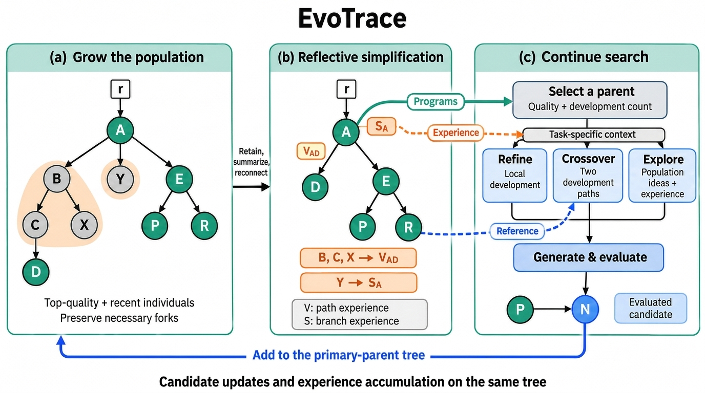
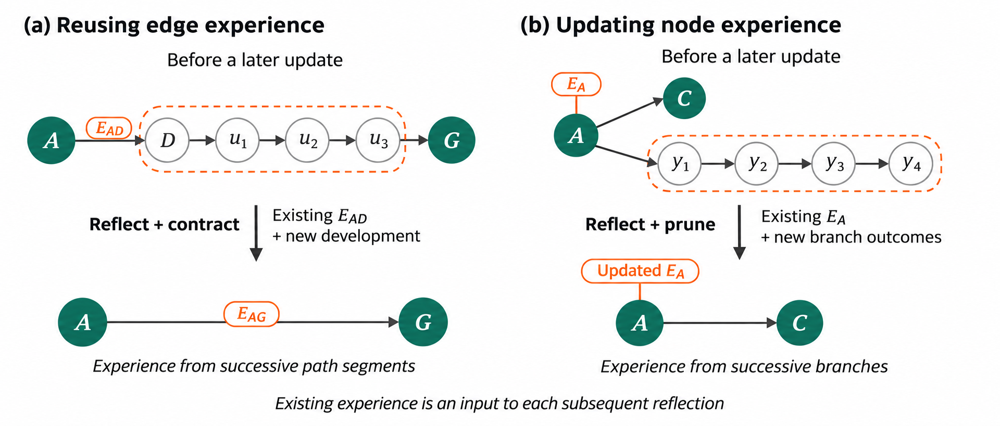
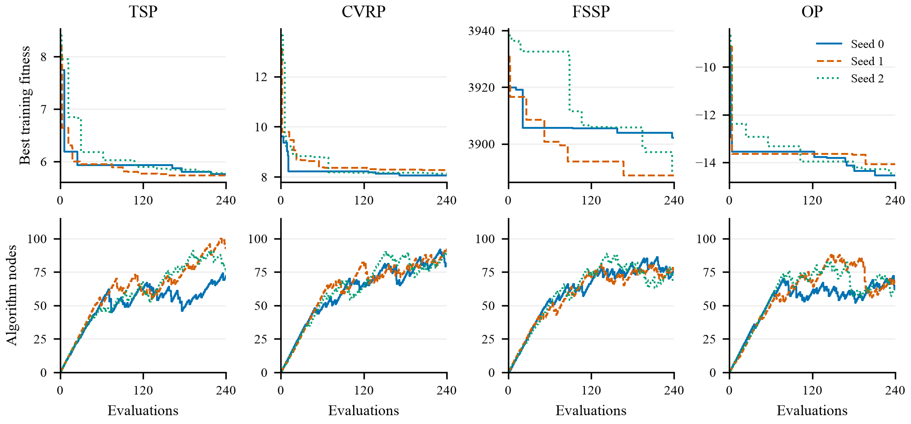
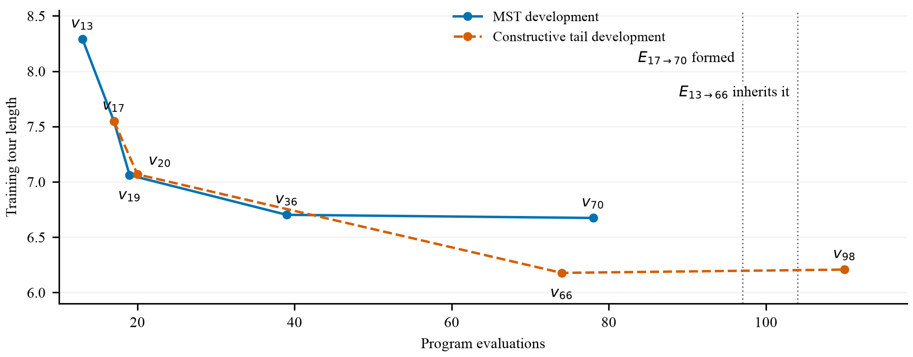

# Reflective Elimination: Accumulating Design Experience in Tree-Structured Algorithm Populations

## Abstract

Large language model (LLM)-based automatic heuristic design (AHD) evolves executable heuristics for optimization problems. However, fixed-size populations discard lower-scoring heuristics together with what their edits revealed, full search trees grow unboundedly, and global reflection pools detach past lessons from the parent code they modified. We propose **TREES** (*Tree-structured Reflective Evolutionary Search*) with **reflective elimination** to maintain a bounded heuristic tree while summarizing removed candidates onto surviving nodes and edges. Each update retains high-performing, structurally distinct representatives and their lowest common ancestors, partitioning remaining nodes into path regions between retained nodes and subtree regions beneath them. Regions smaller than $m$ stay active as candidate parents so temporarily worse heuristics can still improve. Regions of size at least $m$ are removed. Reflection summarizes contracted paths as edge experience and pruned branches at algorithm nodes as node experience, incorporating prior summaries. Refinement, crossover, and exploration then sample feasible parents and read relevant experiences to generate new heuristics. We prove representative invariance and a tight node bound of $4Km-2K-m$ for any evaluation budget. Across 12 runs on four combinatorial optimization tasks, TREES keeps trees under 100 nodes, improves training objectives, and reuses earlier summaries in 147 of 490 reflections ($30.0\%$).

## 1. Introduction

Automatic heuristic design (AHD) seeks effective decision rules for complex optimization problems without manual trial-and-error [@hh; @irace]. Recent LLM-based AHD methods combine large language models (LLMs) with evolutionary computation to generate, modify, and evaluate executable heuristic functions directly as code [@funsearch; @eoh; @llamea; @survey_aad]. During search, each parent-offspring evaluation records a specific code change and its measured objective value: multi-step paths show how strong heuristics are built incrementally, while sibling branches from the same parent show which modifications improve performance and which regress or fail. Beyond the best program found so far, these search records provide direct evidence for generating subsequent heuristics.

Existing AHD methods handle these records in different ways, each with clear trade-offs. Population-based methods such as FunSearch [@funsearch] and EoH [@eoh] retain only a fixed number of top-scoring heuristics; once a lower-scoring candidate is eliminated, search loses both the chance to refine it further and the record of what its edit changed. MCTS-AHD [@mctsahd] keeps all generated heuristics in a search tree so temporarily weaker nodes can still be expanded, but tree size grows continuously with the evaluation budget and long paths cannot fit all raw code into prompts. Reflection-based methods such as ReEvo [@reevo] and RefineEvo [@refineevo] prompt LLMs to summarize heuristic comparisons into global hint pools, detaching an observation from the specific parent algorithm on which it was tested. Recent structured methods introduce phylogenetic forests [@phyloevolve], external entailment graphs [@pathwise], diff databases [@deltaevolve], or branch memories compressed into a global pool upon closure [@memorytree], yet rely on auxiliary structures outside the population or detach summaries once a branch is removed.

To address this problem, we maintain the heuristic population as a single rooted tree in which the retained nodes directly determine which historical attempts are summarized together and where each summary is stored. Each node stores an evaluated heuristic function, and each directed edge records parent-to-offspring derivation. At each update, we select up to $K$ high-performing, structurally distinct **representatives** and add their pairwise lowest common ancestors (LCAs) to form a retained skeleton. All remaining nodes then fall into two disjoint region types: **path regions** connecting adjacent skeleton nodes, and **subtree regions** beneath skeleton nodes without retained descendants. A threshold $m$ governs when regions are simplified: regions with fewer than $m$ nodes stay in the tree so their feasible heuristics continue to compete as parents, whereas regions of size at least $m$ undergo **reflective elimination**. **Path contraction** summarizes removed intermediate steps into **edge experience** on the reconnected edge, and **subtree pruning** summarizes removed branches into **node experience** at their retained algorithm node.

Building on this update, we present **TREES** (Figure 1). Regional reflection compares the intended computation, its implementation, and the measured outcome of each attempt to summarize design experience. An existing summary can enter a later reflection when the algorithm that carries it falls inside a region selected for reflection. Before generating each candidate, TREES samples a primary parent from all feasible nodes in the tree using objective rank and prior offspring evaluations, then applies **refinement**, **crossover**, or **exploration**: refinement and crossover inspect the parent's development and source code to modify an implementation or combine computations. Exploration uses the implementations and local experiences of the parent and diverse representatives to design a different main computation.

Our main contributions are as follows:

- We propose reflective elimination for tree-structured heuristic populations, combining short-term retention below threshold $m$ with path contraction and subtree pruning, and prove representative invariance, update idempotence, and the tight budget-independent node bound $4Km-2K-m$.
- We design a parent selection rule across all feasible tree nodes together with refinement, crossover, and exploration prompt contexts tailored to modifying implementations, combining implementations, and rethinking computations.
- We analyze TREES across four combinatorial optimization problems (TSP, CVRP, OP, and FSSP), measuring maintained tree sizes, reflection token costs, and cross-update experience passing.

## 2. TREES

### 2.1. Problem Setup and Tree Population

Following standard LLM-based AHD settings [@eoh; @mctsahd], we design a key heuristic function within a fixed outer solver framework (such as sequential greedy construction, ant colony optimization, or guided local search). Each candidate heuristic $v$ is a Python function matching a given signature and is evaluated by running the outer solver on a training set to obtain an average objective value $f(v)$ (lower is better). Candidates that execute properly and return a finite objective are called feasible heuristics; candidates that raise an exception or time out record failure messages. Within $B$ program evaluations, search returns the feasible heuristic with the lowest training objective (repair and evaluation details appear in Appendix E).

TREES maintains the population as a rooted tree $T=(\mathcal V\cup\{v_0\},\mathcal E)$, where $\mathcal V$ is the set of evaluated heuristic nodes currently in the tree and $v_0$ is a virtual root without code or score. Each node $v\in\mathcal V$ stores the generation analysis, source code $c_v$, design summary $d_v$, evaluation outcome, and the number of offspring evaluations $n_v$ spent with $v$ as primary parent; all feasible nodes in $T$ form the feasible set $\mathcal P\subseteq\mathcal V$. Initial heuristics attach under $v_0$. Thereafter, refinement, crossover, and exploration each generate an offspring $v$ from a selected primary parent $p\in\mathcal P$ and add a directed edge $p\to v$ (crossover also records the reference heuristic's ID). After simplification, contracted edges $u\to w$ connect retained ancestors directly to retained descendants. TREES stores **edge experience** $E_{u\to w}$ (written $E_{uw}$ in figures) on edges and **node experience** $E_u$ on algorithm nodes (Figure 1).



**Figure 1. Population maintenance and heuristic generation in TREES.** (a) Retaining nodes $A$, $B$, $C$, and virtual root $v_0$ partitions the remaining nodes into a path region ($b_1,b_2,b_3,x$) and a subtree region ($s_1$–$s_4$). (b) Both regions reach threshold $m=4$: path contraction summarizes the former into edge experience $E_{AB}$, and subtree pruning summarizes the latter into node experience $E_A$. (c) Feasible nodes are sampled as parents by objective rank and spent offspring evaluations; refinement, crossover, and exploration read relevant tree information to generate a new heuristic $N$, which is evaluated and attached under its parent.

### 2.2. Population Maintenance and Reflective Elimination

Once $N_0$ feasible initial heuristics have been collected, TREES updates the population after each newly evaluated node in three steps.

**Step 1: Representatives and skeleton.** To select up to $K$ high-performing, structurally distinct representatives $R$, TREES first deduplicates $\mathcal P$: among nodes with identical abstract syntax trees (ASTs, after stripping comments and docstrings) and equal objectives, only the earliest node is kept, forming $\mathcal D$. Sorting $\mathcal D$ by ascending objective (breaking ties by node ID) as $(v_1,\ldots,v_{|\mathcal D|})$, greedy selection starts from $R_0=\varnothing$ and scans:

$$
\begin{aligned}
R_k &= R_{k-1} \cup \bigl\{v_k : |R_{k-1}| < K,\\
&\qquad d(v_k,u)\geq\delta\quad\forall u\in R_{k-1}\bigr\},\\
R &= R_{|\mathcal D|}.
\end{aligned}
\tag{1}
$$

Here $d(\cdot,\cdot)\in[0,1]$ is the multiset Jaccard distance over AST structural features and $\delta$ is the minimum distance threshold. Adding the non-representative pairwise LCAs $\operatorname{LCA}_T(R)$ in $T$, denoted $F$, yields the retained skeleton $\mathcal H$:

$$
\begin{aligned}
F &= \operatorname{LCA}_T(R)\setminus(R\cup\{v_0\}),\\
\mathcal H &= \{v_0\}\cup R\cup F.
\end{aligned}
\tag{2}
$$

**Step 2: Region partition.** Two skeleton nodes $u,w\in\mathcal H$ are adjacent in $T$ when $u$ is an ancestor of $w$ and no other skeleton node lies strictly between them. Each adjacent pair with a nonempty intermediate chain defines one **path region**, consisting of that intermediate chain and all non-skeleton side branches off its interior nodes. Every remaining non-skeleton node lies on a branch without representative descendants and is grouped under its nearest skeleton ancestor $u\in\mathcal H$ into one **subtree region** at $u$. Let $\mathcal C$ denote all nonempty regions. Only regions with at least $m$ nodes are removed, defining the removed set $\mathcal U$ and surviving set $\mathcal K$:

$$
\begin{aligned}
\mathcal U &= \bigcup_{C\in\mathcal C:\,|C|\geq m} C,\\
\mathcal K &= (\mathcal V\cup\{v_0\})\setminus\mathcal U.
\end{aligned}
\tag{3}
$$

Regions with fewer than $m$ nodes remain in $T$, and their feasible nodes stay in $\mathcal P$ for parent sampling. Consequently, an offspring whose objective temporarily drops below its parent's, or whose AST distance to a representative is below $\delta$, still has room to produce better descendants before its local region reaches size $m$.

**Step 3: Regional reflection and removal.** TREES removes all regions with $|C|\geq m$. In **path contraction**, the LLM reads the intermediate chain and its side branches, the retained endpoint $w$, and the starting algorithm $u$ when $u\neq v_0$. It summarizes the changes, measured outcomes, and prior experiences into **edge experience** $E_{u\to w}$ on the reconnected edge. In **subtree pruning** at an algorithm node $u$, the LLM summarizes the removed attempts together with $u$'s prior experience into **node experience** $E_u$. TREES prunes the subtree region at the virtual root directly. Each reflection uses the same pre-update tree. It compares the attempts' pre-coding analyses with their code and measured outcomes. It produces a comparison for the record and writes the resulting design experience to the retained tree (Appendix E.5 and Figure 2).



**Figure 2. Experience passing across successive population updates.** (a) When former retained node $D$ is contracted together with $u_1$–$u_3$, prior edge experience $E_{AD}$ and the newer steps are summarized together into $E_{AG}$. (b) When new branches $y_1$–$y_4$ under $A$ are pruned, their outcomes are merged with prior node experience $E_A$. Earlier summaries stay in the tree after their original nodes are removed.

**Proposition 1 (Structural Properties of Tree Updates).** *Let $T=(\mathcal V\cup\{v_0\},\mathcal E)$ be any finite rooted tree with $K,m\geq 1$ and $\delta\in[0,1]$, and let $T'=(\mathcal V'\cup\{v_0\},\mathcal E')$ be the tree after one reflective elimination update. Then: (i) $T'$ is a rooted tree preserving ancestry among nodes in $\mathcal K$, and $\mathcal C$ partitions $\mathcal V\setminus\mathcal H$ into disjoint regions; (ii) the best feasible heuristic survives, with $R(T')=R(T)$ and $\mathcal H(T')=\mathcal H(T)$; (iii) repeating the update without new nodes removes zero nodes (idempotence); and (iv) for each reflected region, every removed or replaced experience text enters its reflection prompt, and for any evaluation budget $B$ the surviving node count satisfies the tight bound $|\mathcal V'|\leq 4Km-2K-m$ (332 for $K=24,m=4$).* Proofs and the tightness construction appear in Appendix C.

### 2.3. Parent Selection

Before each generation call, TREES samples a primary parent $p$ from all feasible nodes $\mathcal P$ currently in the tree (including representatives $R$, feasible branching nodes, and feasible nodes in regions smaller than $m$). Sorting $\mathcal P$ by ascending objective from $0$ and assigning tied nodes their average rank defines $r(p)\in\tfrac{1}{2}\mathbb Z_{\geq 0}$. Let $n_p\in\mathbb Z_{\geq 0}$ denote the number of offspring evaluations already spent with $p$ as primary parent ($n_v=0$ when node $v$ enters the tree, and simplification preserves $n_p$ on surviving nodes). Parent $p$ is sampled with probability

$$
\begin{aligned}
w(p) &= \frac{2^{-r(p)/h}}{1+n_p},\\
P(p) &= \frac{w(p)}{\sum_{u\in\mathcal P}w(u)}.
\end{aligned}
\tag{4}
$$

Here $h>0$ is the rank half-life: at equal $n_p$, sampling weight halves every $h$ ranks to favor better heuristics, while at comparable ranks $1/(1+n_p)$ reduces the weight of heavily sampled nodes so newly generated heuristics ($n_v=0$) receive evaluation opportunities.

### 2.4. Search Operators and Prompt Context

Given primary parent $p\in\mathcal P$, TREES samples refinement, crossover, or exploration with fixed probabilities $(\pi_{\text{ref}},\pi_{\text{cross}},\pi_{\text{exp}})$. Each generation call asks the LLM to return three JSON fields in order: `analysis`, which uses the problem structure to work out a concrete computation and why its choices should improve the final solution (retained for regional reflection); `code`, the complete Python function $c_v$; and `design`, a short summary $d_v$ of the main computation and parameters implemented in `code`. Writing `design` after `code` lets the model describe its implementation in the same LLM call [@eoh; @mctsahd] (Appendix E.3).

**Refinement** modifies $p$'s representation, input information, procedure, or parameters to improve performance. The prompt shows $p$'s development path with score changes, design descriptions, and edge and node experiences. It then lists $p$'s node experience $E_p$ and the results of surviving direct children, followed by $p$'s source code $c_p$.

**Crossover** combines useful mechanisms from $p$ and a reference heuristic $q$. Candidate set $\mathcal Q_p$ takes AST-distinct representatives in $R\setminus\{p\}$, or AST-distinct nodes in $\mathcal D\setminus\{p\}$ if empty (falling back to refinement if still empty). Letting $r_{\mathcal Q_p}(q)$ denote $q$'s average rank starting from $0$ within $\mathcal Q_p$, $q$ is sampled by rank decay and structural distance:

$$
P(q\mid p) = \frac{2^{-r_{\mathcal Q_p}(q)/h}\,d(p,q)}{\sum_{u\in\mathcal Q_p}2^{-r_{\mathcal Q_p}(u)/h}\,d(p,u)}.
\tag{5}
$$

If all distances in $\mathcal Q_p$ are zero, sampling uses $2^{-r_{\mathcal Q_p}(q)/h}$ alone. Crossover inserts $q$'s card before $p$'s source code. The card contains $q$'s objective, design, own incoming-edge and node experiences, and source code $c_q$. The card omits experiences already shown for $q$ in the development path. If $q$ is also a direct child of $p$, it appears in the reference card.

**Exploration** uses a card for $p$ and cards for up to $M$ structurally diverse representatives to design a different main computation. Each card contains the objective, design, local experiences, and source code. TREES draws representatives without replacement from AST-distinct members of $R\setminus\{p\}$ with weights $2^{-r(q)/h}\min_{u\in\{p\}\cup S}d(q,u)$, where $r(q)$ is the candidate's rank in that pool and $S$ is the set already drawn. A candidate must have positive minimum distance. The prompt displays $p$ first and orders the displayed representatives by objective. The evaluated offspring attaches under $p$. Algorithm 1 outlines the search. The defaults are $N_0=5,K=24,\delta=0.15,m=4,h=6,M=5$, with operator probabilities $(0.50,0.30,0.20)$.

```text
Algorithm 1: TREES
Input: task interface, evaluator, LLM, budget B, initial size N_0
Initialize tree T with virtual root v_0
while budget remains and stopping rule is not met:
    If fewer than N_0 feasible initial heuristics or P is empty, generate an initial heuristic under v_0
    Otherwise, sample parent p in P and search operator
    Build prompt context from T
    Generate candidate and evaluate (at most one repair)
    If no candidate was evaluated, continue
    Attach evaluated node v under its parent and update counts
    If fewer than N_0 feasible initial heuristics collected, continue
    Select representatives R and skeleton H
    Partition V \ H into path and subtree regions
    Reflect on path and non-root subtree regions with |C| >= m using pre-update T
    Contract paths and prune subtrees; store E_{u->w}, E_u
return best feasible heuristic evaluated during search
```

## 3. Analysis of Experience Accumulation During Search

### 3.1. Experimental Setup and Scope

We examine how reflective elimination behaves during search on four combinatorial optimization problems: sequential tour construction for the traveling salesman problem (TSP), static ant colony edge heuristics for the capacitated vehicle routing problem (CVRP) and orienteering problem (OP), and guided local-search perturbations for the permutation flow-shop scheduling problem (FSSP). Each task fixes the outer solver and evaluates candidate programs on 16 training instances using Qwen3.8-27B across seeds 0–2 with $K=24,\delta=0.15,m=4$ (these 12 preliminary runs come from a variant that sampled parents on $R$; full 1,000-evaluation protocols and external baselines appear in Appendix D). The 12 runs record the first 243–363 program evaluations (3,519 total); objective and node-count curves are aligned at 240 evaluations, while reflection statistics use each run's full recorded prefix.

### 3.2. Experience Formation and Cross-Update Passing

Across the 12 runs, 3,271 evaluated nodes enter the trees and 2,301 non-skeleton nodes are removed across 490 regional reflections (192 path contractions and 298 subtree prunings). At the end of the recorded prefixes, each tree holds 66–99 algorithm nodes, well below Proposition 1's bound of 332. In 147 of the 490 reflections ($30.0\%$), the input experience contains the complete normalized output text from a strictly earlier update, including 87 path contractions and 60 subtree prunings (Appendix D.5). Summaries created from removed nodes are thus retained and merged when their host nodes or edges are later simplified.

A branch from TSP seed 2 illustrates this process concretely. After evaluation 97, path contraction summarizes a chain of edits into edge experience $E_{17\to70}$; after evaluation 104, node 70 is removed inside a larger region, and $E_{17\to70}$ enters that reflection and is merged into $E_{13\to66}$ on reconnected edge $13\to66$. A subsequent refinement of node 66 reads this merged summary in its prompt and adjusts the candidate width and remaining-tour 2-opt steps (Appendix F provides the code, scores, and verbatim reflections, and reports the offspring's slight objective regression from 6.1775 to 6.2072).

### 3.3. Region Size and Reflection Token Cost

Each reflected region removes 4–12 nodes (median 4, mean 4.70). All 490 reflection calls returned valid outputs, consuming 3,959,071 input tokens and 88,604 output tokens in total (8,080 input and 181 output tokens per region on average). Batching local trials with threshold $m=4$ keeps reflection output token overhead small.

### 3.4. Tree Size and Training Objectives



**Figure 3. Best training objectives and maintained node counts under reflective elimination.** Upper panels show the best training objective; lower panels show the number of algorithm nodes in the tree after each evaluated attempt across seeds 0–2 over the first 240 evaluations ($K=24,\delta=0.15,m=4$).

As shown in Figure 3, maintained node counts stay below 100 as new candidates enter and full regions are contracted or pruned, while best training objectives decrease steadily across all four tasks. At evaluation 240, mean training objectives across the three seeds reach 5.7574 on TSP, 8.1584 on CVRP, 3893.60 on FSSP, and -14.3552 on OP (Table 1).

**Table 1. Best training objectives at evaluation 240 (lower is better).** Mean and sample standard deviation (SD) are computed over three random seeds.

| Task | Seeds 0 / 1 / 2 | Mean | SD |
| --- | ---: | ---: | ---: |
| TSP | 5.7530 / 5.7372 / 5.7820 | 5.7574 | 0.0227 |
| CVRP | 8.0656 / 8.2830 / 8.1266 | 8.1584 | 0.1122 |
| FSSP | 3902.12 / 3888.88 / 3889.81 | 3893.60 | 7.39 |
| OP | -14.5419 / -14.0794 / -14.4444 | -14.3552 | 0.2438 |

## 4. Related Work

**LLM-based evolutionary heuristic design.** Classical genetic programming [@koza], hyper-heuristics [@hh], and automatic algorithm configuration [@irace] search over predefined primitives or parameter spaces. LLMs allow evolutionary search to generate and edit executable code directly [@elm; @lmcrossover; @survey_aad]: FunSearch evolves scoring functions in island populations [@funsearch], EoH co-evolves natural-language thoughts and Python implementations [@eoh], and LLaMEA and AlphaEvolve extend evaluation-guided coding to metaheuristics and general algorithms [@llamea; @alphaevolve]. To improve diversity and parent selection, HSEvo incorporates harmony search [@hsevo], PartEvo partitions candidates into niches [@partevo], and ShinkaEvolve weights parents by fitness and sampling counts [@shinka]. Whereas these methods discard eliminated candidates outright, TREES summarizes their code modifications and outcomes onto the surviving tree.

**Tree and graph structures in heuristic search.** MCTS-AHD retains all generated heuristics in an MCTS tree [@uct; @mctsahd], Clade-AHD freezes unpromising clades using descendant statistics [@cladeahd], and A2DEPT organizes candidates in evolutionary program trees [@a2dept]. PhyloEvolve maintains phylogenetic forests with pruning, trajectory summaries, and an elite pool [@phyloevolve], while PathWise pairs a population with an entailment graph, world model, and critic agents [@pathwise]. Instead of keeping the entire history tree or maintaining a separate planning graph, TREES maintains one rooted tree whose representatives and pairwise LCAs uniquely partition non-skeleton nodes into path and subtree regions, bounding tree size while fixing where each summary is stored.

**Reflection and experience reuse.** Language agents reuse past attempts through self-feedback [@selfrefine], verbal reinforcement [@reflexion], and cross-task insights [@expel]. In AHD, ReEvo extracts short- and long-term reflections from paired heuristics [@reevo], RefineEvo maintains positive and negative experience pools alongside an operator planner [@refineevo], and MeEvo and BEAM combine shared-history reflection with bi-level memory [@meevo; @beam]. DeltaEvolve records code diffs in an external store [@deltaevolve], while MEMOIR keeps branch-local memory and compresses it into a global pool when a branch closes [@memorytree]. Rather than pooling long-term hints globally apart from parent code, TREES stores summaries on the corresponding edges and parent nodes and merges them into subsequent reflections when those locations are simplified.

## 5. Discussion and Limitations

In TREES, threshold $m$ jointly controls short-term parent retention and regional summarization. While a region holds fewer than $m$ nodes, new heuristics whose scores temporarily drop or make local adjustments stay in $\mathcal P$ and can still be sampled to produce stronger descendants; once a path or non-root subtree region reaches $m$ nodes, a single reflection summarizes those related attempts and stores the resulting edge or node experience where refinement, crossover, and exploration read it. Furthermore, because representative selection, skeleton partitioning, and parent sampling depend only on AST features, objectives, and evaluation counts rather than experience text, one can test the effect of experience by toggling its text while holding the tree and displayed algorithms fixed.

TREES has three main limitations. First, AST feature distance ignores numeric constants so that $R$ preserves differences in control flow and operators rather than scalar copies; although variants in regions below size $m$ can still adjust constants and record outcomes upon pruning, dedicated parameter tuners [@irace] remain complementary when continuous constants dominate performance. Second, each reflected region invokes one short-output LLM call; when program evaluation is nearly instantaneous and LLM calls dominate runtime, increasing $m$ reduces reflection frequency. Third, following standard AHD benchmarks, we design a single heuristic function inside a fixed outer solver rather than co-evolving multiple solver components.

## 6. Conclusion

We introduced TREES and reflective elimination for LLM-based automatic heuristic design. Using high-performing, structurally distinct representatives and their lowest common ancestors, TREES partitions non-skeleton nodes into path and subtree regions, retains regions smaller than $m$ in the active tree, and summarizes regions of size at least $m$ onto reconnected edges and parent nodes via path contraction and subtree pruning. We proved representative invariance and the tight node bound $4Km-2K-m$, and verified bounded tree sizes and cross-update experience passing on four combinatorial optimization problems.

## AI Use Statement {.unnumbered}

Generative AI tools assisted with literature review, manuscript drafting and editing, verification against the codebase, and mechanism diagrams. The LLMs invoked inside TREES are described in Sections 2 and 3 and Appendix D. The authors take full responsibility for the manuscript and its claims.

## Impact Statement {.unnumbered}

This work studies automatic heuristic design to reduce manual effort in developing heuristics for optimization problems. Broader societal impacts depend on the downstream applications in which generated algorithms are deployed.

## References

References are rendered from `references.bib` in the accompanying PDF.

## Appendix A. Background and Related Approaches

Appendices A–B provide background, method comparisons, and design explanations; Appendix C proves Proposition 1; Appendices D–E detail task protocols, default settings, and verbatim prompts; Appendix F traces cross-update experience passing on a TSP branch.

### A.1. Automatic Heuristic Design in Fixed Solvers

AHD searches for an executable heuristic function for a problem class rather than solving a single problem instance directly. Each candidate Python function is plugged into a fixed outer solver, evaluated by average objective across training instances, and later tested on disjoint same-scale and larger-scale instances. The four tasks in Appendix D share this paradigm across sequential tour construction, ACO edge scoring, and GLS perturbation design. Unlike genetic programming and traditional hyper-heuristics that rely on predefined operator primitives [@koza; @hh], LLM-based AHD generates and modifies general Python code directly [@funsearch; @eoh].

### A.2. Comparison of Representative Methods

Table 2 compares representative LLM-based AHD methods across population structure, bounded size, retention of lower-scoring candidates, experience scope and storage location, and experience passing after node removal.

**Table 2. Comparison of representative LLM-based heuristic evolution methods.** Entries follow each paper's published method description.

| Method | Population structure | Bounded size | Keeps lower-scoring candidates | Experience scope and storage | Experience passed after removal |
| --- | --- | --- | --- | --- | --- |
| EoH [@eoh] | Flat population | Yes (fixed size) | No (rank truncation) | None (keeps surviving thoughts and code) | Not applicable |
| ReEvo [@reevo] | Flat population | Yes (generational) | Limited (within generation) | Paired short-term + global long-term hints | Added to global text, detached from parent code |
| RefineEvo [@refineevo] | Population + planner | Yes | Limited | Global positive/negative pools + planner | Stored in global pool, not on tree edges or parents |
| MCTS-AHD [@mctsahd] | MCTS tree | No (grows continuously) | Yes (keeps full tree) | Raw root-to-leaf path; no removal summary | Nodes are not removed |
| Clade-AHD [@cladeahd] | Clade search tree | No (freezes clades) | Yes (descendant stats) | Clade score statistics; no text summary | Not applicable |
| PathWise [@pathwise] | Population + graph | Graph-policy dependent | Yes | World model and critics on entailment graph | Maintained in external graph |
| PhyloEvolve [@phyloevolve] | Phylogenetic forest | Yes (multi-level pruning) | Limited | Branch trajectory summaries + elite pool | Kept on surviving branches |
| DeltaEvolve [@deltaevolve] | Multi-level diff store | Growing database | Yes (retrieves history) | Code modification records and outcomes | Stored in external database |
| MEMOIR [@memorytree] | Branching search tree | Termination-dependent | Yes (while branch active) | Branch memory compressed to global pool at end | Merged into global pool at closure |
| **TREES (Ours)** | **Rooted tree** | **Yes ($4Km-2K-m$)** | **Yes ($<m$ kept)** | **Path regions on edge $E_{u\to w}$; subtrees at parent $E_u$** | **Yes (merged into outer reflection)** |

### A.3. Specific Differences from Tree Search and Experience Pools

MCTS-AHD and Clade-AHD retain all generated heuristics in a search tree and allocate expansions via UCT or descendant statistics [@mctsahd; @cladeahd], without contracting intermediate chains or pruning side branches. PathWise maintains separate policy, world-model, and critic agents alongside a population [@pathwise], whereas TREES maintains a single rooted tree and samples parents directly via Eq. (4). Unlike ReEvo, RefineEvo, and MEMOIR [@reevo; @refineevo; @memorytree], which store long-term summaries in global pools, TREES partitions removed nodes around the retained skeleton so intermediate progressions stay on reconnected edges and removed offshoots stay at their parent nodes.

## Appendix B. Additional Design Explanations

### B.1. Lowest Common Ancestors and Full-Tree Parent Sampling

If TREES kept only representatives $R$ without their pairwise LCAs $F$, a removed branching region could connect to multiple retained representatives below it, leaving no unique reconnected edge to store its summary. Selecting $R$ first and adding $F$ second ensures that every path region connects a unique pair of adjacent skeleton nodes and every subtree region belongs to a unique nearest skeleton ancestor, without consuming any of the $K$ representative positions in $R$.

At the same time, TREES samples parents from all feasible nodes $\mathcal P$ rather than only $R$. As observed in MCTS-AHD, strong heuristics often pass through an intermediate structural edit whose score temporarily drops, or require further refinement near an existing representative ($d<\delta$) [@mctsahd]. As long as a region holds fewer than $m$ nodes, these new heuristics stay in $\mathcal P$ with $n_v=0$ and compete under Eq. (4): if they yield a strong descendant it enters $R$, and if $m$ nodes accumulate without a retained descendant the branch is pruned and summarized at its parent.

### B.2. Roles of Edge and Node Experiences

Edge experience $E_{u\to w}$ records how $w$ developed from $u$ across intermediate attempts. Node experience $E_u$ records computations tried on pruned branches and their measured outcomes. A contracted path starting at $v_0$ records the development of an initial design on the reconnected edge. When a node carrying node or incoming-edge experience later falls in a reflected region, those summaries enter the new reflection (Figure 2).

### B.3. Ordered Output of Analysis, Code, and Design

The model uses `analysis` to plan a concrete computation before writing `code`. The search retains this analysis for comparison with the code and results during regional reflection. The model then uses `design` to summarize the implemented computation and key parameters in the same call [@mctsahd]. Exploration cards show both the design description and the implementation.

## Appendix C. Proof of Proposition 1

Let $T_0=(\mathcal V_0\cup\{v_0\},\mathcal E_0)$ be a finite rooted tree with feasible set $\mathcal P_0$, deduplicated set $\mathcal D_0$, representatives $R(T_0)$, branching nodes $F(T_0)$, skeleton $\mathcal H(T_0)=\{v_0\}\cup R(T_0)\cup F(T_0)$, nonempty regions $\mathcal C(T_0)$, removed set $\mathcal U=\bigcup_{C\in\mathcal C(T_0):|C|\geq m}C$, and updated tree $T_1=(\mathcal V_1\cup\{v_0\},\mathcal E_1)$ on surviving nodes $\mathcal K=(\mathcal V_0\cup\{v_0\})\setminus\mathcal U$ ($\mathcal V_1=\mathcal K\setminus\{v_0\}$), with $K,m\geq 1$ and $\delta\in[0,1]$. Code, objectives, IDs, and counts $n_v$ of surviving nodes remain unchanged.

**Rooted-tree property and ancestry preservation.** Because $v_0\in\mathcal H(T_0)\subseteq\mathcal K$, following parent edges upward in $T_0$ from any $v\in\mathcal V_1$ first meets a unique nearest surviving ancestor $a(v)\in\mathcal K$. Path contraction reconnects surviving endpoints whose $T_0$-parent lies in $\mathcal U$ to $a(v)$, while all other surviving nodes keep their incoming edge. Every edge strictly decreases $T_0$-depth, ruling out cycles and giving each $v\in\mathcal V_1$ a single incoming edge while preserving ancestry on $\mathcal K$.

**Disjoint region partition.** Suppose interior chains $C_{\text{chain}}(u_1,w_1)$ and $C_{\text{chain}}(u_2,w_2)$ for two distinct adjacent skeleton pairs shared a non-skeleton node, and let $z\notin\mathcal H(T_0)$ be their deepest shared node. Then $z$ would branch into at least two disjoint downward paths reaching distinct skeleton endpoints. Because every leaf of the skeleton tree belongs to $R(T_0)$ and every $f\in F(T_0)$ has at least two subtrees containing members of $R(T_0)$, both downward branches contain members of $R(T_0)$, implying $z\in\operatorname{LCA}_{T_0}(R(T_0))\subseteq\mathcal H(T_0)$, a contradiction. Every remaining node $x\in\mathcal V_0\setminus\mathcal H(T_0)$ outside all interior chains first meets $\mathcal H(T_0)\cup\bigcup C_{\text{chain}}$ at a unique ancestor when traced upward, assigning $x$ either to that chain's path region or to that skeleton node's subtree region. Thus $\mathcal C(T_0)$ partitions $\mathcal V_0\setminus\mathcal H(T_0)$ into disjoint regions.

**Best-heuristic retention and representative and skeleton invariance.** When $\mathcal P_0\neq\varnothing$, the first ordered candidate $v_1\in\mathcal D_0$ is accepted first in Eq. (1), so the best feasible heuristic survives in $R(T_0)\subseteq\mathcal K$. Every $r\in R(T_0)$ remains the earliest surviving node in its normalized-AST and objective equivalence class in $T_1$, giving $R(T_0)\subseteq\mathcal D(T_1)$. By induction along the sorted scan of $\mathcal D(T_1)$, suppose the set accepted before $w\in\mathcal D(T_1)$ equals the prefix of $R(T_0)$ preceding $w$. If $w\in R(T_0)$, it encounters the same accepted prefix as in $T_0$ and is accepted. If $w\notin R(T_0)$, let $w_0\in\mathcal D_0$ be the earliest node in $T_0$ in $w$'s equivalence class ($w_0\leq w$); $w_0$ was rejected in $T_0$ either because an earlier $u\in R(T_0)$ satisfied $d(w_0,u)<\delta$ or because $K$ representatives were already selected. Those preceding representatives survive ahead of $w$ in $T_1$ with $d(w,u)=d(w_0,u)$, so $w$ is rejected in $T_1$ as well. Induction yields $R(T_1)=R(T_0)$, and ancestry-preserving contractions and prunings preserve pairwise LCAs, giving $F(T_1)=F(T_0)$ and $\mathcal H(T_1)=\mathcal H(T_0)$.

**Idempotence and retention of prior experiences.** Since $\mathcal H(T_1)=\mathcal H(T_0)$, the non-skeleton regions on $T_1$ are $\mathcal C(T_1)=\{C\in\mathcal C(T_0):|C|<m\}$, all smaller than $m$, so repeating the update without new nodes removes zero nodes. Every removed node in a reflected region contributes its node and incoming-edge experiences to that prompt. Path contraction also reads the endpoint's prior incoming-edge experience. Subtree pruning reads the parent's prior $E_u$. If reflection fails, the system concatenates the prior texts supplied to the prompt.

**Tight node bound.** Let $r=|R(T_0)|$ and $s=|\mathcal H(T_0)|$. If $r=0$, $\mathcal H(T_0)=\{v_0\}$ and $|\mathcal V_1|\leq m-1\leq 4Km-2K-m$. If $1\leq r\leq K$, in the skeleton tree obtained by contracting non-skeleton paths, every $f\in F(T_0)$ has out-degree at least two and every leaf belongs to $R(T_0)$, so $|F(T_0)|\leq r-1$ and $s=1+r+|F(T_0)|\leq 2r\leq 2K$. The skeleton tree has $s-1$ edges (at most $s-1$ path regions) and $s$ nodes (at most $s$ subtree regions). After simplification each remaining region holds at most $m-1$ nodes, so excluding $v_0$ gives $|\mathcal V_1|\leq(s-1)+(2s-1)(m-1)\leq(2K-1)+(4K-1)(m-1)=4Km-2K-m$. To attain this bound, place $K$ feasible leaves with pairwise AST distance at least $\delta$ and strictly best objectives on a full binary tree of $K-1$ internal LCAs under $v_0$ ($2K$ skeleton nodes and $2K-1$ skeleton edges), insert $m-1$ suboptimal nodes on each skeleton edge, and attach a chain of $m-1$ suboptimal nodes under each skeleton node; all $4K-1$ regions have size $m-1<m$, leaving $4Km-2K-m$ algorithm nodes (332 for $K=24,m=4$).

## Appendix D. Tasks and Evaluation Protocol

### D.1. Search Interfaces and Objectives

All four benchmark tasks design one heuristic function inside a fixed outer solver (Table 3).

**Table 3. Heuristic function outputs and fixed outer-solver settings.** Objectives are averaged across evaluation instances and minimized.

| Task | Heuristic function output | Fixed outer solver and objective |
| --- | --- | --- |
| TSP | Next unvisited node ID | Sequential tour construction; mean tour length |
| CVRP | Static edge heuristic matrix | 30 ants, 100 ACO iterations; mean route length |
| OP | Static edge heuristic matrix | 20 ants, 50 ACO iterations; negative mean prize |
| FSSP | Perturbed times and 1–5 job IDs | NEH initialization, 200 GLS iterations; mean makespan |

**TSP.** Each instance samples 50 node coordinates uniformly in $[0,1]^2$ (training seed 2024). Given the current node, start node, distance-sorted unvisited IDs, and symmetric distance matrix, the function returns one unvisited node ID; the solver steps from node 0 and closes the tour.

**CVRP.** Each instance has a depot at $(0.5,0.5)$ and 50 uniform $[0,1]^2$ customers with integer demands in $[1,9]$ and vehicle capacity 50 (data and ACO seed 1234). Called once per instance, the function maps distances, coordinates, demands, and capacity to an edge heuristic matrix (shifted and clipped below at $10^{-9}$).

**OP.** Each instance has 50 uniform $[0,1]^2$ nodes (including depot), tour length limit 3, and distance-based prizes $(1+\lfloor99d_i/d_{\max}\rfloor)/\max_j p_j$ (training/test coordinate seeds 1234/4567; ACO seed 1234). Given prizes, distances, and length limit, the function returns an edge heuristic matrix (clipped below at $10^{-9}$); moves that cannot return to the depot in time are masked.

**FSSP.** Fifty jobs pass through 20 machines in the same permutation order with uniform integer processing times in $[1,99]$ (base seed 20261007). After NEH initialization and up to three swap and insertion local-search passes per iteration, the function takes the current permutation and processing-time matrix and returns a nonnegative perturbed matrix plus 1–5 distinct job IDs to guide perturbations; makespan is evaluated on original processing times.

### D.2. Evaluation Limits and Held-Out Testing

Each candidate runs on 16 fixed training instances across up to eight worker processes sharing a 160 instance-second limit, with a Linux per-worker data-segment limit of initial usage plus 2 GiB (instance $i$ uses seed $730241+i$). Full benchmark runs use budget $B=1{,}000$ program evaluations (including execution failures and repair re-evaluations) and test the best training program on 50 disjoint same-scale instances (500 instance-seconds) as well as 100- and 200-node TSP, CVRP, and OP instances.

### D.3. Comparison Baselines and Cost Accounting

External baselines include EoH [@eoh], ReEvo [@reevo], MCTS-AHD [@mctsahd], RefineEvo [@refineevo], and PathWise [@pathwise], all evaluated under the same task interfaces and evaluator limits. Evaluator calls, LLM requests, and input/output tokens are logged separately, and training curves are aligned by actual program evaluations.

### D.4. Language Model Parameters

The runs analyzed in Section 3 use Qwen3.8-27B with native thinking disabled across seeds 0, 1, and 2. Candidate generation uses temperature 1.0, top-$p$ 0.8, top-$k$ 20, presence penalty 1.5, and max 16,384 output tokens; regional reflection uses temperature 0.3 and max 1,536 output tokens.

### D.5. Preliminary Run Statistics

The 12 preliminary runs in Section 3 contain 243–363 program evaluations each (aligned at 240 for curves; full prefixes for reflection counts) with $K=24,\delta=0.15,m=4$ (run under a variant sampling parents on $R$ with half-life 10 and comparison catalogs in reflection). Whitespace-normalized substring matching between each reflection's input experiences and strictly earlier reflection outputs (excluding parallel regions from the same update) detects inherited summaries in 87/192 path contractions and 60/298 subtree prunings (147/490 total). Removed region sizes are 326 of size 4, 71 of 5, 50 of 6, 21 of 7, 12 of 8, 5 of 9, 2 each of 10 and 11, and 1 of 12, totaling 2,301 removed nodes.

## Appendix E. Implementation Details and Verbatim Prompts

### E.1. Code Distance and Sampling Details

After stripping docstrings, TREES extracts multisets of AST parent-child tag pairs and depth-first adjacent tag bigrams (recording syntax node types, operators, and called function or attribute names while ignoring variable names and numeric constants) and computes multiset Jaccard distance $d(u,v)$. Deduplication in $\mathcal D$ compares full ASTs without comments or docstrings and requires equal objectives among nodes currently in the tree. Exploration displays the selected representative cards in ascending order of objective, breaking ties by node ID.

**Table 4. Default TREES parameters.**

| Module | Default setting |
| --- | --- |
| Initialization and budget | $N_0=5$ feasible initial heuristics; budget $B=1{,}000$ program evaluations |
| Representatives and skeleton | $K=24$, $\delta=0.15$; closed under pairwise LCAs to form $\mathcal H$ |
| Region threshold | $m=4$ nodes per region |
| Parent selection | Sampled over all feasible nodes $\mathcal P$; half-life $h=6$, factor $1/(1+n_p)$ |
| Operator probabilities | Refinement $0.50$, crossover $0.30$, exploration $0.20$ |
| Crossover reference | Sampled from AST-distinct $\mathcal Q_p$ ($R\setminus\{p\}$, else $\mathcal D\setminus\{p\}$) via $2^{-r/h}\cdot d(p,q)$ |
| Exploration overview | Up to $M=5$ draws without replacement using rank decay and minimum AST distance |

### E.2. Evaluation, Single Repair, and Stopping Rule

Each generation attempt allows at most one repair: format repair if JSON parsing fails (consuming zero evaluations), or program repair if execution raises an error or times out while budget remains (counting the re-evaluation toward $B$). Only the final evaluated program of the attempt enters $T$, adding evaluations spent to $n_p$ when $p\neq v_0$. Search stops at $B$ evaluations or after 10 consecutive attempts without an evaluated program. If a reflection call fails or returns empty text, existing experience texts in that region are concatenated and retained.

### E.3. Generation Template and Context

**Table 5. Context blocks in candidate generation.**

| Call | Context in order |
| -------------------- | -------------------------------------------------------------- |
| Initialization | `[Example Algorithm]` task example → `[Existing Approaches]` feasible initial designs and objectives → `[Failed Attempts]` failed programs and feedback |
| Refinement | `[Development of the Current Algorithm]` parent development → `[Attempts from the Current Algorithm]` attempts from the parent → `[Current Algorithm]` parent objective and code |
| Crossover | `[Development of the Current Algorithm]` parent development → `[Attempts from the Current Algorithm]` attempts from the parent → `[Other Algorithm]` reference card → `[Current Algorithm]` parent objective and code |
| Exploration | `[Current Algorithm]` parent card → `[Other Existing Approaches]` cards for the selected representatives |

The development path and attempt list provide generation intent, measured outcomes, designs, and available experiences. Each full card contains the objective, design, incoming-edge experience, node experience, and source code.

~~~~text
[Algorithm-design task]
{task_description}

Design the computation performed by the following function to improve the complete solver's objective. Use the available inputs and the role of its returned result in the solver.

[Function interface]
```python
{function_template}
```

[Context]
{context}

[Instruction]
{instruction}

[Output]
Return exactly one valid JSON object with three string fields, in this order:
- "analysis": {analysis_instruction} Use up to 300 words.
- "code": Provide the complete implementation using only the inputs in [Function interface], including necessary imports and helper definitions.
- "design": In about 120 words, describe for another algorithm designer the main computation the code performs and its key parameters. Describe the implementation, not expected performance.
Keep "design" faithful to "code". Preserve the required function signature and satisfy the task constraints and input/output requirements.
Return only the JSON object, without Markdown fences or additional text.
~~~~

Initialization and the three search operators share the following `{analysis_instruction}`.

~~~~text
Use the structure of the problem to work out a concrete computation. Which choices would it favor, and why could they improve the final solution? Draw on earlier results when useful.
~~~~

### E.4. Generation Instructions

**Initialization before the first feasible candidate.**

~~~~text
Design an effective algorithm for this task. Consider how the returned result affects the complete solution and choose a computational approach suited to that role. The example illustrates an implementation, not a structure to preserve. Implement the specified function.
~~~~

**Initialization with existing feasible candidates.**

~~~~text
Develop an effective algorithm with a different main computation from the ideas already represented. Seek a different way to compute the result, rather than another weighting of the same local features. You can change the representation, the information used, or the computational procedure. Implement the chosen approach as a complete algorithm.
~~~~

When the context includes failed attempts, TREES appends the following sentence.

~~~~text
Use the failed attempts and evaluation feedback to inform your implementation.
~~~~

**Refinement.**

~~~~text
Improve the current algorithm by examining how it computes its result and where this computation can be improved. The development path shows what each step changed and how fitness responded; the experience and the attempts show what has been tried and learned along this path. Use them with the implementation to locate what limits the result and to choose a meaningful modification. You may revise its representation, the information it uses, or its procedure as well as its parameters; implement a coherent improved algorithm.
~~~~

**Crossover.**

~~~~text
Understand the computational ideas in both implementations and develop an algorithm that combines their useful strengths. The development path shows how the current algorithm was formed and what has been tried and learned along it; the other algorithm's code shows what it actually computes, and its experience shows what was learned about it. Use them to decide which of its computations can strengthen the current algorithm and how the two fit together. If no useful combination emerges, improve the current algorithm using what the comparison reveals.
~~~~

**Exploration.**

~~~~text
Design an algorithm whose main computation differs from every algorithm shown above, not another weighting of the same local features. The code shows what each one actually computes, even where a design is inaccurate, and the experience shows what has been tried and learned. The code is not a structure you must preserve. A different computation may use other information, another representation, or another procedure. For example, it can estimate the downstream consequences of a choice, construct and improve a tentative solution, or solve a useful subproblem. Implement the computation that suits this task.
~~~~

### E.5. Reflection Template

~~~~text
{problem}

[Algorithms]
{situation}

{records}

[Task]
{question}
The analysis of each attempt states its intent before it was coded and evaluated; its code shows what it actually implemented; its results show how it performed. Describe each idea by the computation it introduces or changes, without parameter values, and do not generalize beyond what these algorithms show. If an idea seems worth developing although its attempt scored poorly, say why.{merge}

[Output]
Return one JSON object with two strings: "analysis", a brief comparison of each attempt's intent, code and results; then "experience", about 120 words of design experience. In the experience, refer to every algorithm by its idea, not by its number.
~~~~

`{problem}` gives the task, objective definition, and function interface. `{records}` gives pre-coding analyses, source code, design descriptions, measured outcomes or failures, and prior experiences. Path contraction distinguishes the main path from side attempts. Subtree pruning compares attempts with the starting algorithm.

**Table 6. Region statements in the reflection prompt.**

| Region | `{situation}` |
| ------------------------- | ------------------------------------------------------------- |
| Path from an algorithm node | Algorithm {v} was developed from Algorithm {u} along {path}; overall {overall_outcome}. Side attempts along the way are included. |
| Path from the virtual root | Algorithm {v} was developed along {path}, starting from a design made from scratch. Side attempts along the way are included. |
| Subtree at an algorithm node | The algorithms below are attempts that started from Algorithm {p}, directly or from one another. |

**Path contraction question.**

~~~~text
Reflect, as an algorithm designer, on how Algorithm {v} was developed. Which ideas built it along the path, and what did the side attempts try?
~~~~

**Subtree pruning question.**

~~~~text
Reflect, as an algorithm designer, on these attempts to improve Algorithm {p}. Did any idea do better than it, and which ideas did not pay off?
~~~~

**Additional instruction when prior experience is available.**

~~~~text
Integrate the earlier experience shown above, revising what these algorithms contradict.
~~~~

### E.6. Repair Templates

Format repair gives `[Original Response]` followed by `[Parsing Feedback]`. Program repair gives the failed candidate's design and code under `[Current Algorithm]`, followed by `[Failure Feedback]`. Both use the generation template in Appendix E.3.

**Format repair.**

~~~~text
Convert the original response into the JSON object specified in [Output], using the parsing feedback to correct its structure, required fields, and string escaping.
Preserve the existing algorithmic idea and computational logic.
Complete any missing or truncated content consistently with that approach and the task requirements.
~~~~

`{analysis_instruction}`

~~~~text
Keep the original rationale if present. Otherwise briefly state the intended computation.
~~~~

**Execution error.**

~~~~text
Trace the reported exception or invalid result to its cause in the code, using the design to understand the intended algorithm.
Correct the faulty computations or data handling so the function executes correctly and satisfies the task requirements, while retaining the intended core computation.
~~~~

**Evaluation timeout.**

~~~~text
Make the algorithm finish within the reported time limit. Reduce the cost of its core computation, using an approximation when needed, while retaining the intended algorithmic idea.
~~~~

The execution-error and timeout prompts share the following `{analysis_instruction}`.

~~~~text
Explain the correction for the reported failure.
~~~~

## Appendix F. Case Study: Cross-Update Experience Passing After Node Removal

### F.1. Case Selection and Branch Structure

In the TSP search records, we select the earliest update that reads an earlier edge experience, removes that edge's former endpoint, and passes the resulting summary into a subsequent generation prompt (breaking ties by seed and earlier reflection step). This rule uniquely selects seed 2 after evaluations 97 and 104 (subscripts denote archived program IDs). As shown in Figure 4, two branches split from $v_{17}$: $v_{17}\to v_{19}\to v_{36}\to v_{70}$ moves to outgoing-edge estimates and minimum spanning tree (MST) lower bounds with small-set enumeration, whereas $v_{17}\to v_{20}\to v_{66}$ constructs a remaining tour by nearest neighbor followed by bounded 2-opt moves.



**Figure 4. Training objectives and reflection times on two TSP branches.** Dots mark training objectives upon evaluation, solid lines show parent-child generation edges, and dashed vertical lines mark reflections after evaluations 97 and 104. Node $v_{66}$ precedes both updates; $v_{98}$ is generated after reading the merged experience.

### F.2. Merging Experience Across Two Path Contractions

After evaluation 97, tree maintenance retains $v_{17}$ and $v_{70}$ and removes intermediate nodes 19 and 36 together with side branches 39 and 42, creating $E_{17\to70}$ to summarize the shift to MST bounds and enumeration thresholds (main-chain objectives: 7.5490, 7.0604, 6.7022, 6.6737). After evaluation 104, tree maintenance retains earlier ancestor $v_{13}$ and endpoint $v_{66}$ (objective 6.1775) and removes nodes 17 and 20 along with side branches 22, 53, and 70; prior $E_{17\to70}$ enters this reflection input and is merged with the nearest-neighbor and 2-opt steps into $E_{13\to66}$ on the reconnected edge.

### F.3. Entry into a Subsequent Generation Prompt

In generation attempt 98, refining $v_{66}$ includes $E_{13\to66}$ in the prompt and produces $v_{98}$, which replaces a progress-decaying candidate width with a fixed width of eight and scales 2-opt steps with the number of unvisited nodes, scoring 6.2072 compared with the parent's 6.1775. This record verifies that experience from removed branches is merged into subsequent generation prompts, while illustrating why the reflection prompt records concrete code edits and measured outcomes rather than general rules: the compared programs altered multiple computational details together, and further adjusting candidate width and local-search budget did not automatically improve $v_{66}$ in a single step.
